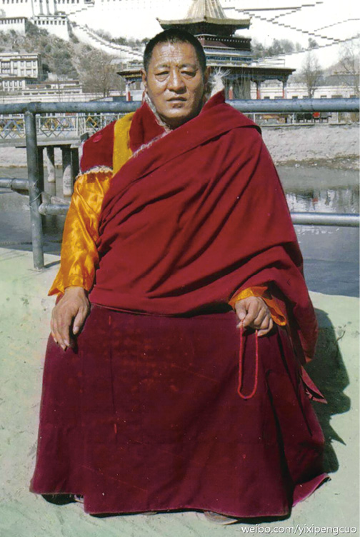

# “在整个世界上，我是最卑劣的人”

傲慢，就是对自己的学问和财富等，生起一种满足之感，并在语言、行为中表现出来。

现在许多人不明白，自己的财富、地位、才华等一切，只不过是前世行善的果报。若是耽著于此而夜郎自大，定会将原有的善根毁坏，心中再也生不出功德。

有傲慢心的人，总认为自己的智慧出类拔萃、才华傲视群雄，但只要认真去观察，就会明白这些根本不值一提。在一段时期内，或者特定的小范围里，你的才华或长相等各方面，或许确有过人之处，但不要忘了：在这世上，还有无数人千百万倍地超胜于你。

退一步说，纵然你的功德在凡夫中无人能及，但在圣者当中，肯定是有超过你的人。并且你这种所谓的功德，也并非永存，它只是因缘聚合的产物，十分无常。

当年我在石渠求学时，遇到了大善知识秋吉堪布、班泽堪布。对于秋吉堪布，我虽然不太了解，但自以为在智慧上远胜于他。可没想到，他的功德和境界非常不可思议，终其一生都在修持甚深法要，临圆寂前还在为弟子们传授佛法，以闻思修行圆满了自己的一生。

至于班泽堪布，我曾在他面前听过五部大论等许多佛法。以前就听说他的智慧和人格非常好，后来我以为他已经老了，可能糊涂了，但两年前和他相遇时，我发现他的智慧有增无减，身上却没有点滴傲慢，人格仍十分贤善，做任何事都非常认真，让我不得不暗自赞叹：“真正的修行人，就该像他那样！”

我以为自己年轻时的智慧超越他们，但时至晚年，他们却已把我远远甩在了后头。这说明了什么？说明我们有些功德只是暂时的，没必要因此而沾沾自喜。

当年，在我的上师托嘎如意宝身旁，智慧卓越、严守净戒的修行人，犹如天上繁星那么多。可到了现在，不少人已堕落到了极为卑劣的地步。反而，过去有些戒律不清净、智慧比较浅薄的人，如今却成了非常了不起的高僧大德。

回顾这些历史足以看出：即便我们现在有智慧、有福德，这些也并非一成不变，实在不应以此而轻视他人。

要知道，别人心中隐含的功德，我们在没有证得他心通之前，根本无法现量见到。有些人的言行举止，尽管看起来不太如法，但实际上，他内在的功德，说不定如海一样广大。所以，我们对谁都不应轻视与傲慢。

作为业障深重的凡夫，不管是什么人，烦恼与功德都相互掺杂，就像粪便中混合着妙药，对此我们又有什么可得意的？假如因为自己有了少许功德就开始傲慢，那为什么不因烦恼炽盛而心生惭愧呢？

仲敦巴尊者曾说过：“在整个世界上，我是最卑劣的人。”阿底峡尊者也说：“自己若有学问，就会特别谦虚地对待别人。”这些具有殊胜功德、远离一切过患的大成就者，对所有众生尚且一视同仁、十分谦逊，我们凡夫的过患如尘垢一样多，又凭什么理直气壮地傲气冲天呢？

极为傲慢、自以为是的人，往往是中了魔王的花箭，因此，我们千万不要认为自己高人一等，而应学会谦虚、低调，就像被驯服的骏马，不管是什么人，都可以让他骑在自己身上，恭敬地为别人做事情。

总之，一切万法在胜义中犹如虚空，没有任何贪嗔烦恼，但在世俗中，如幻如梦的显现也是不灭的。若以大圆满的窍诀来调伏自心，懂得诸法本体无实有，所见所闻都是大空性，同时在名言中，整个轮回还可以显现，以幻化八喻来对待一切。这就是大中观、大圆满的观点，也是文殊菩萨大悲化现的“智慧宝剑”。

运用这把智慧宝剑，我们就能断除我执烦恼，摧毁无明愚痴。若能根除无明愚痴，就像架子的三只脚断了一只，另两只脚也无法支撑一样，整个魔宫将会彻底坍塌，从此任何魔众都对你无法加害！

