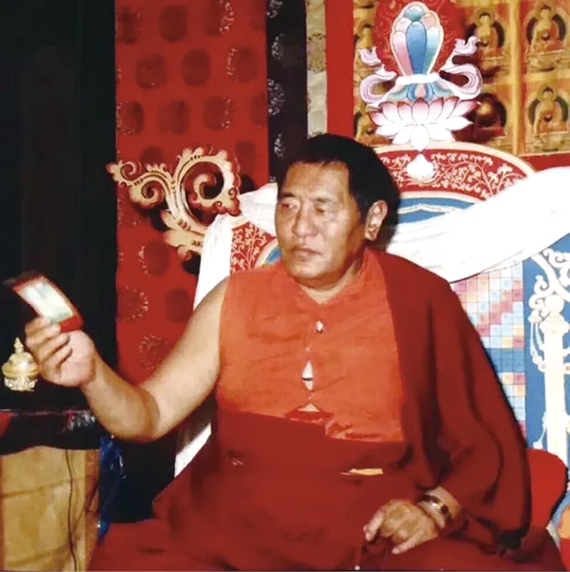

# “念一百万遍阿弥陀佛名号就能往生极乐”

大家方便的时候，最好回顾一下自己的人生：“我造过多少恶业？吃过多少苦头？”其实，只要稍加观察，就会发现痛苦从未远离过自己。所以，若想不再受这些难忍之苦，我们务必要精进修行。

修行佛法，实际上并不像有人认为的那样高不可攀。譬如说，最下等的人也能往生极乐世界，这就比较简单吧！只要对阿弥陀佛有坚定的信心，一心一意发愿往生，然后依教奉行，不造五无间罪和舍法罪，那么定会如释迦牟尼佛和阿弥陀佛亲口承诺的：我们命终后一定能往生极乐世界。

以前有一个喇嘛对外宣称：“色达堪布（指法王如意宝本人）[^1]说念一百万遍阿弥陀佛名号就能往生极乐世界，这完全是妄语，往生极乐世界岂会如此容易！”

此人可能不太熟悉教理。我所说的，实际上是以《阿弥陀经》为依据，并非从分别念中杜撰出来的。所谓“一百万遍名号”的界限，是我的根本上师托嘎如意宝、观音上师、多额单比尼玛活佛等曾明确授记：“将来你若让有缘人念一百万遍阿弥陀佛名号（此处是指藏语佛号，汉语‘南无阿弥陀佛’则需六百万遍），他们就能往生极乐世界。”

我个人的品行再怎样卑劣，也不会拿这个来欺诳世人。所以，有佛陀与上师的教言为证，希望大家好好发愿念佛，毫不犹豫地选择对今生来世最有利的事，珍惜当下的每一刹那！

[^1]: 文中出现的比正文字号稍小的括号内容，是对个别专业术语的解释说明。
