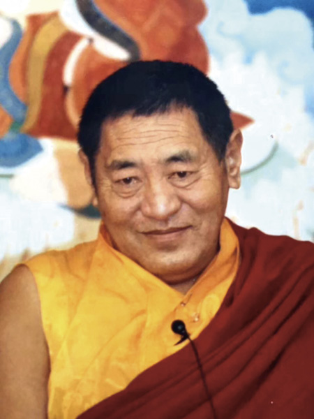

# 不要妄言“我什么都不怕”

在我的身边，有些人平时尽讲空话，说什么“轮回涅槃不存在”“一切善恶无取舍”“我对什么都不怕”，口中也随便哼着一些密法的偈子……

这些人虽然嘴上说什么都不怕，但遇到一点小小的挫折，马上就开始惊恐不安；虽然声称对一切无取无舍，但看到一些美色、钱财，立刻就露出欣喜的神色。他们自认为是大修行人，却从不在大悲、智慧方面做丝毫努力，根本不知道这才是衡量自己是否证悟的标准。

还有一些人，说轮回是本来清净，无有什么可舍的，哪怕下地狱也无所谓。话虽如此，可当别人说他是骗子时，他顿时火冒三丈、怒不可遏。既然你连地狱都不怕，为何还要怕一个普通人的恶语呢？你见到人间的监狱都毛骨悚然，那地狱的痛苦更甚于此亿万倍，说不怕是绝不可能的事。

真正的大成就者，确实没有苦乐的取舍，既没有对佛果的希求，也没有对轮回的恐惧。但我们到底有什么样的境界？自己应该心知肚明。

常见有些人修持了一点世间善法，如念了三亿遍观音心咒后，就说自己现在连死也不怕了。一方面看，修善法的功德确实不可思议，但另一方面，你也应该想一想，根据佛经的道理，有时哪怕是生一刹那的嗔恨心，也会断尽无数的善根资粮，而你又曾生过多少嗔心呢？所以千万不要认为自己很了不起。

我曾遇到一个出家人，他说空话比较厉害，我好心劝告他：“你要注意啊，你的见解并不高，应该踏踏实实地修行。”他听后却不以为然：“没事！我每天都在用转经轮，一点也不害怕地狱。”

作为凡夫，千万不要太自以为是。如果你明明喜欢得到，不喜欢失去；喜欢快乐，不喜欢痛苦；喜欢被称扬，不喜欢被谩骂，整天被世间八法吹得团团转，却自称对一切都不执著，那只是自欺欺人罢了。
