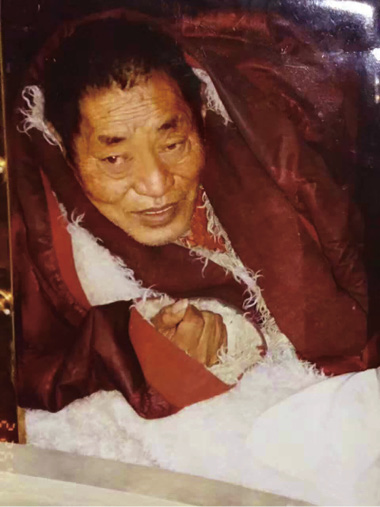

# 不要让自己成为欲望的奴隶

世间上的任何妙欲，从中可以享受的快乐十分微薄，但随之而来的痛苦却无穷无尽。可遗憾的是，许多人好像并不清楚妙欲的众多过患，对此毫不在意，日日夜夜沉溺其中不能自拔。

许多人在年轻时代，花费大量精力追求一些不必要的妙欲，自以为人生还特别漫长。但事实上，人的一生相当短暂，老人们对此就深有感触。

我们从一岁到十几岁，都是贪玩的孩童时期，这段时间如梦般恍恍惚惚就过了；十几岁到四十来岁，可以算是人生的鼎盛时期，但也转眼即逝，并且在此期间，还经常遭遇家庭、工作的各种违缘，抽不出时间修持善法；到了五六十岁以上，身体大不如以前了，尽管也想行善断恶，但心有余而力不足，这时候后悔也来不及了。

所以，大家一定要把握住眼前的时光，不要肆意挥霍宝贵的人生。尤其当妙欲勾住了我们的心时，应通过各种方法了知其本性，不要让自己再成为它任意摆布的奴隶了！
