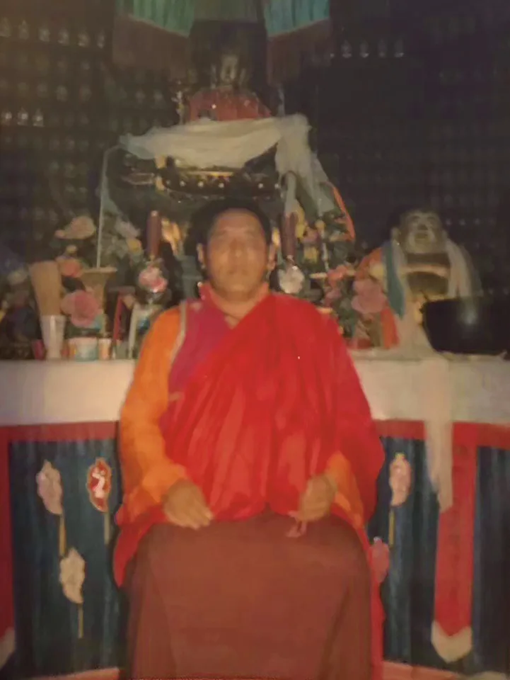

# 人生真是一场梦吗

许多人常说“人生如梦”，那么，这句话真的成立吗？我们周围发生的一切明明如此真实，给我们带来的苦乐也那么明显，为什么偏偏说它是一场梦呢？

对一般人而言，醒与梦完全是两个概念：醒是真的，梦是假的。没人会把梦境执为实有，但人人却把醒时的一切当真，并以此引生了千般执著、万般苦恼。倘若醒时也如梦境般无实，那我们现在的一切执著就没了意义，但事实果真如此吗？

下面，我们根据麦彭仁波切的窍诀，以拟人的方式，通过醒和梦之间的几番辩论，来观察这二者的真相。

## 立论

> 狡猾的醒者首先发言：“你梦境是虚假的！”

> 正直的梦者说：“不仅我是，实际上你也是！”

> 第一回合

> 醒者：“我肯定不是，例如我吃肉可以充饥，身体被火烧会痛，这些感受都真实存在。”

> 梦者：“你的说法不成立。我在梦中吃肉也同样饱腹，被火烧也同样疼痛，感受跟你一模一样。”

> 第二回合

> 醒者：“你昨晚梦境中的显现，到白天醒后一点都不存在了，所以你是假的。”

> 梦者：“同样，你今天感受的一切，到明天以后也没有了，因而你也不是真的。”

> 第三回合

> 醒者：“虽然这些在明天都不在了，但今天的一切，是我亲身所感，它应该真实。”

> 梦者：“如果说亲身感受就是真实，那我在梦中经历的，也是亲身感受，跟你又有什么差别呢？”

> 第四回合

> 醒者：“我醒时的显现长久稳固，比如我家里的摆设每天都不变，所以一定是真实的，而你梦境很快就消失了，故只是一种幻象。”

> 梦者：“梦中的显现也不全是短暂的，也有长久的时候。比如西根活佛在一天晚上的光明梦境中，于清净刹土享受了二十一年的生活。所以，我也有漫长的梦境，不能以时间长短来断定真假。”

> 第五回合

> 醒者：“梦境中可以自由地穿越岩石，在空中自由地飞翔，但在现实生活中，你有这种能耐吗？还不承认自己虚假吗？”

> 梦者：“这有什么大惊小怪的！只要具足因缘，你醒时也能做到这一切。像莲花生大士，在几个国王面前，就示现过入火不焚、入水不沉；米拉日巴尊者显示神变时，也曾在山岩中无碍地穿行，在空中自在地飞翔；嘎单巴德幼年时，噶陀寺有十万比丘，每天中午他们都外出应供，下午再飞回自己的茅棚……

> “因此，只要因缘凑齐了，在醒时也可以显现这些奇迹。反之，假如因缘不具足，不要说醒时，就连梦中也不能穿山越水、自在飞行。”

> 第六回合

> 醒者：“不，梦中不需要因缘，也能显现这些奇迹。你躺在床上睡了就做梦，这要什么因缘呢？你不是随便做梦吗？”

> 梦者：“假如不需要因缘，那你为什么不能每天晚上都梦到这些？一个法之所以不出现，就是由于因缘不具足。既然梦中的这一切不需要因缘，那它理应恒时出现啊！”

> 第七回合

> 醒者：“在梦境中，已故的友人可以重逢，不曾有的儿子也可以出生，这在醒时根本不可能发生，所以你肯定是虚假的，这一点不容置疑。”

> 梦者：“为什么跟你不一致就是假的呢？梦中的事和醒时的事，应该公平对待，不能以你醒时的经验为准绳，就简单武断地确定我是假的。

> “在你面前，某人可能已经死了，但在我眼里，他仍活得好好的，我们可以相遇；梦中生儿子的话，对你来说不可能，但对我来说却可以发生。不能因为你的境界中没有，就认为它是假的。”

> 第八回合

> 醒者：“梦中享用的美味佳肴，并不能解除第二天醒来的饥饿，所以，你的梦肯定是假的。”

> 梦者：“同理，醒时住在富丽堂皇的宫殿中，也不能遣除梦中狂风暴雨的袭击，所以，你也不一定真实存在。”

> 第九回合

> 醒者：“你晚上做的梦，其实是一种迷乱的显现。”

> 梦者：“如果梦中的一切是迷乱，那你醒时所遇到的也是！如上例证也适用于此。”

> 第十回合

> 醒者：“晚上做梦后，醒来只要回想一下，即可了知梦为虚假。但在做梦时，却根本不知醒时的显现是虚假。”

> 梦者：“那又怎样？难道就因为和你醒时所知不同，便说我梦中所见不对吗？如果说梦境在醒时不存在，便认定我是虚假，那你醒时的显现在梦中也不存在，凭什么咬定你就是真实呢？

> “总之，如果是真，双方都是真；如果是假，双方都是假，我们二者没有任何差别。”

这个戏剧形式的教言，只不过简略为我们提供了一个思路。当然，对有智慧的人而言，依此教言，足以证悟一切诸法的本性。

通过从不同角度进行分析，醒者和梦者确实没有差别。也就是说，若以实相观察，二者皆非实有；但不经观察的话，又都有各自的显现，真则都真，假则都假。

明白了这一点后，我们在日常生活中，理应随时随地观修万法如梦，对一切不要特别执著。当我们对别人生贪心或嗔心时，马上意识到这跟梦中嗔敌贪亲一样；当自己成功或失败时，也知道这就如同梦中的成败一样……

若以此慢慢断除执著，不但各种痛苦会离你远去，最终还可以认清一切诸法的真相，证悟三世如来的果位！
