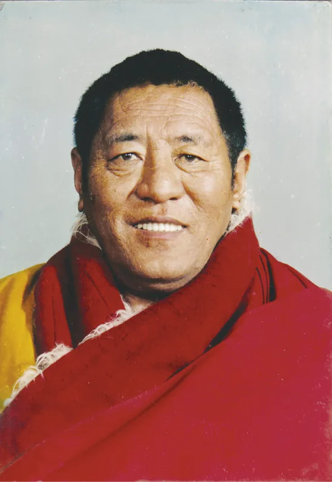

开篇

人身难得 佛法难闻

顶礼本师释迦牟尼佛！

佛经云：“人身难得，佛法难闻。”在茫茫无际的轮回大海中，大多数人都在毫无意义的世间琐事中，虚度了自己宝贵的一生。能依正法调伏自心的人少之又少，既获人身、又不虚掷光阴修学佛法，更是难上加难。为此，我们有缘听闻此法，应当生起无比的欢喜心。

学习佛法时，恭敬和智慧非常重要。若无恭敬，对佛陀和高僧大德的金刚语就不会重视，这样即使佛法再殊胜，也不可能得到点滴利益；而若无智慧，则不会认真思维、反复抉择，对甚深法义就无法获得真切的认知。

因此，只有凭借恭敬和智慧的妙舌，才能品尝到佛法甘露的胜味，遣除自心炽盛的烦恼！

