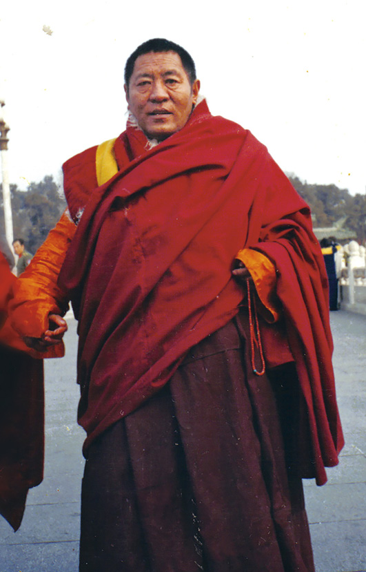

第五章   
一切都还来得及

科学技术可以满足人们的物质需求，

促进生活水平的提高；

佛教则给人们带来精神上的快乐，遣除内心世界的愚暗。

如果没有佛教，只是一味地追求物质的享受，

只会适得其反。

别再心猿意马了

人生的所有痛苦，实际上都是从未调伏自心产生的。我们内心的分别念，就像只小猴子一样蹦蹦跳跳，要想抓住它，必须用一根正念的绳子，否则，它一刹那也不会老实安分。

假如不愿意对治分别念，它的力量有时候相当可怕。就像家中有个性格恶劣的妻子，整天大吵大闹，家人的生活会一直陷于不安之中。同理，如果烦恼存在心中，我们永远也不会有安乐。一个恶妻，不但会耗尽家财，家中男人也可能因她丧命。而我们心中的烦恼若没有调伏，后果比家有恶妻更为可怕。

现在许多人希望自己健康无病，永远青春年轻，其实这些意义并不大，若能调伏自己的心，其价值将远远超过世上的一切。华智仁波切也说：“调伏心、调伏心，用菩提心来调伏心，纵然身体和语言没行持任何善法，实际上这也对自己和众生有利。”

对一个普通人而言，不愿接受痛苦、强烈地执著安乐，这种分别念一直在不断地涌现。而我们作为修行人，应当断除这种心态，将一切苦乐转为道用。比如，自己正在痛苦时，最好安住于空性当中；倘若没有这种境界，那就修持自他交换的菩提心，观想代所有众生受苦。如此修一次法，就可以积累千百万劫的资粮，痛苦当下会转为功德。

