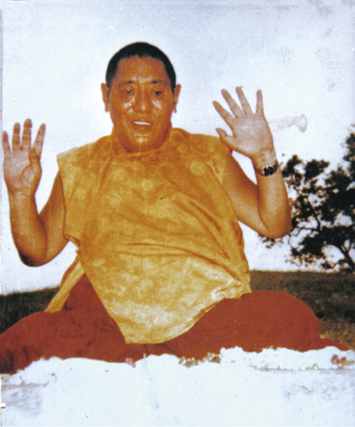
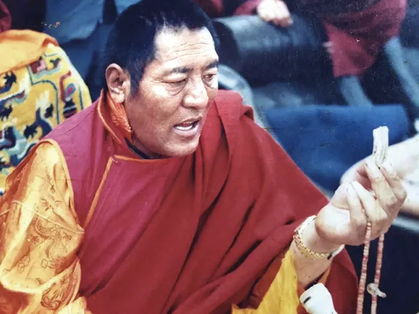

# 别认为青春永远无敌

年轻人在长相、才华、财富等方面比较圆满时，没有必要骄傲。虽然，你与眼下很多人相比还过得去，但世间一定还有你不知道的、比你更优秀的人物让你相形见绌。

年轻的时候，要怀有一颗谦虚朴实的心，对无常有着充分的准备，别以为万法会恒常不变。

在我的一生中，曾看到很多地位显赫的人，后来堕落到了极其可怜的地步。富裕的人一下贫穷，穷人转眼变成富人，这个大地上的事物，变化真是太大了。

富贵无常犹如空中的浮云，地位无常宛如山顶的云雾，美名无常如同空谷的回声。当别人羡慕你的容貌、才华、智慧等时，请记住：这犹如在梦中赞叹我们一样，没有多大实义！

尽管这些东西对世人比较重要，但临终时没有一样能带得走，肯定全部留在人间。因此，对名声、财富、地位等世间法，我们最好不要有强烈的贪执，否则，只会让自己无休止地痛苦。

