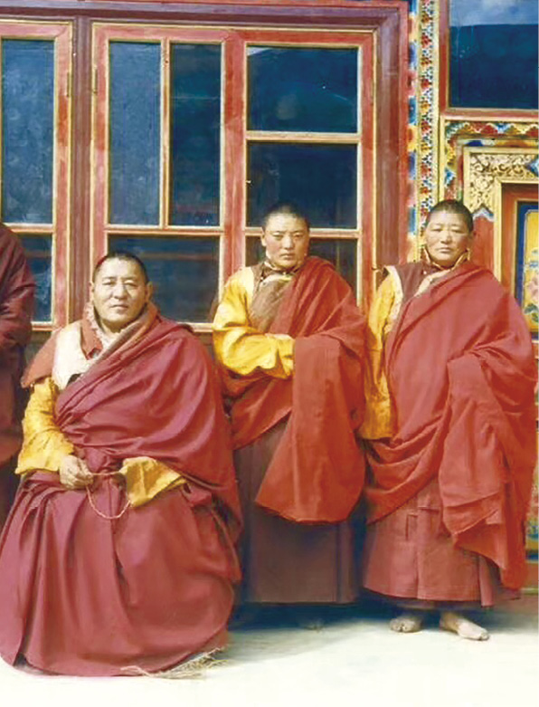

# 喜欢热闹有极大的过失

纵观古今，凡夫人往往不甘寂寞、乐于散乱，喜欢到喧哗的场所打发时光。如果生活中有个什么风吹草动，大家就赶紧聚在一起，兴致勃勃地议论纷纷。假如身边有一点纠葛发生，人们更是兴奋莫名——所谓的安分守己者，就躲在一旁隔岸观火；而好事之徒，则以说三道四的形式为之推波助澜。

龙猛菩萨在《亲友书》中曾讲了观看热闹的过失。华智仁波切在《自我教言》里，也讲述了我们应时常安住一处的道理，并要求大家将身体安住于房屋中，心安住于身体里。

然而，如今的世间人莫说不看热闹，或者时常安住一处，就连平时讲话，嗓门也是越来越大。其实，不管是什么人，平日里都应当心性调柔、轻声慢语，不要随意高声叫喊。

关于不要散乱，也许有人会质疑：“你们佛学院有那么多僧众，难道这不是散乱吗？”

如此质问的人，实则不清楚散乱的内在根源是心，而人数之多寡，并非造成散乱的根本原因。如果心容易为外境牵染，即便你独居深山，也会产生如是之过患。

