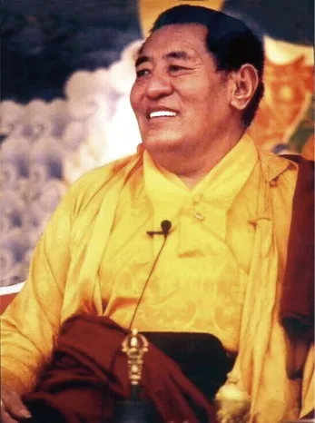

# 寻找上师不要以貌取人

愚人交朋结友，往往会观察对方的财产、地位、相貌，而如今寻找上师好像也是如此，若其父母有一定地位，人也长得比较庄严，很多人就喜欢当他的弟子。

在古代，活佛长相并不一定端庄妙好。像大名鼎鼎的布顿大师，是夏鲁派的创始人，他生下来时嘴巴、鼻子都很大，异常难看。他的母亲特别伤心：“我只有这一个孩子，却长得如此丑陋，谁愿意见到他呢？”没想到，这个婴儿竟然开口说道：“布顿巴（藏文音译，意为这个孩子谁都可见），我并不计较这些！”结果，他长大之后成了一代高僧。

在格鲁派的历史中，其貌不扬的高僧大德也为数不少。

其实，若是娶媳妇，选个美貌一点的也可以，但依止大德就不一定非要如此了。以貌取人，这是愚人的观察方法，作为有智慧的人，理应注重内在胜于外在——只有详细观察了上师的悲心、智慧后，再决定是否去依止，这样才会比较可靠。
