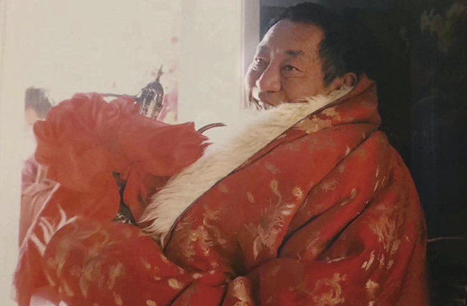

第六章   
众生皆苦，能断为大

如果我们生病或者遭受一些莫名的危害，

此时千万不要心生嗔恨，要明白：

这是修自他相换的良机，

是一个逆增上缘！

怎样断除贪恋一个人的痛苦

当你对一个人生起强烈爱意，心变得极不自在时，用什么方法可以平息由此而生的诸多烦恼呢？

下面，我们来学习麦彭仁波切的一个教言，看看一个贪欲炽盛的老密咒士，是怎样通过观修大圆满，将贪欲融入美妙的道用中的。

> 很久很久以前，在一个名叫“莲花地”的地方，盛开着各色争奇斗艳的鲜花，这里居住着一个老密咒士，他的贪欲就像烈火般熊熊燃烧，故其名为“贪欲火燃”。

> 一天，老密咒士遇到一位美女，他的魂当场就像被勾走了一样，只见他冲到美女面前，卑微地趴在她的脚下，乞求她跟自己一起生活。

> 美女见这密咒士又老又丑，不但不愿搭理他，还一脚踢到他的头上，狠狠骂道：“给我滚！”然后，跑到旁边一位叫“青春快乐”的年轻人面前，与他接吻、拥抱……

> 老密咒士的愿望得不到满足，还白白遭受了一番侮辱。看到美女与年轻人整天卿卿我我，他的贪欲比以前更强了，以至于茶饭不思、夜不成眠，口中不停地发出叹息……

> 旁人以为老密咒士生病了，便为他找来了不少名医。有的医生认为，他的病是由风引起，还有的认为是由火或者魔引起的，并都做了相应治疗。但这些方法不但没有见效，反而让他的病日益严重。

> 老密咒士天天呼喊着那个美女的名字，身体每况愈下，后来竟然疯了。其间，好心的人们还迎请了众多上师为他灌顶加持，但还是无济于事。

> 后来，一位文殊菩萨化现的十六岁月亮童子，嘴里散发出悦意的妙香，来到了他的面前，对他说：“老人家啊，您到底得了什么病呢？”

> 一见到月亮童子，老密咒士生起一丝欢喜心，心智也稍稍恢复了一点。他摸着童子的手说：“我看见一个美女后，当下就生起了难以控制的欲念。每当见她跟别人在一起，对别人流露出爱恋的眼神，我总是私下期盼：那个人是我该多好！因为反反复复想这事，不知不觉就变成了这样。”

> 月亮童子说：“老人家啊，您真该好好想想！您对她生起爱慕心，真的就像飞蛾扑火一样。要知道，女人的青春如同莲花一样短暂，有朝一日，这个美女人老珠黄、满脸皱纹，您还愿像现在这样爱她吗？您既不顾自己白发苍苍的现状，也不明白她的娇躯是无常的本性，真是已经着魔了。请不要再对她执著，断了这种贪心吧！”

> 听到这番话，老人簌簌流下了眼泪：“月亮童子啊，虽然你讲得有道理，但也改变不了我的心意。你如果悲悯我，就请把她带到我身边吧。除此之外，哪怕拥有全世界的财富，也无法让我满足。在这世上，只有她才能让我快乐。”

> 月亮童子继续劝老人：“对于毫无意义的事情，您深陷其中、无法自拔，有何必要呢？以前您没见到她时，心很清净，但自从看见她，就一反常态，您的心已经被魔众的贪心箭射中了，真是非常可怜。若人人都像您这样，甚至对天女也心生倾慕而失望绝食，那就实在太愚笨了！

> “对于始终不能达成的愿望，或根本无法得到的东西，您不应该太强求。否则，只会给身心带来剧烈的痛苦，不但今生中烦恼迭起，而且把来世也摧毁无余了。

> “本来您是一位威风凛凛的密咒士，可以降伏外面的邪魔，为世人所敬重。但现在当自己的心魔显现时，却无力对治，这是非常可笑的。

> “您屡屡执著她的花容月貌，认为她长得国色天香，这也只是您的分别念而已。”

> 老人喃喃道：“你说得很对，但我还是忘不掉她，就像有个桩子插在心坎中一样，对她的爱实在放不下。”

> 月亮童子告诉他：“老人家，请听听我的肺腑之言：您说您的心爱着她，那现在，我给您讲一个故事，里面有遣除痛苦的最好方法——用‘心’来断除自己的贪心。

> “在阿赖耶的大地上，有个叫分别念的孩子正在哭泣，路人问他：‘你为什么哭啊？’

> “孩子说：‘我看见了一个美女，想要她。’

> “这个好心的路人就安慰他：‘你别哭了，其实并不是美女引诱了你，而是你的心散到了外境上，把自己紧紧缠缚。

> “心本来犹如虚空，不存在任何痛苦，但你偏偏要贪著外境，这就像在虚空里打疙瘩一样，人为地制造了各种烦恼。

> “求不得苦是源于自己的心，贪执美女也是如此。孩子，如果你能使自己的心坦然安住，那谁也无力伤害和引诱你。反之，假如你的心紧紧地执著外境而不愿放下，那就像被关在监狱中一样，恒常承受各种苦痛。

> “所以，请仔细观察自己的心，就会发现它本如虚空，根本不存在任何能贪之念，如此，贪心就像阳光下的黑暗，自然消于法界中了。’

> “这种令心自然安住的窍诀，您必须要了知，并运用它来断除自己的贪心。总之，在您生起贪心时，若能立即观它的本性，贪心当下就会消失。”

> 听完此话，老密咒士一下生起了绵绵不断的安乐，贪心彻底根除了。他感激不尽地说：“月亮童子，你真是一位利乐的引路人，非常可惜这么晚才遇见你！以前我虽也听说过‘万法唯心造’，但只是停留在文字上，从未对此实修过，以至于在无意义的贪欲中，白白耗费了大半生。

> “我以前修的法，没能调伏自心，反令烦恼越来越增上，贪心越来越炽盛。与我相似的密咒士也有很多，对这些自以为在行持密法的人，我希望你依靠善巧方便，好好也给他们宣说殊胜教言。

> “你对我恩重如山，现在，我已了知‘依止贪欲来希求解脱’是痴心妄想。虽然我已经老了，但贪欲对我的危害还是非常大。今天遇见了你，令我在功德上增添了一道彩虹，所以，你是我真正的大恩上师！”说着，老人一边热泪盈眶，一边对月亮童子恭敬顶礼。

> 月亮童子继续开示：“我再给您传授一个教言：日后见到美女生贪心时，要明白这实际上是轮回的粘合剂。若想把贪心转为道用，首先应将一切万法的显现观为自己的心。了知美女是自心的显现，再将心观为空性，此时虚空中的彩虹还会不会捆住虚空呢？肯定不会。然后再观察能贪和所贪，就会发现外境和自心没有差别，贪心和外境根本无法束缚自己。

> “一旦明白此理，看不看美女都没有差别，就像梦中踩在火上而毫发无损一样，这时您所见的一切全能转为道用，不像一般的世间人，见到美女就生贪心，注定会感受无量痛苦。

> “若能将此贪心转为道用，与美女相见甚至进一步接触，都是可以的。当然，自己必须要有相应的境界才行。就像狂风对小小灯火是一种违缘，但对森林大火反而是很好的助缘，当风越来越大时，森林里的火也越来越旺。因此，我们应根据自己智慧身体的实际状况，享用与之相适应的窍诀美食。（往昔印度八十位大成就者中，有些行持无取无舍的行为，显现为猎人、屠夫、妓女的形象，但这一切并不会染污他们丝毫。不过，圣者的这些超胜行为，不是一般人可随意效仿的，所以，初学者最好守持净戒，不要胡思乱想为佳。）”

> 最后，月亮童子对老密咒士谆谆告诫：“听了我的这番教言，以密宗为借口的很多修行人，可能害怕将来会堕入地狱。但愿他们依此甚深方便教言，在尽快时间内得到解脱！”
