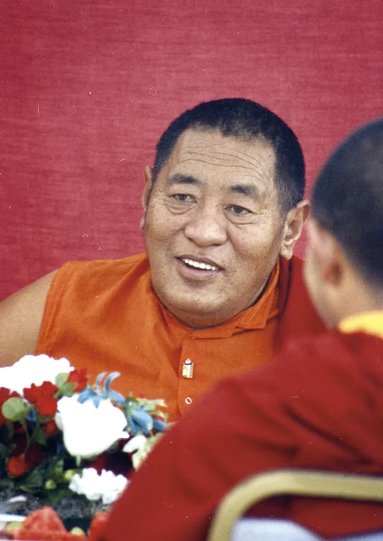

# 我不是“活佛”

如今许多世间人经常喜欢拜活佛，此举虽然有功德，但希望大家在依止之前，最好先多方面详细观察，不要轻信一些过分的宣传。

众人说我是活佛列绕朗巴的化身，但我不要说白天，就连晚上做梦也从没想过自己是这位大成就者。像我一般低劣的人还有很多，甚至有人比我更可怜。其实，得了“活佛”的虚名之后，对自身有什么样的意义？希望有些人仔细想一想。

以前有很多大德，虽被人们尊称为“活佛”，但他们并没有因此而沾沾自喜，只是默默守护着自己的功德。还有些大德不愿得到“活佛”称号，但这并不妨碍他们弘法利生事业的如日中天。可现在有些人，自以为是“活佛”，成天活在别人的赞誉声中洋洋自得，甚至还整天喝酒吸烟，经常对女人生贪心，所得的钱财也用来享欲……目睹浊世的这种恶劣形象，真是让人心生悲悯。

有些品行低劣的人，为了获取别人的恭敬供养，大言不惭自诩为“活佛”，对别人也讲：“活佛是最尊贵的！活佛的地位在藏传佛教中最高！”结果不少人竟也信以为真，认为只要是“活佛”，哪怕他没有任何功德都可以去依止。而对于没有“活佛”称号的人，不管他有多么殊胜的功德、广博的学识，甚至善知识的法相全部具足，他们也不会有点滴恭敬心。

这种现象在汉地比较普遍，而且，如今这个问题比较复杂，有些假活佛给藏传佛教的确带来了深远的危害。

