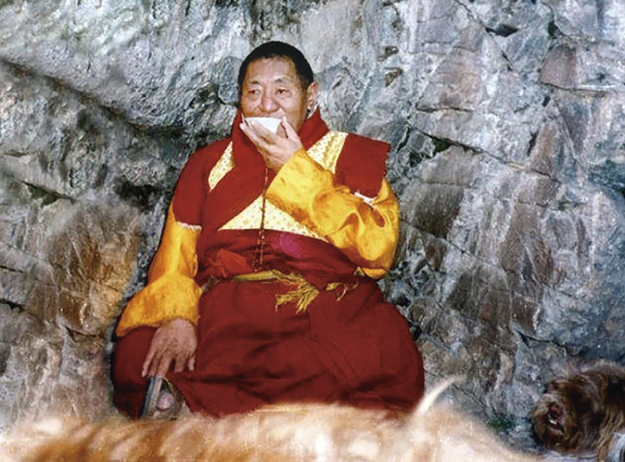

第三章   
痛苦和快乐都是无常

生而为人，应该追寻心灵之道。

若非如此，则浪费了宝贵的人身。

如同已抵达遍满黄金的宝洲，

却没有拿任何财宝而双手空空返回，

这是多么可惜！

我们经常“自讨苦吃”

佛法的殊胜教言，就如天人的甘露能治愈一切病苦一样，有缘者听受并付诸实践后，可以清净自己的贪嗔痴烦恼。

我们每个人业感不同，故从中幻化的苦乐有天壤之别。哪怕是一家三口，整天在一起同吃同住，感受也不尽相同——一个人晚上做梦吉祥，身体也安康，而另一个人却可能噩梦连连，身体不适，心情糟糕得一塌糊涂。所以，不管是谁，哪怕关系再亲密，都不可能是同一个感受。

那么，这些千奇百怪的痛苦和快乐，到底是从哪里来的呢？它并不是外境招致的，而是源于我们的心。

如果我们心中充满慈悲和信心，今生一定会安乐；而若以无漏的智慧摄持，还将达到圆满究竟的解脱。但假如经常生起恶念而造业，那么等待自己的，无疑就只有狰狞的恶趣、难忍的苦痛。

释迦牟尼佛在佛经中也指出：“心为一切诸法之源，故名为普作王。”为什么称为“普作”呢？因为心既能作清净的涅槃，也能作不清净的轮回。就是说，轮回中的一切，是不清净心的显现；涅槃和智慧，是清净心的显现。

若详加观察，我们会发现，外境中根本找不到真正实有的事物，所以，清净和不清净的根本，唯一就是自己的心。

既然心能显现轮回、涅槃等一切法，那么，若将自己的心转到善法方面，安乐将会指日可待；假如不能调伏自心，经常在烦恼的推动下为非作歹，未来也必定是自讨“苦”吃。
