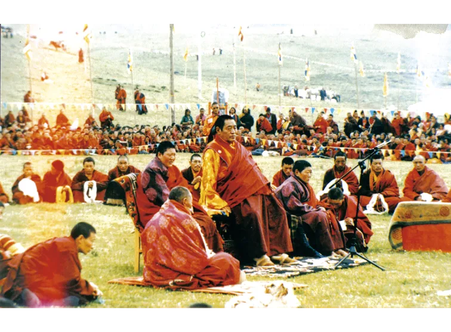

# 有传承，才有力量

在这个世间上，林林总总的行业，都有各自的师承。同样，佛教中无论显宗、密宗，也相当重视传承，它不仅仅是一种法脉延续，更是一种无形的加持力。

尤其释迦牟尼佛八万四千法门的精华，就是大圆满。而大圆满的传承，是从法身普贤王如来，一直到莲花生大士、布玛莫扎等，直至现在的根本上师。

这一代代的上师，以赐予灌顶、传授教言的方式，使黄金般纯净无染的传承，连续不断地继承了下来。

作为一位传承上师，除了亲自领受过灌顶、闻受过教言，还要对甚深窍诀有一定的体悟。在这个传承体系中，若从未出现过诽谤上师、毁坏誓言之人，这就是清净的传承。

我们必须在具有清净传承的上师面前领受教言。有些人对传承不太重视，甚至依靠没有传承的教言，就自认为已经证悟了。但对具有智慧的人而言，遇到这种所谓的“开悟者”，肯定只会敬而远之。

某些人往昔与大圆满的缘分很深，因此，今生看到一些相关教言时，心中自然就生起智慧——当然，这种现象比较罕见。不过，即便他们已经由此获得了证悟，显现上还是要依止上师。就像莲花生大士，本来他已现见了法身，但一生中的上师仍不乏其数。

因此，无论是名声如何显赫的高僧大德，都必须要依止上师，然后接受清净的传承。

