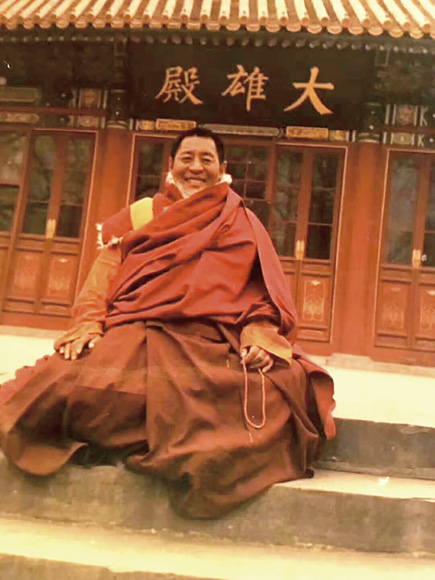

# 有佛法，就有办法

我们对一件事物作出判断时，应时刻保持清醒的头脑，首先要用佛法的智慧来观察和抉择，其次再参照世间法。

然而，现在许多人遇到事情时，只是盲目听从自己的私心或他人的分别念，然后人云亦云，少有自己独立的见解，更谈不上运用佛法了。

全知麦彭仁波切曾特别强调：无论我们做什么事，都必须要有智慧。如果自己缺乏这方面的能力，就应向有头脑的人请教，在权衡得失之后，方可付诸行动。

对修行人来讲，若欲成办某种事业，一方面应在上师面前请教，并祈祷三宝加持，同时，自己也要认真分析、反复思考。若能如此，最终的选择才能称为“明智”，才能避免损人损己。

相反，假如你大事小事都独断专行，以自我为中心，不经观察就随意行之，那所做之事不仅很难成就，还会带来无量后患，最终把自己引向痛苦的深渊。
