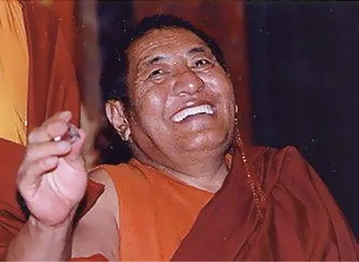

# 有嗔心之人，连一个快乐的机会都没有

人如果怀有嗔心，则始终得不到自在，连一个快乐的机会也没有，别人更不会恭敬自己。

实际上，嗔恨是烧毁自心的猛火，一刹那能将所有善根摧毁无余，在这个世上，再也找不到比嗔心更严重的过患了。

若想消除嗔心，我们就要想方设法修持自他平等，要懂得：自己喜欢快乐，别人也是；自己不愿受苦，别人也是。如此推己及人，就会知道别人在伤害自己时，也是身不由己，有他的烦恼缠缚，如是便不至于斤斤计较，甚至还祝愿他尽早获得安乐。

这种自他平等的慈悲心，若能在内外心行中时时体现，并对任何众生都可以生起，此人就像如意宝一样，能对众生作广大的饶益。不仅如此，他的内心也会盈满欢喜，愿望自然成办，现在和将来的一切都顺利圆满，功德如上弦月一样日益增上，不会衰损……

毫无疑问，这种人正是一切世间的庄严。
