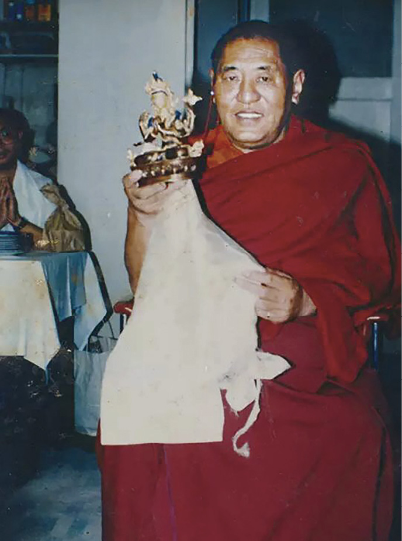

第一章   
为何我们活得不快乐

心念，就像空中的云雾。

如果你自然安住，它是无利无害的；

一旦分别执著，则有百害而无一利。

真正令你受尽折磨的，  
实际上是心魔

在佛陀的教言里，经常会提到四魔中的“天魔”。通常，人们认为这是指魔王波旬，但实际上，真正的魔王，就是我们的无明迷乱。

这个魔王每天躲在愚痴的阴暗角落里，为阻碍我们获得永恒的安乐，不断射来五支箭——贪心、嗔心、吝啬、傲慢、嫉妒，让中箭者饱尝生不如死的剧苦。为了断除他每日对我们的伤害，最殊胜的对治方法，就是证悟一切万法的本性，这即是文殊菩萨手中的“智慧宝剑”。

要知道，我们每一个人，哪怕身处睡梦中，都渴望安乐无恙、远离痛苦，但事实上，并没有任何一个人能赐予我们这些。在这个世界上，有人正在安享无边快乐，有人却感受剧烈痛苦，这种巨大的差异，难道是随他们各自心意而变现吗？答案显然是否定的，因为谁也不愿遭受痛苦。

就拿财富而言，绝大多数人都愿意拥有，而不希望自己一贫如洗。但如果前世没有积累福德，今生即使非常渴望，拼命追求，也往往事与愿违。

当然，我们所感受的这些苦，若从外境中寻找，其始作俑者根本不存在。假如真有一个“苦难创造者”，那对他恨之入骨也无可厚非。但往外去苦苦寻觅的话，结果必然是徒劳无获。

真正令我们受尽折磨的，实际上是内在的魔王。他阴险地藏在我们心里，轻易发现不了其踪迹；他时时与我们形影不离，所以摧残我们非常方便。在他的蹂躏之下，我们就像奴仆一样，毫无自由可言，不断遍尝着各种苦楚。

但极为可悲的是，大多数时候，我们却根本不知道谁在捉弄自己，所以想要灭掉他，可以说难如登天。

