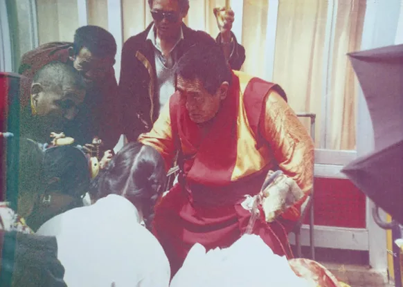

# 贪嗔痴是一切祸害的根源

作为居士和出家人，希望大家不要业际颠倒！

什么是业际颠倒呢？比如，不努力闻思修行，经常破坏戒律，失毁自己的誓言；又如，不愿好好学法，经常跑到各地化缘，营谋私利，或者返回故乡，协助家人搞世间法，这都属于业际颠倒。

我们一切的痛苦和快乐，其实是各自业力造成的。尤其痛苦的根本，就是贪嗔痴三毒。龙猛菩萨也说：“贪嗔痴及彼，所生业不善；无有贪嗔痴，及彼生业善。”

要知道，我们日常的言行举止、起心动念中，掺杂了贪嗔痴的都是恶业，断除了贪嗔痴的才是善法。因此，想方设法断除贪嗔痴，对每个人来讲至关重要。

只有远离了这三毒，才能从根本上得到暂时和究竟的安乐！
