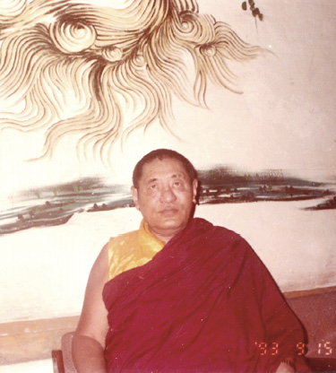

# 越有钱有势，对周围的人越要看得起

当自己的地位越来越高时，对下面的人越要有慈悲心，对上面的人也不能卑躬屈膝，应当做到不卑不亢。

在古代藏地，像松赞干布、赤松德赞、赤热巴巾，都是以佛法护持国政的大国王、大法王，他们虽然地位高高在上，但行为上对所有众生都慈悲对待，尤其对可怜的众生更是如此。

有些人只要拥有了一定地位，就开始对下面的人疾言厉色，对上面的人则摇头摆尾地巴结，以此想换取更多的世间财色。还有些人虽然得到了高位，但没有为自他带来什么利益，比如有些高僧大德，对众生和佛法没做出任何贡献，这种人就像黑暗中的装饰品一样，谁也看不见。

此外，作为有权势的人，还应该赏罚分明，谁做得好，就应赐予相应的奖励。如同在格萨尔王时代，利他心比较强的人，才会被选作大臣。

总之，与人人都和睦相处，并且具有慈悲心，对上者恭敬，对下者爱护，也不贪求自己的财利名声，这种人可以当首领。
