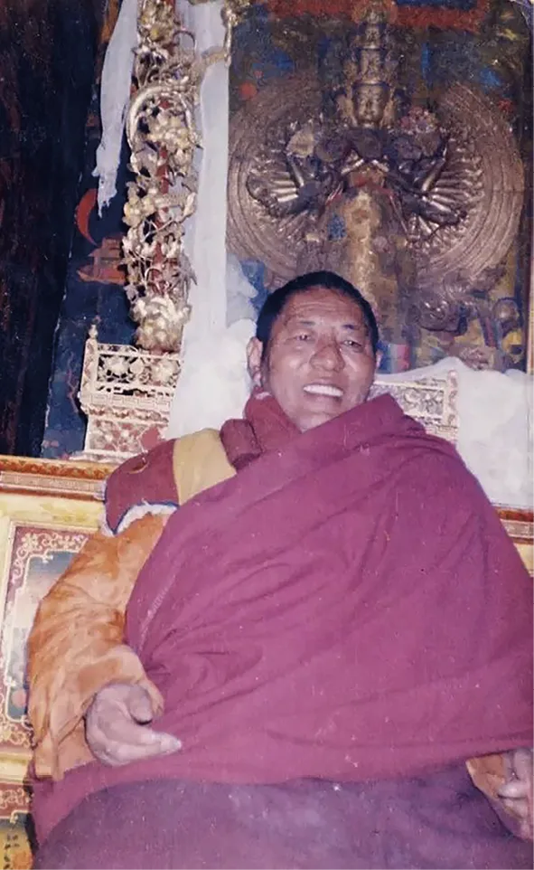

# 第10章诸善奉行

◦ 放生的功德

◦ 转经轮的功德

◦ 诵经诵咒的功德

◦ 供灯的功德

#### ·第59节· 放生的功德

现在，广大信众都承诺三年内不宰杀家畜，这是一种不可思议的善举。好孩子们，再接再厉！

大概在四五年前，有一次，我梦见托嘎如意宝赞叹我放生护生的功德。他老人家的话，应该是菩萨加持的语言。我把他那些话在大众中传讲，结果堪布活佛们欢喜踊跃，仿佛饮用了甘露醍醐，大家都在实行戒杀放生。例如，仅这一年，慈诚罗珠堪布就放生了一卡多长大大小小的鱼约1亿条，历年放生的生命加起来有好几亿了。这不是一两个人的事，每个人都要不遗余力地放生。

在世俗的善根中，护生是最重要的。因此，大家应该高度重视，尽可能地放生。

#### ·第60节· 转经轮的功德

你们花30块钱请个转经轮吧。钱才30元整，但其善根是无穷无尽的。请去请个转经轮！请去请个转经轮！这不是个小东西。如此来源清净的转经轮，是由数多僧众开光的。

你们请一个转经轮的钱，会专门用在转经轮的资金周转上。大家要发起大心力，我的好孩子们，这个事没什么做不到的。我们要请转经轮！要转转经轮！

转经轮不能横着转动，不能把它扔在床上，也不能在转经轮上跨越，平时要放在干净的地方。真正的观世音菩萨，就是这个转经轮，请大家记在心中。

#### ·第61节· 诵经诵咒的功德

对于我们修行大圆满法的人来说，自然佛法《一子续》最好用金子来写，即使做不到，也应该把四指宽的经函带在身上，乃至临终前要一直不离体温，死后与尸体一同火化。我们每天都要念一遍，就算不念其他任何经，也要念诵这部续。此法理是极为甚深的究竟法，即使有人去空行刹土寻找，也不可能得到比这更殊胜的一个法了。

现今在喇荣佛教大学，几乎没有人不拿念珠。这应该是我的贡献，我不确定你们有没有这样说。只要你拿着念珠，就代表你是观世音菩萨的随行者。华智仁波切不是说过吗，“诸佛总集的一位本尊，是观世音菩萨；密咒总集的一个心咒，是六字大明咒；生圆总集的一个妙法，是菩提心。当于‘知一解脱一切’的境界中，诵六字真言”。念观音心咒！念观音心咒！念观音心咒！嗡玛呢巴美吽。

藏地雪域，原是观世音菩萨的所化刹土。就算你现在什么都做不了，但拿串念珠念观音心咒，也应该可以做得到。或者念金刚萨埵心咒、文殊心咒、莲师心咒，都没有差别，所有本尊的本体是一个。没有人连这样的行善也不会吧？如果有谁说不会，那纯粹是在说妄语。

#### ·第62节· 供灯的功德

供灯的功德实在不可思议。它是一切供养之王，尤其依靠灯光能照亮十方的缘起，可以遣除自相续一切烦恼的根本——无明。

能驱散无明的，没有比这供灯更好的了。噶当派的前辈善知识博多瓦、金厄瓦、普穹瓦等所有大德，都会在他们枕头的上方安放一尊佛像，前面供水、供灯从不间断。

再有，贫女宁嘎母在佛前供了一盏灯，发愿：“现在，贫女我以这小小的油灯供佛。以此福德，愿我未来具足智慧灯，遣除一切众生的无明垢染。”这样发愿后，她就离开了。当天晚上，其余的油灯都熄灭了，唯独宁嘎母那一盏灯到天亮还燃着。这就是供灯的威德力。
