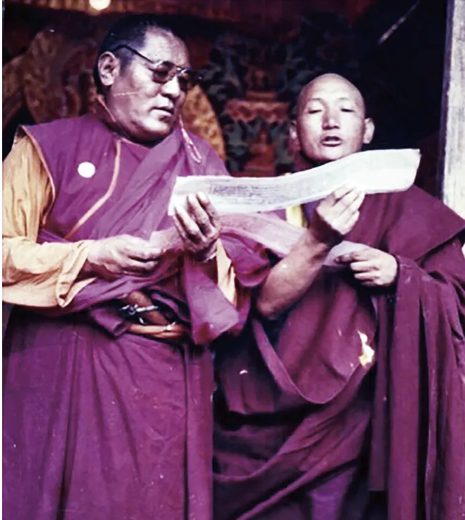

# 第11章珍惜文化传承

◦ 穿藏装

◦ 藏族的优良传统

◦ 祖先之魂——语言文字

◦ 藏文的特色

#### ·第63节· 穿藏装

藏族服饰不能随意改变，藏族传统也不能随意改变，包括穿衣、戴帽、穿鞋等。

如今个别藏人穿着中式服装，说是皮夹克，我也不知道到底是什么，据说价格是几千元。它看起来像皮革补丁或橡胶上涂漆一样，穿着不暖和也不好看。但现在持这种恶行的人很多，而学善行的人少得可怜。

作为藏族人，穿藏装是非常好的。在我们喇荣佛教大学的四个学院，管家也要经常检查，察看大家的服饰有没有变化。在我们当中，假设一个人今天穿了一件不同的内衣，第二天就会有许多人模仿，穿同样的内衣，不知道它是在哪里做的，这必须要有一个标准。对于僧人来说，穿各式各样的内衣是根本不如法的。你们在家人也不可以穿僧装。

#### ·第64节· 藏族的优良传统

一般来说，藏族人穿藏装是很重要的。如果我们一直穿戴着祖辈的服饰，就是在继承古代的优良传统，这也是智士的风范。否则，随意改变服饰和语言，会激怒地方神、土地神等，他们会引发骚乱，给各地带来疾病、饥荒、战争。

实际上，藏族有自己的特色。从法王松赞干布、赤松德赞、赤热巴坚祖孙三君执政以来，藏族人一直流行手拿念珠和转经轮，口念观音心咒，主食吃糌粑——糌粑是与众不同的食物，它营养非常丰富，吃糌粑的人爬山时都会觉得身体轻快。一般来说，当人们看到一个人手里拿着念珠时，就会问：“你是藏地哪个地方的人？”纵然你修行不广，但手上拿串念珠，再拿个转经轮，口里念着观音心咒，也是清净的藏传佛教徒。

·第65节· 祖先之魂——语言文字

对于藏语和藏文，你们千万不要忽视。

有的藏人表面上会说一些汉语，就觉得很了不起，一直喋喋不休说个没完，只是一味地讲汉语。其实，如果你会说汉语，也没什么好骄傲的，因为在汉字大行其道的今天，几乎没有人能真正掌握一百年前的汉字，字形都已经变了，经文也像一堆堆纸一样，被束之高阁。想想我们藏族，这种正楷文字从法王松赞干布时代到今天，一个字都没有变动过。但听说现在印刷时有上下加些元音字符的现象，这样也是不允许的。

#### ·第66节· 藏文的特色

以汉字为例，要想了解佛法教义的内容，基本上要学几万字，如果没学这么多，完全可以肯定不会是一个好翻译。如果不会几千字，那根本没办法当翻译。

想想我们藏文的数量有多少？四个元音字母和三十个辅音字母。只要会了这些，就可以随意用藏语传讲佛法和日常交流。藏文，不可以改变！藏语，不可以忘记！
