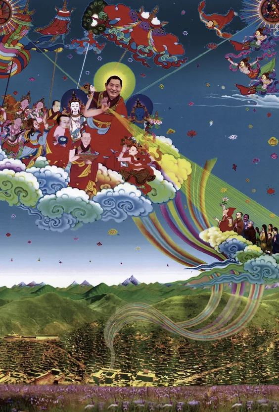
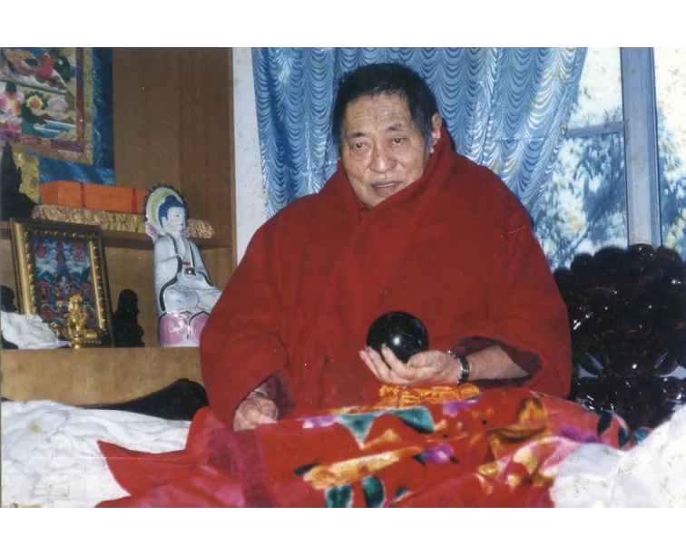

# 第12章接引有缘者的承诺

◦ 极乐世界的功德

◦ 一心不乱

◦ 同生极乐

#### ·第67节· 极乐世界的功德

我们哪怕守护一分的净戒、做一点一滴的善事，都要专注于清净刹土，除特殊情况外，必须以强烈的向往心专注于极乐世界。

西方极乐世界，容易往生，往生那里的功德殊胜，这样的佛土哪里也没有。依靠阿弥陀佛的发心和愿力，除了造过舍法罪和无间罪的人，其他人必定能往生。

舍法罪，有点难以避免，但真正阻止往生极乐的大障碍，应该没有吧？闻思修佛法的我们，要诚心忏悔，力求做到还净，要认真地发露忏悔。无间罪，一般不会犯吧？大家最好能对往生极乐世界，生起虔诚的信心、欲乐心。

#### ·第68节· 一心不乱

我起初在汉地五台山的怙主文殊菩萨面前发愿：最好我能将全球的芸芸众生都带到解脱道上，中等是将中国的大多数人带到解脱道上，最低也是将藏地雪域的大多数人带到解脱道上。

但后来，不仅仅是藏人，我还让很多汉族人和外国人生起了诚挚的信心，这真的是文殊菩萨的发心威力。

我的心愿是，能否令见到、听到、忆念、接触我的一切众生，全部往生极乐世界？如果做不到这样，看能不能使大多数众生往生极乐。我不是给你们讲过吗，我自己平时的修行也是发愿往生极乐世界，你们最好也这样选择。

有人一会儿发愿生到兜率天，一会儿发愿往生铜色吉祥山，一会儿又发愿现喜刹土，一会儿又发愿普陀山，这样不太好。临死的心，就像在雷鸣电闪、霹雳巨响中的心境一样，那时，心若不能平静，一会儿祈祷莲花生大士，一会儿祈祷至尊度母，一会儿皈依上师，一会儿皈依佛陀，没有一个指定处，就像逗疯子说话一样，怎么能行呢？死亡时是非常恐怖的。

所以，说到“修行净土”，这个净土并不需要我们靠自力来修，而是阿弥陀佛已在他的世界摆好了丰盛的美味佳肴等着我们，就像儿子回到父亲的家里一样，不会有一点困难。因此，我们都要一心向往西方极乐。

#### ·第69节· 同生极乐

邬金莲花生大士、上师麦彭仁波切都曾说过，我将会广利众生，凡与我结缘者，都会往生极乐世界。尤其是两百多年前一位叫多哲钦的上师明确授记：下方是阿拉达则神山、上方是单坚神山、腾俄树神女所在的地方叫喇荣，这里有具足四大学院的僧团和我本人。

此外，列绕朗巴也说过：在紫美秋雷地方，有一个名叫晋美彭措的人，父亲叫班玛，母亲叫耶措，他出生在鸡年，身语意有许多瑞相。他将转法轮消除浊世的衰败，把大众接引到极乐世界。

他们不会说妄语的。早在我出生之前，他们就这么说了。如果是我生下来以后说的，有可能是上师们在说好话，但并不是这样的。还有很多授记。我没有说谎，也不是为了我好而说的，而是为了让你们欢喜才说的。所以，你们要欢欢喜喜发愿往生极乐世界。

这次来参加这个法会的人，要好好诚信，不要打架，不要偷盗，我想你们会一个不剩全部往生极乐世界的。我这个接近死亡的人，也是这么努力在做，因为这些授记不会有错，我也想广利有情。

所以，如果你们念诵阿弥陀佛名号一百万遍，命终后会立即往生极乐世界。我以诸佛菩萨作证来担保，对此你们无需怀疑或犹豫。

