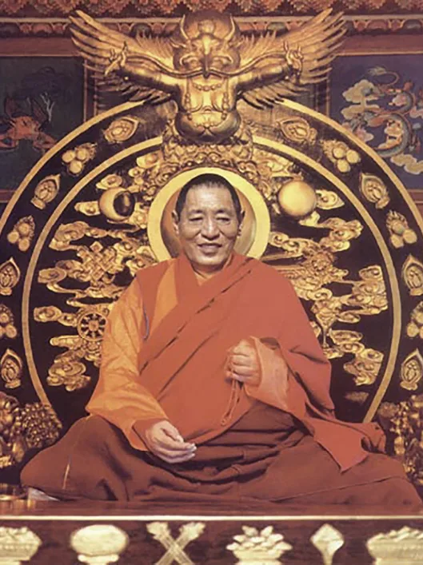

# 第13章临终遗教

◦ 极乐法会最后叮嘱

◦ 最终的遗教

#### ·第70节· 极乐法会最后叮嘱

你们要发愿往生极乐世界，要念念不忘，这是第一件事。

你们要尽力做到不杀生，再再拜托，这是第二件事。

你们要想办法对上中下各阶层的人都怀有一颗善良的心，这是第三件事。

这三件事包含了一切佛法。

也许这是我们最后一次聚会了，但愿不是，希望我们还能再见面，发愿今生还能再次相遇。然而，也许我即将离开这个世间，如果我死了，你们可能会说“要去找转世活佛”，在七七四十九天还没结束之前、在母胎里还没满九个月零十天之前，就开始认定活佛。但是，如果我去世后能自由自在，那绝对不会一开始就来这里转世。

我一直希望就此死去后往生西方极乐世界，在那里面见阿弥陀佛，聆听他的教诲。他将莲花瓣般的右手，温柔地放在我头顶，赐予菩提授记，我自在得到了五眼六通等。如果需要利益众生，那时的我不会像现在这样脆弱、无奈，而是已经获得了如海功德。正如《普贤行愿品》中所说：“我于一切诸有中，所修福智恒无尽，定慧方便及解脱，获诸无尽功德藏。”到了那时，我再转生到世间中来，智慧、方便、精进、等持、神变等都已得自在。

我以悲心绝不会舍弃整个世界，特别是雪域，尤其是我的家乡——位于多康下游的瓦西色达这个地方。如果我往生到任何一个清净刹土，永远都不会舍弃我曾经居住过的这片土地，以及寺院里的僧人信众们。

#### ·第71节· 最终的遗教

莫舍己道，勿扰他心。

2017年2月12日

于喇荣译毕

