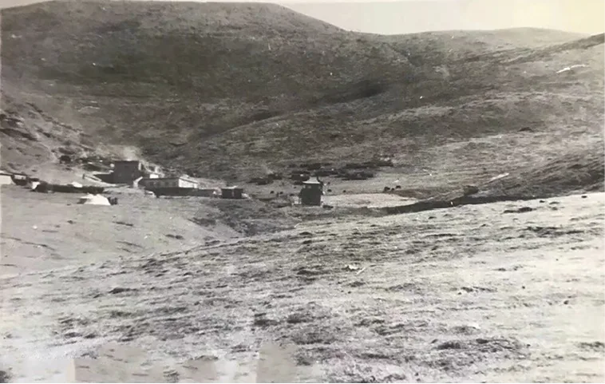
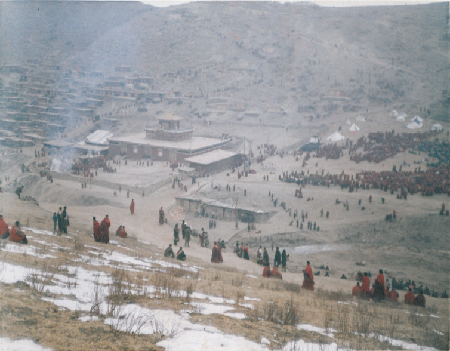
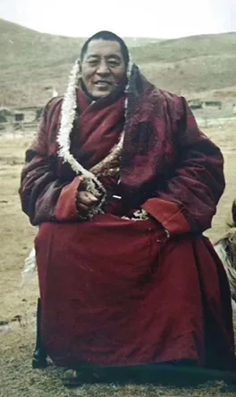

# 第1章圣地喇荣的殊胜

◦ 加持的圣地

◦ 授记的圣地

◦ 增上觉悟的圣地

◦ 纯洁的圣地

◦ 虹身解脱的圣地

早年的喇荣沟

#### ·第1节· 加持的圣地

想来，像喇荣佛学院这么殊胜的地方，是极其罕见的。

第一世敦珠法王，是真正的忿怒莲师现世；他的八个儿子，是真正的八大菩萨化身，每一个获得成就的儿子，如果把他的生平事迹讲出来，的的确确会让没有信心的人生起信心，有信心的人禁不住流泪；在敦珠法王的亲传弟子中，同时还涌现了十三位虹身成就者。

这些成就者们加持的地方，就是这里。

#### ·第2节· 授记的圣地

当第一世敦珠法王大约八九岁的时候，红黑仙巴夜叉护法神送给他一枝红柳箭，并告诉他：“在未来的兔年，如果你把箭插在上面那个山沟里，眷属弟众、名声都将圆满齐全。”

后来，敦珠法王住在扬哲空行聚集洲时，空行母也经常这样授记。

于是，敦珠法王观察缘起，对身边的人说：“今天，你们看看能不能找到不同的石头，带回来给我。我未来要住在哪里，依此会有一些明显的信息。”后来，他得到了一块形似耳朵的石头，说最好去一个他从未见过、只听说过的地方。

之后，密宗护法神一髻佛母授记：如果住在喇荣雅钦山谷，他的亲传弟子及传承弟子会增上圆满。

我不确定是不是那块石头。去年，我在那边的房子废墟里捡到了一块耳形的石头。大概是当时敦珠法王的石头吧。

#### ·第3节· 增上觉悟的圣地

因为这么殊胜的地方实在太少见了，从我能够自主时起，选择自己老的地方、死的地方就是这里。如果在这里不能增上觉受证悟，不能成办弘法利生，我敢保证在其他地方会更难。正是考虑到这一点，我才立下了这样的誓言。

来到这个圣地，你们也应该知道它的不同寻常。正如莲师所说：“在普通地方修一年，不如在圣地修一天。”在平常的山洞或树下修一年，比不上在“第二大佛陀”邬金莲花生大士加持的地方修一天的功德大。

#### ·第4节· 纯洁的圣地

喇荣这个地方，即使在“民主改革”和“文化大革命”期间，也没有受到染污。总之这是一个清净的地方，一个有加持的地方，一个有很多授记的地方。

来到这个圣地，大家不要再愦闹散乱了，要告诉自己：“不可放逸，好好修行！”

#### ·第5节· 虹身解脱的圣地

这个圣地是十三位虹身成就者出现的地方，是八位佛子诞生的地方，是从来没有被破誓言的晦气染污的清净地方。将来一旦我不在了，你们也要住在这里，没有什么不妥的。

以后你们别忘了这片圣地和老父我！

