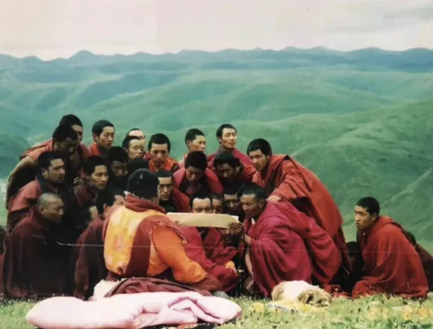
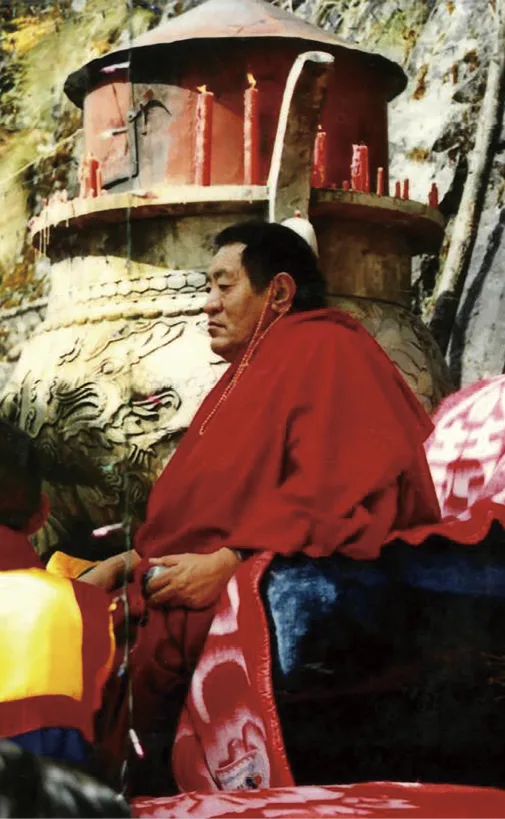
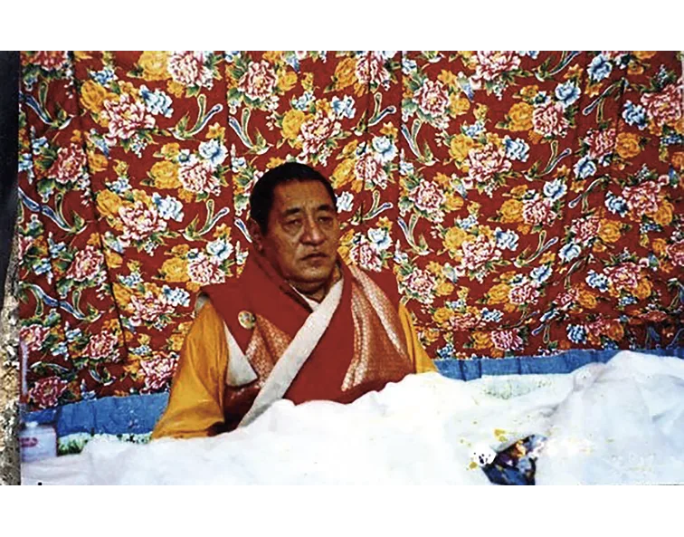
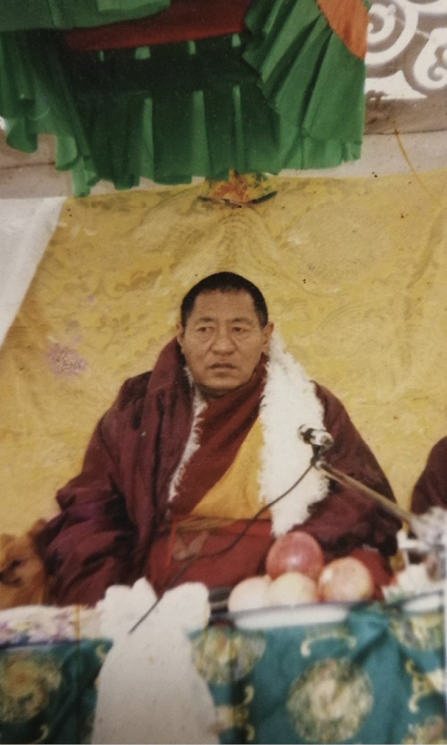

# 第2章讲闻正法

◦ 起初的发心行为

◦ 传法前后的行为

◦ 利乐源泉的菩提心

◦ 善根不尽的菩提心

◦ 摧伏重罪的菩提心

◦ 增上善根的菩提心

◦ 传法时别交头接耳

◦ 到经堂听法的功德

◦ 不是在哪儿听都一样

#### ·第6节· 起初的发心行为

正如我们的导师、大慈大悲、善巧方便的佛陀亲口所讲：“认真谛听，铭记于心，我当为你宣说。”你们也要善加调整听法的行为来倾听。

听闻的法是：

现在，我们师徒要深入思考：难得的宝贵人身已经得到了，难遇的善知识已经遇到了，尤其是更难值遇的正法，以及正法的精要——金刚乘，已经值遇了。这个时候一定要扎扎实实去修行真实的教言，不要虚度暇满人身。

假设我们现在所依赖的这个身体，没有使暇满人身具有实义，那么后世必将随业风所牵而流转。一旦生于三恶趣等处，那时佛菩萨们就算想救也救不了，以自己的业力所感，连善趣的名字都听不到。所以，大家一开始就要通过“暇满难得、寿命无常、轮回过患、因果不虚”这四种厌世心来调伏自相续。正如寂天菩萨所言：“暇满人身极难得，既得能办人生利，倘若今生利未办，后世怎得此圆满？”

#### ·第7节· 传法前后的行为

讲闻正法这一功德，是世俗善法中无与伦比的。在讲闻的开头，对上师和本尊顶礼必不可缺。而且，在讲考等场合，最好也先念顶礼句。

一般来说，在许多论典注释中，顶礼句的必要性是显而易见的。尤其对我而言，在传法的开头，为了表示我是佛陀的随行者，随念佛的恩德，我会顶礼无等能仁王佛陀。佛的随行者有很多，为了表示自己是邬金第二大佛莲花生大士的传承弟子，我会顶礼莲花生大士。莲师的众多随行者中，为了表示自己是秘密心滴大传人全知龙钦巴的随学者，我会顶礼全知上师无垢光尊者。无垢光尊者的随行者也有许多，其中，为了表示密意传承证悟融入我相续、甚深窍诀密要赐予我心间的是唯一部主全知麦彭仁波切，我会向上师仁波切顶礼。

或者，可观待近传加持的次第作顶礼：如今我们佛教的教主，唯一是大恩导师释迦牟尼佛。他所授记称叹、密意传承的首要传人，是莲花生大士。莲花生大士佛父佛母亲自摄受、最密心滴的传人，唯是全知上师。得到全知上师无垢光尊者意传证悟中最主要的一位，就是上师麦彭仁波切。我的相续中，包括一点点的信心、一点点的悲心，绝对是直接或间接来自于上师麦彭仁波切的恩德作为增上缘。因此，就证悟传承的次第而言，是这样的。

再者，提醒发心这一点很重要。就像华智仁波切曾经说过：“上等者从家里出门时要记得发菩提心，中等者听到法螺声时要记得发心，下等者被上师提醒发心时要尽可能发心。”法师们在传法的时候，提醒听法者发心是非常重要的。

在我们的课前念诵中，除了《八吉祥颂》和《怀业自在祈祷文》这两项，《普贤行愿品·七支供》、《菩萨戒仪轨》以及课后《普贤行愿品》的后半部分，都是来源于无畏如来芽尊者的传统。我本人自从去石渠江玛深山静处求学以来，不管传大大小小任何法，一直遵循这个传统。你们念诵的时候，也要从《八吉祥颂》开始，直到《普贤行愿品》后半部分结束，不要没头没尾。单单是课前课后的念诵，其善根也不可思议。虽然慈悲的佛陀相应所化众生界性、根基、信解、意乐的千差万别而宣说了不可思议的法门，但这样行持正法，基本上是考虑到一些智慧中等和下等的人才宣说的。

对于智慧上等的行人来说，依安乐道菩萨乘抵达安乐果佛地的善妙方便，唯一就是这颗珍宝菩提心。正如《入菩萨行论》所说：“犹如乌云暗夜中，刹那闪电极明亮，如是因佛威德力，世人暂萌修福意。”

#### ·第8节· 利乐源泉的菩提心

这样的珍宝菩提心，是轮回涅槃一切善妙之法的源泉，是所有利乐的唯一因。有了这颗菩提心，就能无余灭尽三界一切众生的痛苦，轻易成办一切安乐善妙资粮。这是慈悲的诸佛菩萨历经多劫观察分析得出的结论，根本没有一个法的功德能胜过菩提心。正如寂天菩萨所说：“佛于多劫深思维，见此觉心最饶益，无量众生依于此，顺利能获最胜乐。欲灭三有百般苦，及除有情众不安，欲享百种快乐者，恒常莫舍菩提心。”

这颗如此珍贵的菩提心，即使在自相续中只生起一次，也会获得佛子菩萨的称号。如寂天菩萨所言：“生死狱系苦有情，倘若生起菩提心，即刻得名诸佛子，世间人天应礼敬。”

#### ·第9节· 善根不尽的菩提心

譬如，没有以菩提心摄持的善根，会被未回向、颠倒回向等四种摧毁善根的因所灭尽。但是，以菩提心摄持的善根，就算微乎其微，也会让我们暂时获得人天不可思议的安乐富足，在没有究竟证得菩提之前，善根一直越来越增长，不会有穷尽的时候。就像《入菩萨行论》里说的：“其余善行如芭蕉，果实生已终枯槁，菩提心树恒生果，非仅不尽反增茂。”

#### 第10节· 摧伏重罪的菩提心

另外，如果相续中具有珍宝菩提心，即使是死后必定立即感受的五无间罪等，也会基本清净无遗。如果还剩下一点点，你只需要在地狱里感受如毛线团从地上弹起般短暂的痛苦。如寂天菩萨所言：“如人虽犯极重罪，然依勇士得除畏，若有速令解脱者，畏罪之人何不依？菩提心如末劫火，刹那能毁诸重罪。智者弥勒谕善财，彼心利益无限量。”

《入菩萨行论》的第一品，简略宣说了菩提心的功德利益，而详细的道理在《华严经》中以230多个比喻做了广泛阐述，有必要从中加以了解。

#### ·第11节· 增上善根的菩提心

珍宝菩提心有两种：愿菩提心和行菩提心。了知它们的功德、差别，按照仪轨于各自相续中得受菩萨戒，是非常重要的。这样的菩提心一旦在相续中生起，善根就会连续不断地产生。关于这个道理，《入菩萨行论》也说过：“即自彼时起，纵眠或放逸，福德相续生，量多等虚空。”

#### ·第12节· 传法时别交头接耳

通常情况下，无论听大小任何法，除了极其重要的事情，绝对不能交头接耳地聊天。否则，真的是出法身佛血，是五无间罪中最大的恶业。如果你想转生到无间地狱等恶趣，在讲闻佛法时中断法而说话，则一定会转生。但恐怕没人愿意生在那里。

我也一遍又一遍地告诫法师们，从开始念诵《八吉祥颂》直到回向偈圆满，最好都不要说话。如果实在做不到，那在传法听法的过程中不要说闲话。这一点需要平时强调。若经常讲，大家自然就记住了。

#### ·第13节· 到经堂听法的功德

就算是80岁的老人，对听法也不要怯懦。哪怕你只能活五六个月，也要到传法现场来听课。

老年人不要偷懒！如果你病得十分严重，实在不能来，我们也开许用收音机听。除此之外，不能觉得有点困难就不来了。

每个人都应该亲自来经堂听法。佛陀在很多经典中说，“你以七宝供养恒河沙数诸佛菩萨，不如为求佛法而迈出七步的功德大。”

#### ·第14节· 不是在哪儿听都一样

有些人会想：“在这里也是听，也能听得到，哪里都一样。”

其实不一样。就像《本生传》里说的，“坐于极下地，当具温顺仪，以喜眼视师，如饮语甘露，当专心闻法……”自己应该坐在比上师低的位置上，严加守护身语意的行为，微笑着注视上师的尊颜。

当然，像我这样的人，你们笑也好、不笑也好，我都看不清楚。不过话说回来，如果你们真的对上师有欢喜心，表里如一地怀着欢喜心和信心，面带微笑地目视上师，其福德也真的是不可思议。甚至，哪怕只来见上师一面，这种福德也是无量的。

其实并不是说只要在某个地方能听到，就不需要来经堂。像阿弥陀佛，他的眷属不计其数，佛经上说：“此大地微尘之数可量，阿弥陀佛首批眷属之数极难计量。”而且那些眷属都有五眼六通，可以随意坐在某个地方听法，但他们都前往阿弥陀佛座前，面见怙主无量光而听法。同样的，我等本师慈悲的释迦佛每一次转法轮时，他的法音在无量世界之外都能听到，但仅仅听到声音是不够的，其他诸佛也会派菩萨到释迦佛座前问安、听法。

因此，每个人都需要亲自前来听法。

如果真的是老年人，尤其是身患重病的老年居士，我们一般开许他们听同播。然而，其功德大小有非常悬殊的差别。

你们哪怕只在这里待六个月，每次听法也要善始善终。你们知道开头要发菩提心吗？知道最后要随文思义念诵《普贤行愿品》来回向吗？让自己不再漂泊轮回的方便法，只靠这一点也能成办。
