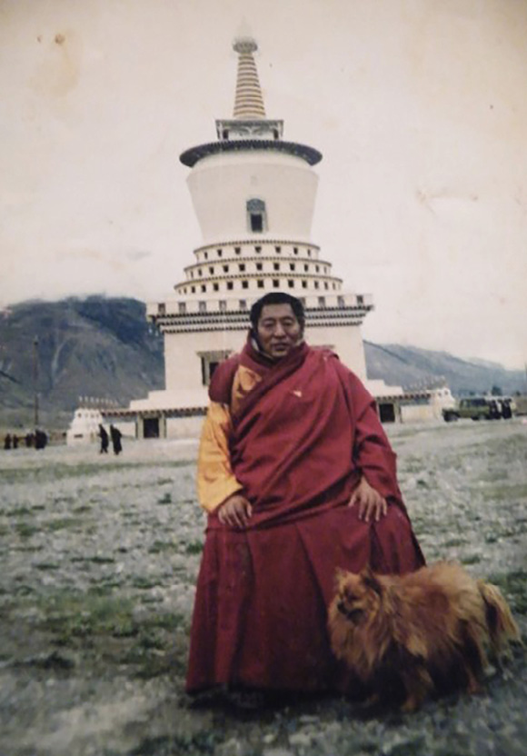
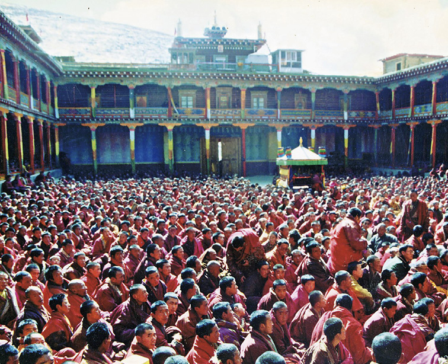
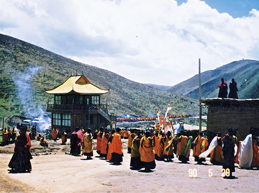

# 第3章细微因果深理

◦ 没钱就去当乞丐

◦ 专款专用

◦ 不该拿的分文不取

◦ 不要打狗

◦ 自他交换

◦ 供养谁功德大

◦ 该得的可以接受

◦ 诽谤大德也是舍法

◦ 谤法也是舍法

#### ·第15节· 没钱就去当乞丐

说到僧财，通常是一件很麻烦的事情。

佛陀曾讲过：“具戒解脱行者我开许，未守护者丝毫不开许。”也就是说，如果是具足戒律的人、在此基础上通过修行使相续解脱的人，是可以开许享用信财的，但不是每个人都有这个资格。

虽然我们不具备清净戒律及解脱的功德，但正如人们常说的“经忏师的本事在嘴上”，我们在接受信财的时候，口中还是要认认真真地诵经回向。

包括分念经钱，这些问题都需要严谨。我说这些也是为了你们。对我一个人来讲，这是无关紧要的事。

如果你没参加念经，但同样领了一份信财，甚至拿了两份三份等等，这是在造许多大劫无法从无间地狱中解脱的业。千万不要这样！

没钱的话，去乞讨也比这要好得多。说到乞丐，米拉日巴应该是带头人。乞丐去乞讨很正常，谁也不会说什么。

#### ·第16节· 专款专用

如果施主的供养包括居士，那么就有居士的一份。但像给沙弥、比丘供斋之类的，居士就没有资格享用。这个问题，我们经过反复分析讨论，基本可以确定。

听说居士林前几天念经，得了一点钱，如果分的话，每个人分不了多少，所以就放到了“放鱼款”里。但是，这可以吗？这是成了善法还是罪业呢？只有佛陀与僧众才可以确定，其他人是无法断言的。

《百业经》中说：夏季的收入，却在冬季分；冬季的收入，却在夏季分；供养佛像右侧的，却用于供养左侧；供养左侧的，却用于供养右侧。如此一来，就算是比丘也要感受痛苦，纵然经历成百上千尊佛出世，也无法解脱。这样的公案，在《百业经》等佛经中是有记载的。

所以，你们绝对没有权利这样做。施主想供养谁，就必须供给他。如果是供养僧众的，那就分发给僧众。如果是供养放生款的，“我们不用来放生，让僧众吃掉”，恐怕没有一个懂道理的人会这么说。

如果居士有不能决定的事情，必须由四位比丘以上的僧团有理有据地评判，不能像做生意一样随随便便说“这样是好的，这样是有利的”。

#### ·第17节· 不该拿的分文不取

不管你是谁，如果没有参与念经，就不要领取信财，否则会犯根本戒。

千万不要公开拿取或背地盗窃僧财。只要你具足沙弥戒以上的清净戒，就好好地参加集体诵经，那佛陀也开许有你的一份。如果没有念经，就不能领信财，否则，后世将堕入金刚地狱。

对于信财，且不说自己任意享用，就算是给别人，也有非常严重的大罪。但是，对于病人，他的那份需要提前预留出来。不仅是病人，护理病人的人也同样可以领取。当然，除了病情严重的人以外，大家身边不要有许多护理者，中断他们的闻法传承，这对你们也不好。

#### ·第18节· 不要打狗

你们不要用石头打那些家畜和流浪狗！

我去年也说过，你们可能觉得我太心软了。我本来就是一个有心脏病的人，也许是因为这个而心软的。但我不是在假装，你们打狗，基本上跟用石头打我没什么差别。

当然，这里是僧众聚集的地方，不是狗聚集的地方，狗不应该被带到传法的现场。如果有人能把这里的流浪狗带到别处去养，带走一只，我们僧众就给他念一亿遍观音心咒。

让僧众想办法减少流浪狗，还是困难重重的。因此，大家一开始就不要养狗或喂狗。但是这里现有的流浪狗，你们不要打！

小孩子们认为打狗是英雄，但实际上，并不是在狗身上逞威风就能获得英雄的称号。按照佛教的上等标准，勇于消灭烦恼敌人的，那才是英雄；按照世间法则，消灭敌人则称得上是英雄，这在《格萨尔王传》中仙巴大臣唱的道歌里也有。所以，希望你们不要再打这些狗了！

#### ·第19节· 自他交换

从今以后，只要你们打狗，就和打我一模一样。

有的僧人装英勇，用大大的石头如雨点般打到狗身上，我实在无法忍受。这听上去像是假装的，但是当你们在那边打狗的时候，我的心真的真的很痛。它们也是我的责任，拜托你们了！

牧区来的那些在家人，我们没法控制，他们会打，也没办法。三恶趣众生恒常都在感受痛苦，我们也无能为力。但是，那些属于我的眷属、把我当成上师的人，对一切众生都不能加害，尤其是不要打我们周围的这些老狗，不要伤害这些众生。谢谢你们，拜托了！

确实，有时候一想到浊世众生因业力显现的痛苦，似乎坐都坐不住，特别是亲眼见到、亲耳听到，就更难受了。

想想每一个进入屠宰场的牲畜，都因为业力而感受痛苦，真的很可怕。它们在牧区被收购上来后，到达目的地之前，一直被装在车里，上下嘴唇都被铁钉钉着，据说这样不咀嚼就不会瘦。到了屠宰场，它们感受到的各种痛苦，除了时间短以外，恐怕和地狱的痛苦没什么区别。一想到它们，心脏病都要发作了，但对此也无计可施。

#### ·第20节· 供养谁功德大

依靠佛、法、僧三宝所造的恶业，是一切恶业中最大的，而且大多是现世现报。假设今生没有报，它是顺次生受业，死后必定立即受报。反之，供养三宝，哪怕只是少量，也能培植广大福德。

尤其是，与供养佛陀、佛法相比，供养僧宝的功德更大，因为僧宝集三宝于一体。

若供养佛像、舍利塔等，虽有供养的功德，但没有享用的功德，而供养僧宝，既有供养的功德，也有享用的功德。哪怕是供养微薄的资具、一口食物，基本上今生就能成熟果报。而且，也不是今生受报后就完竭了，乃至没有成佛、没有证觉之前，一直会出生广大的果。

僧宝是积福的圆满福田。如果能将自己所拥有的财物做供养，哪怕只是一点点，也会有意想不到的功德和利益。

#### ·第21节· 该得的可以接受

财务部门在分配念经钱时，一定要特别注意。我看了你们关于诵经的规则，念经的人似乎并没有认真念。你们还是要好好念啊！

你们当中，如果不能念很长时间的经，作为精进闻思的人，只是简单地念诵，佛陀也是开许的。如云：“供养三界亦不足。”就是说，对戒律清净、闻思勤奋的人，供养三界的财物也不多。

集体诵经时，大家要积极参与。我最近也跟你们讲过，领信财时不要说妄语，否则就真的犯了根本戒，会造下堕入恶趣的可怕恶业。一方面是偷盗，第二方面是享用僧财，第三方面是狡诈骗取，这很可怕。当涉及僧财时，一定要小心谨慎！除非你是一个戒律清净、精进闻思的人，否则不要随便享用信财。

有时候我心里会浮现出这样的想法：有的人一辈子都在吃黑财，真的挺可怕。只要造下与僧众有关的恶业，就是在造大恶业，这与往生极乐世界绝对背道而驰，不知道会不会堕入三恶趣。我们活着的时候要注意这些问题，否则，所谓的死亡无常，不知何时就会来临。年少的、年老的，不一定谁先死，死亡的外缘也是不定的。

那什么是对死亡有益的法呢？就是信心、悲心、实修大圆满法。这些可以让你以后不再流转三有轮回，没有比这更好的了。每个人都必须下功夫勤修。不管你是谁，都应该尽心尽力修持这些法。

#### ·第22节· 诽谤大德也是舍法

如果造了舍法罪，一定没有解脱的机会，这是特别要谨慎的问题。

那什么是舍法罪呢？诽谤菩萨，也是舍法罪。我们完全不知道菩萨到底在哪里，所以对待每个人都要慎重。出家人中有菩萨，在家人中也有菩萨，甚至动物群里有没有菩萨，我们也不得而知。

譬如，过去有个人去五台山，文殊菩萨请他捎一封信给达西，信中写道：“达西大菩萨：您以此身份利益众生已圆满，今当前往东方现喜刹土。”那人去了成都一带的一个城镇，四处打听，却根本没有一个叫达西的人。最后，有户人家说，他家养了一头猪，名叫达西，明天就准备宰了。那人不知道菩萨在哪里，于是把信放在了那头猪面前。猪用嘴巴拱开信，看完就死了。

这样的菩萨，在各种飞禽走兽中都有。菩萨发愿时也念诵“愿成鸟兽城中乞”，还发愿转生为受赞叹者、被诋毁者、病人、说法者等。甚至在妓女和屠夫中，也有许多菩萨。

为此，严格来说，对一切众生都不应该取恶名、说过失，否则将成为舍法罪之因，这是非常危险的。

#### ·第23节· 谤法也是舍法

对于甚深的法，如果你觉得它不是正法，对正法生邪见而进行诽谤，这都是舍法业。

比如，我们这些闻思的人，为了维护宗派，以贪执自方、嗔恨他方的心，说新派的观点不合理，或者噶举派的观点不合理、觉囊派的观点不合理，等等，这都是舍法罪。

说这话的人，藏地在家男女中一般不多，就是出家人里有。不过，在过去新派与旧派僧团不和的时候，他们下面所属的在家人也跟着造下了很多舍法罪。所以，不可诋毁正法宗派。

当今时代，真伏藏师与假伏藏师、真成就者与假成就者非常多，凡夫人无法分辨是真是假，因此应该不破不立，并保持中立。正如《经庄严论》中所说：“意罪自性恶，非理色非理，疑法何须说，等舍善无过。”
