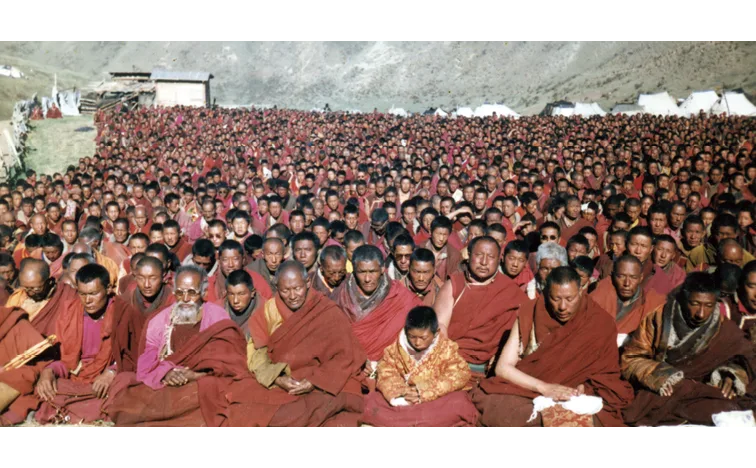
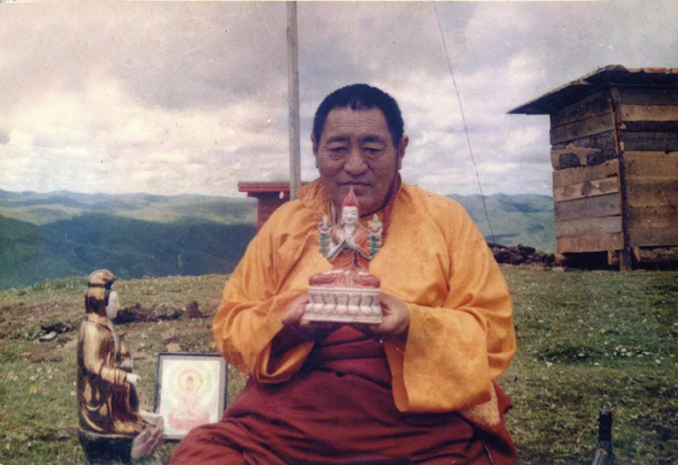
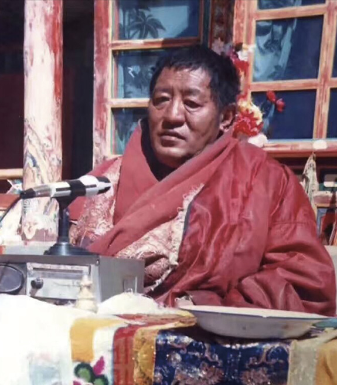
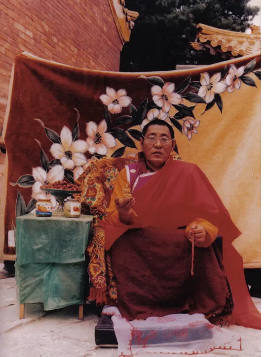

# 第4章对教派不偏不倚

◦ 宗教要和睦

◦ 宗派要团结

◦ 重视自宗

◦ 持明传承的加持

◦ 五岁就有菩提心

◦ 不容忽视的深法

◦ 缘起破坏的遗憾

◦ 无畏教授的安慰

◦ 藏传佛教的圆融

◦ 殊途同归

#### ·第24节· 宗教要和睦

在这个世界上，有四大宗教：印度教、基督教、伊斯兰教和佛教，小宗教不胜枚举。如果所有宗教内部、相互之间发生冲突争斗，那一定会给众生带来巨大的灾难。为此，所有宗教都应该和睦相处，避免偏执争斗。

#### ·第25节· 宗派要团结

特别是在藏地雪域，有八大修传教派、十大讲传教派等。这所有教派都遵循同一位本师——释迦牟尼佛的教法，所以各教派要团结和合，持戒清净。

主要是僧人们，不要一味地偏袒自己的教派，也不要以贪嗔的心态说“我们是新派，你们是旧派”“你们是苯波教，我们是噶举派”之类的话，否则就是造了舍法罪，会转生到恶趣。我们对任何法都不要有邪见，而要以恭敬虔诚的信心，修自己有缘的本尊。当今依靠个别了不起的持教大德的恩德，雪域不同以往，教派间的冲突有所减少，但仍没有从根本上杜绝，所以各派之间不要争执不息。

如果我们大家齐心协力，哪怕对佛教起到一点点作用，让它变得更清净、更完善，我想那是再好不过的。

对佛教起到作用，就是利益众生。否则，像以前个别人那样，以贪心和嗔心进行破立，着重维护自宗、破斥他宗，这是绝对不行的。这种对教派的贪嗔，一定是转生恶趣的因。

特别是就密宗而言，这也是违犯了第六条根本戒，如续中所说：“自宗或他宗，谤法第六条。”古大德也说：“不仅仅是诽谤入道的声闻缘觉、大道的大乘宗派等正道佛教，就是诽谤寻道的外道，都犯第六条根本戒。”

尤其在菩萨戒中，这是舍法罪。想往生极乐世界的人，必须要小心，没有什么业比舍法罪更严重的了。

此外，对于相续中有正法的持教大德，本无过失却无中生有，或者本有功德却加以抹杀，进行诽谤，多番恶语攻击，这也是舍法罪。

#### ·第26节· 重视自宗

作为一个佛教徒，无论学习哪宗哪派，都要对自己的教派有牢固的定解，对自己有缘的法和有缘的本尊有坚固的信心。当然，仅有信心是不够的，还需要长期修行。对于自宗，无论是所学的理论、所诵的仪轨心咒、所修的道次第及窍诀的运用，你都要做到了如指掌。

有时间也可以学习研究一下其他宗派，但重点要放在自宗上。就像上师麦彭仁波切说的，他今世转生在莲花生大士的教法中，感到非常荣幸，对自宗有不共的诚信。我这一世生在宁玛派的教法下，也会把主要精力放在自宗的修持和弘扬上，在此基础上，再无偏地学习和弘扬各宗各派。

不管你是出家人还是在家居士，都不要整天东奔西跑，参观寺院，拜访各种各样的人，这样到头来会一无所得，白白浪费宝贵的光阴。每个人要尽可能持之以恒、深入一门地修持自宗，这应该是人生中最重要的一件大事。

#### ·第27节· 持明传承的加持

一般来说，诸佛菩萨的悲心是无有偏袒的，但在学道阶段，因他们的发心、发愿不同，我们在多劫中祈祷其他佛陀，不如祈祷莲花生大士一次的加持大。并且，莲师对遣除外界地水火风等灾难的威德力尤为显著，这一点在《七品祈祷文》中也有记载。

大家一定要怀着强烈的信心、诚挚的恭敬心，深情地祈祷莲花生大士，关键是要坚信不疑。在雪域中，堪称最有缘的圆满上师，唯一是第二大佛莲花生大士。

就我本人而言，这一世转生在前译持明传承的教法中，遇到了光明金刚藏法理，自认为三传持明上师的加持已融入了心相续，有获得如理自在拥有大圆满法义的缘分。总的来讲，这是邬金第二大佛等传承上师的恩德，尤其是上师麦彭仁波切的恩赐。所以，要依靠我来获得加持，就必须依止麦彭仁波切的这些言教，甚至，宗派间的关键性问题，连旁敲侧击也不能破麦彭仁波切的观点，否则会堵住加持之门。

对我来说，看到他的四句言词，也会增上信心、悲心和觉受证悟，百论的难点都会迎刃而解。这种境界，会在心中萦绕七八天左右。因此，我希望你们也以一颗真挚的心至诚祈祷。

法王如意宝与麦彭仁波切像

#### ·第28节· 五岁就有菩提心

总的来说，我对前译持明传承，尤其是对上师麦彭仁波切，有着无与伦比的信心。

从四五岁起，我就认定上师麦彭仁波切是究竟皈依处，把他这个人当作一位本尊来祈祷，虔诚的敬信心从未松懈，始终相信他与怙主文殊菩萨不仅是本体、而且形象也无二无别。

说3岁就有这样的信心有点太早，但5岁肯定就有了。记得有一次我在父亲的怀里，认定上师麦彭仁波切就是我的部主。也就是从那时起，我相续中生起了无伪的菩提心。

#### ·第29节· 不容忽视的深法

当今正值见解浊的时代，福报浅薄的行人往往是法越甚深，信心越小。假设你觉得“不用如理依止具有持明传承窍诀的上师，只靠表面听闻听闻、表面理解理解、懂得辩论应用方法，就可以轻易通达甚深之法”，这是完全错误的想法。

正如上师麦彭仁波切所说：“纵经百年勤思维，若无宿修成熟因，具大智慧极精进，然却不能通达也。”所以，刚刚闻思的初学者，不要轻视深法。

#### ·第30节· 缘起破坏的遗憾

我原本以为，自己对邬金莲花生大士的传家宝——甚深密意伏藏、广大地伏藏等十八种伏藏，具有都能自在开取的宿缘，此生也本该打开甚深伏藏门，遣除浊世的衰败，广泛弘法利生，实现莲师的心愿。有朝一日，在吉祥山莲花光宫殿空行持明聚集的行列中，蒙受莲师佛父佛母含笑目视，面露喜色，以梵音赐予安慰，如实享用秘密甚深方便道、智慧解脱道、大圆满法，与莲花生大士具有同等缘分，那该多好啊！

但是，由于大部分缘起被破坏，导致甚深伏藏门已经封闭，主要是开启十三大伏藏之门的缘起已被他人摧毁，所以这一切不能如愿以偿。对此我感到深深的遗憾！

#### ·第31节· 无畏教授的安慰

我小时候就想：由前译持明传承上师大悲与加持的铁钩摄受，意传证悟的加持已融入心中，自相续如理拥有大圆满法义，我决定会获得虹身与光明身的成就。

可现在，因为弟子破誓言的晦气染污了我这个虚幻的身体，所以我圆寂后，就算身体没有变大，也不会缩小。哪怕变大了，你们也不用怀疑，不必生邪见。如果你们自己能坚持不懈地实地修行，这对你们不会有什么损害。

只要你对三恩德上师有视为真佛的信心，尽可能如理护持戒律誓言，孜孜不倦地实修大圆满法，发愿往生极乐世界，从此之后，必定能成办自他一切众生的利益。

#### ·第32节· 藏传佛教的圆融

过去，萨迦派、格鲁派、噶举派、宁玛派的智者们之间，有过非常精彩的辩论。然而，我们中的一些人不知道它的必要性，并认为他们的观点是完全抵触的相违。如果谁认为他们就像内与外一样针锋相对，那就是在造漂泊无边恶趣的舍法罪。

真正说起来，藏地雪域所有的佛法，都是大乘。如果讲中观，大家一律是中观应成派，没有一个人会说“我是自续派”。就密宗而言，大家统统是实修无上续部的人。所以，要知道“一切教派并不相违”是极其重要的。

班禅大师曾经说过：“如果我们佛教各派统一起来，就会对整个佛教和民族文化等做出贡献。”所以，我们法脉传承的内部之间，不要怀着偏执说什么“我是旧派，你是新派”之类的语言，互相冷嘲热讽、心生嫉妒，造贪嗔的恶业，否则，那就毁了我们大家。

我是诚心诚意说的。一方面，我们佛教各派没有好坏之分，同时也没有一丝一毫的相违。如果你认为有相违，那是你自己不懂。

#### ·第33节· 殊途同归

格鲁派、萨迦派、宁玛派等，讲法的方式和法语有些不同。比如，新派说佛地需要有心，如果没有心，佛就恒常成了无情法，诸如此类的过失很多。而宁玛派、萨迦派都说佛地没有心，也讲出了很多观点。但他们所说的一切，究竟意义上都是同一理趣。

理由是什么呢？不管是萨迦、格鲁、宁玛哪一派，没有人会说“现在我们相续中有的所取能取二现的心、心所戏论，在佛地也有”，而哪一派都会说“佛陀的智慧、十力、四无畏本性的一切法互不混杂无误了悟必然有”。为此，仅仅是名言讲法与智者们宣说特法有差别而已，但其实是同一要点。

萨迦派、格鲁派、宁玛派，噶举派、竹巴派、达波派等中大智者的说法，真正从究竟意义上看，只言片语也没有差别。如果你明白这一点，就通达了各教各派互不相违。

