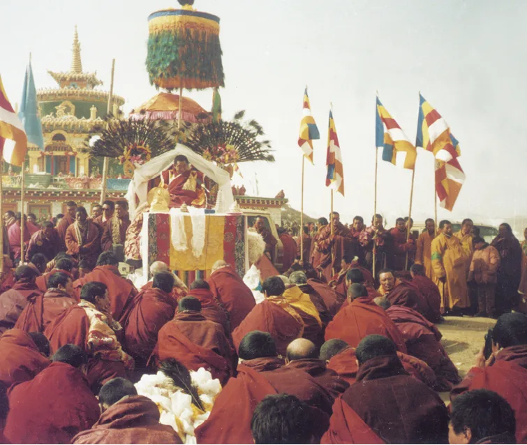
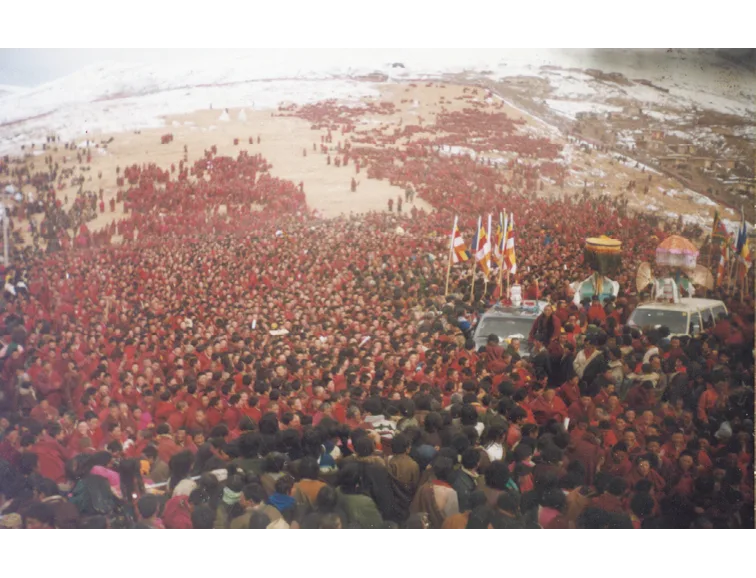

# 第6章甚深的法会

◦ 十万持明大法会

◦ 金刚萨埵法会

◦ 地藏法会

◦ 极乐大法会

◦ 长寿法会

法王在坛城赐予怀业九本尊的灌顶

·第39节· 十万持明大法会

举行十万持明法会的主要原因是，根据《应成根本续》中“尔后具慧者受持”等授记，如果举办十万持明法会，连同十万眷属一起，将共同抵达持明地。

本来，这种缘起的时机已经到了，但现在，由于所化众生福报太浅，加上妖魔的强大阻碍，以至于缘起没能完全圆满，主要是开启十三大伏藏门的缘起被破坏。尽管如此，承蒙雪域持教高僧大德为主的各层人士的关照，通过念经等广做佛事、祈祷发愿，使得现在有机会举办十万持明大法会。此次法会，亲自参加的僧人确定有三万八千多，再加上有形与无形的持明众，共计十万，这是一件值得庆幸的事。

依《观音九本尊甚深修法》来修行怀业，唯一是为了在整个世界尤其是藏地雪域弘扬佛法、利乐有情。

分别来说，关于喇荣佛法住世多久，根据列绕朗巴和第一世敦珠法王的授记来推测，还能存在三百年左右。对此虽然有很多佛事可做，但最重要的是怀业深修十万持明大法会。如果将来也能如理如法不间断地举行这个法会，那么我不在之后，这个佛学院还可以在三代以上广兴佛法。佛法能不能住世，主要取决于这一法会，因此大家要予以重视，积极参与。

如今在佛法兴盛的藏地，也有一些不容乐观的事情：与无害的佛教直接相违、宣扬损害法的边陲异教，恶行异常残暴——屠杀成百上千的众生。想想看，真的好像地狱来到了人间。

我去年去了多康四江六冈的大部分地区，主要在玛多、果洛等地，强调不要杀生。但有几个好心人对我说：“别说这些了，不然会威胁到你的生命。”

本来，佛教就是不害他众的宗教，佛陀也说“害他非沙门”，可现在已经到了对此也需要怀疑、不敢说真话的境地。我怎么忍心置之不理、袖手旁观呢？为此，修怀业更是大有必要。

当今世界上大约有182个国家，但像藏地雪域这样佛法如此兴盛的地方，几乎在哪儿都没有。从某种角度来说，还没有到无爹管、无娘疼、无依无靠的地步。如果做弘法利生的事业，也不是不可能成功的。以后我们都要认认真真做实事。

我也在你们面前发誓：从现在乃至尽虚空界，为了弘法利生，我纵然舍弃生命也在所不惜。按照我的想法成办弘法利生大业，请你们也赐予一切助缘。

#### ·第40节· 金刚萨埵法会

之所以举行金刚萨埵法会，是因为我们从无始生世以来积累的一切堕罪，尤其是破誓言的一切罪，最殊胜的对治法就是金刚萨埵六字真言。《金刚手威猛续》等云：“诵此心咒十万遍，破根本誓言之罪也可清净。”那障碍往生极乐世界的舍法罪与无间罪，今生能得清净就更不用说了。

所以，这不仅对出家人很重要，对在家男女信众也非常重要。关于念诵的数量，续中说念十万遍，但按照“圆满劫所念诵数量，具诤时要增到四倍”所说，为此需要念四十万遍。

念诵咒语时，要吐字清晰，并一心专注于所缘境。上等者应安住在生起次第、圆满次第的境界中念诵，最低也应该具足四种对治力。若如此诵咒，自性罪及破别解脱戒、菩萨戒、密宗誓言的一切罪，以及舍法罪、无间罪、享用信财的罪障等，一定会无余得以清净。

这个法会的施主，是降魔胜利洲或国际学经会。之所以让他们做施主，是因为会有很多汉族信众前来参加，而且那时候的气候也冷暖适宜。特别是，我在玉哲取出的甚深伏藏法《金刚萨埵修法仪轨》后文中提道：此法在伏藏地附近修行容易成就，利生事业主要在汉地普及。所以我认为，劝勉汉地信众念诵金刚萨埵心咒，应该比其他法门更有利。

#### ·第41节· 地藏法会

在我等本师释迦佛初转法轮的吉祥日，我们学院举办这个地藏法会，又称亿修普贤行愿法会，主要是修地藏法门。而亿修普贤行愿，在四大法会中普遍都有。

地藏法会和金刚萨埵法会，基本上是为在家人举办的。地藏法会专为庄稼丰收、万事顺遂而设。为此，数劫中祈祷文殊菩萨、普贤菩萨、弥勒菩萨、观音菩萨等，不如短短片刻祈祷地藏菩萨一次的利益大。《地藏赞》中是这样宣说的，说者不是别人，正是大悲释迦佛。

大的方面，要想获得最高成就的佛果，要想往生西方极乐世界；小的方面，为了吃的、喝的、穿的应有尽有，为了运气亨通、心想事成，没有比祈祷地藏菩萨更好的了。

在家男女信众，祈祷地藏菩萨会有什么成效，你们应该清楚。比如，最近色达及其下游，主要包括炉霍、壤塘、新龙、甘孜等地，连续数十天遭遇严重干旱。在旱得最厉害的那几天，我们学院全体僧人念诵地藏菩萨名号，结果当下就下起雨来，有这么立竿见影的加持效果。

祈祷地藏菩萨，今生能长寿无病、拥有财富、愿望成真，对后世来讲，这也是命终后能即刻同与自己结缘的一切众生往生极乐世界的不共近因。

不仅如此，如果你祈祷地藏菩萨，究竟而言，自相续必定会得到声闻、缘觉、菩萨、佛陀的无上功德与智慧。这位地藏菩萨，是十万如意宝也无法比拟的独特宝珠。如果祈求普通如意宝珠，它只能给予世间的财富，而不能赐予出世间的戒、定、慧等一切功德。

现在举行这个法会的目的，就是为了让雪域为主的一切众生，尤其是附近对我们有大恩的施主们，能够丰衣足食、时来运转、万事顺利，消除对上者嫉妒、对中者竞争、对下者轻凌、怀着憎恨度日等即生感受的无量痛苦，以及死后立即转生到饿鬼界等将要感受的痛苦。所以，正是为了让他们即生财富受用圆满、后世堵住投生恶趣之门，才举办这个法会的。

#### ·第42节· 极乐大法会

极乐大法会之所以在天降日举行，是因为那时农民们已经收割完庄稼，牧民们也没什么大事可做，是农牧民信众都比较空闲的时候。举办极乐法会的原因是，依靠阿弥陀佛的发心和愿力，很容易修成往生极乐的因，并能往生彼国，具有最大的功德和利益。因此，主要是考虑到广大信众，才打开了极乐法会的大门。

尤其是，和具有戒律的持藏大僧团一起共修，是一种非常殊胜的积资方式，是往生极乐净土捷径中的捷径。这个法会的地点，是居士林所在地，以后也主要由居士林负责举办。

#### ·第43节· 长寿法会

举办长寿法会的目的，不是让我一个人长命百岁，而是为了让无偏的如来教法广弘各方、长驻世间，持教高僧大德需要长久住世，尤其是为了某位持教大德长久住世。喇荣佛教大学每年都要认真念诵绕那朗巴的长寿仪轨至少五万遍。绕那朗巴的这个《密集长寿大修仪轨》，比其他仪轨更有加持力，修持它，也有令每个人自己修行圆满的必要。

伏藏大师绕那朗巴，是一位缘起从未被破坏的伏藏大师。他缘起成熟的情形是这样的：有一次，一个人要还他的债。那人带着一个价值100头母牛的昂贵瓷碗来，碗里盛满牛奶，供养在绕那朗巴面前。他当时正在睡觉，刚醒来的时候，正好是早上太阳升起的时候。白色的碗里盛着白色的牛奶，当他醒来时，阳光正好照在牛奶上。依此，一切缘起吉祥圆满，结果他三世的利生事业在一世中完成了。他的伏藏法也是广利有情，无论谁修，都大有成效、大有加持。
