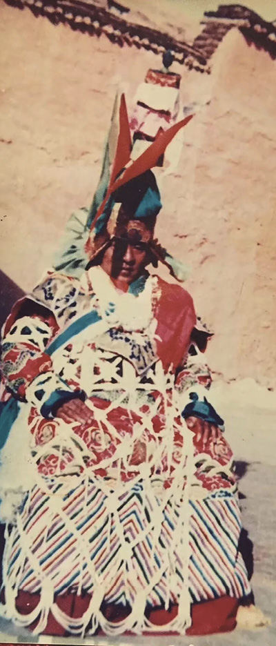
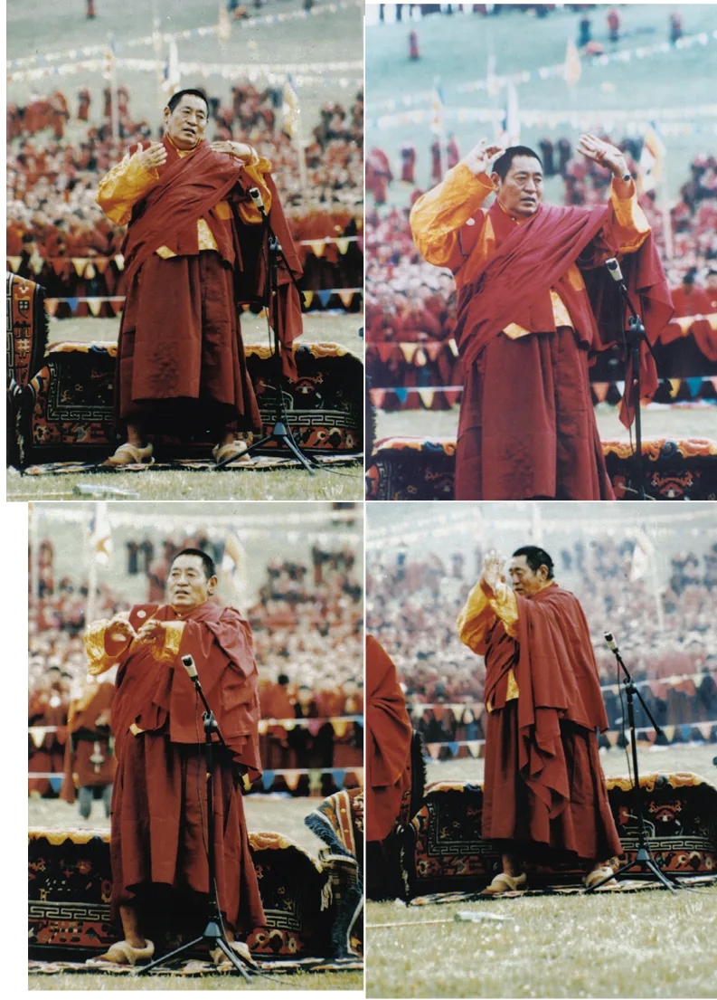

# 第7章遣除弘法利生灾难

◦ 遣除时世衰败的佛事

◦ 遣除违缘的佛事

◦ 生生世世

◦ 大乐金刚舞

#### ·第44节· 遣除时世衰败的佛事

平日里，大家尤其需要精进修行伏藏大师列绕朗巴的这个殊胜法——《金刚橛伏藏法》。现在，你们已经完整获得了灌顶、传承和引导。根据自己的条件，上等者要大修，中等者要中修，下等者要小修，哪怕最少只有三天时间，也要修三天。如果这个法门遍及整个藏地，将会遣除疾病、饥荒、时局动荡纷乱的衰败，使各方安定幸福、人们事事如意，有令佛法广兴于世、长久住世的必要。

就我而言，正如我的传记中提到的，在护法神的鼎力相助下，有不可思议的事业。如果没有铁匠、寡妇、破誓言的人参加，都是誓言清净者念诵清净的护法仪轨来供养护法神，那么，护法神的威力是真实不虚的。

#### ·第45节· 遣除违缘的佛事

“文革”后期出生的年轻人，没有经历过严重的大运动。虽然这些年轻人有世俗的知识学问，但他们没有经验。那么，谁有经验呢？是坐在经堂下面的那些白发苍苍的老人。我们亲身经历过很多温和、粗暴的运动，所以我们有丰富的经验，在这样严重的大运动袭来时，如何做到既不得罪上级，又不损失自己的利益。如果你鲁莽行事，只会使事情变得更糟。如果能让本尊、护法神转变人心，那做任何事都会顺顺当当。

所以，这几天我们需要认真念诵《八吉祥颂》七百万遍。

之后听说工作组要来，我们也要提前订好方案。在这种时候，我们做什么、说什么，都要有一个原则。否则，如果我们随波逐流，没勇气却故作勇敢，恐怕这个佛学院会毁于一旦。这样，我们20年来所做的一切都将前功尽弃。所以，大家做到松紧适度很重要。

#### ·第46节· 生生世世

生生世世中，我与文殊怙主麦彭仁波切永不分离。我们两个有时以君臣的身份、有时以父子的身份、有时以师徒的身份弘法利生。

未来在勇武铁轮法王时期，文殊怙主麦彭仁波切会受身为桑格布巴军官，我转世成为事业金刚军官。以前在格萨尔王国的时候，文殊怙主他成为擦扬丹玛香查大臣，我则是他的儿子丹哲意吾布美。个别授记中说我是伏藏大师列绕朗巴的转世，是文殊怙主麦彭仁波切的化身，但那些应该是有特殊必要讲的，对此我没有任何把握。但如果说我是丹哲意吾布美的转世，的的确确可以这么说。

这次来看丹哲舞剧的人，将来一定会转成勇武铁轮法王的眷属。

#### ·第47节· 大乐金刚舞

麦彭仁波切亲自创造的《大乐金刚舞妙音》，其表演传统如果能够在整个藏地兴起，那么雪域的疾病、饥荒、战争就会消失无余，幸福的太阳也会升起，有这样的缘起。

然而，麦彭仁波切在世期间，这个金刚舞普遍流行的缘起并没有成熟。后来，绕章彻仁波切、列绕朗巴等大德试着将此《大乐金刚舞妙音》在雪域总的佛教节日上表演，但由于雪域人们福报不足，导致没能坚持下去。

之后，第二世敦珠法王等大德也有意将这一金刚舞弘扬开来，但因为雪域的幸福时刻还没有到来，所以一直未能传开。现在，缘起和时机已经成熟，所以《大乐金刚舞妙音》得到了广泛的推广。

此舞兴盛之处，就会大吉大利，无病无疾，所有浊世衰败尽化为乌有，增上世间、出世间善聚。在其结文中还说：“在家男女信士，应该虔诚地渴望，专心观看。”你们应该对此充满信心，这既是娱乐也是修行。特别是，如果你们在家的善男信女能坚持跳这个舞，那会给总的藏地雪域、分别的各自地方带来莫大安乐。

一开始，即使你们看不懂文句，只要播放录音来跳，也会大有利益。这个金刚舞有多种不同的舞姿，现在这个舞姿是由喇荣佛教大学精心编排的。每个人都应该怀着恭敬心、诚信心来欣赏它。看到和听到这个金刚舞的人，也是幸运者。
