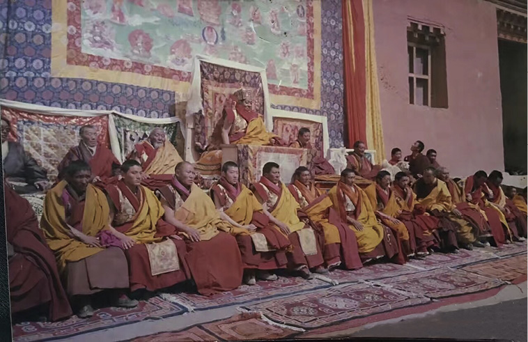
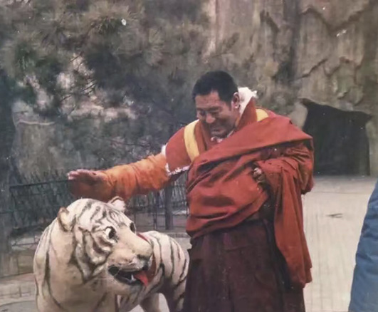
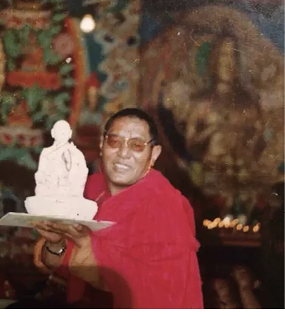

# 第8章掌握是非取舍

◦ 僧人可以积财吗

◦ 活佛的言行举止

◦ 僧尼少交往

◦ 什么是好人

◦ 远离恶友

◦ 结交善友

◦ 关要三句

#### ·第48节· 僧人可以积财吗

有人认为，出家人做生意没有什么。其实做生意的时候，十不善业都已经齐全了。如果做的是大生意，不管是比丘、沙弥、居士，谁都必定会破根本戒。不失戒律而做成正当的生意，是相当困难的。

如果你这辈子一直做生意，那到死的时候，是独自前往阎罗城的时刻，亲属们帮不上忙，财产受用也毫无用处，决定有利的就是正法，决定有害的就是不善业。那时，罪业与你相伴，只会带来痛苦。那时，一般人放不下财物，在依依不舍中，自己也毫无办法，只能立下遗嘱“我们的财物要这么办、那么办”，除此之外什么也做不了。

所以，大家不要积累太多的财富，尤其当今积财的人里有僧人，更甚者是假活佛。僧人和活佛们要好自为之！你们还是应该一丝不苟地闻思修行，华智仁波切不是说过吗，“活佛们刚能骑马就肆无忌惮地享受黑财，这是在毁坏自他”。

如果你们只是有个活佛的名号就到处乱跑，恐怕连自己的戒律都很难保得住。昨天我不是讲了吗，别人说你是活佛，你就承认自己是活佛，但如果你不是真正的活佛，那就可能犯了上人法妄语的根本戒，这是非常严重的。

活佛们不要从小就恣意放纵地享用信财。米拉日巴尊者说过：“享用黑财生命剑，斩断解脱之命根。”能够斩断解脱命根的，确实就是这种黑信财。只有具备生起次第、圆满次第修行境界这一生铁利齿的菩萨，才咬得动黑信财的铁丸子。

#### ·第49节· 活佛的言行举止

身为上师活佛，如果放逸无度，破了戒、破了誓言，那么你今日在高高的法座上、精美的伞盖下，明日就会一落千丈。让你从法座和伞盖之间很快堕落下去的，没有比放逸更可怕的了。特别是小活佛要慎之又慎，俗话说：“母马生的小马有九次劫难，渡过九劫就是烈马。”对小活佛来说，小时候违缘会很多。

其实对你们来说，清净的戒律是根本。如果在它的基础上，还具有智慧和禅定，那就是至高无上的。即使没有智慧和禅定，如果你有清净的戒律，无论如何你已被认定为活佛，坐上了活佛的位置，现在就没有一个人会说“你不是活佛”。你们纵然不能变得越来越高，也千万不要越来越下堕。

可是现在有些人不小心谨慎，破了戒、破了誓言，在此基础上还假装说各种神通，我是根本不相信的。如果说得多了，碰运气可能会有个别说得准，就像人们常说的“喝酸汁时身体会哆嗦”。但也有句俗话说：“真的，经考验，如长长山谷；假的，快露馅，如老鼠尾巴。”意思是，如果是真的，那么时间会证明一切；如果是假的，很快就会暴露无遗。

所以，你们假装说神通是第一个不成功，假装取伏藏是第二个不成功，假装显成就相是第三个不成功。如果你想得到活佛的地位，不管别人说你是不是活佛，只要自己守护清净戒律，那么包括天人在内，都会尊你为活佛，把你当成供养处来恭敬。但若不守戒律，即使能说会道也没用。如果修行没有达到一定境界而放逸，这就是下堕的因。

小活佛们，还是要小心啊！你想成为高尚的人，取决于自己；想成为低劣的人，也取决于自己。能真正把你们这些上师活佛往下拽的，是什么呢？就是年轻的女人。小僧人真正的敌人，也是她们。少女会把你们扔到下劣之地，所以务必要当心。

#### ·第50节· 僧尼少交往

喇嘛、尼众，包括居士林在内，都做了戒律方面的整顿，现在整个学院的四众应该是清净的群体。如果谁不能守护杀、盗、淫、妄、酒这五戒，最多只能在这里待五天，不可以常住。

要特别注意的是，男女僧人之间的清规。你们应该冷静下来好好想一想：来到这里，你们是为修行而来的，是想守戒而来的，千万不要随那些捉弄人而让人破誓言的怨鬼所转。我以前也曾教诫过你们。

一开始想看异性时，就要小心提防；如果没注意，就会发展到想和异性接触；如果你不防患于未然，久而久之自然会染上过失。为此，僧尼应该比以往更严格，不要破坏相关戒规。一旦破了根本戒，就玷污了珍贵的佛教，再没有比这更有害的了。所以，请三思而后行，如果实在不能守戒，那就随缘各自回家吧。

#### ·第51节· 什么是好人

我们已经得到了人身，不仅得到了，而且有幸进入持戒持藏者的行列，或者步入释迦牟尼佛四众眷属的行列，所以一定要非常慎重。作为出家人或佛的随行者，上至高级的人类，下至蝼蚁以上的低级动物，不得损害其身体和生命。佛陀说过“害他非沙门”，请大家认真地身体力行。

一般来说，学院常住的人，对新来的男女僧人和居士要欢迎、接待。我们过去一直有这样的传统，这既是人规，也是佛法。

总之，如果是一个专门利他的人，一个心地善良的人，吉祥会属于他，财富也会属于他。我们所说的“好人”，不是指口才好的人，也不是指勇敢的人，因为他们当中也有坏人。总的来说，心肠好的人，才是好人。所以，始终保持心善、行善相当关键。

心善是指什么呢？就是满怀信心地祈祷三宝，想让一切众生都幸福快乐，“就像我自己快乐幸福一样，想让一切有情都拥有”。看看你相续中有没有生起这样的善心？当然，善行比这更重要。

#### ·第52节· 远离恶友

对于每个人来说，交往善友是极其重要的。华智仁波切曾经说过：“如果交往有贪嗔痴的友伴，自己也会变成有贪嗔痴的人；如果交往有信心和悲心的友伴，自己也会变成有信心和悲心的人。”所以，在没有证得一地之前，自己会变成怎样，唯一依靠友伴。

无论你住在城市还是深山寺院的什么地方，随时随地远离恶友很重要。作为一个僧人，如果喜欢经商的人，与他交往，意味着你也会变成商人；如果喜欢读书人，与他交往，意味着你也会变成读书人；如果喜欢实修的人，与他交往，意味着你也会变成修行人；如果交往恶友，那说明你也是个恶人。

如果你想观察别人是不是一个好人，那可以通过察言观色，看他的行为举止便知道。如果这个人与商人、流浪者、盗贼共行共住，那就证明他也是个奸诈的人、行窃的人。不是很多人都说“某某僧人本来是个高尚的人，但因交上一个坏朋友而完蛋了”吗？

#### ·第53节· 结交善友

虽然你们以前结交过恶友，但重要的是，以后要交往贤善的朋友。正如上师麦彭仁波切所说：“当断诸散乱，假设不能断，当交贤良士，彼是汝妙药。”意思是，如果你实在不能断除散乱，那就交往有功德的朋友，他会把功德熏染给你。

再者，大家对每个人都要生慈悲心，对上上下下的人不要生嗔恨心。即使我们无法避免对敌人生嗔，也绝不能对同行道友生嗔心。乃至获得菩提果，我们需要像灯光与灯芯一样相伴不离。

#### ·第54节· 关要三句

就像在《整顿佛教通告》中所立的一样，佛教的基础是守护清净戒律，佛教的心要是精进闻思修行，佛教的结果是成办众生利益。

一切佛法无不包含在这三要点中。即使诸佛都聚在一处，也没什么可再讲的了。因此，大家要将此付诸实践。

