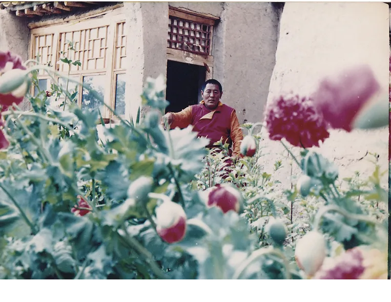

# 第9章诸恶莫作

◦ 杀生是开地狱之门

◦ 中止陋规

◦ 胜过母亲的母牛

◦ 今生来世安乐之源

#### ·第55节· 杀生是开地狱之门

如果谁以嗔恨心杀生，那他后世只会下地狱，别无出路。你们有些人认为，如果一辈子不杀生，那就没法活下去，但事实并非如此。比如，在我们喇荣，平时有大约一万名僧众，大家都承诺开法会时不吃肉，不吃肉反而比以前吃得更饱、吃得更好，一点也没觉得断肉会垮掉。

确实，依靠四面八方大恩施主的恩德，如今这里更加丰衣足食，时常有供酸奶、供斋饭的。夏季三个月、秋季三个月，基本上每天都有供斋。

#### ·第56节· 中止陋规

作为学修大乘佛法的我们，要尽可能改掉那些做荤食供养的寺院陈规陋习，否则，这与佛教是直接抵触的。在色达这个地方，依靠华智仁波切的恩德，没有这样的不好传统，据说其他地方好像有。

而且听说有人在造佛像、佛塔时，满不在乎地将几百头牛羊交到屠夫手里，让他牵去屠宰场。如果这是真的，那就是在故意毁坏佛法。我相信你们当中不会有人那样做，那样是绝对不行的。

特别值得一提的是，不要总是靠宰杀这些对人们有大恩大德的母牛为生。这些众生其实和我们一模一样，它们也有疼痛的感受，也害怕死亡。所有这些众生并不是我们的敌人。一辈子都在养着我们、护着我们的母牛，是大恩人，它们不是该杀该剁的。

所以，我一再希望诸位僧人及上中下各层人士，不要伤害众生，尤其是绝不能大量宰杀。如果是国家规定，那避免不了，但并不是这样的。没有谁会因为不杀生而活不下去，不要说大批屠杀，就是一两只也不能杀。如果谁不能做到杜绝屠杀，那么此生必遭厄运，来世还会堕入无边无际的恶趣。

#### ·第57节· 胜过母亲的母牛

你们不要再一味地杀害宰割这些胜过大恩母亲的大恩母牛了！不可以杀家畜！不可以杀野兽！它们都是无辜的。周围的野兽，都是你们父母亲属的转世。它们没有获得人身，因为舍不下我们，才投生到这里来的。做到不宰杀、不打猎，是根本的根本。

我这样再三祈祷，也是为了你们好。你们别再宰杀、别再打猎了。如果是宰家畜、杀野兽的人，那么坐在佛教徒的行列中，不知道还有什么意义。

拿色达来说，老百姓以牧民为主。作为牧民，如果把那些动物都杀光了，那靠什么来生活？可以养活我们一辈子的，正是这些大恩家畜。当今时代有些人说：“等我把母牛都杀光后，再去一个地方签个合同。”但你可能无法签到任何合同，到头来，背上背着乞讨的口袋、手里拿着乞讨的书信，那时该有多么艰难。身上连十块钱都没有的人，怎么能签到合同呢？

去年和前年，我真的很害怕，几乎每一两天就屠杀了数百数千只众生，血流成河。现在稍微好了一点，可能是因为肉价没上涨等诸如此类的原因吧。如果是真的，那就太好了。

#### ·第58节· 今生来世安乐之源

在佛法兴盛的藏地，可以完全信赖的就是三宝。如果你能全心全意依靠三宝，那么今生会快乐，来世也会快乐。所以，从今往后，不要杀生、不要打猎。如果你能做到，应该会幸福快乐的。

去年，我对人们的杀生吃肉非常不忍，心想：“如果色达地区及其附近的人，还继续犯下这样的罪行，那大多数人会不会因饥饿而死或因病而亡？”我于心不忍，就一心一意向地藏菩萨祈祷。
