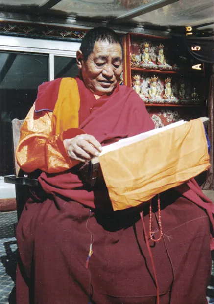
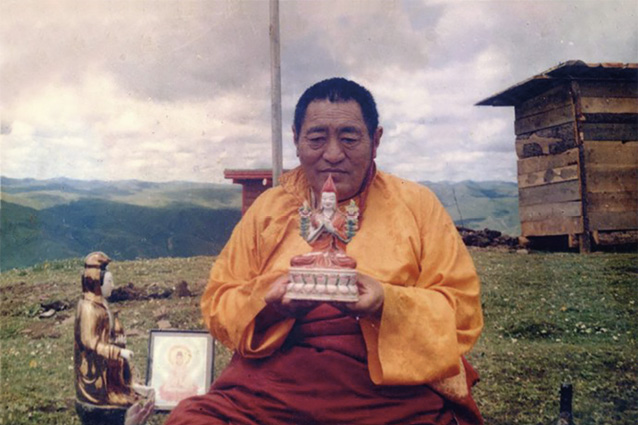
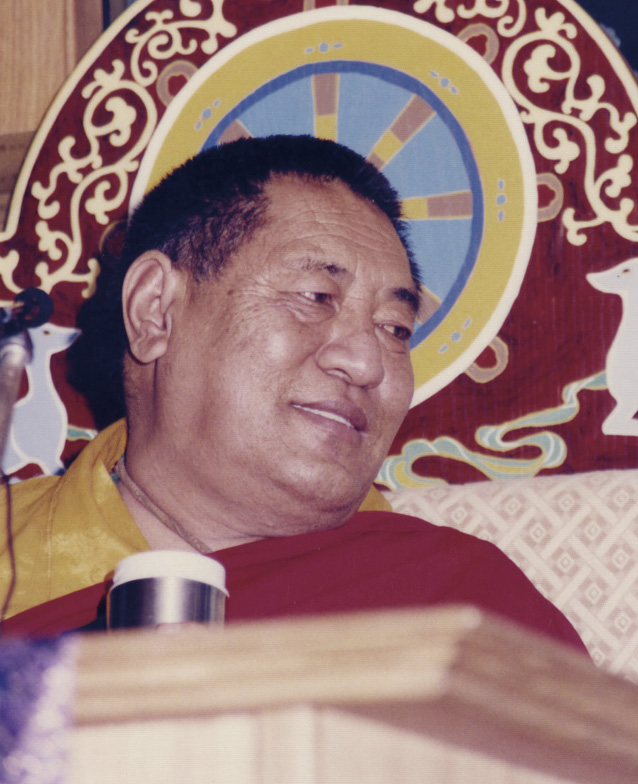

# 第3章 全知上师

◦ 一诞生就圆满觉性妙力

◦ 唯依本尊加持造论

◦ 传承加持书函自净

◦ 语无内部相违首尾广略一致

◦ 句句有深义

◦ 教诲爱重自宗

#### ·第13节· 一诞生就圆满觉性妙力

对于上师麦彭仁波切的语言，我不只是像人们常说的“贪著父亲的碗很清净”一样，而是他的语言的确有不可思议、耐人寻味的含义。之所以有这种功德，是因为从一出生就拥有圆满一切觉性妙力的人，在印度圣地，只有旃扎古昧居士，而在藏地雪域，只有上师麦彭仁波切。比如旃扎古昧居士7岁的时候，写了一部论典，折服了对手，上师麦彭仁波切也在7岁时造了《定解宝灯论》。

其他诸位上师，有智慧力圆满和未圆满的时期。持明无畏洲曾说：全知法王龙钦绕降也有智慧圆满、未圆满的阶段，比如，《深义海云聚》是他智慧未圆满时造的论典，《上师心滴如意宝》等是他智慧圆满时造的论典。

再者，大名鼎鼎的宗喀巴大师，《善说金鬘论》是他智慧未圆满时造的论典，《菩提道次第广论》与《入中论·善解密意疏》是他智慧圆满时造的论典。

然而，上师麦彭仁波切根本没有童年时智慧较差、年老时智慧圆满的差别。

#### ·第14节· 唯依本尊加持造论

上师麦彭仁波切说，他曾经在华智仁波切面前得过与自己相应的《入行论》，除此之外，他从来没有闻过佛法。造论的时候，他会祈祷本尊、依靠本尊的加持，而不像读万卷书那样或汇集别人的说法来造论。虽然他是文殊菩萨特意化为善知识的形象，但一般来说，由于总的浊世众生福德浅薄，尤其是宁玛派修行人福报浅薄，并没有如他所愿地成办众生的利益，最后他说“现在我要前往东方现喜刹土”。

因此，上师麦彭仁波切是了义怙主文殊故意化现的善知识，更重要的是，他小时候就圆满具足了一切断证功德。

#### ·第15节· 传承加持书函自净

上师麦彭仁波切传下来的这个法，七代之间加持不会消失。如果有什么未加校正的地方，你们就先放置一旁，获得陀罗尼的菩萨的书函，自然是正确的。这种情况在大多数上师的传记中都有记载。

#### ·第16节· 语无内部相违首尾广略一致

上师麦彭仁波切的语言没有一句是自相矛盾的。如果你觉得有，那是你没有理解。《殊胜赞》中云：“若愈多深思，外道诸宗义，如是于怙您，我心更起信。”与其他诸位智者的语言相比，显然他的语言比其他人更超胜。

上师麦彭仁波切的语言，开头详略如何，结尾也是如此，没有虎头蛇尾之类的情况。他不卑不亢的圣者本性是显而易见的。我也知道，无论你修习萨迦派、格鲁派、噶举派、宁玛派的任何一种法，都可以获得遍知佛果，这些都是无误的正道。然而，在传讲前译大圆满法时，上师麦彭仁波切与众不同。比如，（他所造的）讲解宁玛派特法的《前译教法兴盛愿文》、讲解大圆满的《文殊大圆满愿文》，这些殊胜教言不仅在雪域，就算在印度圣地，可曾出现过？虽然我心里有这个想法和分别念，但不知道你们是怎样想的。

#### ·第17节· 句句有深义

上师麦彭仁波切的语言，如果你看一遍，会对其意义有所领悟。如果你看两遍，就会理解得更多。无论看多少遍，每次看都会有更进一层的理解。就像是佛的金刚语一样。

当我把《直指心性》念了一万遍、把上师麦彭仁波切的祈祷文念了一百万遍的时候，心中才大体呈现出《心性直指》的句义。最初念诵一两遍的时候，觉得没有什么不明白的，基本上已经懂了。但是，我总觉得持明传承的加持和上师麦彭仁波切的语言不可思议，一定还有比这更殊胜的含义。所以，我每念一百遍上师麦彭仁波切的祈祷文“觉空文殊童子加持中，意密界中解脱八辩才，教证法藏大海胜主尊，阿则达哦匝雅前祈祷，于具缘分弟子身语意，恩赐加持予以胜灌顶”，就会再念一遍《直指心性》的教言。当祈祷文被念了近一百万遍、《直指心性》被念了近一万遍时，“上师麦彭仁波切所说的真正意义就是这个”的定解才真正产生。当时，我脱口而出的无伪词句是：“我漂险恶轮回深渊时，师尊舒展善巧方便手，置三传师会众行列中，无以回报恩德明在心。”依靠全知麦彭仁波切的加持，我终于进入了三传持明上师的行列，随后我萌生了“一定不需要再长久漂泊在轮回的险恶深渊里”的想法。

#### ·第18节· 教诲爱重自宗

你们永远不要低估全知麦彭仁波切的言教，我也从来没有轻视过。我反反复复地看了上师全知麦彭仁波切的言教，他的教诲有着不可思议的加持威德力。

然而，他的法义只看一遍绝不会通达。我十三四岁的时候，曾以为《中观庄严论释》总义及其注释的意义，没有什么不明白的，其实并不是这样。因此，你们也应该深入细致地分析和探究，要着重于自宗的法本。前译持明传承的加持，有着殊胜的缘起，所以一定要得到全知麦彭仁波切的加持。你们平时闻思修行，应该尽可能地把注意力放在与他宗不共的自宗无误的法本上。
