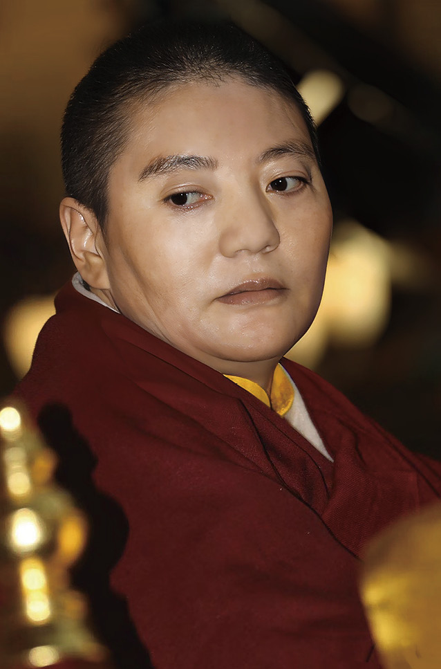

二 
空行母分类

在深入探讨门措空行母的人生经历之前，让我们先简单了解一下何为“空行母”。

一般来说，梵语“札革讷”翻译成藏语，叫堪卓玛，汉意为空行母。为什么称之为空行母呢？如《平等行后续》所述：“札名空行者，由界真实观，成行诸虚空，共称空行母。”

梵语“札达巴雅阿萨玛”，是空行之义；“革约革”，是成就空行瑜伽母之义。或者按照《声明要领二卷》中所说：“所谓‘札革讷’，指的是哲布哈雅色嘎多，翻译过来就是，依靠密宗成就而获得能行于空中等神变的女性。”《大幻化网续难释·虚幻》中也提到：“随行于空中，由彼取原名，诸成行空者，共称空行母。”《诸佛平等空行幻胜乐续义释》进一步阐述：“‘空行’一词应用于五种场合：以智慧力行于空中，以神变力行于空中，以成就力行于空中，以自然力行于空中，以业力行于空中。”虽然行于空中的方式多种多样，但通常都称为空行母。

从内部来分，空行母可分为世间和出世间两种。还可以将其分为三种，如智慧空行母、事业空行母、世间空行母，或者咒生空行母、刹生空行母、业生空行母，或者咒生空行母、刹生空行母、俱生空行母，又或者是空游空行母、地游空行母、地下游空行母，诸如此类是以三类而详细划分的。还可以将其分为四种，如智慧空行母、誓言空行母、非人空行母、食肉空行母，或者誓言空行母、世间空行母、食肉空行母、种种空行母，或者刹生空行母、俱生空行母、处生空行母、部生空行母，或者刹生空行母、俱生空行母、部生空行母、业生空行母，或者咒生空行母、刹生空行母、业生空行母、智生空行母，或者处生空行母、部生空行母、咒生空行母、业生空行母，或者俱生空行母、处生空行母、部生空行母、末生空行母，诸如此类是以四类而详细划分的。还可以将其分为五种，如刹生空行母、俱生空行母、处生空行母、部生空行母、咒生空行母，或者金刚空行母、智慧空行母、事业空行母、誓言空行母、食肉空行母，或者如来空行母、金刚空行母、珍宝空行母、莲花空行母、种种空行母，诸如此类是以五类而详细划分的。还可以进一步细分成金刚空行母、珍宝空行母、莲花空行母、事业空行母、誓言空行母、种种空行母、一切空行母、世间空行母八种。如此就像在诸论中明说的一样，空行母有多种不同的分类。

1．世间空行母

其中，所谓的“世间空行母”，包括非人母、寂行母、普行母三种。非人母，指的是断除了对他人的损恼，而以人相游历各处的空行母；寂行母，则是居住在二十四大圣地等处，既行利益之事也做损害之事的空行母，她分为依靠身体和不依靠身体两种情况，在天、龙、食肉鬼、夜叉、罗刹女、寻香等所在的一切处中都有；普行母，虽然有各种类别，但《集诸事业根本续王》中将她与罗刹归为同一行境。大班智达无垢友在《密续应成根本续释·密意觉受明灯》中说过：世间空行母有七种非人母、姊妹母、食者母、衰老母、红母、大怒母等。《明灯释》中还提到其分类有邬玛母、乐方母、吉祥母、称誉母等。
