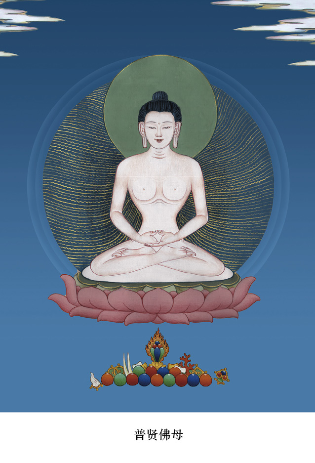
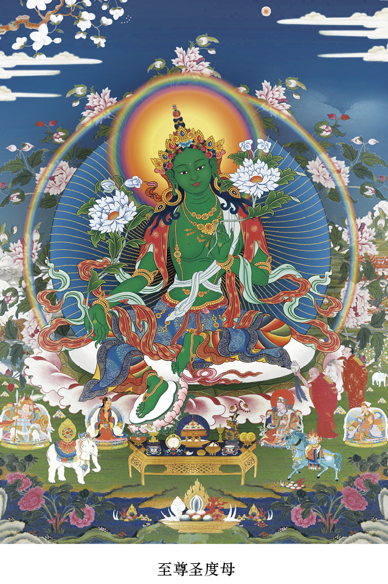

三 
历代转世简介

现在，以简要的方式讲一下至尊门措空行母历代转世的生平事迹。空行母的种姓与分类等在前面已经解释过了，门措空行母的历代转世及其幻化基都属于出世间空行母，在此基础上所分出的类别，都归入智慧空行母或俱生空行母的任意一种。其中，智慧空行母大多是佛陀的三身金刚显现为明妃形相；俱生空行母们以受生为赡部洲女性的形相居多。无论如何，诚如《释量论》所说：“抉择第三处，依论即有理。”对于极其隐蔽之处，是以比量的正理无法分析的，所以需要依靠圣教量来证明。在深入探究这一点时，见而有益的尊者等大德们一致认定，门措空行母就是门吉华卓的化身。门吉华卓的历代转世，实际上也是至尊门措空行母的历代转世。这个道理，根据前译教日邬金·德达朗巴或持明不变金刚在《夏俄伏藏品密印授记》最后一段中提到的内容，连同补充她历代转世的情节，下文将进行简要的概括与阐释，请从中了知。

此外，由于至尊母门吉华卓是空行母益西措嘉的转世，所以，与益西措嘉前世有关的生生世世，也是门吉华卓的生生世世。关于这一点，正如达夏巴的伏藏法《传记开显隐义·乾达婆歌鬘》中所记载的，她在报身刹土中是妙音天女，在圣者常啼菩萨时代是商主之女，在我等本师面前是恒河天女……因此，她们的生平似乎都应写在门吉华卓与门措空行母的历代转世传记里。但因为幻化基与化身之间有差别，幻化基的所有功德不一定要在不同化身等差别法上分毫不差地完全体现，所以在此不一一描述。

然而，大智者阿南达玛德曾引用教证，提到过她在印度的多次转世，包括婆罗门女色杰尼玛、成就者革革热巴、空行母色卡斯德等。尤其是《至尊门吉华卓传·除信士恼》中说：“门吉华卓持诵金刚忿怒明王心咒时，在黄昏这一座上，金刚忿怒明王的身体在她面前的空中，如如不动安坐了一个小时，她昔日在印度身为婆罗门色杰尼玛、比丘尼花姆的情景历历再现。”这些都可以算在门吉华卓前世的范畴里。

依照伏藏大师秋杰嘉波所述的金刚语，下面简单介绍一下门措空行母历代转世的情况。在夏吾伏藏法的《密印授记》最后一品中，有这样的记载：“法界普贤佛母尊，布达拉山圣度母，吉祥山莲措嘉母，今莲师妃卡钦萨。此世而现无数幻，玛吉拉卓囊萨波，苏姆格布等众多，桑耶南方札友境，具缘标记贝若尊，传承空行名卓玛，富有经续圣教传，广博续部至究竟。”根据其中的金刚教义，简明扼要地加以叙述。

1．普贤佛母

所谓初始普贤佛母，她是在法性光明基中以无有造作的功德庄严自然显现的任运自成宝刹土中，与无始时现证菩提、自在圆满的本师普贤如来同等，和智慧海会众一起安住于身智无合无离的密意中，并在四时等性的本智中以无有迁变、不偏不倚的形式而住。正如《大海续》中所说：“原本现证觉，圆满自在师，超胜一切故，恒住法身刹。”具有如此本性、极其清净、自在驾驭法性界的这位大佛母，就是普贤佛母，她显现为所有自生幻化本师、历代补处本师、历代圣教本师、圆满自在本师之佛母的形相。

《密藏续》等中提到过“法行普贤佛母”，其中“法”是一个广义的词，将世俗中显现的一切法摄于胜义谛离戏法性的法界中，成为一切坛城的主尊母，因此被命名为“法行普贤佛母”。她是出生十方四时一切如来的殊胜之母，遍及虚空的一切佛坛城，归根到底与至尊金刚母的空界无离无合。其实她和般若佛母是一本体。法身本师显现为报身的时候，以自然本智抉择所知对境的方式取名，能抉择的是作意者金刚普贤佛父，所抉择的所知对境是法行普贤佛母。或者说，从对应清净的层面来看，这就是所谓的“能所作意法清净，普贤佛父母前礼”。

因此，在了义中，普贤佛母唯一是以法界安立的。虽然她并不像普通修行者那样，需要经历发心、修道、证果到最终安住于一处说法，也不是一个有面有臂有形相的平常本尊，但为了调化所化众生的必要而可以如此显现。就像能生四圣者的般若佛母，被誉为诸佛之母，她无始无终、无形无色，但正如历史记载，当至尊度母祈求她作为众生积累资粮的所依时，她就显现为黄色四臂的大般若佛母身相，这是有其必要性的。在所化众生面前，能化者会根据他们的缘分而相应显现，而并非是一个普通自相者。正因如此，她的身色、面臂等不是完全固定的，而是会呈现出各种各样的形态，这在诸续与修法中都有表述。

如此，一切种智本性的了义普贤佛母，就是本初怙主。她为与其无别的诸眷属转了不可言诠的甚深实相法轮，她还是劝请者与结集者。她的事业与事迹等同法界、不可思议，完全超越了观现世量分别心的范围，因此无人能够测度。正因为她具有这样的本性，所以她不仅是益西措嘉历代转世的唯一幻化基，也是大悲智慧幻化的一切空行母与三时诸佛的幻化基。尽管她并没有偏堕于一方，但根据《密印授记》最后一品中所提到的，在此对三身空行之中的法身空行母作了简要阐述。

原本寂灭无为如虚空，任运平等不动离戏界，

能生时方诸佛唯一母，法界普贤佛母诚稀有。

