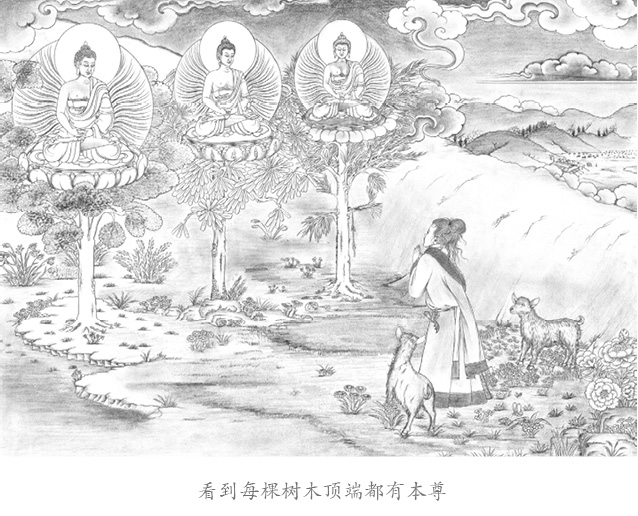
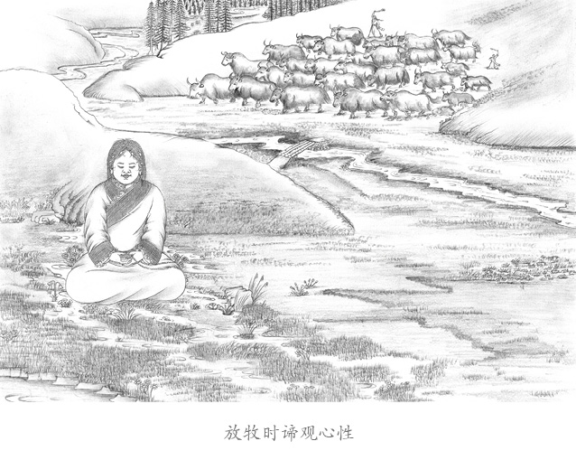
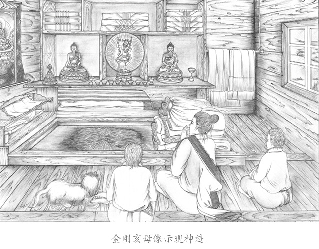
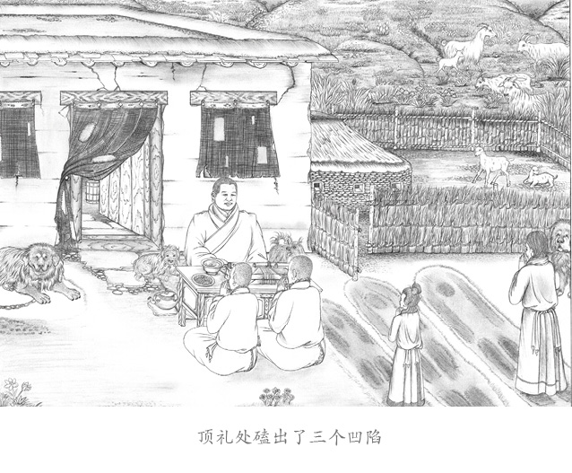
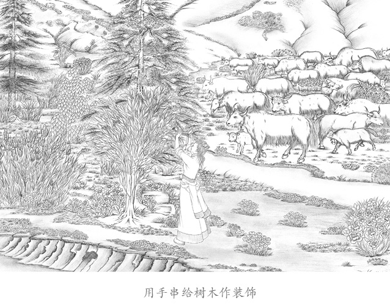
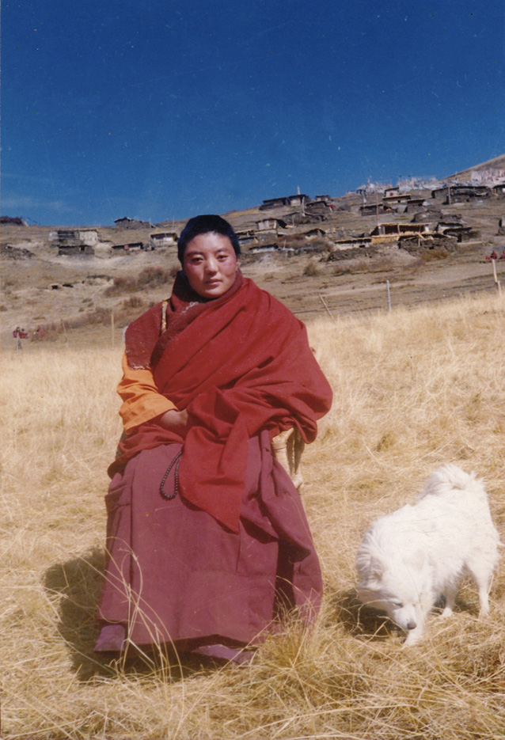

四 
详述此世经历

1．诞生与幼年时代

现在开始讲述门措空行母的这一世。我们可以从她在一般凡夫众生眼前幻现为平常的善知识，依靠圆满的闻思修功德来广泛弘法利生的情节入手，稍微叙述一下她的事迹。

首先，门措空行母的出生地，位于被白色雪山环绕的这片领域，它包含在如水池的上阿里三环、如水渠的中卫藏四翼、如田地的下多康六冈这三大区域中最后的六冈范围内。关于她降生于六冈中的哪一冈，是隶属于安多还是康区哪一个，虽然众说纷纭，观点各异，但实际上，她的诞生地上方是四面群山环抱的中心、如同须弥山王般高高耸立的珠日神山，中间是漫山遍野长满各种药草药树、形状如心脏的草山——单坚神山，下方是左右围绕着错落交织的石山、高耸入云的铜色岩山——阿拉神山。她生于这三大神山中的单坚神山附近的山谷，属于上色、中色、下色里的中色地段。这个地方位于心宝神山前侧，紫青树天女神山背侧，缓缓流淌的色达河左侧，也就是与多康五台山内的莲花空行聚集洲或喇荣佛学院所在山谷相毗临的紫青琼夏。

她的生身父亲，名为西罗或阿邦札西嘉措，出生在康加拉家族。这个家族在多克、色达、玛库等地扎根生长，孕育出了阿邦、阿哲、阿恰、阿罗等众多分支。其中，阿邦巴塔一支绵延出更多的子孙。阿邦帕巴才让是这支家族中的一员，他有七个儿子，最年幼的叫桑毕敦哲。他的子孙中，出现了一位伏藏大师列绕朗巴的弟子，以及被大班智达布玛莫札幻化的玉科喇嘛称赞的甚深断法瑜伽士。这位瑜伽士的儿子便是西罗，他情意长久、修行心切、精通医方明，通过医术能将众生从非时死的恐怖中解救出来，这方面颇具胆识，是一位贤德之士。

她的生身母亲，名为阿里美珠，属于佛法前弘时期努万南卡酿波、大努桑吉益西等氏族的阿加哲家族，因其子嗣生在努境，也被称为努氏。这个家族的一个支系，因时代变迁而迁徙至邻近的措赤秀加木地区（青海湖附近），最终被一个蒙古国王驱逐出境并定居于嘉空地方。在这里，这个家族继续繁衍生息，其中诞生了玛德绕那的转世夏伏藏大师和第一世敦珠法王等。阿里美珠是此家族中嘉空巴德的女儿，她性情温柔，吃苦耐劳，勤于做事，精进修行，是一位女性大菩萨。

在藏历第十六胜生周火马年猴月（1966年7月）初二的上午，阳光普照大地，门措空行母在母亲无痛苦的情况下顺利降生。刚一出生，法王如意宝便亲自为她涂抹了腭酥油[^1]，并赐予长寿灌顶等延寿法，做了特别的甚深加持。在她的发际处，有一个似乎是由食指按压留下的凹陷痕迹。有一天，身边的班玛措在为她洗脸时，问道：“您额上发际处的这个凹陷是怎么来的？”门措空行母回忆说：“这是我刚一出生时，大概在脐带被剪断之后，舅舅为我做了一场驱魔仪式。他一边念诵‘我当庇护此孩童，今后谁亦莫加害，班则绕恰绕恰护’，一边以保护的姿势，用拇指在我额头上按下的痕迹。”类似的情况在法王如意宝去木雅时也发生过。他曾在一名小孩的额头上按下手印，随着孩子的成长，那个痕迹变成了一个凸起，一直未曾消失。这也成为当地人们的谈资，并且这个凸起在照片上清晰可见。

门措空行母诞生的日子颇为特殊，正值这一天，舅舅法王如意宝念诵《文殊修法事业源·如意网》中的一字心咒“门（མུ）[^2]”，圆满了一亿遍，考虑到这一善妙的缘起，便为她取名为“门措”。根据莲花金刚大师的《入续义注释》等教典所言：所谓咒语“门（མུ）”字，实际是梵语“门达”，寓意着解脱。因此，她的名字“门措”可译为“解脱海”。

讲起这一明咒王的功德，《文殊根本续》中提到：“预见未来众生后，彻知佛法隐没之时，为回遮末法时对三宝作害之厉鬼，此咒被赐予诸如来之意长子大势至菩萨摩诃萨；依世尊之加持，大势至菩萨将其授予普贤菩萨；普贤菩萨摩诃萨又将其传给文殊童子；文殊童子为摄受所有众生，以大悲力将其安置于自己心间。观未来于末世佛法隐没之时，如来之末子我也宣说此咒。诤时与佛法毁坏时，此咒会真实守护我之教法。”这段文字就描述了这一字心咒所具备的不可思议功德。

法王如意宝对这个心咒也极为重视，他持诵此咒达到了一亿遍。正是在那个时期，黑方魔众气焰十分嚣张，佛法如意宝遭受了灭顶之灾。在这个危机四伏的凶险时刻，法王之所以念诵这一字咒，并为空行母取这样一个名字，显然是出于不同寻常的必要和特殊的考量。

门措空行母的另一个名字叫“门美益西措姆”，这是后来法王以藏语取的。在这个名字中，“门”并非指的是一字明咒“门”，而是藏语中“边”的意思。因此，“门”需要与否定词“美（无）”结合起来读。

这两个名字虽然都是空行母的尊名，但由于分别涉及立和破的运用对境，因此它们各自具有不同的含义，应当加以辨别。

据说，门措空行母在出生后，并没有像一般的婴儿那样沾满垢秽，也没有感受到不适与痛楚等，更没有发出不悦耳的大声啼哭。相反，她安静地躺在摇篮中，睁着一双炯炯有神的大眼睛，如如不动地凝视着虚空。在出生后的头六七天里，她甚至没有吃过母乳，更不用说其他食物。这种异常情况让周围的人感到担忧，以为她是否生病了，心中充满了不安。

随着时间的推移，她逐渐长大，常在临睡前念诵文殊心咒。家人也常说：“现在该睡觉了，她正在念文殊心咒‘嗡阿Ra巴匝那德’呢。”不久后，她如同池中莲花般快速地长高，与其他小孩一起享受着童年的游戏等。即便是在玩耍时，她也始终没有任何与正法不符的行为。她的小伙伴回忆道：那个时代，儿童主要的玩具是虫蝇等小生灵。然而，空行母天生就是一个不爱作恶的小孩，从未伤害过这些小生灵，反而给予它们无限的关爱呵护。她把被酷热逼恼的小生灵移到凉爽的地方，把接近冻僵的小生灵置于温暖的地方。

那段日子里，她看到每棵树木的顶端都有一位红色本尊，而所有的草木和森林都在念诵无忧佛的圣号。于是她向舅舅法王询问：“所有树木都在念诵无忧佛的圣号，您听到了吗？”诸如此类的事情，是从当地一些熟人口中得知的。

在那个政策不开放的特殊年代，任何与行持正法相关的事都必须小心谨慎。平日里，法王会秘密地向弟子们传授引导法等，此时需要一两个极为可靠的人在附近的山顶放哨。雅钦地方有两座小山丘，一座被称为“日光照耀小山丘”，因为那里是朝阳最先照射的地方。另一座则是门措空行母放哨的地方，因此得名“门措放哨小山丘”。

在雅钦居住期间，阿里美珠有时会代表法王前往色达县参加会议等。这时，门措空行母总是会说：“我要为阿妈特地诵经。”于是，在一个铜盆里堆满了山羊的粪粒，每放一个粪粒就念一遍《八吉祥颂》，一直持续到所有粪粒用完。

有时，母亲出门开会，尽管通常这会耽误五六天，但空行母对舅舅法王说：“阿妈很快就会回来。”当法王如意宝外出时，她会告诉母亲：“今天舅舅不会回来，不必为他准备吃的喝的。”有一天，没有任何迹象，她突然说：“舅舅今天会回来，快点做饭烧茶。”这类事情后来都一一应验。当别人问她关于牲口丢失、家里是否会来客人等事情时，她总是说得很准确。然而，后来舅舅法王认真叮嘱她：“从现在开始，不要再随便地说这类事情。”如今，她一直保持着深藏不露的性格，似乎根源也是因为这个原因。

在那个处境动荡、变幻莫测的时代，法王如意宝在“雅钦”这个地方居住了大约三年，期间为一些有缘的弟子恩授了许多经教和灌顶。法王亲口教导我们说：“我曾在这里认真地实地修行，你们也应在此坚持不懈地用功修行，我相信一定会获得一些与众不同的极大加持。”

在那段时间里，有一次，门措空行母与法王一同去放牧，当走到一片树林边上时，她问：“舅舅，这棵树的根是怎么长的？它为什么会歪着头？为什么变得弯弯曲曲的？”又来到一个有岩石的地方时，她再次问：“这是由什么原因形成的？怎么会产生这个呢？……”面对她源源不断的提问，法王耐心地一一作答，最后笑着说：“小孩子的问题真是没完没了，不可能一一回答完的。”后来细细思考，其实这些问题的答案仅在《施设论》中略有提及。即便是像《俱舍论》这样的重要经论，也没有详细说明这些现象的具体原因。因此，一个智慧力尚未开发、还不能熟练读诵的小孩居然能提出如此特别的问题，实在让人觉得有点稀奇。

在门措空行母幼年时期，法王在传授弟子们灌顶和引导法时讲述了关于破心房的教义，她由此产生了深刻的定解。一次，来自洛若乡的一位老太太问她：“您的心是什么样的？”门措空行母回答说：“我这颗心是长长的，好像能够到我们俩之间；有时又恰恰相反，是无法言说的。”她在那么小的时候就非常喜欢向内禅修，曾对亲友说：“我的心即使需要长时间安住，不起任何念头，我也能做到。”索木喇嘛曾提到，他听法王上师随口说道：“她从小就有与生俱来的寂止境界。”

有一天，在切酿年钦，门措空行母和一位名叫恰波的女孩一起去放山羊。期间，她有时会坐着沉默不语，专注地凝视着某个目标。现在看来，大概是在入座禅修。还有一次，她向舅舅法王汇报：“我一两天都处于寂止的境界中，没有产生任何分别念。”当时，法王说：“小女孩，不要说谎话啊。”她回答：“是不是说谎，现在就让您看看我的本事。”说完就入定安住。在此期间，无论她的小哥哥才真和华作怎样在她面前戏耍，她都能保持如如不动，安住很长时间，最后是带着微笑出定的。这些都是从她的家人口中得知的。

住在切酿的那段时间，有一次，门措空行母和辛莫吉、索罗三人一起去放牧。当时，切酿雅勒正值雨季，在途经一个沼泽地时，其他两个女孩说：“我们三人中，如果谁能坐在这个沼泽里，这个人就可以在这坐着，其他两人去赶牲口。”当时，空行母说：“我可以。”说完她自己就安坐在那里。其他两个女孩去将分散在擦哦分支山谷多西山坡以下的所有牲口都赶回来，耽搁了好久才到。在这期间，空行母一直如如不动，眼睛未曾离开凝然的看式，身体依然保持着原来的坐式。两个女孩不知道这是一种境界，说：“你是这么不勤快做事的懒惰女孩啊。”

在那段时间里，还有一次，一尊金刚亥母像向门措空行母展示了颤动的表情等，在场的华作、才真等许多小孩都亲眼看到了。这尊佛像曾由伏藏大师列绕朗巴和嘉旺土登嘉措二人一同从拉萨殿堂里的佛像心间取出，后来传至法王手中。

在那个地方居住期间，每天门措空行母都会念诵五千遍无忧佛的名号。在未完成这个数量之前，她总是板着脸，表情严肃地坐着；而一旦完成了五千遍的念诵，她的脸上就会露出微笑，显得非常欢喜。曾有一位特别乐于侍奉法王如意宝的老僧人，名叫巴桑，他告诉年幼的空行母：“手里不离念珠，是非常重要的一件事。”这句话她一直铭记在心，从那以后，她养成了喜欢持续念诵佛号和心咒的良好习惯。

平时，舅舅法王会规定年幼的门措空行母每天要念诵一定数量的心咒，并且规定每天傍晚要到他面前汇报念当天念诵的心咒数量。如今，一位年过七旬的霍西老奶奶回忆道，当时法王上师住在切酿地方时，她患有肿瘤，前去请教法王如果开刀是否会顺利，法王入定片刻后说：“哦，你虽然得了比较严重的病，但开刀不会有大碍，我也会为你念经的。”那时，门措空行母还是一个穿着羊皮袄、七八岁左右的小姑娘。大概下午的时候，她赶着山羊回来了。法王上师问她：“你今天念了多少咒语？”她随即将手里的一串短念珠放在法王手中，并报告了当天已念诵的咒语数量。

据达西拉波和喇嘛敦尼的叙述，他们曾一起采药，并顺道拜访了法王他们三人。当抵达法王住所——一间挂着牛毛毯窗帘的简陋土房时，他们看到法王正悠然地坐在床上，枕头上方摆放着伏藏大师列绕朗巴的著作《全集》。阿里美珠一边转动着一个小转经轮，一边念诵观音心咒。当时，门措空行母大约七八岁左右，头上好像还留着小发辫，手里拿着一串红珍珠的小念珠，正专心地念诵咒语。当时，达西拉波向法王请求：“能让我们看一下您手上的宝珠吗？”法王答应了，并展示了手指上的宝珠，说：“它会变色的。”随后，他又请求法王为他们念诵一个发愿文，法王便将手放在他们头上，念诵了发愿文。

突然间，他们得知乡政府的工作人员即将到来。在这种紧急情况下，大家急忙将所有的经书藏到小棚子里。当他们下去时，二人注意到在门边上法王兄妹和外甥女顶礼的地方——右边是门措，左边是她的母亲阿里美珠，中间是法王如意宝，地面上显现出三个深深的凹陷。

在切酿居住的时候，每天晚上，当所有的羊都被赶进羊圈并安顿好后，他们三人便开始进行顶礼。门措空行母在那里完成了超过十万次的顶礼。她还教会小伙伴嘎瑞吾罗如何磕头，并鼓励她以后也与自己一同磕头，一直磕到全身大汗淋漓为止。同时，她还叮嘱嘎瑞吾罗：“晚上睡觉前也要顶礼，平日要经常祈祷莲花生大士。”有时候，即使嘎瑞吾罗在睡觉，空行母也会突然叫醒她，让她进行顶礼。

当向她的其他玩伴和熟悉的当地人询问空行母小时候的事情时，他们都会说，虽然没有见过一些超出寻常、特别稀奇的神变之类的行为，但她小时候就有着与众不同的寂静调柔的内心，对上上下下的众生从未做过任何伤害之事。在孩提时代，她就表现得知耻有愧，言谈格外谨慎，从不说些闲言碎语等，是一个沉默寡言的人。偶尔与人随便聊天时，她也一直面带慈爱的表情，说一些意味深长的话。

平日里，她的性格安静调柔，无论对待男女老幼，她从未扰乱过任何人的心。谁见了她，都会感到喜爱和悦意。她从小就对世间的物质没有太多执著，对金银、松石、珊瑚等装饰品也无贪恋之心。即使丢失了贵重物品，她也只是担心母亲阿里美珠会知道，而并没有过分伤心。有一次，罗珠旺波活佛从哲多回到家乡时，送给了门措空行母一把镶嵌有大珊瑚且镀金的精致小刀。她在放小牛犊的地方弄丢了，但也没有过度伤心。

从幼年时起，门措空行母就天生拥有与众不同的慈悲之心，特别是对于可怜的人和鸟雀等动物，更是充满了无限的爱心。回忆起以前在雅钦居住的日子，她曾经养了四只小动物：一只失去母亲的小牛犊、一只小乌鸦、一只鸡和一只山羊羔。那只小乌鸦是它的父母欲将其杀死时，空行母看到了，于是救下它并亲自抚养。

有一个名叫嘎瑞吾罗的女孩是她的邻居，经常在空行母放羊时帮忙赶羊。她说：“空行母从来不会用石头打山羊等动物，并且她还教导大家‘千万不可用石头打山羊’。”

还有一次，住在切酿地方期间，她和小伙伴秋杰卓玛一起，在年钦一带赶牛群。当秋杰卓玛情急之下猛力赶的时候，空行母提醒她：“不要急躁地赶牛。它们真的很可怜，和我们一样，也会感到身心的疲惫和艰难。”

还有一位叫查吾吉的女孩回忆着讲到：法王如意宝在雅钦居住期间的某一天，突然告诉她和门措空行母：“附近有一只山羊羔快要冻死了，你们俩想办法跑去救它。”空行母问：“那只小羊在哪里？”法王没有给确切的位置，只是大致指了个方向，空行母毫不犹豫地跑去寻找。神奇的是，她直接跑到雅钦山上的一个树丛下，发现了那只躲藏在那里、几乎奄奄一息的小羊羔。她立即将小羊羔抱回，交到法王的手中。随后，法王用黑茶汁注入羊羔的口里，并将它放在阳光下。那只小羊羔逐渐恢复，开始微微张开嘴巴，最终活了过来。查吾吉认为这是一件神奇的事情，她感慨地说：“即使有这样一只小羊羔，通常也是很难被发现的。但就像前面所述，他们舅舅和外甥女就这样救了小羊羔的命，这是我亲眼所见。”她反复强调“这真的太不可思议了”。

她接着说：“还有一次，他们三人养的山羊患上了一种名为吾擦的病，导致四蹄无法正常行走，只能拖着挪动。在那个时候，法王兄妹和外甥女以极大的慈爱心，将山羊的四肢都用毛毡包裹起来，每天早晚精心喂食和照顾它们，把糌粑在一个大铁盆里和好。他们分别给各自养的山羊取了名字，在呼唤它们时就像呼唤人一样。这些山羊似乎也懂得，纷纷从羊群中拖着身体过来，他们用美味的糌粑团喂养这些山羊。记得当时还养了大概四条狗。对于这些可怜的动物们，他们付出了无尽的爱和关怀。”她一边合掌一边讲述。

她继续说：“此外，他们还把所有的小羊羔抱在怀里，用心呵护着它们。门措空行母将自己所享用的饮食都平等分给这些羊羔，表现出非凡的慈爱心。而在切酿地方居住期间，门措空行母养了一只特别小、还没有长毛的羊羔，名叫嗡琼。嗡琼长大后，又生下两只小羊。后来，当所有山羊最终需要交给合作社时，空行母露出了依依难舍的表情，心中充满了悲伤。第二天清晨，发生了一件奇怪的事：它们母子三口都安详地往生了。”

还有一次，阿哦坡罗的牧民家里一头母牛去世，留下了一只可怜而难以照顾的小牛犊。门措空行母说：“我来负责抚养。”于是便开始照料它。她时常将自己所吃的食物和糖果等，分给那头小牛犊。一些邻居好奇地问：“这样的糖果并不容易得到，为什么不自己吃，反而给牛犊呢？”她的回答是：“假设在您们缺少饮食等生活物资、陷入极端困境时，有位善心之人愿意给您们一些美味的食物，而另一人却说‘最好不要给这些人食物’并从中阻挠，您们会有怎样的感受呢？”听了她的话，他们都感到十分惭愧，找不到合理的语言来回答。

空行母不仅对待人和动物等众生充满慈爱，甚至对山上的花草树木也以温柔的爱心呵护。在她还很年幼的时候，去放牧时看见路边有一棵令人舒心悦意的绿树，她说：“好可怜啊，它没有系带任何装饰品。”于是，她取下自己精美的手串，一边说“这个给你当装饰”，一边挂在树梢上。第二天，母亲阿里美珠为了验证这事是否属实，特地去看了一眼，果然那个手串就系在树梢上。这个情景让人想起了大诗学家那木库创作的《夏林玛温白西毕剧》中讲述的如花般美丽的苦行女子对树木怀有姐妹之情的故事，两者颇为相似。

当时，“文革”的狂潮正在肆虐，人们内心只充斥着破坏的念头，很难涌现出建设性的思考。那是一个甚至连“保护环境”等词汇都听不到的时代。然而，空行母“用爱心呵护树木等植物”的理念，是她幼小心灵中无需他人教导而天生拥有的。可以说，在那个时代，这样的信念显得十分稀有。

通常情况下，所有内道佛教徒并不认为树木本身具有心。但鲜花、树木等这些植物，不仅仅是由众生共业所形成的器世界的一部分，而且许多大小生灵和树神也都依赖于它——有些众生将它们看成是住处，有些则认为是自己的身体。当一棵树生长时，树神也会与之共生；当树叶、树皮等脱落，那棵树凋零时，树神也会随之消亡。诸如此类的道理，在《大般涅槃经》中有阐述。

在佛教中，人们被教诫以友爱的心、呵护的想法来爱护这些花草树木，而不应该以放逸的心恣意砍伐等。往昔，我等本师在世时，看到六群比丘随意砍伐或叫他人砍伐树木，自己割或叫他人割青草，自己折断或叫他人折断花朵，结果遭到其他人的责备和讥讽。对于他们的行为，世尊在许多场合都斥责说：“此非沙门法，非应随同，非为应行，非为合理，彼非诸出家人之所为。”他还教导说：“今后我之诸随行者，若损害花草树木等，则成堕罪。”佛陀这样制定戒律，无疑具有广泛的必要性，对当今时代更有着深远的意义。

白色雪山并肩连，意幻世界北方地，

多康五台山刹土，化身空行生地赞。

多色嘉拉种姓精，努境哲温苗芽种，

共同欢喜而相拥，美妙天花尽绽放。

现为人相至尊母，无边俱生智慧海，

花灯胎中诞生时，昭显空行母瑞相。

韶华未熟吉祥茎，小树以昔善法生，

玛拉雅山檀林故，自散俱生妙芳香。

以成境时相隔因，他前隐蔽未来法，

汝心离垢宝珠境，明现取舍妙语影。

绿色璎珞叶繁茂，顶端摇动妙树梢，

庄严无忧相好身，明净光相无边际。

童身不动结跏趺，入于寂止一座定，

日轮已至西山上，同龄口传神奇史。

寻觅心之实相慧，自然自性住禅定，

大悲润泽慈爱众，传奇故事牵动心。

青春年华之月牙，放射不凡善行光，

推知具足三善圆，臻至十六满月德。

[^1]: 腭酥油：孩子生下后，要用手指头抠一点新鲜牦牛酥油，放入婴儿口中，并要贴在上腭。据说放过腭酥油的孩子长大后，不挑食，身体好，能抗各种疾病，还能消除违缘、开启智慧。
[^2]: 藏语中正确的发音应为“么”（me），但由于很多汉族人习惯性地念作“门”，后来逐渐演变成了这个发音。
