# 2．到喇荣出家闻思修行

门措空行母在九岁那年，即木虎年，与法王兄妹一同前往切酿地方，在那里度过了大约七年的时光。切酿地方是法王如意宝居住很久的一个修行圣地，坐落于沿着紫青公路通往山谷的大约十三公里处。这里曾是法王前世伏藏大师列绕朗巴开启伏藏法等许多应时深法事业门之地。法王曾亲口对一些侍者说过，这是普贤菩萨的圣地。

住在这里的时候，门措空行母从基础开始学习读书，舅舅法王亲自教导她从字母开始学习文字的读写。日常课诵和前行法行，也都是在法王面前学会的。同时，她还在法王跟前听受了《时轮法王心要》、麦彭仁波切的医方明等多个共同明处的讲解引导，接受了“缘起除障法”“极密忿怒橛”“持明根本修法”“集善逝卓罗”等灌顶。此外，她还学习了《七句祈祷文释·白莲花》《直指心性》等教言，以及《杰珍心滴记录》《上师心滴如意宝》等诸多不共的甚深引导。据说她曾在与内部的人聊天时提到，在那段时间里，法王不仅为她独传了《杰珍心滴》和《上师心滴》的实修直指法，还指导她按照每个引导闭关修行，并亲自印证了她生起的觉受等。

到了十五岁的铁猴年（1980年），她与法王兄妹一起首次来到大密虹身成就寂静处——喇荣山谷。他们选择将这个山谷的中心，也就是第一世敦珠法王在世时由红黑仙巴夜叉嘱咐寻找的地方，作为基地。随后，在第一世敦珠法王住处的残墙断壁所在地，新建了法王如意宝的住舍。自那时起，来自四面八方寻求妙法甘露的弟子们纷纷前来，各自用草坯建造了仅能容纳行住坐卧四种威仪的简陋房屋。之后，僧房的数量逐渐增多。那个时期仍然不敢公然摄受大量弟子，光明正大地进行讲经说法、引导实修等活动。

后来，一些厌弃在家生活的老妇女为求解脱寂灭的安乐，追随法王如意宝，选择出家为尼。当时，为她们特别划定的与喇嘛分开的居住地，即如今德玛塔拉经堂（觉姆大经堂）的位置，这也成为莲花空行聚集洲的初创缘起。

水猪年（1983年）左右，觉姆的常住人数约有八人。那时，还没有专门的堪布来为她们讲经说法。在堪布上师们辅导各个论典时，门措空行母只能远远地听着。回来后，她对法王说他们是如何如何讲的，详细复述了每位堪布的讲法风格，这些后来在法王如意宝给大众讲法时被穿插提及。

大约在这个时期，门措空行母内心涌现了强烈的出家渴望。当她向法王兄妹汇报自己的想法时，他们二位教诲道：“如果你的出离心不是暂时的、摇摆不定的，而是源于对解脱真切的追求、对今世的看破和放下，那是值得随喜的。不管怎样，我们仍然需要请华觉嘉措活佛观察一下善恶凶吉。如果观察结果很好，那么你就可以按照自己的意愿去做。”后来，向尊贵的活佛询问时，活佛非常欣慰且喜悦地说：“从迹象来看，是非常好的。如果能出家为尼，非常吉祥，会善始善终。”

没过多久，门措空行母宣布：“现在我要出家了。”她向舅舅法王供养了献新发，然后到舅舅才让敦珠前请求：“舅舅，请您为我剃度并披上袈裟。”才让敦珠非常高兴，欣然答应，并选了一个良辰吉日为她剃度。当时，门措空行母表示要将自己原有的一切装饰品都供养给两位舅舅，于是将其分成两份，一份供养给法王如意宝，另一份供养了才让敦珠。

在那个秋季，门措空行母决定了她长久以来一直渴望的大事——受出家戒。她在具足戒腊、智慧、功德的准哲札巴等诸位持律长老的足数僧众中，首先接受了询问戒障情况等事宜，然后按照完整的羯摩仪轨，包括前行、正行与后行，如理如法地受了沙弥尼戒。

在她尚未出家之前，就对无有实质的轮回琐事有着极为强烈的厌离心，对受持殊胜解脱津梁的沙门禁行有着极大的胜解信，正如《雄长请问经》中所说：“我亦从苦处出离，一旦如是而行，我亦欲有朝一日能安住僧伽羯摩、布萨羯摩、结夏羯摩、作礼羯摩，彼当如是心喜出家。”对于出家的禁行和生活，她怀着无限向往之情，意气风发。每当看到具足沙门行为与沙门装束的人时，她内心都充满了欢喜，表达出无尽的欣乐与随喜之情。即便是在游戏中，她也特别喜欢带有出家元素的生活用具，做各种各样的法行。

尽管小时候她有着一头秀发，也拥有许多装饰品，但有时她会将头发藏在帽子里，然后说：“如果我是一名出家人，会是什么样子呢？”她对小伙伴嘎瑞吾罗说：“如果你想出家，就必须立下坚定不移的誓言。将来我是要当一名出家人的，如果我们俩都能够出家为尼，那今生会快乐，来世也会快乐。”

还有一次，她听到小时候的伙伴秋杰卓玛说“我也非常想出家”时，她这样说：“如果你真心想成为女尼，就需要下定决心。即使过着简朴的生活、随遇而安，也可以感到满足。在家人也会给予我们一些基本的生活必需品。如果实在困难，我可以帮你乞食。我们两个如果向当地人化缘，一定能得到一些口粮，所以无需过多担忧。”

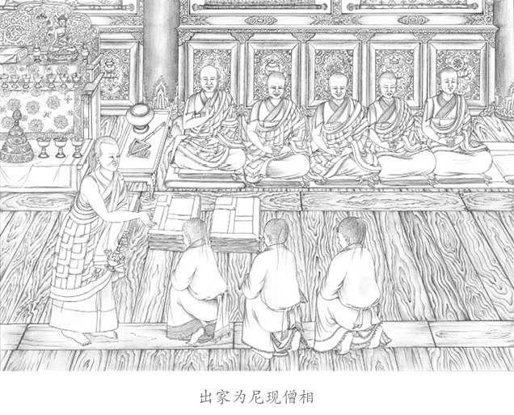

门措空行母的出家之举，不仅在引领众多女性踏上解脱之道方面发挥了带头作用，更成为依靠佛法力量给予她们魄力和才智的一剂灵丹妙药。因为她们会深感：“现在我们有了依怙，可以拥有像她一样的出家身份。因此，如果我们能听闻法藏如意宝而清净慧眼，修学戒、定、慧三学，必定也会有所成就。”这与“昔日自在圣者主尊化现的国王赤松德赞之王妃、如娑罗大树般的王族——珠萨赤嘉姆赞和哲赞姆嘉等首先出家，随后，追求解脱的众多信女接连不断地受出家戒，建立了藏地雪域最初的女尼僧团”这一事迹显然有着相似之处。

这一年，门措空行母在法王如意宝的面前，聆听了《噶当祖师问答录·宝珠鬘》和《戒律花鬘论》，并相应地接受了各种灌顶引导的次第法门。

木鼠年（1984年），觉姆扬吉等人来到这里后，尼众的数量逐渐增多。后来有一次，炉霍四位藏族姑娘前往学院想出家，法王得知后说：“这非常好，将来还会有更多的尼众。到时候，整个翅岩石[^1]以上都将遍满房屋。尼众下课后，前面离开经堂的人已回到家中烧好了茶，后面的人还在一边唱诵着莲师心咒，一边走出经堂……”

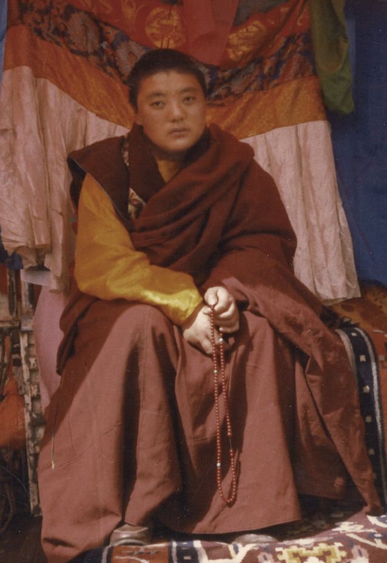

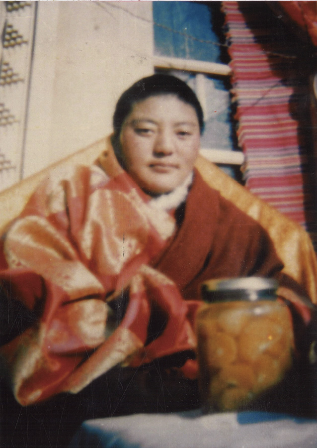

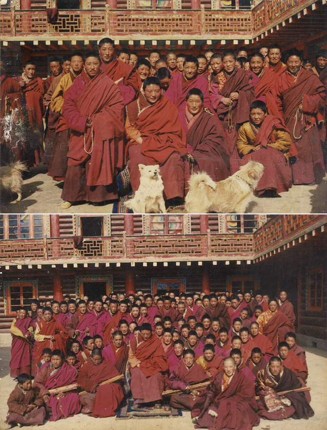

从那时起，法王首次为聚集于此的尼众开启了深广法门，在甘多拉经堂传讲了《大圆满前行》。当时，觉姆还没有专门的经堂，平时的讲法、闻法都是在草场外进行的。几年后，法王花费一千元人民币买下了附近一户人家的一栋房子，作为尼众的临时讲法场所。

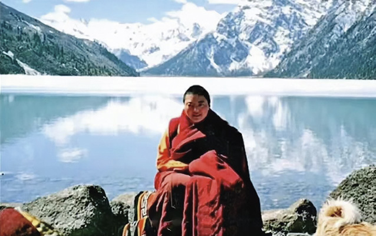

这一年，门措空行母在法王如意宝身边不仅聆听了《诗学明镜》《譬喻妙音海津梁》《戒律花鬘论》《俱舍论》《大圆满前行》《菩提道次第广论》《密藏续释·能除十方黑暗》《大圆满心性休息》《定解宝灯论》等，还接受了“四心滴”的灌顶、列绕朗巴所著的《杰珍心滴·智慧明点》的引导、《华智仁波切全集》的传承等。随后的几年里，在法王面前，她还得受了《贤愚经》《入菩萨行论》的讲解，以及“时轮金刚”的灌顶、《圆满次第六加行》的引导等。

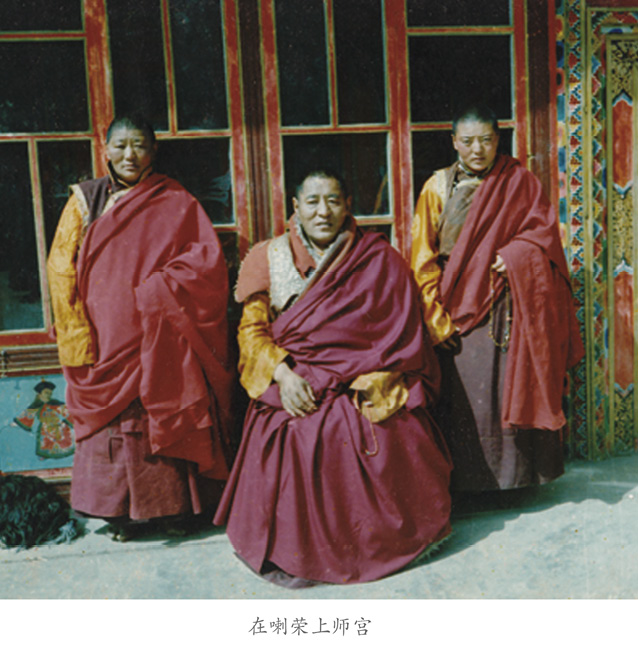

木牛年（1985年），法王如意宝为所有眷属传授了功德光所著的《戒律根本颂》，这是说一切有部的论典。法王在这个时候强调：“戒学是定学与慧学的基础和所依，因此，起初就一定要学习研究这种微妙的善说——戒律，这是非常重要的。先学了戒律以后，再学因明等其他经论，就不会造成次第错乱，具有不毁坏自相续的必要性……”法王传授了他在佛法真理方面领悟到的众多教诲。

正如措普译师的传记中所记载：“以前，在丛谛革木革贡的坚贡寺里，有白藏与黑藏两位论师。当时很多人受比丘戒，有时白藏充当传戒师，有时黑藏充当传戒师。黑藏论师曾说：‘我们这些持戒者是如此行持的，而那些寻思者整天耍嘴皮子，唇干舌燥，实在可怜。’他以戏谑的语气对着胡须斑白的白藏论师说出这番话。白藏论师回应道：‘所有持戒者，就如同打造了许多刀，却都没有锋利的刀刃，因此无法发挥出其功用。’黑藏论师反驳说：‘如果在打造刀之前已经具备锋利的刀刃，那将是非常稀奇的事情。’他这些话针对的是那些先学因明后学戒律的人。”由此可见，古代存在着两种传统，一种是先学戒律后学因明，另一种则是先学因明后学戒律。

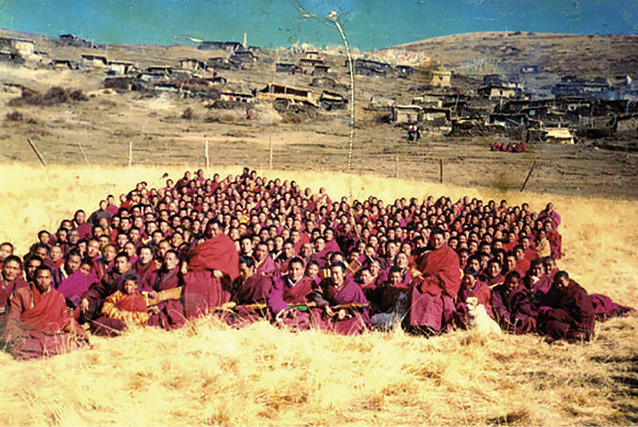

噶当派一些善知识的传记中提到：“行者在进行任何事之前，都要先学因明，因此需要倾听相关教诲。于是他们首先听闻《释量论》……”这与白藏论师的观点相一致。法王的观点则与黑藏论师的主张相符。不仅如此，以前的藏地智者中，关于“因明是否包含在内明的范畴里”，以及“对于追求解脱的修行人来说，因明是否必不可少”等问题，显然也存在着不同的观点——

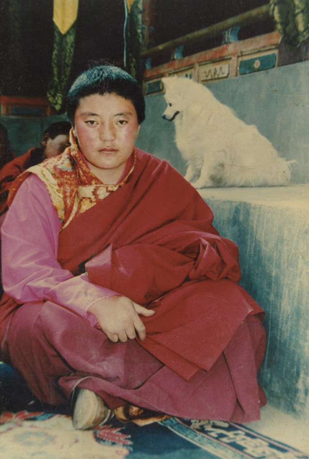

《集量论》中指出：“通过阐述‘量’与‘所量’来揭示外道的承许并没有实质，因此，为了遮止对外道观点的执著，才撰写了这部论典，而不是依赖此观点而步入如来教。佛法并非寻思者的行境……”与此所说的意趣相同，博朵瓦格西的《蓝史注释》中提到：阿底峡尊者在尼塘期间，看到祥那切、祥那琼等人在寻求各个宗派的不同教言时，说道：“所谓的因明，并非是完全没有必要的，但在藏地的确没有太大用处。在印度，从反驳外道攻击的角度来看，它具有至关重要的作用，所以，因明完全是各位智者为了遮破外道的辩论而运用的。由于我们要了解的知识无穷无尽，而且没有太多时间，因此只需认识到‘守护着内明三藏’这个自宗的立场，通过修行上师传授的窍诀，让这一生过得有意义即可。可以发愿在将来再深入了解所有五明。”这意味着，并不是非要懂因明不可。同样，米拉日巴尊者在回应法相师达罗时提到“我不懂因明，如果调伏了内心，那就是因明”，基本上也表达了类似的观点。

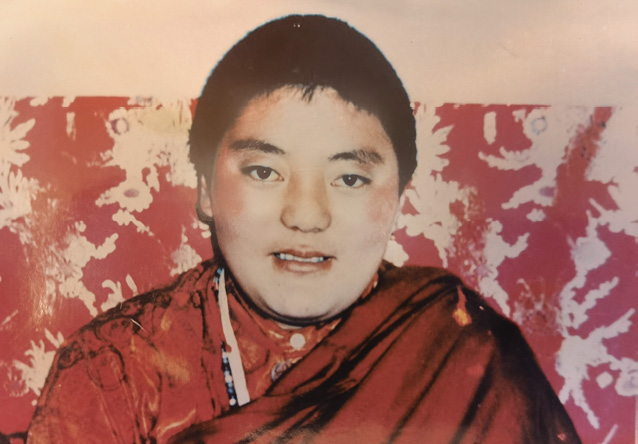

与之相反，一些大智者则主张：“因明不仅是内明的法藏，而且由于它具足对法（俱舍）的现前、重复、胜伏、了悟四种法相，因此还属于论藏的范畴。”邦译师父子也认为，对法可分为教对法和理对法两种，其中因明属于理对法，按照《集量论》礼赞句中提到的“以顺式逆式的理证建立本师是量士夫，佛所说的法是诸位求解脱者的津梁”，对这一点生起深深的定解，是一切道的根本。而依靠因明的推理来获得这种定解，是不可或缺的。所谓“中观与因明狮子交颈”，指的是在抉择中观的见解时，强化其理证的方式必须借助因明。因此，所有希求解脱者不可不学因明。宗喀巴大师的观点也与此一致，在他所著的《乐善传》等中明确表述了这一点。

持有这不同观点的两种宗派，根据文献来看，其意趣略有不同。然而，这种差异主要是因为他们暂时关注的焦点有所不同，因此在表达上存在一些差异。但归根到底，正如《集量论》中所说“由寻思道引法尔”，两宗所认可的因明，并不是将“一味地向外通过‘所量’与‘能量’来破立等着重依靠推理的辩论，也即寻思派的量理”，认为是修行菩提之道，而是将“通过正理的方式，对本师和佛法引生殊胜定解的势事理”，视为修行菩提道的助缘。因此，从究竟意义上来看，这两者的意趣并不相违。这也是一个顺带提及的话题，接下来言归正传。

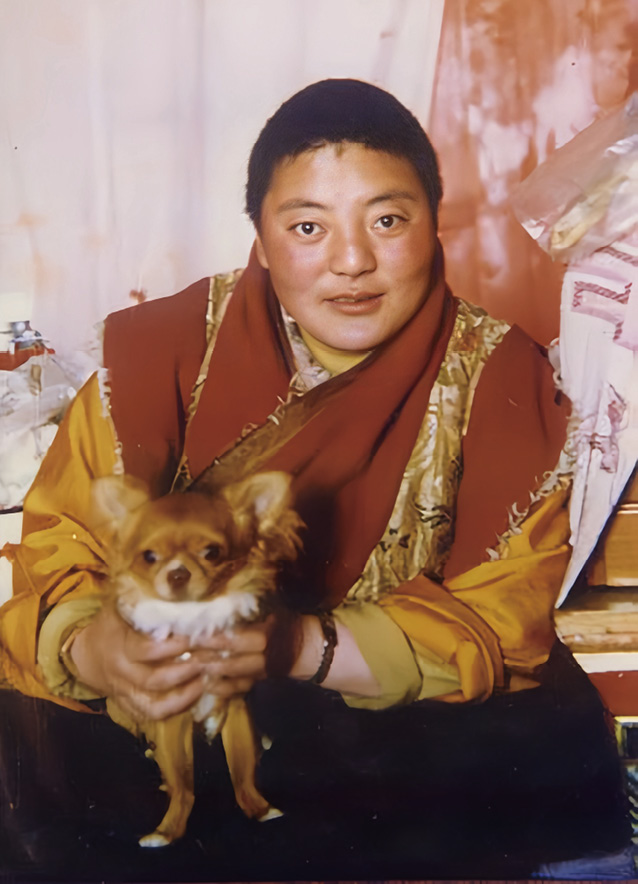

大约在火虎年（1986年），法王如意宝为了确保尼众未来对佛法根本法藏如意宝的讲闻奠定坚实的基础，同时也为了提升尼众的声望，首先让门措空行母和她的母亲两人带头，加上阳吉、帕准、热雪、才让、秋杰卓玛、班玛秋准、罗桑秋措等一些觉姆，在男女僧众面前背诵《佛子行》和《三主要道论》，为莲花空行聚集洲创立了尼众背考的先例。这一做法极大鼓舞了尼众闻思的热情，其意义和恩德非常深远。

正如《桑耶史料》等中所记载，在佛法前弘时期，藏章寺和门嘎寺等地不仅居住着大量尼众，比丘尼也不在少数。她们创立了讲闻妙法的优良传统，将尼众僧团的声望提升到了一定的高度。然而，自从朗达玛灭佛之后，情况逐渐发生了变化：只有极少数具有特殊功德的女尼，能够凭借以前的修行而自然流露出智慧，自在拥有辨别正法的能力。而藏地尼众僧团中的大多数觉姆，只满足于听闻一些修心法门，只在念佛、诵咒、修行、顶礼、转绕等法行上下功夫，通过为施主们做佛事来获取供养，她们主要以诵经等为主，除此之外，并没有传授和听闻显密大经大论，也没有依靠讲辩著经典和论著，来抉择、受持、维护、弘扬佛法如意宝。在这种因缘的推动下，后来尼众的声望明显下降。

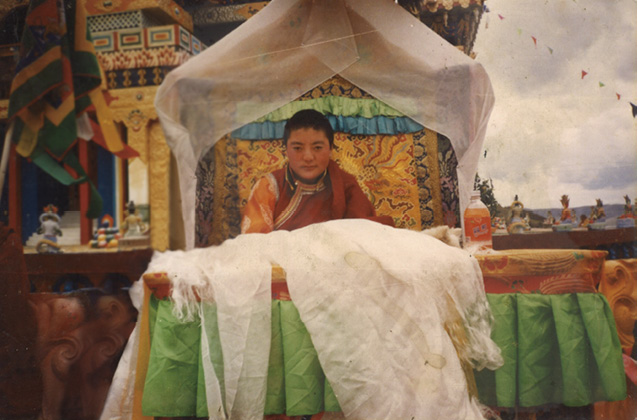

为了改变这种局面，“浊世佛法之灯”殊胜大恩上师法王如意宝尊者，以其卓越的远见和智慧，培养了门措空行母为首的一批持藏尼师。这仿佛是“跳神舞前必须先敲打乐器作为开场”一样，新时代的尼众不再只是依赖他人，而是凭借自身的洞察力，在受持、维护、弘扬佛法的道路上迈出了第一步。毫无疑问，正是在再弘佛法的朝阳冉冉升起的那一刻，雪域尼众深入细致地讲闻显密经论的伟大事业拉开了序幕。

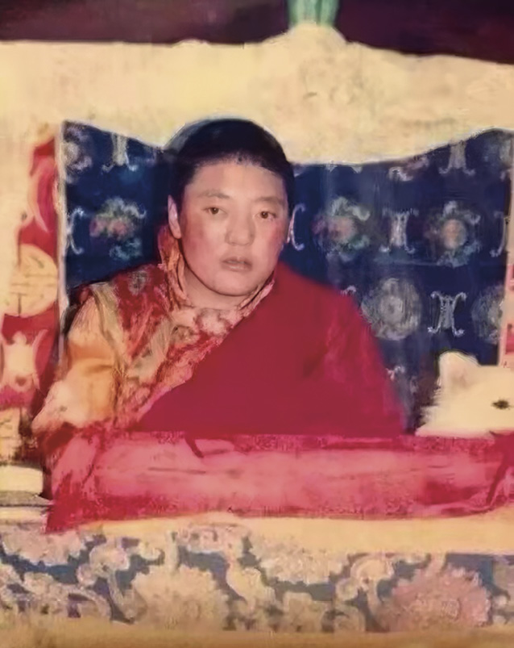

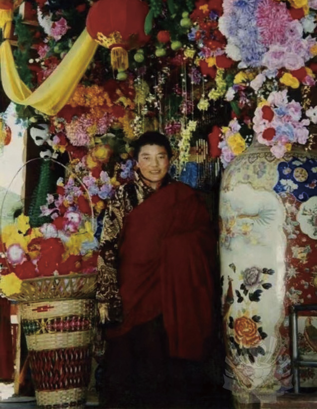

从那时起，就像雨后的鲜花般，喇荣佛学院及其各个分支道场，以及法王长子、大堪布、金刚持珠旺龙多嘉灿（阿秋喇嘛）的亚青寺邬金禅林等，多康上中下各地的尼众僧团，在短时间内迅速壮大，呈现出蓬勃发展的局面。不仅如此，她们还得受了所有法藏如意宝的传承，通过研讨的方式进行抉择，在内心思维其意义，以观察和安住的方法如理实修，坚守闻、思、修不脱离的原则，始终致力于弘扬佛法如意宝。她们通过各种途径和方式，积极推行这一善妙事业，这是大家有目共睹的。因此，诸位高僧大德在发心时机成熟之时所显现的威德力，真的是不可思议，这也引发了我深深的感慨。

在这一时期，门措空行母的日常作息安排如下：她通常在早上四五点起床，除垢气，通过修习上师瑜伽来接受四灌顶，随后进行早课并阅读书籍。大约八点吃早餐，然后前往舅舅法王处听课。课堂间隙，她常会请教一些教义上的难点，并进行讲考。午餐后，她会独自在房间里阅览经论，并背诵五部大论为主的偈颂。晚上六点左右，她吃晚餐，之后继续日常的法行，每天磕一百个头，念诵晚课，进行禅修，然后在十一点就寝。除特殊情况外，她每餐都吃得很快，之后就去看书。

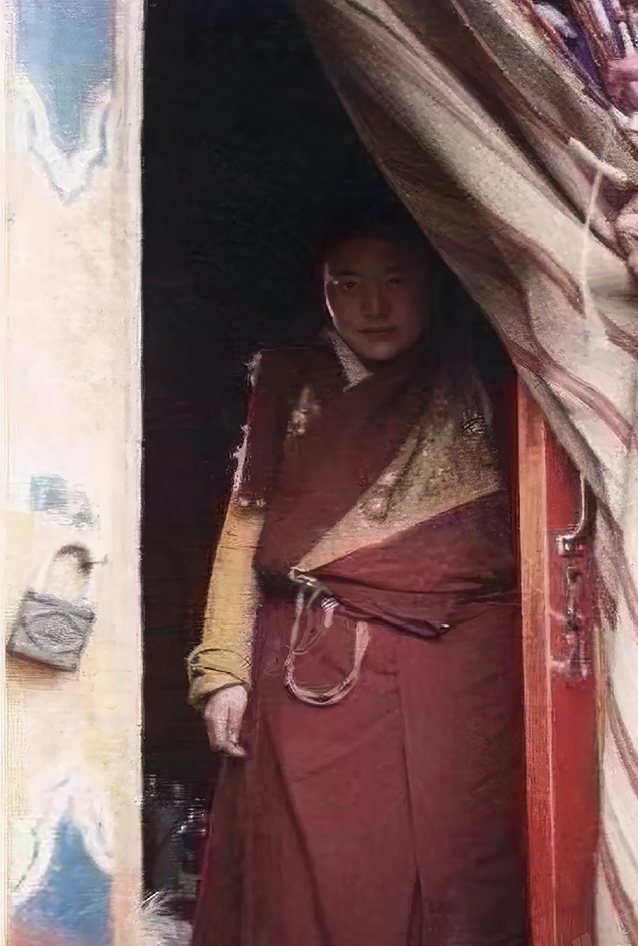

那年夏天将近之时，在第一世敦珠法王故居遗址上建立的殿堂中，门措空行母向六十余位尼众传讲了《入菩萨行论》。尽管这看似是她自幼以来对弟子的首次传法，但事实上，在此之前的木牛年（1985年），她已经为秋杰卓玛、热雪、欧罗、根帝、赞札等约十八位觉姆传授过《大圆满前行》等。如果再进一步追溯，她传授正法的起点可以定在她十八岁那年，即水猪年（1983年）的夏季，那时门措空行母为大约八位觉姆讲解了《菩萨宝鬘论》，这是她一生中首次为他人传讲正法。从那时起，她逐渐为许多有缘弟子不断赐予妙法甘露。直至今日，她的弟子及其再传弟子，在智慧、严守戒律、人格贤善等方面表现出色。这些具备众多功德的持藏尼众，在安多、卫藏、康巴等许多地区广泛地弘扬着佛法，这一成就归功于法王如意宝和门措空行母的恩德。因此，我们应当知道，门措空行母不仅是吉祥喇荣莲花空行聚集洲的第一代持藏堪姆，也是为喇荣尼众传法的第一位阿阇黎。

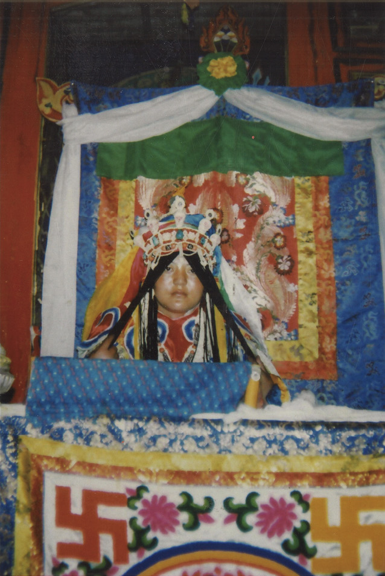

犹如萨哈嘎绕树，渐次叶茂果实丰，

年少妙龄至尊母，研修功德与日增。

雪域知识花苑中，摘采元音字母花，

精穿句义珍宝线，挂于慧颈为严饰。

风华正茂如夏虹，所积受用如水泡，

深情爱恋如闪电，汝已彻见此等理。

出离轮回红黄色，善染法衣极庄严，

三寸发辫献戒师，向往解脱现僧相。

如孔雀闻苍鸣声，享受胜师之教言，

沁心正法甘露味，虔信欢喜相媲美。

犹如大鹏金翅王，引领百鸟翱空中，

持藏尼众引领者，善说妙音永回荡。

[^1]: 翅岩石，坐落于居士林的上方。
