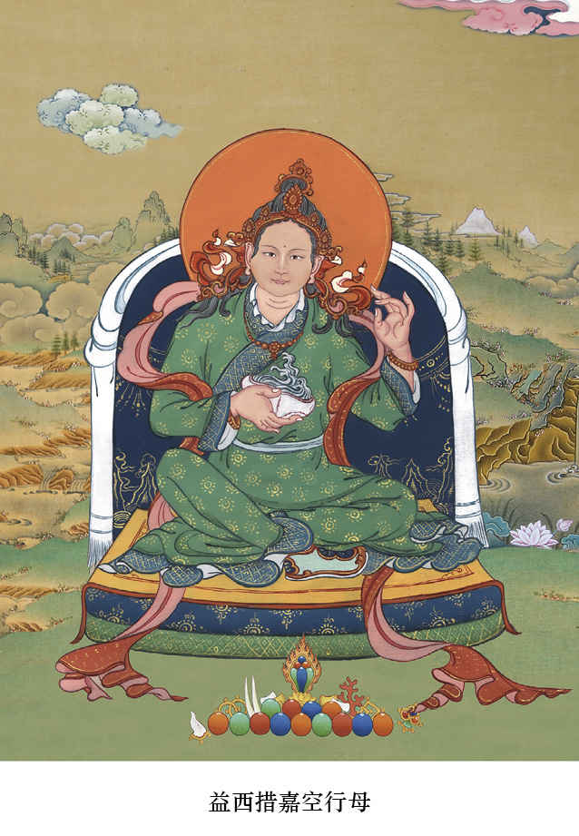

# 2．至尊圣度母

接下来要讲的是《密印授记》中所述的“布达拉山圣度母”。她是三时如来及佛子的事业本尊，显现为天女的形相，受身为将无偏众生从轮回的恐怖与痛苦中救度出来的主尊——圣女度母。

往昔无始劫前，在名为“种种光”的世界里，出有坏鼓音如来出世。有一位国王对如来的教法至诚恭敬，他有个公主名叫般若月。公主长年供养承侍鼓音如来及其众多菩萨、声闻眷属僧众，最初发起了殊胜的菩提心。当时比丘们劝她：“依靠这广大善根的力量，您若从这一世起发愿转成男身，广泛弘扬佛法，必定会如愿以偿。”但她以辩才回答道：“此无男相无女相，无我无识无行者，名为男女实虚妄，世间恶慧所迷惑……”她进一步立誓：“许多人以男身求证菩提，而以女身行利生者寥寥无几，故在轮回未空之前，我将以女身利益有情。”

之后，般若月公主一直居住在王宫，一边以善巧方便享受五种欲妙，一边修持禅定，由此获得了无生法忍。她以修成救度众生等持的威力，每天利用一上午的时间，让百千俱胝众生摆脱俗世之心，在没有完成此事前不进食。下午也是同样的行持。从那以后，她的名字便变成了人们共称的“度母”。对此，鼓音如来不仅给予高度赞叹，还授记她在证得无上菩提之前，将一直被称为“度母”。

在随后的尊胜劫，她在不空成就如来面前发下誓愿：救护十方浩瀚刹土中所有众生于危难之中，并在摧伏诸魔等持中入定，每个白天将十万百千俱胝众生之主安置于禅定等持中，每个夜晚调伏百千俱胝他化自在天主，因此被众人共称为“奋迅母”“勇母”。

后来，在无碍劫中，无垢光明比丘蒙受十方一切如来大悲光的灌顶，成为圣者“观世音”；此后他又得受所有佛菩萨智慧本体的大光明灌顶。先后这两道光，以父母的形象融合，化为“度母”。所以，度母也是从观世音心间出生的，能够救护众生脱离八难、十六难等。

之后在阿桑嘎劫中，她又受到十方一切如来的灌顶，成为能生诸佛之母。

如今，在这一劫中，她居住在殊胜圣地布达拉山上，正在成办利益天、龙、夜叉等无数众生的广大事业。

智慧自性微妙身，发心为得菩提果，

尽虚空际度众母，杨柳宫主我随念。

