# 3．根据授记前往措嘉寺

火兔年（1987年）的春季，尊贵的法王如意宝带领一万多名弟子眷属去朝拜汉地五台山。在这次朝圣中，门措空行母和她的母亲阿里美珠也随行前往。途中，他们还朝拜了峨眉山、乐山大佛等圣地。

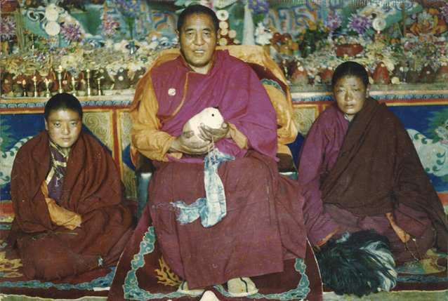

住在五台山期间，门措空行母不仅在法王面前听受了《文殊静修法》《大圆满手中赐佛》《精藏续密意释》等所有五台山法类的灌顶、传承，还恭听了《法界宝藏论》《句义宝藏论》的讲解和引导。她在善财洞等地进行闭关修行，断绝了与外界的联系，专注致力于真修实证，全身心投入精进的念修。据说，在东台望海寺居住期间，她得到了一个显现白色“阿”字的宝珠状小石箧，但具体细节不详。

随后，门措空行母和僧众一起返回喇荣。在那一年里，她在法王面前听受了荣索班智达的《入大乘论》、萨迦班智达的《量理宝藏论》、麦彭仁波切的《释量论大疏·善说光明藏》等。此外，她还在第一世敦珠法王故居遗址上新建的殿堂中，为大约三十位尼众传授了麦彭仁波切的《智者入门论》，以及《大圆满前行》。

土龙年（1988年）夏季，法王在自己住处的院子里，为莲花空行聚集洲的尼众讲授了《心性休息》。在这一期间，门措空行母为大约六十位觉姆辅导时，就本论的逐句解释、正文的科判、每品的摄义，特别是一些难点和必须掌握的实修窍诀等问题，都向法王逐一请教，以此帮助觉姆们消除了所有的疑惑。

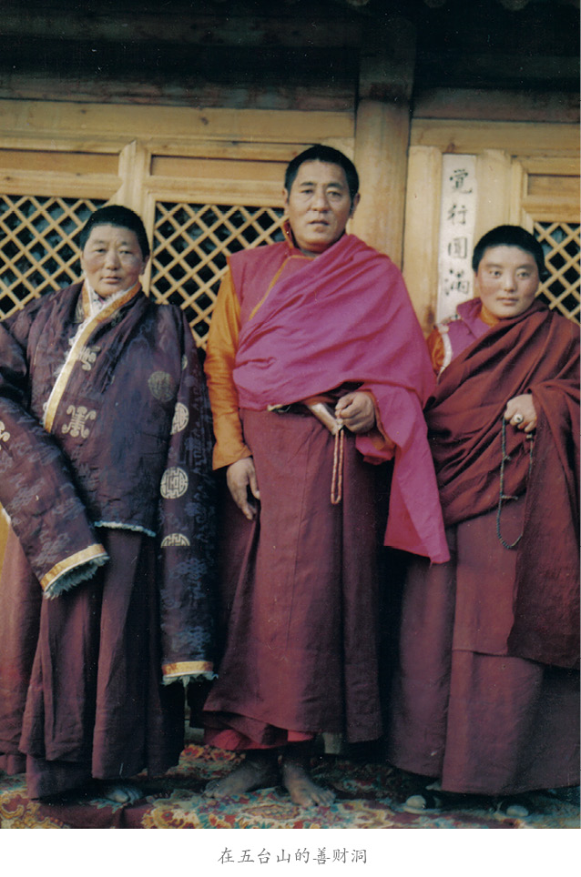

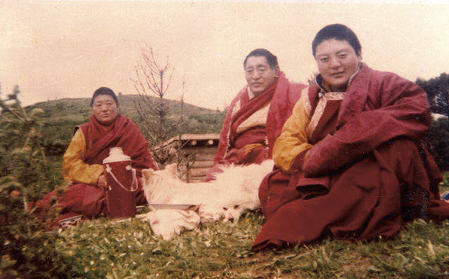

那年五月，法王在前往香札神山的途中，再次造访了新龙，去了札宗寺、匝绕寺、噶桑寺等十三所寺院，与当地的大众结上了法缘，广泛劝勉信徒行善。到达帝赤神山时，法王在他前世居住的地方逗留了七天，并在班蚌停留了两天。在此期间，加思措嘉寺的住持桑吉措觉姆和管家等几位觉姆拜见了法王，表达了他们的诚挚请求：“依据新龙上师白玛灯邓和伏藏大师列绕朗巴的授记等多方面的信息，我们坚信门措空行母正是益西措嘉的化身，也是我们寺院真正的寺主。这一点不仅毋庸置疑，根据授记中明确提到的道路、铁桥、城镇等建筑来推测，更可以确定，现在正是她前往我们寺院的时候。因此，我们特地前来迎请门措空行母亲临寺院坐床，希望得到您的慈悲开许。”

法王说：“好的好的，如果从实际的道路、铁桥、城镇等情况来看，似乎授记中的时间已经到来。但请问，现在你们寺院中是否有授记中明确提到的一百一十三位觉姆？”她们回答：“如果把已经出家和即将出家的觉姆都算在内，我们寺院的觉姆确实恰好有一百一十三位。”于是，法王慈悲地表示同意：“既然如此，那么缘起非常好。从今天起，这位门措空行母将属于你们措嘉寺。现在你们请求她去坐床，也是合情合理的。”

实际上，在过去，白玛灯邓尊者曾亲临新龙加思地区，并在那里加持了地基，修建了喇嘛寺和觉姆寺两座寺院。而且，他还授记了上下两座寺院佛法弘扬的盛况。在益西多吉的《白玛灯邓朗巴传·善缘欢喜甘露云聚》中，明确地讲到：“白玛灯邓尊者来到新龙境内的加思，在以前没有僧众的地方，摄受了前所未有的大量僧众，并对地基进行了加持。他给新建的喇嘛寺取名为密宗大乐法林寺，随后又建立了觉姆寺，命名为措嘉寺。他不仅重建了经堂和僧舍，还在这两座寺院中修建了许多三宝所依。之后，他授记了将来这两座寺院的佛法会广泛弘扬。”

确实如文献所记载，那一年当白玛灯邓尊者在加思寺——密宗大乐法林寺为众生转法轮时，嘎热的秋珍与阿库的秋措两位女子前来拜见。尊者以授记的方式告诉她们：“未来，这里将建立一座觉姆寺，应将其命名为措嘉寺。益西措嘉的一位真实化身必将来到这座寺院。届时，在新龙河对岸、则特山下会有一条大道，寺院尽头将有一座铁桥，桥对面是一个繁华的城镇，大道上将充满络绎不绝的商人，益西措嘉空行母的化身将会亲自来到那座桥上。这位尊贵的空行母，上有绿色孔雀伞，下有白色狮子座，将在这里转妙法轮。到那时，道孚灵雀寺以上的觉姆们将聚集此地，最初有一百一十三位，随后人数将逐渐增多……”

同样，法王如意宝的前世，伏藏大师列绕朗巴来到加思措嘉寺时，也曾说过：“我这一世不会直接为加思寺带来显著的利益，但来世，我的一位外甥女将在这里发挥重要的作用。”这番话是列绕朗巴大师对未来的无误授记。而法王如意宝正是他的转世，他的外甥女正是门措空行母，所以与授记中完全一致。这在当地信众中广为流传。

藏历六月初四，即释迦佛初转法轮的吉祥节日，门措空行母当天受到了彩绸严饰的车队相迎，僧众也列队欢迎，鼓乐齐奏。场面恰如白玛灯邓尊者授记的那般：她头上撑着绿色孔雀伞，在狮子座上坐床。与此同时，铁桥、城镇等景象也完全符合授记中的描述，原原本本呈现在所有人眼前。现场的人们都对她生起了极大的信心。

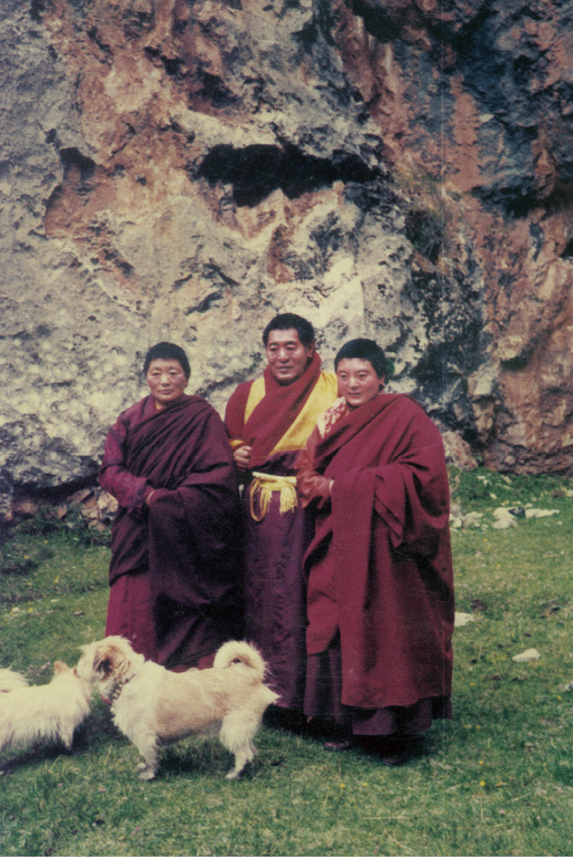

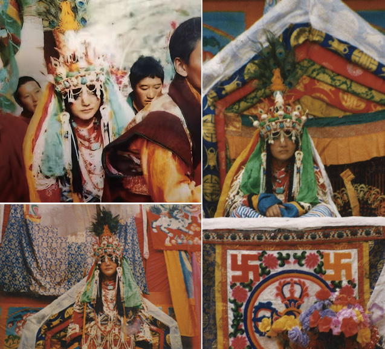

在此时，措嘉寺的尼众献上了三宝所依等各式各样的大量供品，呈上了妙高曼茶罗，连同两寺的能依所依，也都完整地供养给了门措空行母。随后，在这个释迦佛初转法轮的吉祥日子里，空行母向措嘉寺尼众为主的僧俗信众，赐予了《佛子行三十七颂》的传承，这标志着她与措嘉寺首次结下了深厚的法缘。

后来，门措空行母又多次莅临措嘉寺。在她第三次去之前，加思措嘉寺的各位负责人去拜见法王，表达了他们的请求：“我们寺内已经聚集了一百一十三位觉姆，现在急需一位能够转法轮的人。因此，恳请尊贵的门措空行母能再次光临我寺，转深广法轮。我们诚心诚意地祈求，请您以大慈大悲尽可能开许。”法王如意宝说：“我已经知道了你们的诚意，我会根据情况做出相应的安排。”不久之后，法王派遣司机才旺嘉措前往措嘉寺，并对他说：“你去通知她们尽快准备好法本，门措空行母即将前来为大家传授《大圆满前行》。”

在四月初五那天，空行母在莲花空行聚集洲的如西、卓玛措、秋扬卓玛三位堪姆的陪同下，亲临了位于新龙的措嘉寺。她首先去了喇嘛寺——密宗大乐法林寺，随后在一百一十三位觉姆的热烈欢迎下，受邀至措嘉寺，并受到了热情款待。从初六开始，空行母开讲《大圆满前行》。二十四天里，该寺的常住觉姆、来自喇荣寺等各地的众多觉姆，还有附近的男女僧俗纷纷云集。空行母对这部大引导文的整个框架，包括共同前行、不共前行、实修正行分支——往生法的引导，进行了深入细致的讲解。

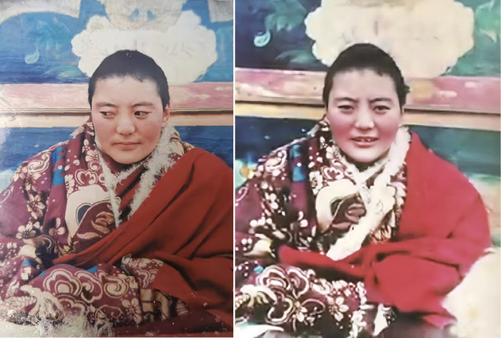

讲解圆满结束后，为了放松一下，空行母与众人前往阿勒卡帝，一同欣赏了各种各样的佛教娱乐节目。休息了几天后，她便返回自己的住所。在回程途中，当见到寺中常住尼众排列有序时，觉姆桑吉措对空行母说：“尼众排得真是整齐。”空行母赞同地说：“缘起很好。”就在此时，怙主法王如意宝也恰好到达。空行母带领措嘉寺的觉姆们远远前去迎接。由于她平时习惯与舅舅法王和母亲常相伴，二十多天没见面对她来说似乎过于漫长。他们二人的突然到来，令门措空行母感到非常高兴，彼此亲切地分享了这段时间的经历。

土兔年，措嘉寺住持再次拜见法王如意宝，并提出了一个建议：“为了让至尊空行母在新龙自己的寺院中有一个住所，我们是否可以为她建造一所精舍？”法王回答：“如果能在加思为门措造一所住舍，那将是非常好的缘起。”法王接受了这个建议，并慷慨捐赠了一万元人民币作为资助。精舍建成后，她又前去晋见法王，汇报了精舍的完成情况。法王听后显得十分高兴，赐予了放置在精舍内的上师、本尊、空行三尊像，以及茶砖、地毯等许多礼物。后来，当法王住在成都时，他通过电话给这座精舍取名为“空乐空行宫”。法王所赐的三尊像至今仍被珍藏在门措空行母精舍对面新建的金色殿堂内。

虹身金刚白玛尊，预见未来授记言，

至尊空行将莅临，新龙阿则荣山岭。

白色熏烟如云布，迎接场景如密林，

供品积聚如海浪，赞颂乐音如苍鸣。

善缘妙相纷纷呈，满心欢喜惬意处，

僧尼列队前相迎，具幢车乘缓慢行。

部主至尊空行汝，于措嘉寺坐床时，

众生顶戴皎月足，无垢宝冠极庄严。

上擎翠绿孔雀伞，下踏雪白狮子座，

获赐王权胜冠冕，欢悦盛宴喜洋洋。

犹如孔雀喜雷声，满面笑容诸信众，

皆大欢喜满心愿，宛若秋季丰收果。

往昔措嘉幻化戏，曾于新龙大地演，

四方时轮转至今，彼之善缘复彰显。

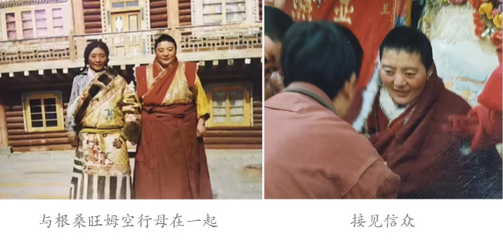

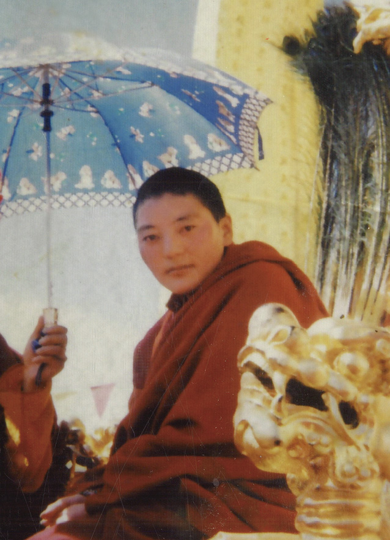

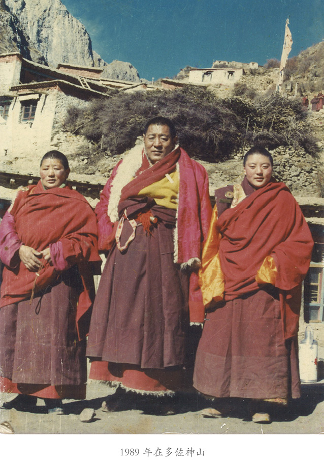

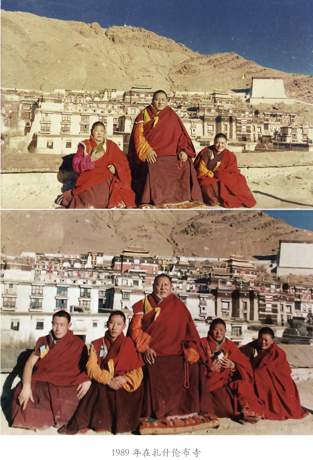

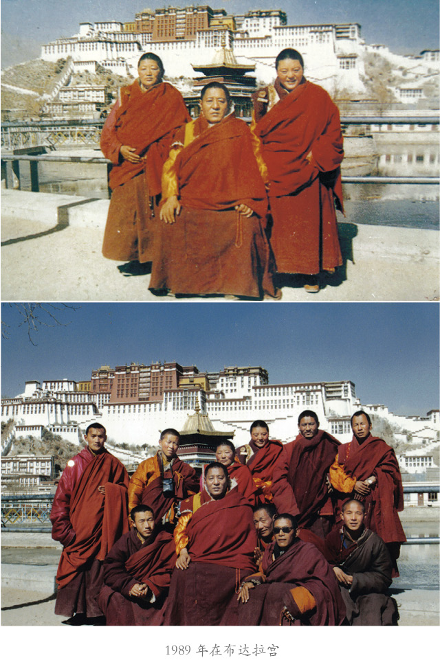

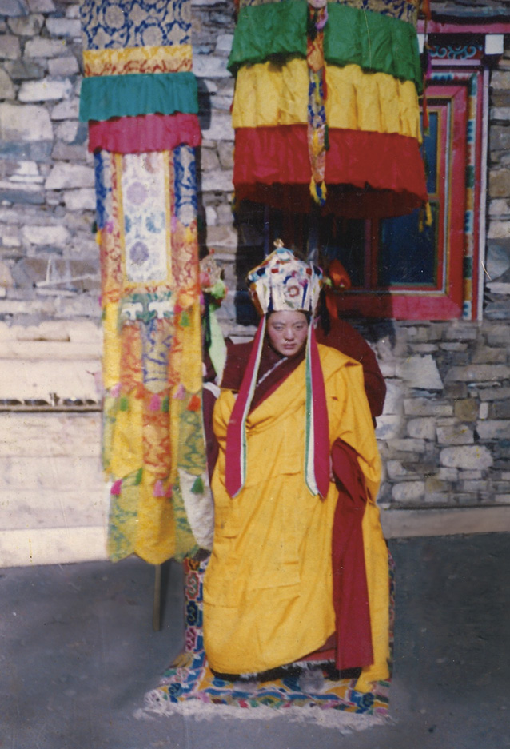

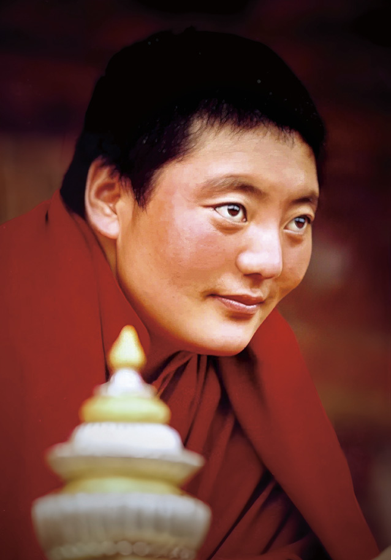

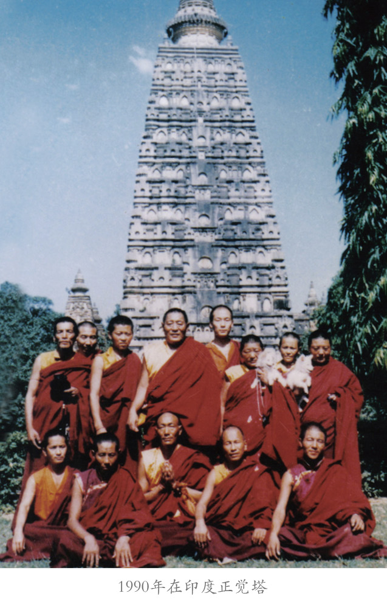
