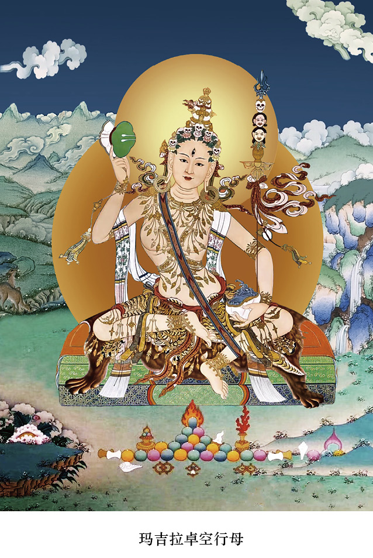

# 3．益西措嘉空行母

接下来，是受持“第二佛”莲花生大士密藏的教主——卡钦萨·益西措嘉。她出生于自在圣者的幻化天子赤松德赞，或称为梵天花国王治理雪域的时期。当时，有前朝历代法王封赐的卡钦巴、宿卡瓦、卡切瓦、贡塘巴、则巴、札巴、荣巴七大家族，她属于其中的卡钦巴族，是父亲华杰旺修和母亲努萨格措的小公主。

到了青春美满的妙龄时，她因其卓越的美貌、超凡的气质，名声遍及整个国度，引来众多追求者。卡切·华杰云尼和则卡·多吉旺修二人为了娶到她，甚至准备开战。国王赤松德赞听闻此事的始末后，在卡切瓦族与宿卡瓦族之间进行了调解，经过双方协商，最终将这位尊贵的公主供养给大国王赤松德赞。就这样，益西措嘉嫁给国王为妃。

不久后，尊贵的国王为建造吉祥桑耶寺举行伏地仪式，迎请了赡部洲最了不起的持明密咒师——邬金莲花生大士。在莲师向君臣们传授妙法并赐予密宗灌顶时，国王将益西措嘉献给上师作为灌顶供养。同时，国王还将象征着须弥山的卫藏后藏四翼、象征着东胜身洲及其附属小洲的汉江康三地、象征着南赡部洲及其附属小洲的夏贡门三地、象征着西牛货洲及其附属小洲的霍蒙珠三地、象征着北俱卢洲及其附属小洲的阿里三环，连同国政和王妃一起以曼茶罗的形式供养。

从那时起，益西措嘉成了莲花生大士所摄受的至尊明妃。作为空行主尊母的她，在莲师前接受灌顶时，选择本尊部的花落到了金刚橛坛城中，面见了金刚橛尊众，并证得成就。她降伏了祖先的馋鬼，密名为大乐佛母，成就了起死回生的威力，能使尸林里死于利刃下的人尸复活。她与莲师在桑耶青普共同居住了十一年，听闻了大量密宗甚深教言，在门卡内让狮子堡的修行地获得成就。并依照莲师的授记去修行，证得了与本尊无二的殊胜成就。为了利益随行者，她还在香波冈、萨龙、达仓等诸大圣地修行。

在友多德卓，她在邬金莲师前听受了《莲花心滴》等无数深法，并实地修行，取得了很高成就，同时对上师的语密——不可思议的所有法进行了结集。为了使莲师的教法在未来轮回未空之际长久不衰、日益昌盛，她在藏地各处伏藏了上师的所有法教。诸如此类，尽未来际与莲师相关的伟大利生事业，都是依靠这位智慧空行母的壮举而来。

在不同时期，她以各种化现摄受诸位幻化的伏藏大师，并对他们进行授记、给予安慰……她以无尽的神变幻化相，作为一些伏藏师的密伴。她的真实化身是曼姆·班玛措杰和空行母根嘎波这两位女伏藏大师，她们不舍肉身而飞往了空行刹土。以此为例，她有不可胜数的化身降临于世。

她的传记大多记载在伏藏法中，其中存在诸多差异，难以确定唯一的版本。但是，达夏伏藏法的《传记开显隐义·乾达婆歌鬘》以偈颂形式记载了益西措嘉空行母的不共传记概要：“德卓空行表劝请，八难行现成就相，雪岩得绝地火暖，离开世间轮回衣。供殿具足四灌暖，所见净观上师相。尼泊尔境起死者，方便救赎阿匝绕，获深道精之悉地。语言具足妙梵音，身成虹身空中行，心具三时之密意。狮子堡中摄药术，现见药师佛会众。尼让调伏诸魔众，验相圆满得悉地，面见所修本尊已，顺利获得彼成就。巴卓虎穴行深道，三伴大乐黑日嘎，风脉明点得自在，自行驾驭五大种。身语意三成三身，得无量寿佛授记，与亥母尊无有别，成诸坛城主尊母。纹坡虎穴成就橛，取受三千鬼神命，见无量寿佛会众，成就无死寿持明，犹如金刚不可摧……”其详细内容可以从中了知。

见义光明得成就，幻持结集伏藏法，

佛陀莲喜女使者，怀念雪域首空行。

