# 4．周游国内外、建造幻化网坛城等

铁马年（1990年），法王一行前往印度圣境，途中经过尼泊尔，在三大佛塔等极其重要的所依前，为佛法兴盛、众生安乐做了深广的祈福和发愿。抵达扬列雪山洞时，法王以意伏藏的方式抉择了“项袋金刚橛”法类，并首次向以门措空行母为主的少数弟子传授这一法门，赐予了他们能成熟的灌顶和能解脱的教言。同时，法王还特别强调了在开取伏藏现场修行伏藏法的重要性，指出这一做法对遣除违缘、不失修持至关重要，并指导身边的众眷属依照伏藏仪轨中成办事业的要求，圆满完成了规定的持咒数量。

不久后，法王一行在印度首都办事处的迎接下，下榻于新德里。五月二十四日，南札吾秋和嘎吉康哲仁波切等人作为代表向法王敬献了哈达，当地寺院的常住僧众也对法王的到来表示了热烈欢迎。随后，法王一行从那里出发，先后拜访了布热白玉法轮林、诶旺法轮林、萨迦色热寺、菩提法轮林等多个寺院。接着，他们前往著名的莲花湖，这是邬金第二佛莲师在被萨霍国王活活焚烧时，依靠神变将火堆变成湖泊的圣地。在这里，法王以强烈的信心深情地祈祷和发愿。

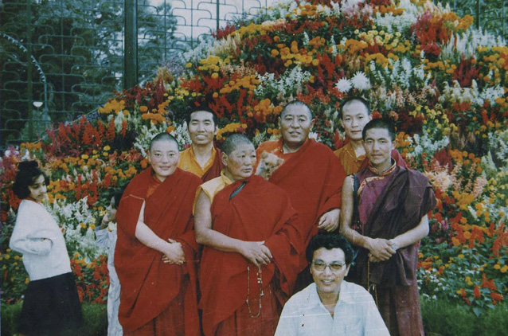

之后，他们从昌迪加尔出发，前往新德里，再乘飞机抵达迈索尔，经过拜拉库比，最终乘车到达前译宁玛派的南卓林佛学院。在那里，佛学院的主要堪布、活佛们和主管负责人等前来迎接，伴随着众僧的列队欢迎，法王被恭请至寺院的精舍。当时，法王如意宝和门措空行母坐在狮子金宝座上，宁玛派教主贝诺法王、色拉寺的堪仁波切，以及各个佛教中心的代表向他们献上了三门所依的曼茶罗。

九月初四上午，以贝诺法王为首的整个僧团共同诵念《密集长寿法仪轨》，祈祷法王长久住世。同时，门措空行母也被请到金宝座上进行坐床，并被赐予了见解脱莲花帽，供养了三门所依的曼茶罗，以及各种各样的丰富供品。

在接下来的约三个月时间里，门措空行母与南卓林佛学院的一千多名僧众一同，在法王座前接受了“文殊静修”、列绕朗巴的“金刚橛”、法王本人的“伏藏法类”、“上师心滴”等灌顶，并聆听了《定解宝灯论》《七句祈祷文释·白莲花》《正行光明藏讲义》等论典的详细讲解。在这段时间里，法王一行还短暂访问了不丹，之后再次回到南卓林佛学院，又住了一个月左右。期间，门措空行母和所有僧众一起在法王前接受了许多能成熟的灌顶和能解脱的教言。

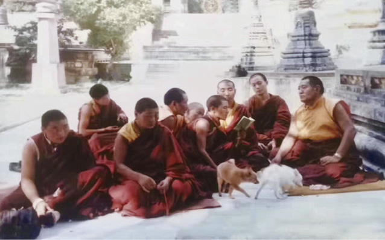

随着炎热天气的逐渐转凉，法王一行朝拜了诸多佛教圣地，包括我等本师成道的中土菩提伽耶、第二转无相法轮的灵鹫山、佛陀示现涅槃的拘尸那罗等。在这些圣地，他们发下了《愿海精髓·普贤刹土杲日》中所提到的令佛法兴盛、众生安乐的广大宏愿。

此后，他们经过尼泊尔返回成都。藏历十月初一，法王一行乘车回到色达喇荣五明佛学院。在僧众整齐排列的队伍、缭绕的熏烟、悦耳的鼓乐声中，法王受到了热烈而隆重的欢迎，圆满归来。

藏历十二月初一，在喇荣五明佛学院，法王首次为人格善良、以殊胜纯洁的意乐弘法利生、威仪如法、戒律清净、精通经续及明处、智慧广大、成绩突出的一批弟子，颁发了堪布证和堪姆证。当时，六十多位喇嘛与六位女尼不仅得到了法王亲手赐予的堪布或堪姆盖章证书，而且参加颁证典礼的所有僧众，还为新得殊荣的他们奉上了抑扬顿挫、美妙动听的吟诵，祈愿他们违缘消除、长久住世，在未来的新时代中，事业如日月般光辉普照十方每个角落，顺利成办广大的弘法利生，为此做了诚挚的祈福和发愿。就这样，喇荣五明佛学院堪布堪姆传承的新篇章得以开启，这一历史性的瞬间无疑将成为未来值得铭记的伟大时刻。当时，门措空行母也荣获了“堪姆”称号，成为获此荣誉的六位女尼之一。

从此刻起，所有身披袈裟的尼众，依靠闻思修行显密教法及明处，通过严格的班级考试，成绩优异、达到标准的人将得受堪姆称号，这一制度由此在藏地得以兴起。正是因为这个原因，整个雪域的尼众对于三藏、四续部的深广要义，依靠三观察清净的教证、无垢的理证之门，进行观察、分析、传讲、研讨，全面展现了她们的细致才智和深刻洞察力。授予持藏尼众“堪姆”这一荣誉的传统，最初在藏地由喇荣五明佛学院创立。这一具有历史意义的举措声名远播，甚至在当今时代研究藏学的外国学者中也广为流传，成为一时的佳话。

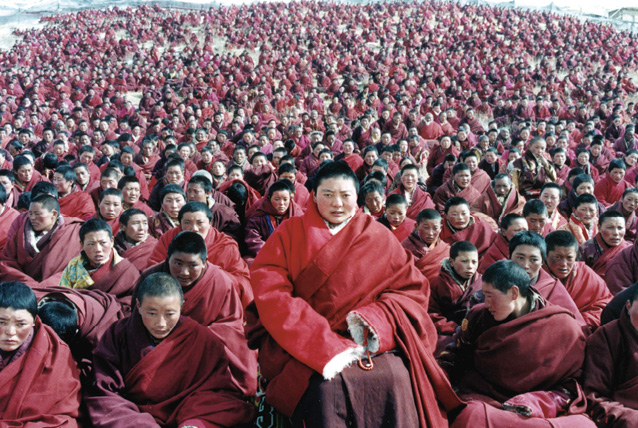

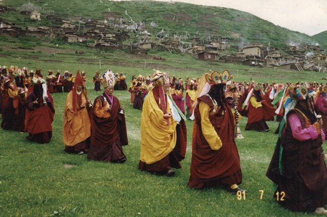

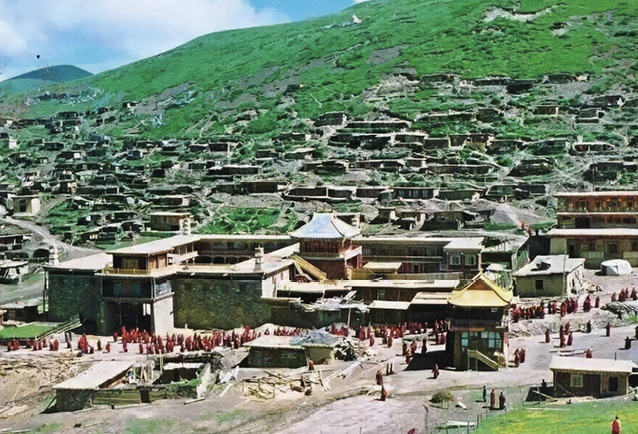

铁羊年（1991年）冬季，门措空行母在莲花空行聚集洲，为大约两百名尼众弟子传讲了《入菩萨行论》。继而，她又传授了全知麦彭仁波切所造的《智慧品释·澄清宝珠论》。第二年，在文殊幻化宫中，她为一百多位尼众讲解了《定解宝灯论》，这部殊胜论典具有七圣财数目的问答，着重抉择了前译密宗的不共甚深见解。她还在觉姆大经堂内为莲花空行聚集洲的所有尼众，讲授了龙钦绕降尊者《七宝藏》之一的《窍诀宝藏论》，这是一部能让一个修行者通过完整的道次第现前成佛的窍诀宝典，它以六法一组的形式进行总结，使内容更易于记忆。此外，她还传授了阐述“心趋于法、法趋于道、道除迷乱、迷乱净智”之理的重要论典《四法宝鬘论》，以及华智仁波切根据不共实修引导的甚深教言编撰的《莲苑歌舞》——一部通过两只蜜蜂悲欢离合的故事来隐喻修行之道的精彩论著。

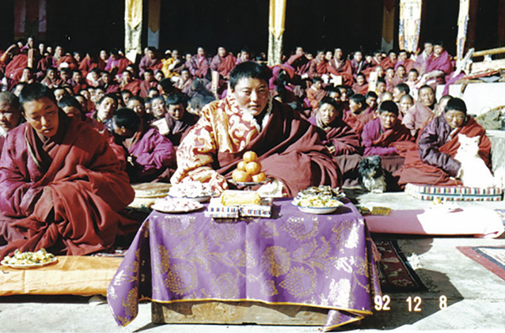

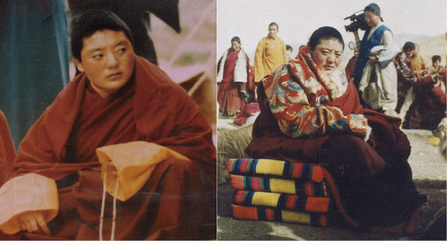

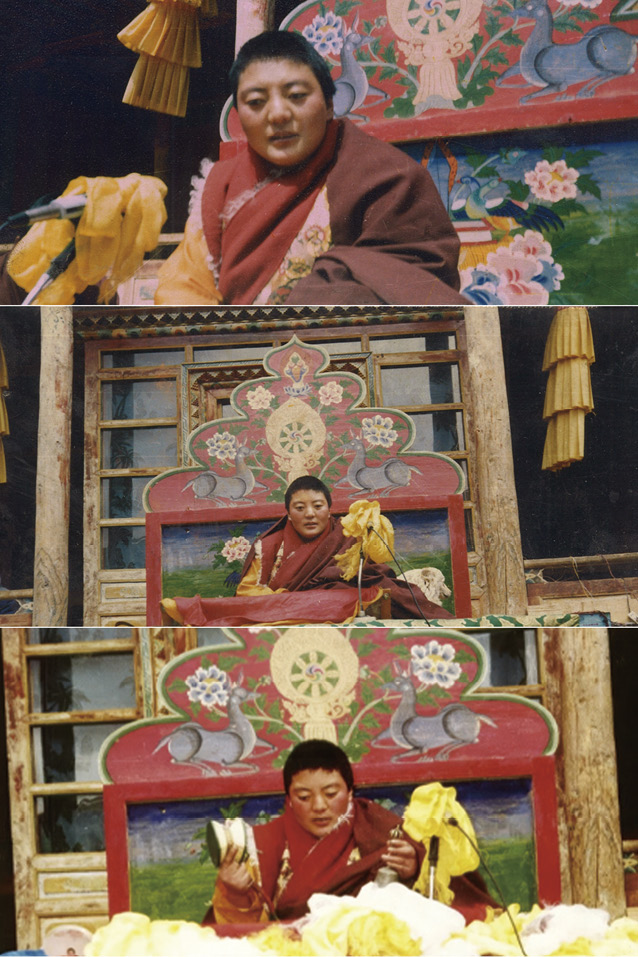

水鸡年（1993年）四月初一，法王如意宝首次举办了规模宏大、覆盖面广泛的极乐大法会。两百多年前，菩提金刚曾经说过：“单坚阿拉木天喇荣沟，邬金莲师化身名晋美，彼于菩萨四众眷属中，广弘显密教法如明日，利生事业顶天立地也，清净所化眷属遍十方，凡结缘者皆生极乐刹。”其中明确指出了地点、时间、上师、眷属，以及凡结缘者皆往生极乐世界。根据这一金刚授记的密意，法王为了开启接引有缘众生往生极乐世界的事业大门，于色达喇荣下方的“迎送译师班智达草原”，举行了第一次极乐大法会，历时十五天，先后聚集的人数，粗略估算，约有三万名僧众和二十万名在家男女。

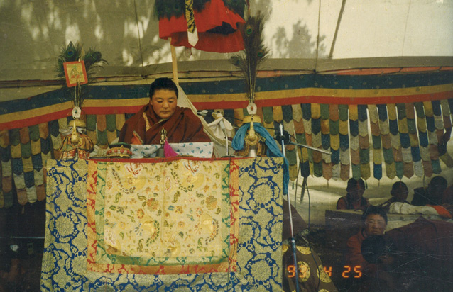

在法会中，法王赐予了“阿弥陀佛”灌顶，并传讲了《无量寿经》和《净土教言》等。门措空行母则传授了“阿弥陀佛”“观音菩萨”“播解脱种子”等多个能成熟相续的灌顶，并讲解了《三主要道论》《佛子行》等。每天的法会分为四座，早上的第一座在黎明时开始，大约有十五位堪布活佛轮流以《心滴事续乐道》的仪轨，为想受在家戒的人们传授八关斋戒。整个上午的时间里，精通念诵的僧俗男女随观想而念诵伏藏大师列绕朗巴的《阿弥陀佛修法仪轨》及天法派的《极乐仪轨》。下午的第一座和第二座，念诵乔美仁波切的《极乐愿文》。之后，为了确保来自不同地方的信众理解法语，十五位堪布活佛分组轮流进行辅导，根据法王和门措空行母的教言意趣，用简明易懂的方言解释如何修行往生极乐世界的四因，以及广劝行善断恶等内容。法王不分僧俗老幼，让所有在场的众眷属都承诺“念诵一百万遍阿弥陀佛名号及四十万遍金刚萨埵心咒”。每个人发誓念诵的一百万遍阿弥陀佛名号，综合统计起来，总数大约为两千亿遍左右。

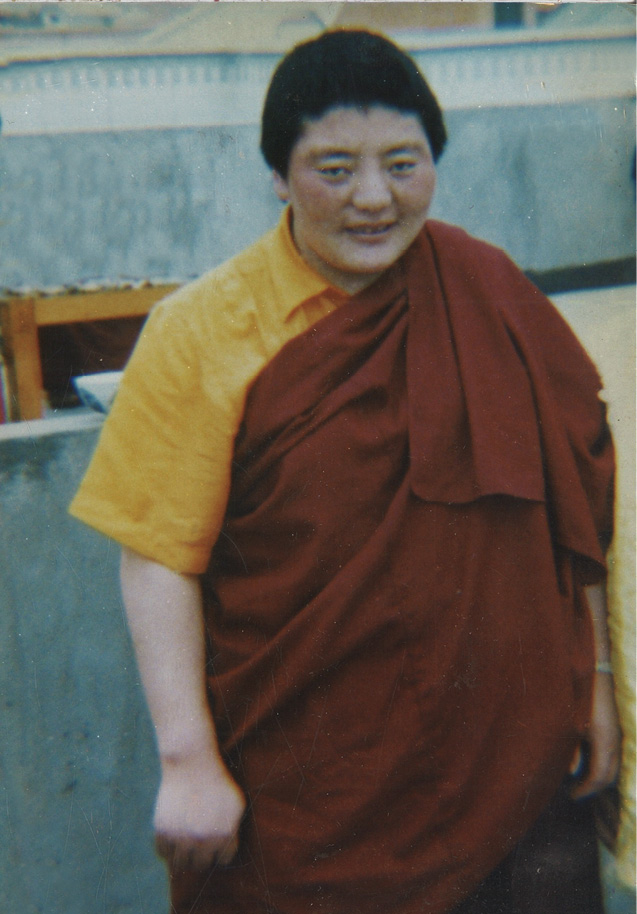

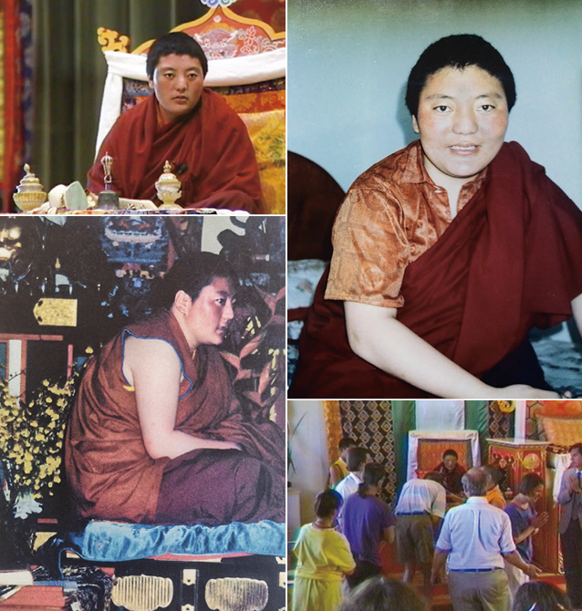

那一年的四月中旬，法王携门措空行母一行人前往西方国家广利众生。他们首先抵达了北美的夏威夷岛。五月初十这一天，法王来到科罗拉多州，为近千名信众赐予许多灌顶和教言，门措空行母传授了“文殊菩萨”灌顶。五月十五日，在科罗拉多州的另一个地方，门措空行母为四百多名信徒再次赐予了“文殊菩萨”灌顶。五月二十三日，在加利福尼亚州所属的阿底林道场，她赐予了“忿怒莲师”“观音菩萨”“作明佛母”的甚深灌顶。六月初二，在嘉哲仁波切的道场扎西秋林，她为一群热衷实修的修行者传授了“文殊菩萨”灌顶，满足了西方信众的愿望。

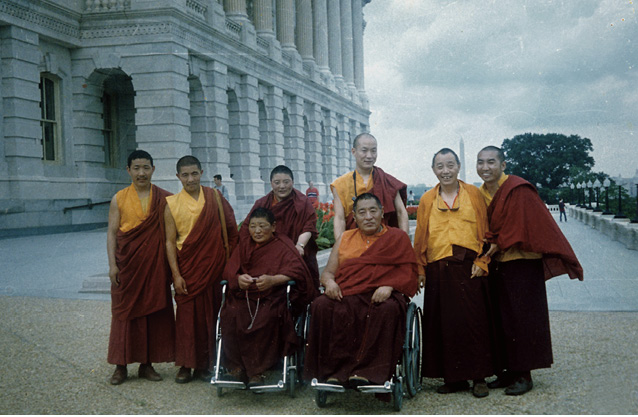

之后，他们经过加利福尼亚抵达了美国的政治中心华盛顿，参观了华盛顿纪念碑、越战纪念碑、国会大厦、航空航天博物馆、白宫等著名地标。随后前往华盛顿附近拥有众多外国出家人的阿贡拉姆道场——根桑白玉秋林。在那里，法王强调了“佛法的根本是戒律”的重要性。看到金发碧眼的人群中也有身披袈裟的出家人，法王对此表示高度赞叹，并鼓励他们继续团结和合、清净戒律、精进不懈地修行，讲了有关这方面的道理。接着，他们前往世界经济中心纽约，与求法的人们结下了深厚的法缘。

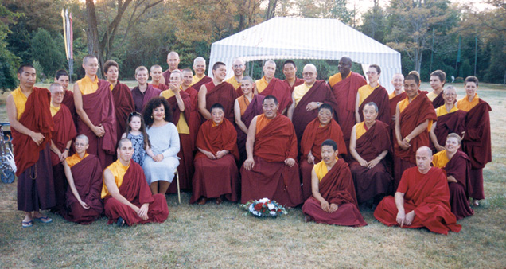

随后，抵达加拿大的夏日亲林道场。在哈利法克斯，法王恩赐了相应的灌顶和教言。七月十三日，到达位于法国南部的列绕林道场，法王向那里的弟子传授了能成熟的灌顶和能解脱的教言，门措空行母赐予了“忿怒莲师”灌顶。之后，从法国坐飞机经由香港抵达台湾，在台北与台中两座城市停留了一个星期左右，期间法王与门措空行母为当地弟子传授了不同程度的灌顶和教言。最后，途经香港顺利抵达四川成都。在藏历八月上旬的吉日，形形色色由彩绫装点的车队和马队远近相迎，整齐有序的僧众列队前来迎接，在鼓乐齐奏、熏烟缭绕中，法王与门措空行母一行回到了色达喇荣五明佛学院。

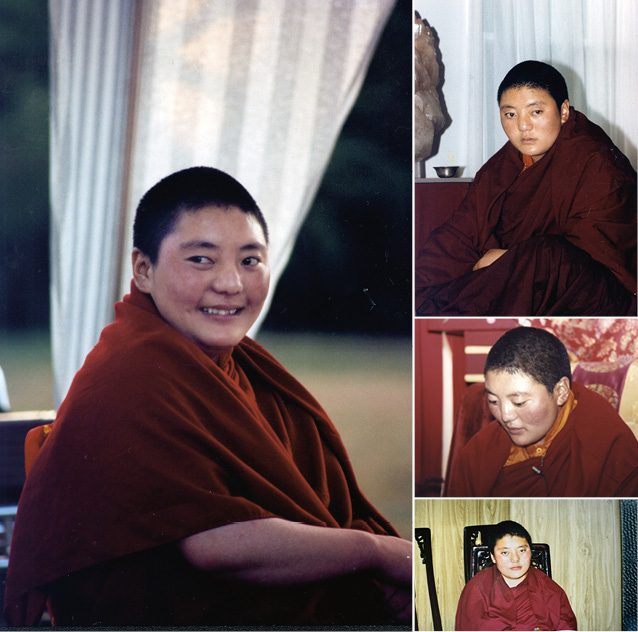

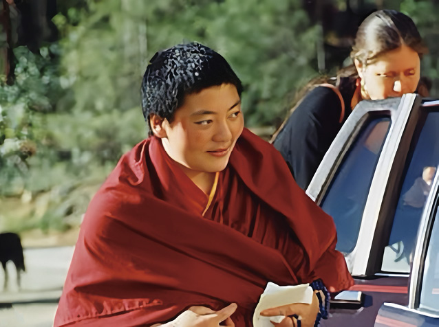

这一年的八月，法王如意宝在喇嘛大经堂，为全体弟子传讲了《三休息》之一的《心性休息大车疏》。与此同时，门措空行母每天下午在觉姆大经堂为尼众进行辅导。第二年冬季，她迎请德巴堪布仁波切到喇荣的大乐怀业宫，在他面前听受了《中观庄严论释·文殊欢喜言教》、堪布本人所著的《入中论释·开显精藏曙光》，并为众堪姆和辅导员进行了讲解。

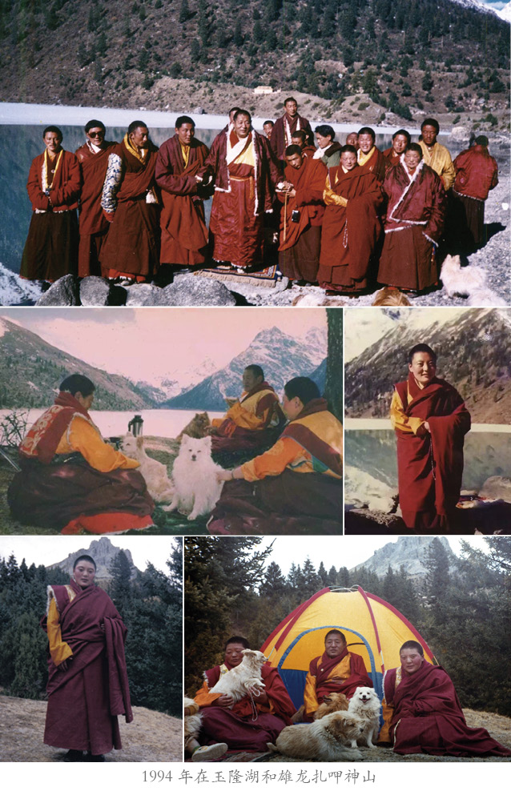

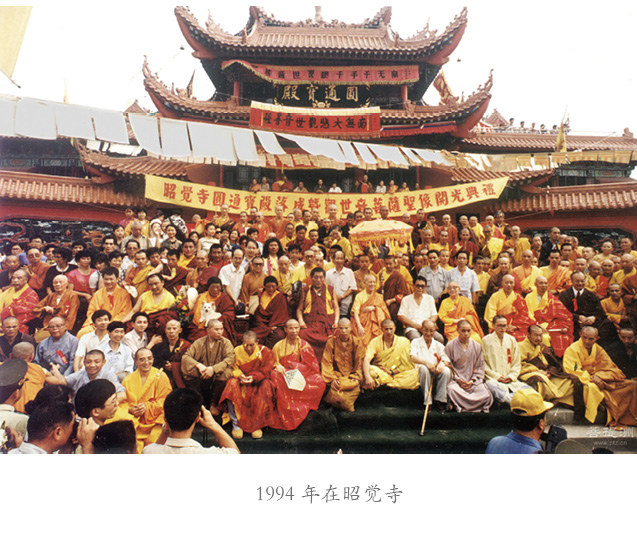

木狗年八月，应木雅燃姑寺为主的许多寺院以及众多在家信徒的祈请，法王如意宝和门措空行母等人专程前往，在十天中举办了第二次极乐大法会。期间，来自各地不同宗派与法脉的僧众和密咒师约有一万人，再加上木雅等地的有缘信众，粗略统计，总数约为四十万人。法王为信众赐予了“阿弥陀佛”“文殊菩萨”“时轮金刚”的灌顶等，并宣讲了《无量寿经》《净土教言》等。门措空行母传授了“观音菩萨”“播解脱种子”的灌顶，还念诵了《佛子行》《三主要道论》《四法宝鬘论》的传承。

在这次极乐大法会期间，法王不仅使得聚集的信众全部发愿念诵一百万遍阿弥陀佛名号和四十万遍金刚萨埵心咒，而且让当地百姓确信三宝是究竟的皈依处，重视因果，如理而行。大家尽己所能地勤修正法，发起最大的精进心，杜绝了毁坏今生来世的盗窃抢劫、打架斗殴、为杀生而买卖牲口、吸烟喝酒等恶行。总之，法王通过苦口婆心的谆谆善诱，教诫大家尽量摒弃一切不符合世间正轨的不善行为。在一段时间内，当地人全面遵循十善，法王这一善妙事业遍及整个木雅地方。

木猪年（1995年）一月十七日，应色达达西村与刚擦村的祈请，法王如意宝与门措空行母携眷属来到色达上方的泥朵乡附近，举办了一场为期四天念修《普贤行愿品》的极乐法会，参与的人数约有三万。门措空行母为他们传讲了《忠言心之明点》，并赐予了“播解脱种子”灌顶，圆满了当地信众的心愿。

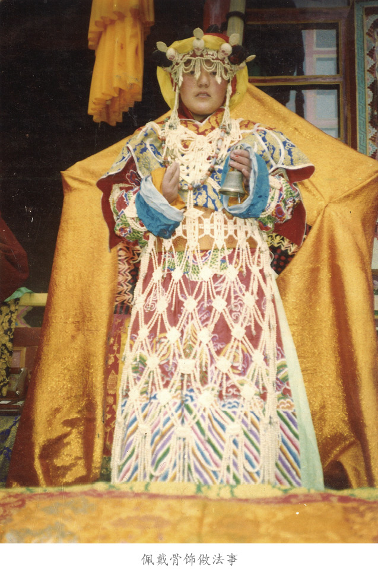

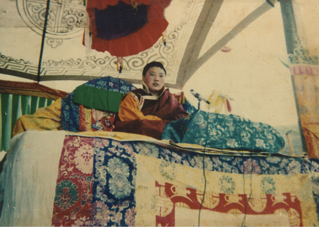

接着，应炉霍玲珑寺上师宫的邀请，法王如意宝与门措空行母及随行人员前往那里，举办了为期四天的极乐法会。法会期间，法王不仅为五万多名僧俗信众深入浅出地传授了与往生极乐世界四因相关的许多教言，而且门措空行母也赐予了“阿弥陀佛”灌顶和《佛子行》的讲解。

藏历二月，法王与门措空行母一同前往炉霍木那寺。途中，寺院的出家人和在家信众热情相迎。下午抵达木那寺后，他们为经堂开光并进行加持。晚上则在寺中安顿。第二天上午，他们前往名为康玛札嘉的地方举行法会，在四天中共修极乐法门。每天上午，法王如意宝赐予“文殊菩萨”的灌顶和《往生法》等；下午，门措空行母念诵《佛子行》的传承并赐予“观音菩萨”灌顶。

极乐法会结束后的第二日，他们乘车前往新龙的唐加地方。木那寺的僧人与在家信众，恭送法王一行到甘孜县的拉则卡地方。途中，他们经过新龙的协瓦寺，在那里传授了《往生法》与《延寿法》等，并在寺内居住了一天。十一日当天，法王抵达了将举办极乐法会的唐加地方。在供养的熏烟缭绕中，在美妙的诵经声、鼓乐声中，法王与门措空行母一行受到了僧队、车队、马队的隆重欢迎。这次法会是应新龙县四十七座寺院和二十四个村落多次祈请而举办的。在为期八天的极乐法会中，以共称的“新龙万户人家”为主，来自安多、卫藏、康巴三区域的信众云聚于此，粗略统计大约有六十万人。

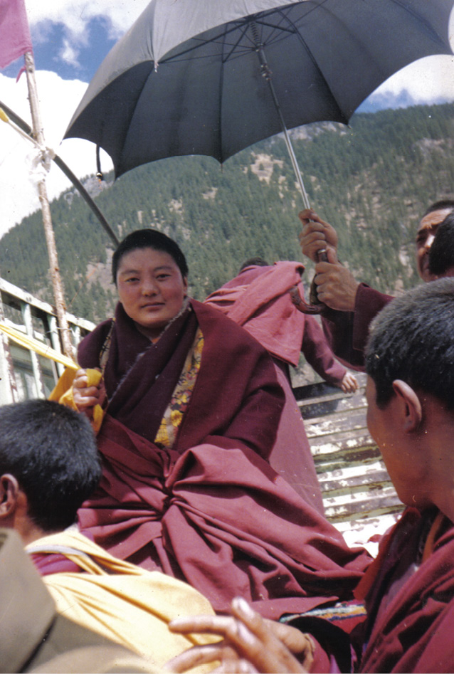

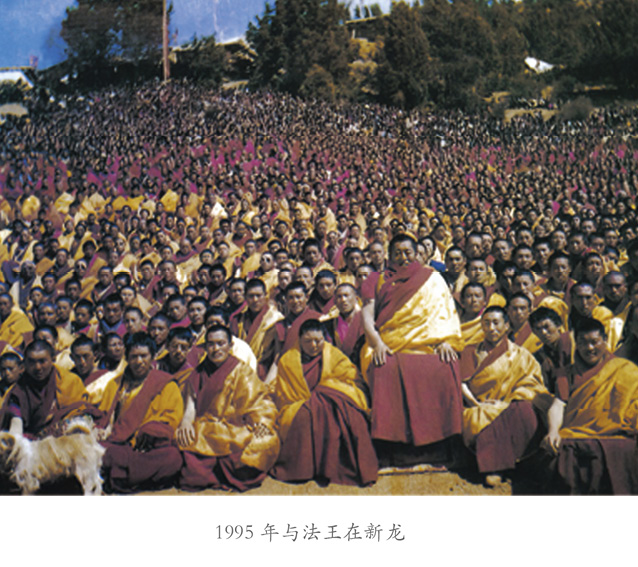

在这样盛大的法会中，上午，法王如意宝恩赐《净土教言》等，与大众结上法缘；下午，门措空行母念诵《佛子行》《三主要道论》《四法宝鬘论》等的传承，赐予“观音菩萨”“阿弥陀佛”的灌顶。在此期间，新龙县的大多数人都立誓不杀野兽，每人发愿念诵一百万遍阿弥陀佛名号和四十万遍金刚萨埵心咒，不盗不夺他人财物，不从事宰杀牲口的生意等。此外，在家男女成为多戒居士、圆戒居士的，也是屡见不鲜。

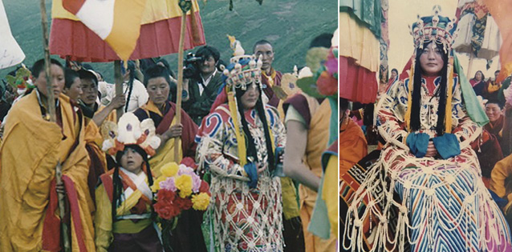

这一年的上半年，开始兴建大幻化网见解脱坛城。法王如意宝与门措空行母考虑到修持幻化网道次第的人，决心为他们打造一座明观生起次第的所依，同时成为有缘信众积资净障的无上福田，于是在喇荣西北方核心地段的山上兴建了这座坛城。它的中央是一座无量殿，四方各设一门，顶部装饰有法轮和仁兽，最顶端是金刚宝，外围有八大尸林、金刚圈和火山……所有这些都是由门措空行母投入数百万人民币才得以建成的。随后，这座坛城似乎成了喇荣五明佛学院的象征性标志。

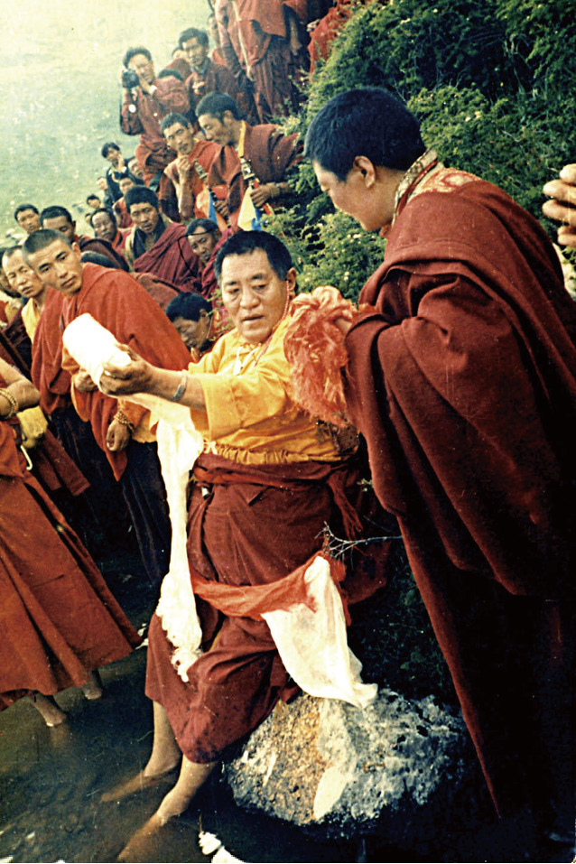

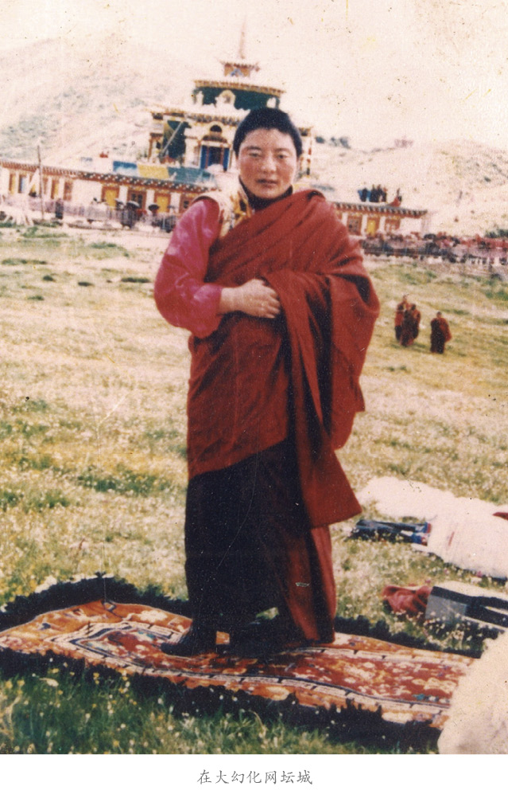

坛城的所依和能依，是依据《密藏续》的根本颂与注释、修坛城的教轨、画像度量经而建成，完全符合标准，而且铸造的圣像都有如理如法的装藏。此外，在无量殿的墙体内，藏有法王如意宝赐予的一百尊响铜像和伏藏像，以及大大小小的许多宝箧和各种圣物。大约两年后，坛城的底基周围又建造了二十三个殿堂，无偏供奉着所有法脉的三根本及护法神的众多圣像，成为所有信众积资、净障、顶礼、供养、发愿的殊胜对境。

在幻化网坛城竣工之后，法王亲自莅临现场，以金刚阿阇黎的身份，抛撒鲜花进行开光，并以善愿印持此坛城成为众生积资净障的无上福田。从那时起，“见解脱”坛城的事业大门就此打开，汉、藏、蒙族人群如夏季密云般纷纷涌至，对它进行精进不懈的顶礼、转绕、供养等。每一天都有成百上千的信众，将三门不停地投入到这一善业中，这也是大家有目共睹的事实。

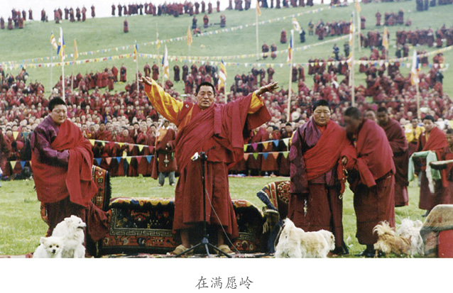

总的来说，大德的发心和愿力是不可思议的。在短短的时间内，由一盏灯火点燃盏盏明灯，噶陀寺、白玉寺、雪谦寺、佐钦寺等宁玛派各大古寺中，都建起了与此相媲美、庄严精美、符合标准的幻化网坛城。不仅如此，果洛东方的晋美陈列达吉林、德达寺、龙温寺，德格的玉隆札西持林与札熙寺，新龙的云丹炯尼寺，尼泊尔扬列雪的光明禅定法林等，也相继兴建了庄严辉煌的幻化网坛城。如今，许多寺院和地区都依循这种人工设计的图纸建起底基、筑起墙体，可以预计，未来将会有更多庄严宏伟的幻化网坛城在世界各个角落拔地而起。

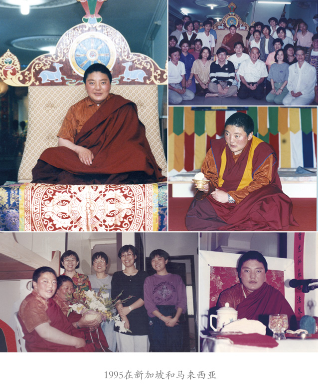

传扬悦耳善说音，持藏至尊堪姆誉，

千年时代里程碑，与汝之名并相连。

阿休查树所庄严，中土法兴悦意刹，

为弘正法利生事，跟随依怙上师行。

见者具益尊亲言，门吉华卓美名冠，

恩赐予汝稀有语，传遍世界诸方域。

圣境南方与北方，环游朝拜四圣地，

期间广发善心愿，依循愿海精髓行。

越过汪洋任运游，西方繁华众国土，

摄受金发所化众，赐深广法满其愿。

先后圣洁雪山境，开启极乐世界门，

二尊日月相合璧，数十万众得成熟。

无谄幻得信众供，普遍加持虚幻财，

以幻等持妙力摄，建造幻网曼茶罗。

犹如布休画匠描绘奇妙庄严之影像，

圆满表诠义因特征之不了义相坛城，

天等众生礼供对境见解脱之吉祥塔，

汝依不凡发心而建众生积善之福田。

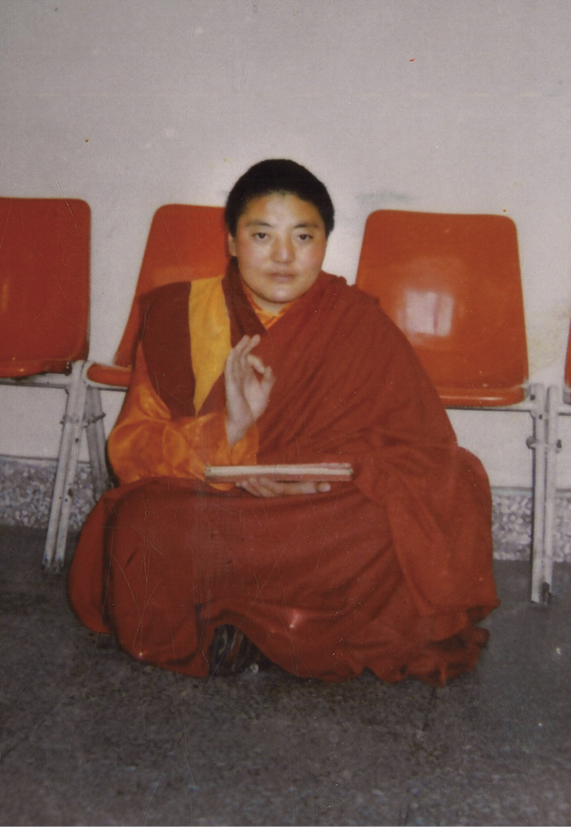

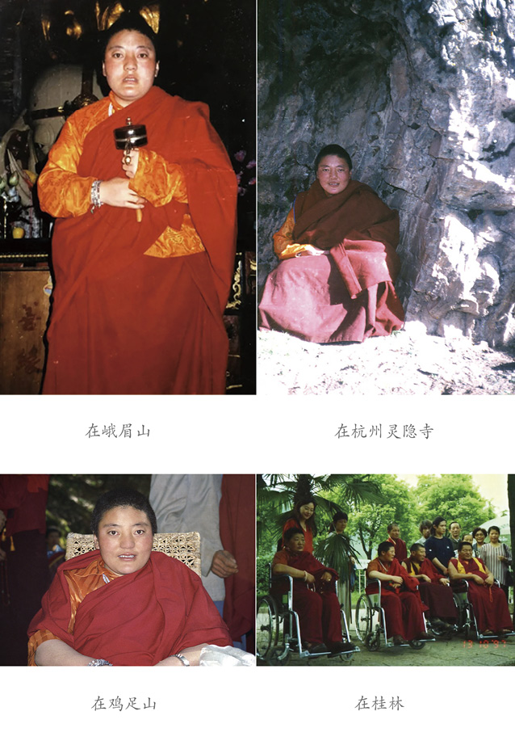

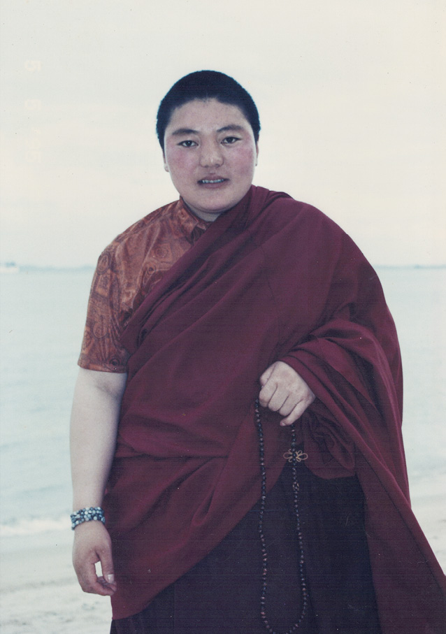

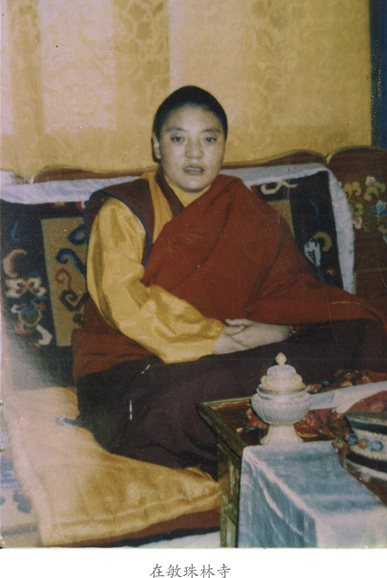
