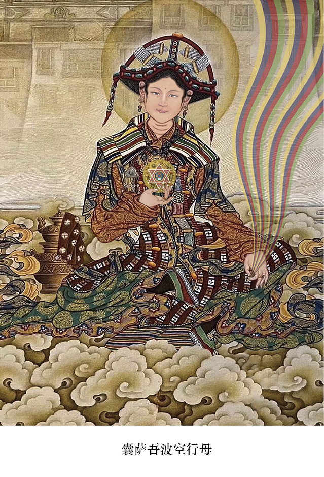

# 4．玛吉拉卓空行母

接下来要讲的是，益西措嘉的化身、息结断法派的伟大祖师——玛吉拉卓。第一胜生周铁羊年，她伴随着奇妙的瑞相降生于拉协地方，父亲名为秋杰达瓦，母亲名为雪耸萨·波嘉玛。年仅三岁时，玛吉拉卓便能念诵很多咒语，如观音心咒、度母心咒、舍字咒、阿字咒、布德则达咒、嘎得咒、哈热尼萨咒等，并在佛堂的佛像前顶礼膜拜、献上供品、打扫卫生等，十分勤快地做着各种稀有的事。到了五岁，她家有一位供养处，是一个叫觉沃单巴的人，开始教她正楷文字，他只稍作指导，她就心领神会。八岁时，她对梵藏双语的读写不学自通，每天读诵两函《般若八千颂》。

后来，古格国王对她的母亲波嘉玛说：“把你们的女儿带到这里来。”母亲带着她来到国王面前，国王详细询问了女孩的情况。在这个显赫且威严的国王面前，作为寻常人家的波嘉玛，显得相当胆怯，声音颤抖，难以开口汇报。就在这时，年幼的玛吉拉卓却毫不畏惧地详细叙述了自己的所有情况。在场的诸位印度班智达、众多僧人、小国王和官员们都对玛吉拉卓的表现感到极为惊讶，纷纷赞叹：“这个女孩真有胆识，小小年纪便如此能言善道，注定不是一般平凡的姑娘家。”当时，国王问她：“你能识字吗？”她回答说：“我能。”于是国王递给她一本《般若摄颂》，结果她竟然能用三种不同的语言朗诵，这使得所有君臣眷属都对她赞赏不已。

另有一次，国王又说：“现在叫你们的女儿来，我想仔细观察她的面相。”他观察时，发现玛吉拉卓眉间有一个“阿”字，还有其他许多空行母的特征。国王非常高兴地问：“这个女孩叫什么名字？”得到的答复是：“她叫西绕卓玛，又叫阿准，还叫准才玛。”国王说：“这个女孩的原名是卓玛等，而且她出生在拉协地方，所以给她取名为玛吉·拉吉卓玛吧。她是能让所有听到这个名字的众生都获得利益的人。”现场的班智达们、僧众、官员等人连连称赞“善妙善妙”。从此，在这片西藏雪域，她被人们共称为“玛吉拉卓”。

十六岁时，玛吉拉卓前往友热札唐，在一个叫温西坚的僧人面前出家为尼。她在上师身边诵读大中小三部般若经的时候，有一天，上师温西坚说：“你戴上这顶锦缎帽子来读，会读得更流畅。”因为戴上了那顶帽子来讽诵，所以她被称为“小帽觉姆”。嘉坡瓦仲杰每天能读一遍《般若十万颂》，堪称诵经典范，但是与他的读诵相比，小帽觉姆的语速快了两倍，因此声名鹊起。

不仅如此，她还听受了《贤劫经》、《般若十万颂》、《般若二万颂》、《般若八千颂》、许多零散经文的传承及其甚深意义的详细讲解，并对《般若十万颂大疏》、《般若二万颂略释》、包括《一字般若》的所有意义精通无余，相续中也生起了特别的觉受与证悟。当她去上师面前印证时，上师非常欢喜地说：“你已经领会了大中小般若，对经藏通达自如，我也难以达到你的程度啊！”

她住在友热札唐期间，单巴桑吉尊者从印度来到藏地。尊者住在加地的寺院时，遵循空行母的授记，特地来和她见面。据说两人按约定时间在札地的岩石隘处相见，以碰头礼互致问候。单巴尊者亲口对她说：“您是智慧空行母，生于拉地并在藏区利益众生是一件非常稀有的事。您的这一法脉，将如空中升起太阳般，兴盛于末世。”之后，玛吉拉卓便回去了。

她在诵读《般若二万颂》时，依靠“魔业品”，相续中生起了很深的感悟。她一边看佛世尊的大中小般若经一边思量，特别是读到“魔业品”时，看到其中讲：“当知，从色法到一切智智，挂碍任何一法皆是魔业……色乃白、黄、红、蓝、绿，亦非红色……色无所从来，无所从去，亦无所住……诸法等性，直至般若波罗蜜多等性……”她由此获得了更深层的开悟。

在玖敦索南上师前，她先后得受了单巴仁波切传承的法相宗之心法灌顶——也就是等持四灌顶，以及辨别虚空的四灌顶及其直指法，还有大幻化网的灌顶等。她还在雅当巴上师前，听闻了大手印表示法类、六法类、三类道歌、时轮金刚六加行等。从巴敦巴上师那里，她聆听了大圆满阿底三类教、《佛平等行续》、《十七续》、《通彻密意》、《集善逝》等丰富的教法，并通过实地修持而获得了殊胜暖相。后来，当单巴仁波切从印度来到当日地方时，她得受了余下的所有教言。单巴仁波切显得十分高兴，为她授记说：“请云游一百零八处凶险之地，作为前藏下游铜旋神山地神的供养处。你若在那里培养弟子，将会广泛利益众生。”

以前，单巴仁波切、温西坚、索南札巴三位上师都曾劝请玛吉拉卓将本派的不共言教立成文字。以此因缘，为了造福将来的众生，她把自宗的法轨编纂成文，令四魔解脱于自地。她的著作有《大教厅》《大复厅》《大精厅》《手要品》《反击秘密表示法》《三类决定》《基用道用》等，这些能生起殊胜觉受的深法，合集为一百一十八个窍诀，她将其全部传给了诸位弟子。

玛吉拉卓在晚年时，利生事业非常广大，弟子遍布贡波以上、尼泊尔和阿里以下。她利益了大量众生，每一次说法，都会有四十余万人聚集周围聆听。她不仅先后培养了受持传承的十六位佛子，还指导了无数的弟子。在她所有的心子中，有四位瑜伽士证得了八地，十四位瑜伽士证得了六地，六十四位瑜伽士证得了一地，还有八十三位瑜伽士；此外，庄严四公主等二十六位女子获得了见道，共涌现出一百零八位男女成就者。

以方便智慧啪的字，直断贪执妄分别，

断派祖师玛吉尊，随念拉吉卓玛传。

