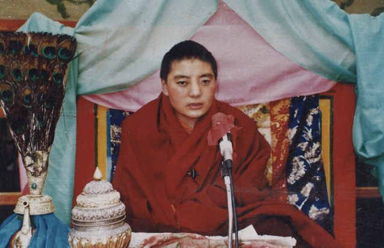
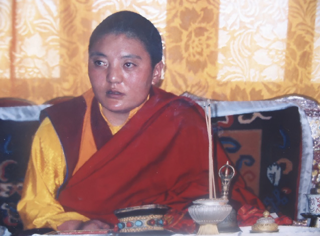
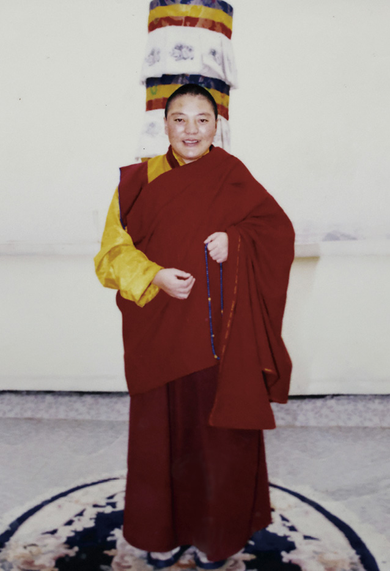
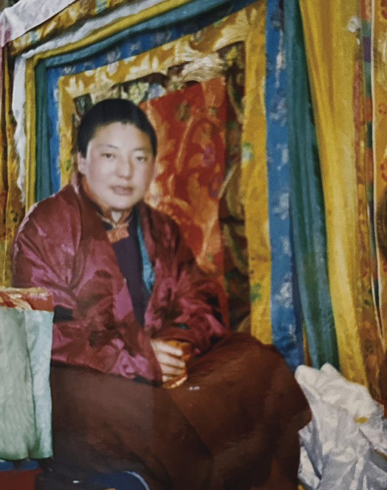
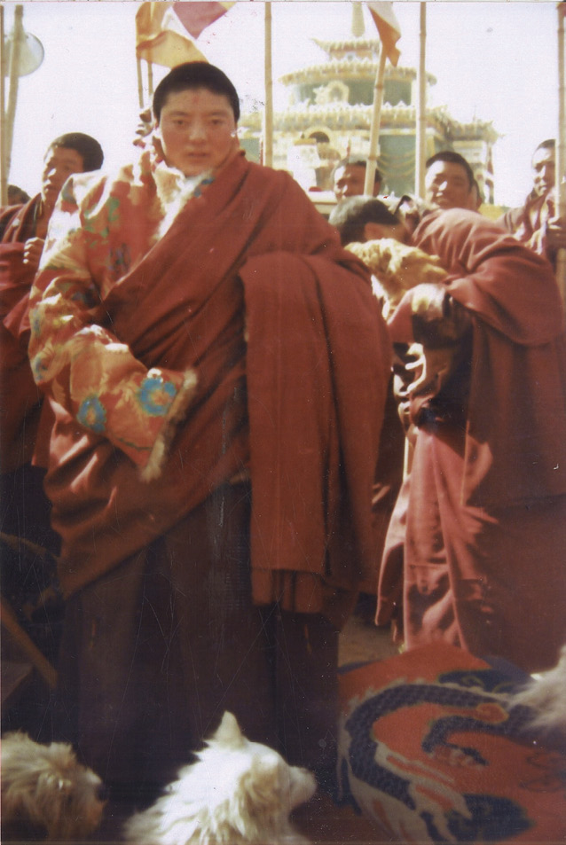
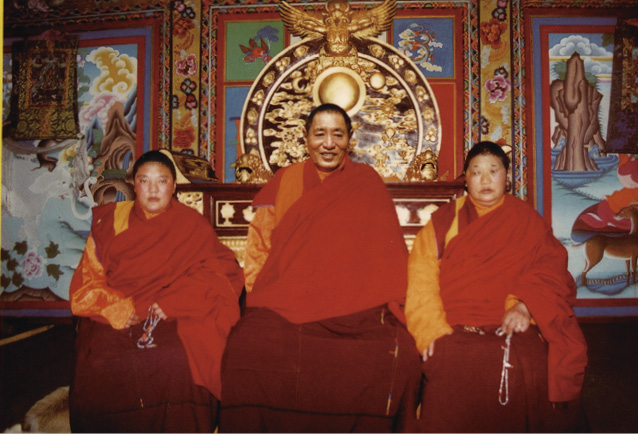
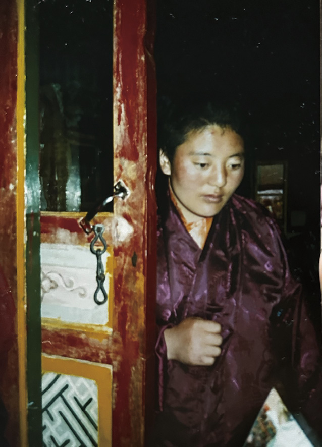
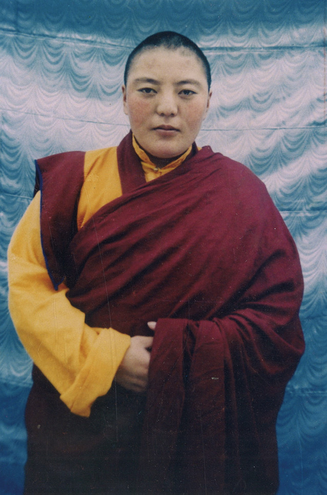
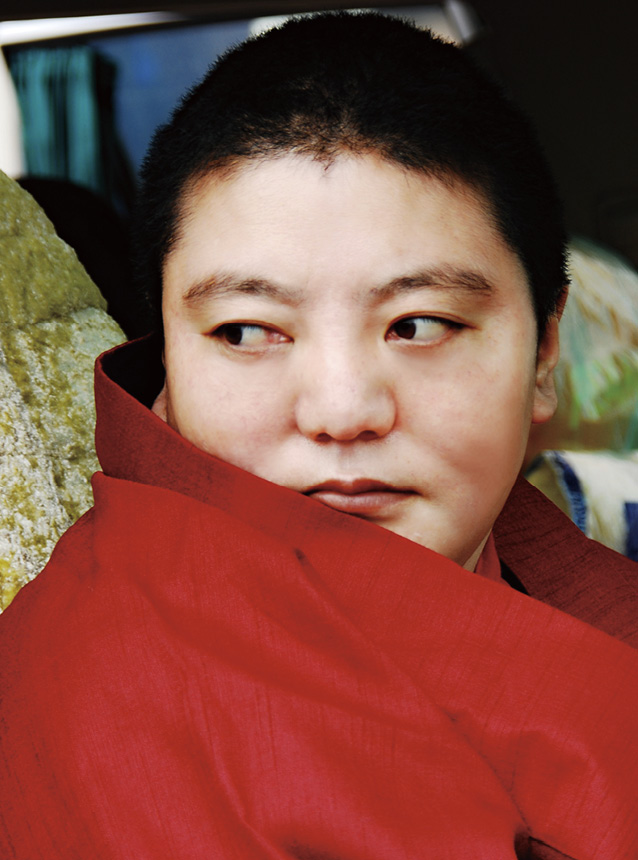

# 5．前往邬金敏珠林等

土虎年（1998年），敏朗派教主东哲仁波切和住持秋匝·蒋华嘉灿等为首，与敏珠林寺僧众一同，通过古觉札那寺密宗法林、库钦邬金禅林的诸位活佛上师，多次祈请门措空行母在前世法座上接受坐床仪式。

于是，当年秋天，门措空行母从色达喇荣大密虹身成就寂静处的莲花空行聚集洲出发，前往成都。九月十五日，当她抵达拉萨贡嘎机场时，立即受到热情等候的人们欢迎，被簇拥着前往敏珠林寺。寺院的僧人以无垢的洁白哈达引路，手执熏香、伞盖、胜幢、彩幡、乐器等，分别在远近不同的地方整齐有序地迎接着远道而来的空行母，并将她请至狮子座上。

该寺的金刚阿阇黎丹增尼玛比丘、住持秋匝·蒋华嘉灿、堪仁波切札西敦哲等为首的全体僧众，虔诚地供养了三门所依的曼茶罗，献上了一整套精致的妙衣，并按照邬金德达朗巴的仪轨，祈祷空行母长久住世，供养了见解脱莲花帽等各种美妙的供品。

当天，应敏珠林寺僧众的请求，门措空行母慈悲地传授了源自至尊德达朗巴伏藏法“吉祥金刚萨埵意修解脱妙道”的甚深灌顶。对每一位僧侣，她赐予了以至尊德达朗巴和全知麦彭仁波切的骨灰所制成的释迦佛像，而对佛学院的僧众，则每人颁赐一尊文殊像和一条哈达。

接着，她细致地参拜了在动荡年代中遭遇凄惨经历的前世寝宫和一些主要所依。当她注视着保存在密宗殿内的父亲德达朗巴的“如我一般”像时，似乎回忆起前世的情景，眼中泛起了泪花。她三次顶礼膜拜后发下了深广宏愿，并对存放在经堂和密宗殿上中下的所有三门所依进行了沐浴开光仪式。当天晚上，她朝拜了邬金敏珠林寺古代保存至今的一箱圣物，金刚阿阇黎丹增尼玛向她认真逐一介绍了相关的历史，她仔细地观看着，并对那些进行了沐浴开光。

在门措空行母面前，敏珠林寺的全体僧人虔诚地祈请：“非常非常希望您在将来能多次驾临此处，为弘法利生而长久住世，深广正法的事业绵绵不断，以无缘大悲不离不弃而摄受我们。”当时，她谦逊地回应：“一般来说，以女性身份很难弘法利生，但过去邬金敏珠林寺的佛法遭受重创时，至尊母门吉华卓挺身而出，肩负起重任，对佛法的伟大事业护持并恢复，将其从垂危之中挽救下来。她对伏藏大师两兄弟的教法发挥了巨大的作用，因此是众所周知、公认的密严邬金敏珠林佛法后弘时期第二代祖师。我本人虽然没有如此功德，但依靠被虚称为门吉华卓的缘起，也愿意全心全意为敏珠林寺的佛法讲修事业贡献一份力量。”

随后，空行母一行人与敏朗住持秋匝·蒋华嘉灿等，一同前往吉祥桑耶不变自成寺，进行朝礼、供养、发愿。接着前往拉萨，为拉萨大昭寺的主要所依觉沃释迦牟尼佛像，全身贴金，并以强烈的发愿深深祈祷，发起殊胜菩提心，共诵《普贤行愿品》，祈愿利乐之源佛法如意宝广弘兴盛长久住世、众生暂时永久吉祥安乐。在拉萨停留约三天期间，邬金敏珠林派的教主东哲仁波切，又名第十三世根桑晋美尊者，携带三匹绫罗锦缎等丰富供品亲临门措空行母住处，说道：“至尊母此行回到前世寺院，圆满了坐床仪式，我非常欢喜，赤钦仁波切也十分高兴，并衷心期待门措空行母未来多次莅临前世寺院。”两位大德在轻松愉快的氛围中，进行了深入广泛的畅谈。

之后，空行母接见了江达县哲达寺的活佛诶敦丹增仁波切和秀色仁波切、南朗堪布衮秋丹增、伏藏师多吉才嘉的儿子吾色多吉、丹毕卓美等诸位上师活佛，以及一千多名僧俗信众。当时，身处冈日托嘎与秀色寺的堪布、活佛、尼众，纷纷祈请空行母莅临，但由于时间关系未能成行。于是，他们将门措空行母请至该寺位于拉萨嘉布山一带的天龙洞，秀色仁波切、堪布与在场的所有尼众供上三门所依的曼茶罗，门措空行母也相应地与他们结上法缘，对那里的佛像、佛经、佛塔进行沐浴开光等。随后，还朝拜了布达拉宫和罗布林卡不变任运自成宫等。行程圆满后，她乘机回到成都，之后，顺利返回色达喇荣的莲花空行聚集洲。

土兔年（1999年），在十万持明大法会期间，喇荣五明佛学院中属于邬金敏珠林分寺和法脉、西钦丹尼达吉寺、古觉札那寺、古觉库钦寺、巴香嘎寺等三十多座寺院的僧人，再次向门措空行母供养了三门所依等，恳切祈祷她为弘法利生而长久住世，不断转深广法轮。门措空行母慈悲地为众人各赐了一尊小小的释迦佛像。

铁龙年（2000年），在喇荣五明佛学院举办的萨迦月金刚萨埵大法会期间，邬金敏珠林的负责人单秋丹增与堪仁波切札西敦哲，以敏珠林寺的名义特意前来喇荣。他们向门措空行母奉上了佛像、佛经、佛塔的曼茶罗，以及锦缎披风、堪布帽等整套法衣，并在整个学院范围内供僧、供灯、供香等，广做佛事。同时，住在喇荣五明佛学院的邬金敏珠林约五十七座分寺的僧众，为门措空行母长久住世，事业如日月般光芒普照十方每个角落，供养了佛像、佛经、佛塔的曼茶罗等各种表示善妙缘起的供品，在喇嘛大经堂，再次举行了空行母的坐床仪式。当时，来自新龙四十座寺院的僧众共同祈祷她长久住世，还供养了三门所依与车乘，以及妙衣、氆氇、种种坐垫等许多高质量供品。门措空行母显现上欣然接受了这些供品，后来不仅将这一切全部赐给了各个寺院，还资助了邬金敏珠林寺建造佛学院，捐款达十五万元人民币。她不仅提供了佛学院僧人们的月薪，还成立了金刚萨埵修行基金会，总计约二十万人民币，并答应护持敏珠林道场。

火狗年，邬金敏珠林寺住持秋匝·蒋华嘉灿及其佛学院的主管堪布西夏、僧人班玛敦哲三人来到喇荣五明佛学院，将至尊德达朗巴、敏朗译师达玛西日二人的《全集》完整版，恭敬供养给门措空行母。还有一次，空行母住在成都期间，堪仁波切西夏作为邬金敏珠林的代表，也将编辑好的敏朗父子二人《全集》完整版供养给她。总之，邬金敏珠林寺及分寺僧众对空行母有着持之以恒的十足信心，门措空行母也以大慈大悲始终如一地护持着他们。

稀奇化身之皓月，俱生功德皎光灿，

弟子群星遍环绕，照耀昔父之古刹。

三百岁月悠然逝，记忆深处难抹去，

吉祥双足再游归，旧时温馨之故土。

昔日门吉华卓尊，隐蔽禁行历历现，

端坐无畏妙法座，纳受缘起之仪式。

回忆前尘往事时，时而兴盛时而衰，

时而聚集时而离，时势变迁不思议。

参拜庄严法轮宫，赴往密宗殿朝见，

伏藏师像忆前世，颗颗泪珠洒落地。

悲喜交织神情中，重见自寺敏珠林，

了义欢喜大乐苑，内心感受难表诠。

