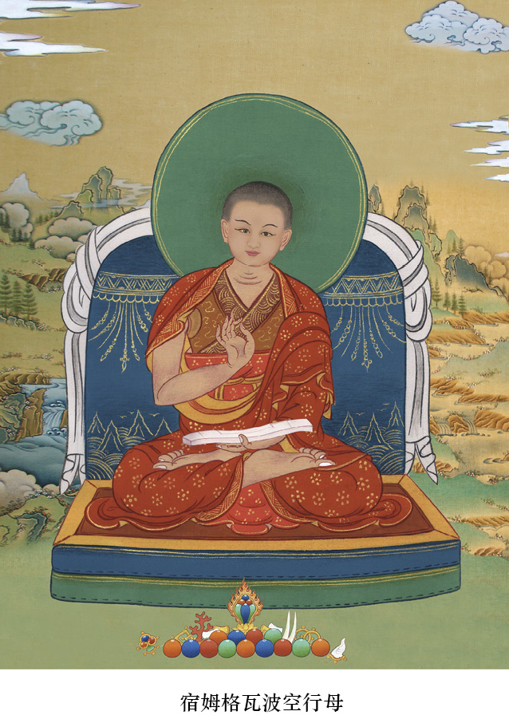

# 5．囊萨吾波空行母

接下来，根据桑吉朗巴的伏藏授记中提到的“西方酿多颇境内，措嘉汝之语化身，共称十万光出世”，讲的是益西措嘉空行母的语化身——还魂大师囊萨吾波空行母。

她出生于酿多加则地方的一个名为江坡克巴的普通家庭，父亲名叫根桑德钦，母亲名叫酿擦萨准。在她诞生的时候，将第一口母乳作为献新洒向空中，说道：“我是为利众生现，愿此大地普吉祥，事业光芒遍诸方，十万众生入正法。”因此，人们称她为囊萨吾波。

囊萨的相貌非常端庄，性情异常温柔，深受父母的宠爱，他们感叹道：“我们年事已高，却生下你这样一个天女，真是太奇妙了。”囊萨不仅智慧超群，还非常勤奋，在处理日常事务时早起晚睡，无论是做饭、编织、务农等，都做得十分出色，她的家庭因此变得越来越富裕。平日里，她不间断念诵观音心咒与度母赞等，对正法的坚定宿愿和深厚习气毫不掩饰地显露出来。

尽管囊萨自幼渴望唯一修行正法，远离尘世的纷扰，然而，当她十五岁时，因其美貌和名声已经传遍四方，被迫嫁给加则热囊地方一位权势显赫的官员札钦的儿子札巴桑哲。婚后，她以随顺世间的行为，维护酿多热囊官员一家。在结婚的第七年，她生了一个儿子，名为拉吾达波。

囊萨是一个善良又有智慧的人，对所属的黎民百姓无有亲疏，都给予平等的关怀和爱护，札钦父子因此决定将财库的钥匙交由她管理。但这时，一个名为涅姆尼祖的小姑心里不悦，出于嫉妒，她诬陷囊萨对来自拉多当热的瑞巴师徒供斋，甚至送给一名乞丐五颗大珊瑚和三颗珍贵的松石。由于这些阴谋诡计，札钦父子错怪了囊萨，并对她进行了难以想象的严厉责罚，最终导致她不幸身亡。

囊萨的遗体被安放了几天后，根据天葬历算的指示：“遗体要被送往东方一座似大象伸出鼻子般的青山上，需要安放七日，期间不得触摸或移动。七日之后，火化或天葬都可以。”遵循这一安排，七天后，送殡的人们惊讶地听到囊萨的声音，当他们靠近时，更是震惊地看到囊萨坐起身来，身披遗体布作为上衣，以白氆氇作为下裙，安详地坐着。这一奇迹让所有人惊呆了，他们急忙通知酿多热囊的长官。热囊官员父子、小姑涅姆等恐慌不已，赶紧来到她面前，纷纷忏悔自己过去的所作所为，发誓绝不再造，并恳求她的宽恕。札钦父子和她的儿子拉吾达波为主的全家老少，多次请求她回到以前的家中，她最终暂时同意了，回去后仍像往常一样。

然而，囊萨对尘世间已经感到深深的厌离，对愦闹的生活产生了极大的厌烦。一次，她回娘家，到父母的身边。她在纺织的地方，依靠纺织唱起教言道歌，表达了求法修行的愿望，但遭到父母的拒绝。她内心充满悲伤，不久后便秘密离开家乡，前往色绕雅玛谷，在上师释迦幢前出家为尼。

札钦父子得知此事后勃然大怒，率军前去攻击，导致雅玛谷的僧众遭受不同程度的伤亡。他们父子看到囊萨身无服饰，只是披着单层布、系着禅带时，愤怒达到极点。就在札钦拉弓射箭、札巴桑哲挥舞宝剑，准备伤害释迦幢上师的紧要关头，上师和囊萨二人大显神变，这使得官兵们颜面尽失，气焰顿消。由此，热囊当地的人们心生敬畏，转而心向正法。长官父子也把一切家当和珍宝全部交给了拉吾达波，舍弃了所有的世间荣华，立誓修行正法。拉吾达波贤明地治理国政，令百姓安居乐业。其详细情节在《囊萨传》中有明确记载。

寿命之灯非时熄，然以见明觉幻变，

复还人间成就者，随念吾波空行母。

