# 6．在喇荣转法轮

土兔年（1999年）夏天，门措空行母在觉姆大经堂为莲花空行聚集洲的全体尼众，传讲了全知龙钦绕降所著的《大圆满心性休息》。此论是作者从觉性界中无勤流露的、以窍诀方式完整宣说佛法见修行与基道果的所有要点、极其殊胜的杰出论典。

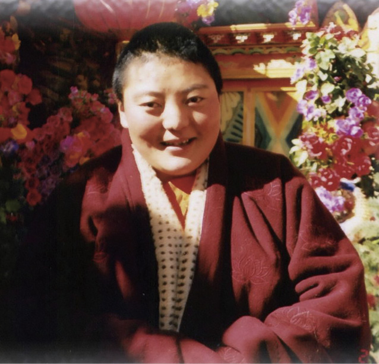

前代的诸位上师亲口讲过：“这一《心性休息》并非普通的论典，而是完整无误宣说显密二宗、生起次第、圆满次第、大圆满之道的特殊窍诀教言书。”它直接以纲要宣说了一位修行人以四种厌世心净化相续、依止善知识、皈依、发心等前行的所有道次第，以及正行生圆双运的总修法、分别自性大圆满实相直指法、道禅定无垢止观双运、修等持之方便，后行如何现前任运自成之果。

以实修法来讲，就像《菩提妙道三处三善引导文》中提到的，可将一切修行归纳为一百四十一个引导，以略、中、广、极广四种方式进行实修。正如引导文的结文中所说：“倘若引导具缘弟子时，圆满一切年修最重要。此法分为略中广极广，略修每日传授一修法，如是四月二十一日时，开启内外密之法藏门；中修三日传授一修法，如是一年二月零三日，获得因果无上乘暖相，必定趋入菩提解脱道；广修五日传授一修法，如是直至一年十一月，一十五日完全圆满时，证悟三宝了义精华藏；极广七日传授一修法，如是二年八月廿七日，圆满胜乘精华引导文，趋入不退菩提精藏地。”

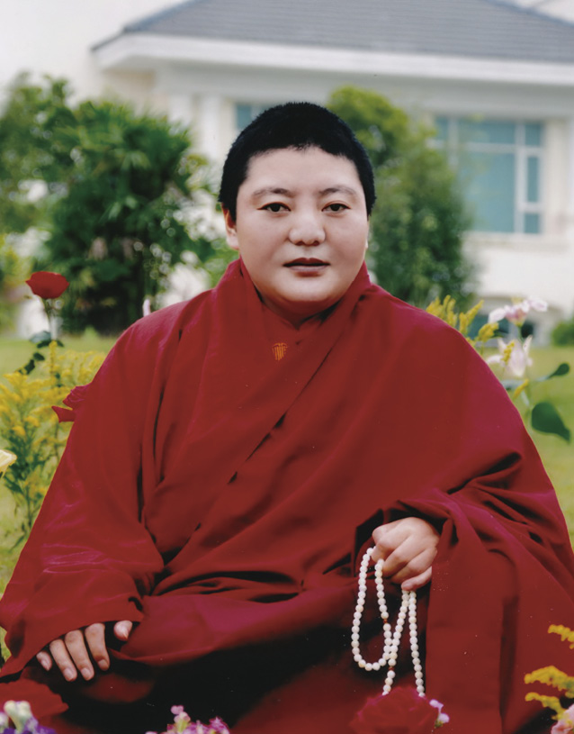

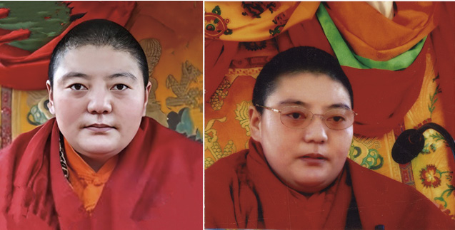

纽西龙多的著作中提到：“在华智仁波切的实修传统中，《心性休息》的这个引导，从前行暇满难得开始到行菩提心六度之间，要修一百四十六天。如果这样行持，上等者必定会成就四禅境界；中等者一定会成就一禅境界；即使是下等者，也不可能不成就欲境一心的境界。成就这些后，再给他直指大圆满的觉性，就能得到真正的止观双运境界。”这些也是顺便谈起的。

铁龙年（2000年）六月十九日，门措空行母在大乐怀业宫，为莲花空行聚集洲的诸位堪姆和辅导员为主的约两百名尼众，恩赐了《密藏续总义·光明藏论》的讲解。

八月八日，法王坐在轿子里，与众弟子一同边唱诵文殊心咒，边绕行多康五台山。法王通过祈祷为神山进行加持，正式开创了转绕多康五台山的先例。途中，经过法王兄妹在特殊时期曾经居住的紫青琼夏地方时，法王表示：“在门措空行母降生之地，需要兴建一座塔。”当时，阿嘉村的信众主动承担了整个建塔工程，承诺将善始善终地完成这一重任。

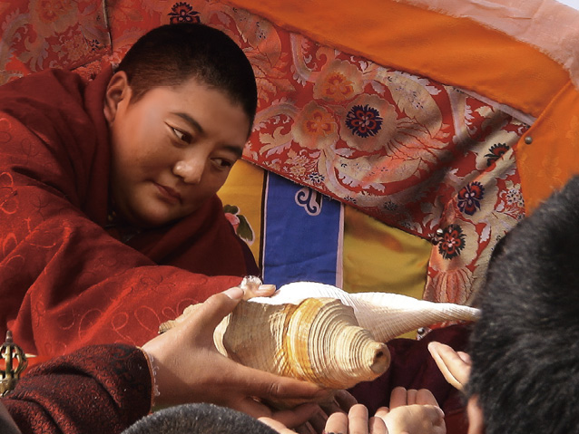

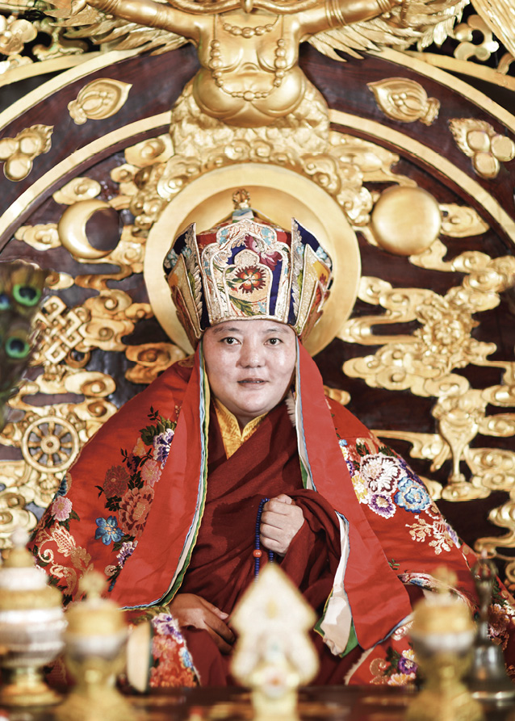

那年的九月十九日，在居士林举行极乐大法会期间，法王大慈大悲地为约五万僧俗赐予了相应的教诲。门措空行母传授了“阿弥陀佛”、伏藏大师列绕朗巴伏藏法“观音菩萨”、“播解脱种子”的灌顶，满足了现场信众的愿望。

记得在那不久以后，法王考虑到委任门措空行母为自己补处的特殊缘起和必要，开许学院内的智者们为门措空行母撰写各种赞颂文，并让他们在课堂上当众以悦耳的妙音引吭吟诵，如此持续了许多天。

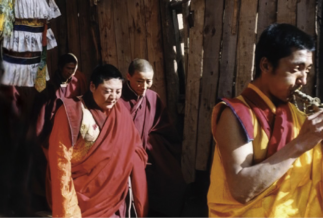

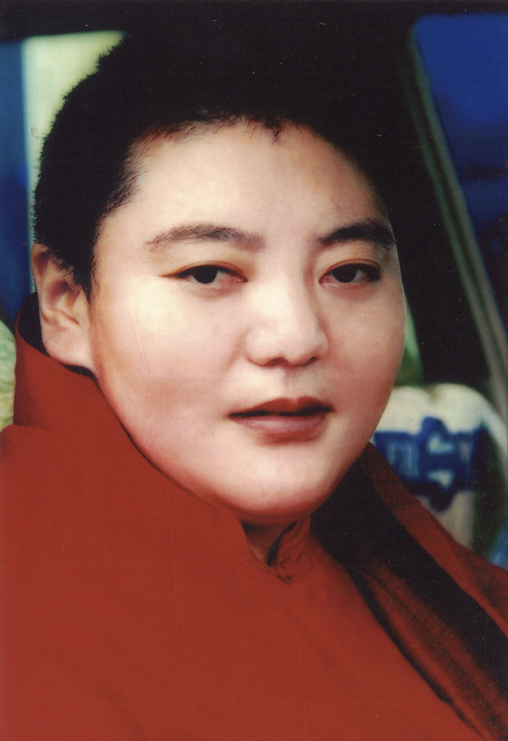

十月初二，法王如意宝为全体弟子传授了《密藏续注释·日月藏》，而门措空行母则在万人大经堂为全体僧众传讲了夏嘎·措周壤卓所著的《光明大圆满见歌·大鹏展翅》和《任运自成顿超歌·开启百门禅定之钥匙》。这一传承，按照远传来说，是夏嘎·措周壤卓传给后藏大成就者香巴秋增，他传给具证上师噶玛秋佩，后者再传给至尊门措空行母。就近传而言，夏嘎·措周壤卓传给法王上师如意宝，然后法王又传授给门措空行母。

那年冬天，在喇荣五明佛学院求学的受持邬金敏珠林法脉的众弟子，包括古觉札那寺的堪布活佛上师僧人们、库钦寺的上师僧人等，前去拜见法王如意宝，真诚地请求：“当今大圆满《阿底深义》的引导传承十分罕见，门措空行母是门吉华卓的真正化身，她前世的深法《大圆满阿底深义藏·引导法备忘录》已立成文字，名为《普贤密意庄严》。特别期盼门措空行母能将这一甚深法传授给敏珠林法脉僧众为主的全体弟子，请予以开许。”法王慈悲地回应：“门措应该可以讲《阿底深义》，她自己在新龙阿蒋喇嘛座下完整地接受过传承。阿蒋喇嘛是敏朗大堪布阿旺·钦哲罗吾的亲传弟子，因此也算是拥有近传了。”随后，古觉活佛卓嘉和堪布益西彭措等人提供顺缘，印制了法本。虽然这一引导文的法本印了上万册，但由于听法的人太多，仍然有许多人未能得到法本。

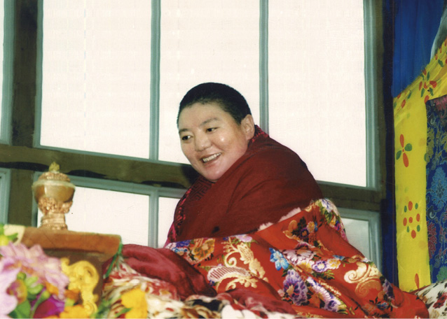

铁蛇年（2001年）二月二十一日，门措空行母依靠她前世门吉华卓所造的《阿底深义补充文》进行了灌顶。接着，从引导法开始，她用了一个月的时间广泛讲解。在传讲圆满的当天，舅舅法王说：“现在门措已经善始善终地讲完了《阿底深义》。她的前世门吉华卓在世时，父亲至尊上师德达朗巴在四个月之内，将这一不可多得的传家宝——《阿底深义》的精华教言毫不保留地传授给她，并且她也进行了实修。当她达到了加持验相不错的境界时，父亲伏藏大师说：‘女儿啊，根据伏藏授记中所提到的，你是一位合格的修行人。’

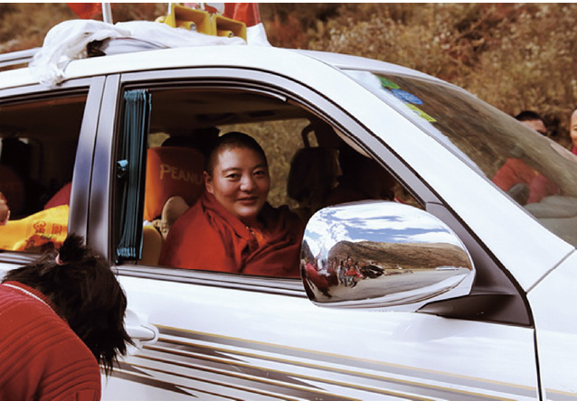

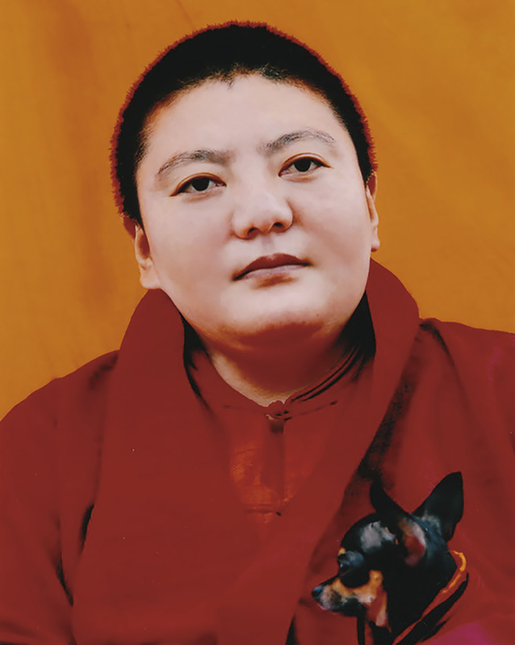

非常感谢邬金敏珠林佛学院的活佛们与库钦寺的僧人们这次祈请传讲这一引导法。库钦寺在弘扬敏朗教法方面，曾有着极其重要的历史作用。据说，敏朗伏藏大师仁波切的亲传弟子堪布南珠桑波在修建库钦寺时，请伏藏大师为该寺赐名。德达朗巴因为它将来会对敏朗寺有特别大的助益，所以取名为‘库钦禅定法林’。在蒙古恶君晋嘎巴摧毁多札寺、敏朗寺等宁玛许多寺院，达玛西日大译师和第二代住持班玛杰美嘉措等大德惨遭杀害的时候，门吉华卓空行母不得不逃往锡金，敏朗第三代继承人杰美仁钦南嘉则经过门隅地区，秘密地被请到康区古觉库钦寺。仁钦南嘉的传记中也曾将库钦寺郑重地称为‘自寺’。在敏朗教法复兴时，至尊门吉华卓从锡金返回，而仁钦南嘉从康区库钦寺上来，这两位同族兄妹为敏珠林的佛法讲修事业做出了巨大贡献，因此被尊称为‘再弘佛法二明灯’。

这次主要也是应库钦寺上师僧人们的劝请，门措为喇荣全体僧众认真传授了《阿底深义藏》的灌顶和引导。本次，《阿底深义藏》的请法者包括喇嘛、觉姆、汉僧、居士林四众弟子，尤其是僧众中有这么多如连绵金山般的堪布活佛，每一位堪布活佛的事业都不可思议，因此，他们也将为成百上千堪为法器的众弟子传讲。从这个角度来看，《阿底深义藏·普贤密意庄严》这个法似乎在很长时间内不可能隐没。因此，门措也算是对总的佛法、特别的邬金敏珠林教法起到了一定的作用。”

种种所化意界根，十二月宫相伴行，

二尊日月合璧灯，正法千光遍百方。

汝之尊颜莲绽放，敏珠教法甘露滴，

十万融成甜蜜流，具缘心底吉祥旋。

所有法雨如意云，弥漫善愿天空中，

欲解心现春光美，信心欢喜苗芽长。

实修四因系妙语，具义动听之梵音，

善传众生之耳畔，心中法喜日俱增。

授记阿字大尊主，即名阿巴师之教，

阿义究竟绝密要，阿底深义赐予众。

累劫难遇之深道，内现智慧大圆满，

如海续教窍诀精，非汝莫属恩赐众。

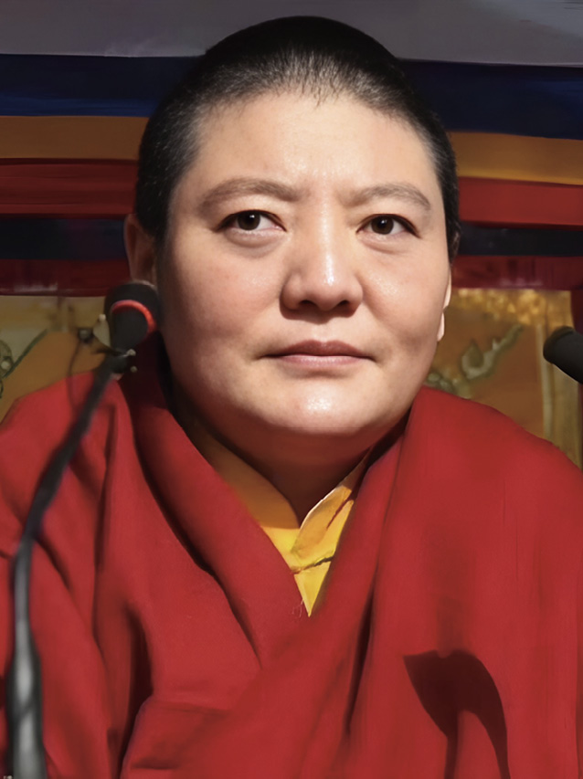
