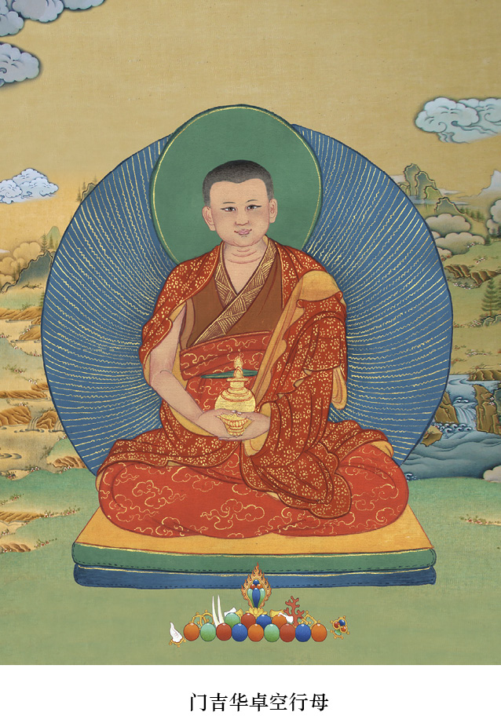

# 6．宿姆格瓦波空行母

下文介绍的是益西措嘉的功德化身，被称为宿姆格瓦波，亦名克珍桑吉空行母。她出生于后藏的宿俄巴龙巴家族，是宿敦·香巴桑给之女。她有两位姐姐，长姐名为宿哈，二姐名为喇玛秋嘉。她是家中的小妹，名花丹措姆，即宿姆格瓦波空行母。

如《心部酿派传承祈祷文》所述：“修学究竟确信具禅定，断轮回过自性瑜伽母，玛吉宿姆克珍桑吉前……”她自幼心相续便充满俱生的禅定等无量功德。尽管她是一位真正的自性瑜伽母，但显现上，她在童年就选择远离尘世的过患，出家为尼。她依止了卓钦·桑哲多吉等多位智慧与成就兼备的上师，精通生起次第、圆满次第、大圆满的意义，并以修行作为人生核心。由此，她不仅在生起次第方面获得稳固的境界，而且对圆满次第的殊胜本智获得自在，甚至成为大圆满心部酿派的教主，被誉为“大圆满觉受证悟境界超群的玛吉宿姆·格瓦波”，声名远播。

在她的下半生，她居住在酿玛则加的修行院，利生事业极为广大，成功培养出许多弟子。她将《集密意续》的灌顶、交付和印持赐予宿敦·释迦西宁，释迦西宁继而将其传给噶托巴·克主札秋波，克主札秋波再传给智者释迦波巴，后者传给善知识果秋桑波……如此一代接一代，逐渐弘扬开来，形成了“宿派”。这位至尊母传给宿敦·释迦西宁，一直传至噶托多桑，依靠她所撰写的书籍，形成了《集密意续》“康派”。宿姆本人亦根据宿派的观点撰著了《密藏续释》等，由此可见，她也致力于维护《幻化密藏续》这一法脉。此外，这位尊贵的宿姆还将大圆满心部《母子十八续》的觉性妙力灌顶等传授给才旺嘉波活佛。特别值得一提的是，心部酿派的灌顶、教法、引导的大多数传承，都集中于她的手中，使她成为众所周知的大圆满教法的杰出祖师。

综上所述，她承继了内三续部的灌顶、传承、引导的法脉，堪称一位无与伦比且极具声望的大德。在敏朗伏藏大师杰美多吉尊者的传记中也提及，他曾对自己的女儿门吉华卓说道：“你要做到像玛吉宿姆·格瓦波一样。”这清楚地表明了伏藏大师对她的深厚敬仰。

三瑜伽法付教者，研修究竟具定力，

经幻心等熟解藏，怀念宿姆格瓦波。

