# 7．法王兄妹圆寂前后

铁蛇年（2001年），大约在四月份，上级派遣了多个工作组前往喇荣五明佛学院，进行治理整顿工作。六月初二那天，法王前往阿坝州府马尔康接受治疗，门措空行母与母亲也陪同前往。为了调理法体，法王一行又来到四川省会成都市。在那一年的整个冬天到第二年夏天之间，法王等人一直低调地居住在成都的私人住所。

水马年（2002年）五月十五日，法王一行返回色达，在满愿岭住了半个月后回到学院。法王老人家开始为常住的众弟子传授《贤愚经》《大圆满前行》等。在这段时间里，门措空行母也与全体弟子一同以欢喜心、信心、踊跃心，毫无厌足地聆听了法王上师的言教甘露。

水羊年（2003年）八月，法王在大经堂为喇荣的所有弟子传讲了文殊怙主全知麦彭仁波切的《宝性论释》。在这部阐释了义深密要点的重要论典讲完的当天，门措空行母的母亲阿里美珠示现圆寂。几天后，法王发表了一段讲话：“美珠平日再三发愿要在我之前离开人世，如今确实已经实现了。她今生没有造过十分严重的大恶业，是一个尽可能精进行善的人，念诵的咒语数量多达几亿，我感觉她在实证心性方面应该也有一定的境界。从她圆寂时体温收摄以及圆寂后一些上师的授记等情况来推测，基本上可以确定她已经往生到了极乐世界。”

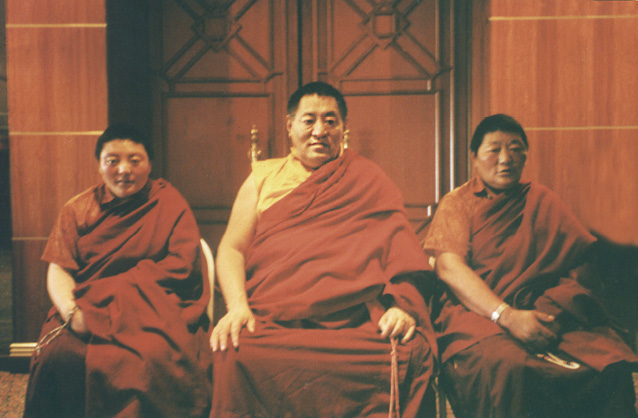

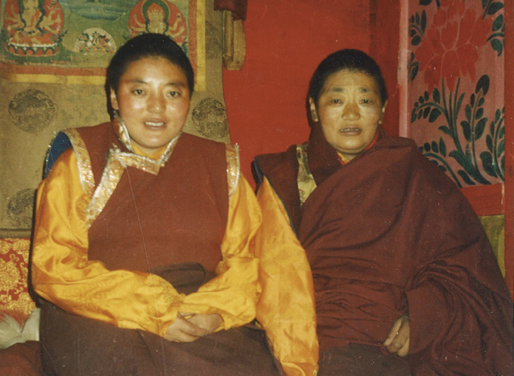

这期间，门措空行母在母亲的遗体前发愿：为了帮助她积累善根，劝大众念诵一百亿遍阿弥陀佛名号。随后，在第十届极乐法会上，她请出了伏藏大师列绕朗巴的伏藏品——名为“降甘露雨”的释迦牟尼佛像。在佛像前，她广劝所有聚集的信众念诵阿弥陀佛名号。结果，发愿念佛名号的数量达到了两百多亿。

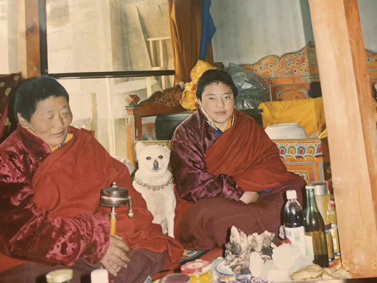

极乐法会结束后，法王开始传授详细阐释第三转法轮密意、了义如来藏实相的论典——全知笃布巴所著的《宝性论释》。没过多久，法王示现法体有恙，于十月十五日前往马尔康进行治疗。二十九日，已经圆寂的阿里美珠的七七日圆满。在此之后，法王上师仁波切从马尔康动身前往成都，住在军区医院，接受了心脏起搏器植入手术。十一月初六，法王在医院通过电话对大经堂内的全体弟子，留下了最后的遗教：“莫舍己道，勿扰他心。这两句，你们不要忘记，要铭刻在心。”

几天后，法王对身边的人说：“本来为了能帮助门措，我曾考虑是否还在这个世间多活几年。然而青春的美好已经消逝，上了年岁的负担与日俱增，我感到有点疲惫，时常四大不调，体力不支，今天一个病好了，明天另一个病又随之而来。因此，我继续留在世间不仅不能帮到她，反而会成为她心理的负担。”据法王身边的一些人透露：“这段日子，法王与门措空行母放松地聊了很长时间。估计是法王对她私下讲了一些教诲和嘱咐。”

十五日黎明，法王如意宝完整地念诵了一遍平时始终随身携带的一部密续。大约在七点钟，法王的病情显得有点严重，他老人家说：“现在我要端直安坐。”说完后，手结定印，双目凝然直视对面，以入于禅定的神情，身体如如不动地安住，最后容光变得黯淡、气息逐渐消失，庄严的色身完全回归于光明法身界。

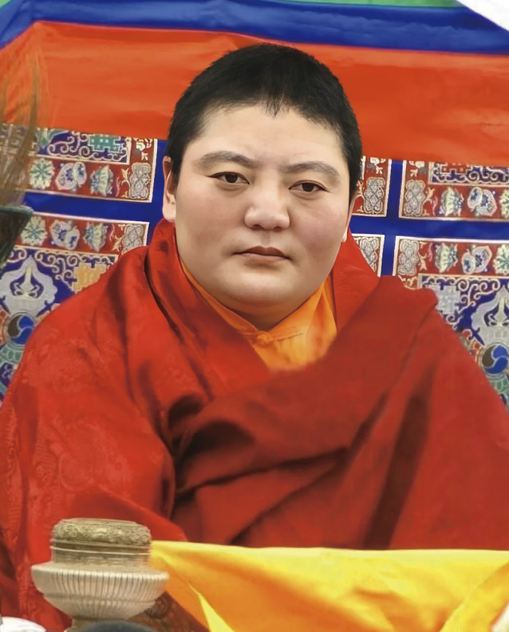

据说在当时，门措空行母面对着法王的法体，久久地凝视，大概是将自己的心与法王的智慧融为一体，沉浸在这种入定境界中。过了一会儿，身边的才仁医生问：“现在该怎么办？是否应该将法王的法体迎回学院？”这时，门措空行母才出定，泪水夺眶而出。这一幕确实令人感到十分悲痛。

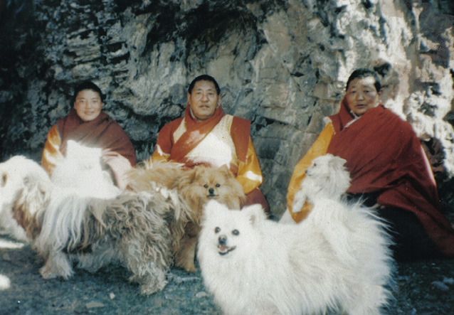

原本，他们三人依靠往昔的宿缘和愿力成为一家，她从小就在恩重如山的舅舅和母亲的呵护下茁壮成长，无论是在世间还是出世间方面，如同被雌鸟哺育的小鸟一般，得到了无尽的关爱。在过去的三十多年里，一直未曾离开过他们的关怀和慈爱，一路走来相依相伴，如影随形。然而，突然间以迅雷劈顶之势，犹如心脏般的舅舅尊者和明目般的母亲在短短两个多月里相继辞世，寂灭于法界之中，这确实是一场难以想象的变故。

如果是一个普通人，可能对此难以承受，甚至会悲痛欲绝。然而，她只是哭过一次，显露出如山王般沉稳的心性，并未表现出过度的无助感。想必这是因为她深谙“自心即上师”的见解，洞悉了来去聚散如幻，领悟到生死只是在花园中游玩的一种验相。正所谓：“言死是分别，勇士瑜伽母，领至空行处，法身清净中，彼岂有死殁？彩虹画消失，彼岂有死殁？心无生死中，彼岂有死殁？如幻城市中，彼岂有死殁？空悲无别中，彼岂有死殁？光明清净中，彼岂有死殁？缘起聚散中，彼岂有死殁？自心无生灭，彼岂有死殁？去往净土中，彼岂有死殁？我于离去时，思我所化众，切莫悲伤也，向内观自心，无改见本体，即是不离我。”

可能正是因为早期法王曾传授过这样转为道用的甚深教言，她并非只是空谈其义，而是亲身实证并修行过。后来门措空行母在与内部的眷属聊天时亲口说过：“平时一入梦乡，就能在梦中见到舅舅和阿妈，因此内心感到十分欢喜，仍然觉得与他们在一起，从未觉得他们已经离别。”

唯一离戏法身师，二现去来合离无，

三处空行相迎乐，唯是所化四众现。

就这样，在众生怙主法王及其妹妹圆寂后的一段时间里，门措空行母低调地住在喇荣五明佛学院自己的住处。

木猴年（2004年）四月初七，她为整个学院的四众弟子赐予了敏朗“金刚萨埵”灌顶。初十那天，喇荣桑耶经堂的重建已经竣工，在举行开光仪式时，空行母为全体僧众赐予了伏藏大师列绕朗巴“三根本”的甚深灌顶。同年九月十八日开始的极乐法会期间，她在居士林为学院四众弟子和数万僧俗信士，传授了“阿弥陀佛”“观音菩萨”“播解脱种子”的灌顶等。

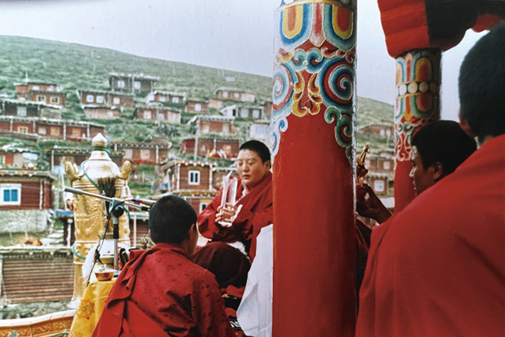

木鸡年（2005年）四月初七，门措空行母在十万人坛城法苑为佛学院的全体四众弟子恩赐了至尊德达朗巴的伏藏品“金刚萨埵意修事业仪轨”灌顶。在这期间，她还为修传教派的耶托上师噶玛索南及少数眷属赐予了“缘起除障法”灌顶。次年六月初四，空行母前往洛若旺夏寺，亲自为重建的经堂中的全部能依所依进行开光，并接见了当地的僧俗信众，当晚她住在那里。次日，应克旺罗吾活佛的请求，为他身边的眷属和汉族弟子们传授了“播解脱种子”的灌顶。

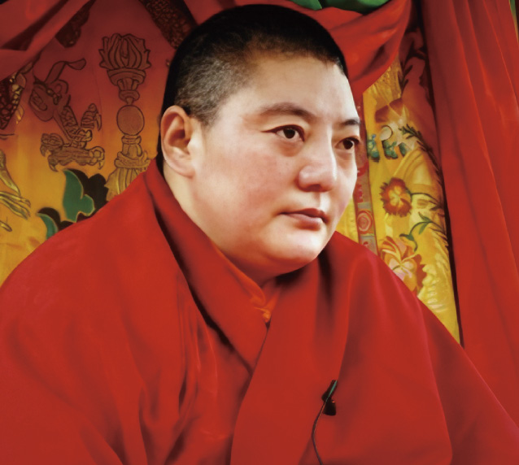

火猪年和铁兔年的金刚萨埵法会时，在十万人坛城法苑，她像以前一样为全体弟子进行“金刚萨埵”灌顶。火猪年九月十八日，极乐法会召开时，她在居士林为四众弟子为主的数万信众赐予了“阿弥陀佛”“观音菩萨”“播解脱种子”的灌顶。

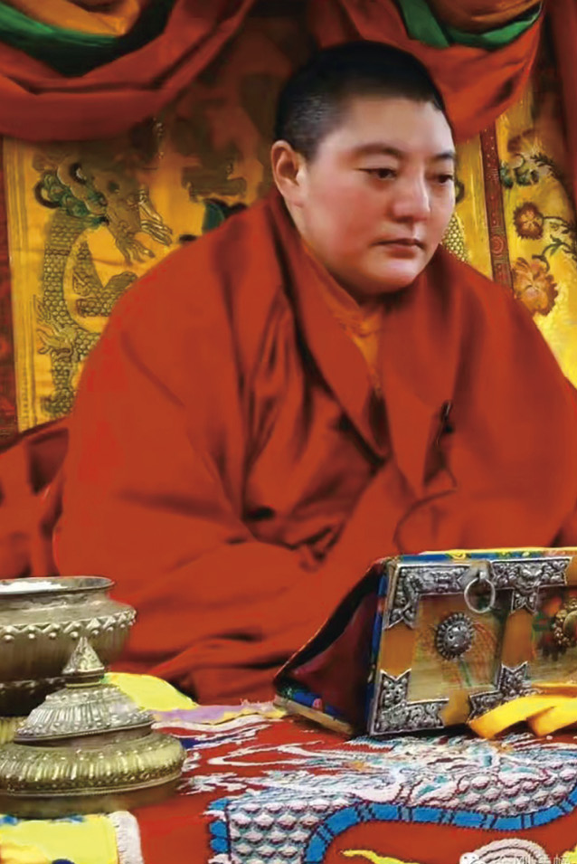

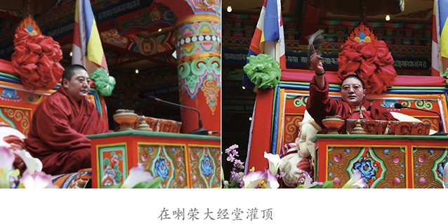

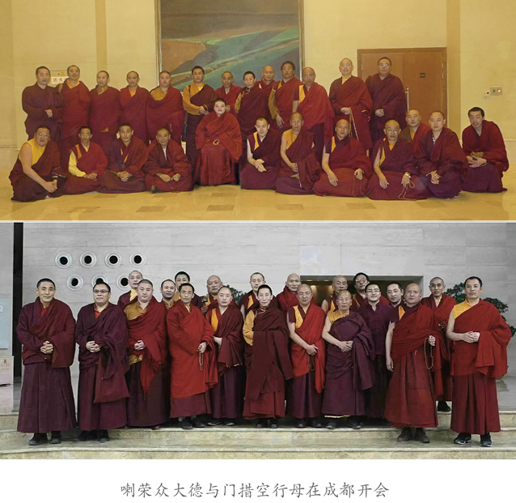

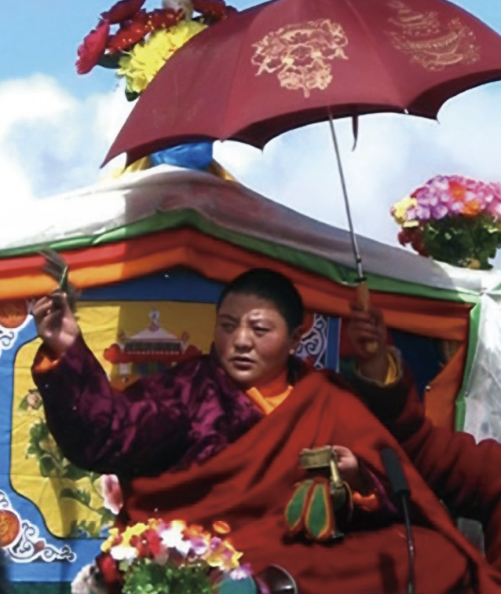

铁兔年（2011年）六月，父亲家族阿邦的兄弟亲戚们，在热萨部落尼地的吉祥法苑聚会。此时，当地僧俗多次祈请门措空行母前来，尤其是身患重病的父亲，怀着巨大期盼郑重请求，最终得到了空行母的应允。六月初二，她亲自前往，对来自各地的同族兄弟亲戚为首的与会大众，传授了“播解脱种子”灌顶，与他们结下了法缘。亲戚们纷纷发愿，尽己所能地持诵佛号和甚深心咒等。值得一提的是，热萨部落的人们发誓断绝杀生，对马、牛、羊，甚至包括家犬在内的动物，都进行放生。同时，来自远近各地的成群信众中，也有相当多的人承诺戒杀放生。

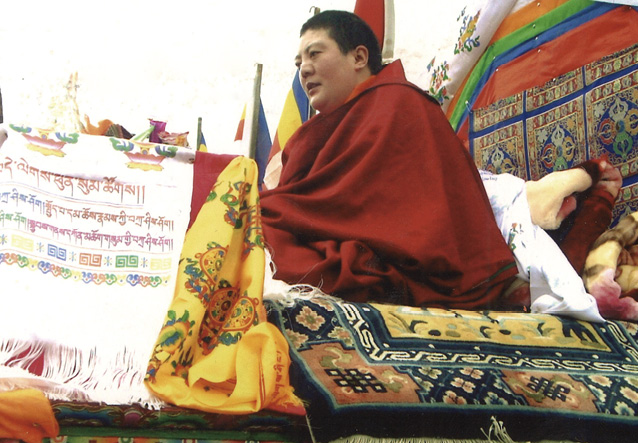

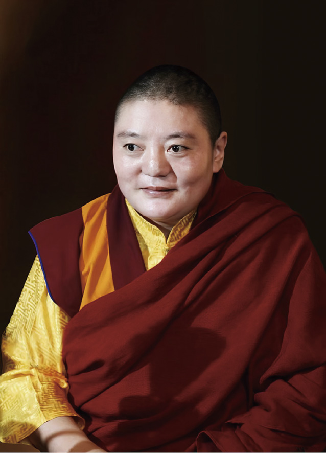

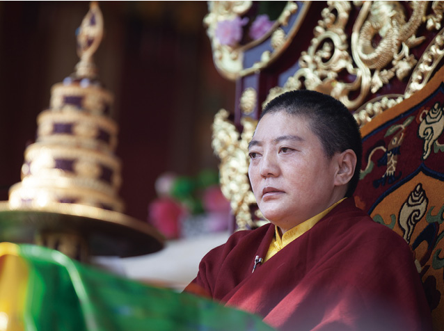

六月初四，门措空行母在万人大经堂，为喇荣五明佛学院的全体僧众，传授了甚深见派的菩萨戒。这一菩萨戒的传承上师包括：全知无垢光尊者之前的上师们，详见于《心性休息三处三善引导文》中所宣说的传承次第；无垢光尊者之后的上师们，依次是克哲恰达酣哲、蒋扬札巴吾色、彻耶桑吉温波、全知达瓦札巴、大成就者根桑多吉、无等嘉灿华桑、克哲那凑扬珠、殊胜成就者丹增札巴、全知多昂丹增、持明陈蕾酣哲、伏藏大师杰美多吉、大译师秋华嘉措、炯意云勒哲、嘉哲仁钦南嘉、大堪布邬哲雅那、杰美桑昂丹增，一直到蒋扬钦哲旺波；或者，伏藏大师杰美多吉传给嘉哲仁钦南嘉，然后是赤·班玛丹增、杰·陈蕾南嘉、至尊母陈蕾秋卓、蒋扬钦哲旺波。再逐渐传至邬金丹增罗吾、大堪布根桑华丹、雅西上师罗珠仁波切、菩萨摩诃萨法王如意宝，最后传给了门措空行母。

水龙年（2012年），大约在夏初，门措空行母从汉地返回喇荣。在此期间，慈诚罗珠堪布、索达吉堪布、希阿荣博堪布、革日堪布、益西彭措堪布、土尼堪布、秋扬尼玛堪布等堪布活佛亲自前去迎接。全体僧众，包括喇嘛、觉姆、汉僧、藏族居士，以及来自各地的僧俗信众，以特别隆重的仪式欢迎她的归来。八月十三日，色达尊胜塔寺佛学院的经堂主体建筑完工时，他们请门措空行母参加该寺举行的缘起法会，僧俗信众列队欢迎，将空行母一行请至佛学院经堂的所在地。当天，门措空行母为尊胜塔寺当地的僧俗弟子以及色达县附近的一千多名信众赐予了“阿弥陀佛”灌顶。得受灌顶的每一个人，都在她面前发愿念一百万遍阿弥陀佛名号。接着，多昂尼玛活佛邀请门措空行母到自己的住处用膳，空行母晚上返回喇荣。

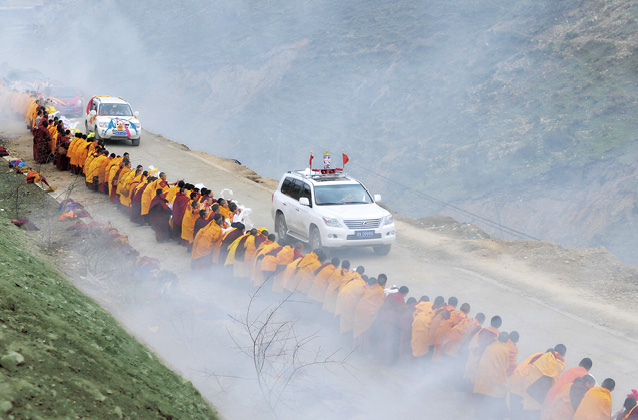

水蛇年（2013年）四月十八日，在万人大经堂内，门措空行母与堪布活佛诸大善知识以及数千名求学者齐聚一堂。她置身于大众中央，坐在高高的法座上，首次在公开场合，为显密及五明学科成绩优异、荣获学位的十七位堪布与二十八位堪姆，以及专攻密续的五位堪布，亲手颁发了堪布堪姆证书。

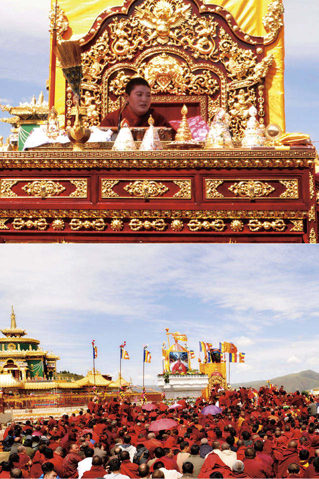

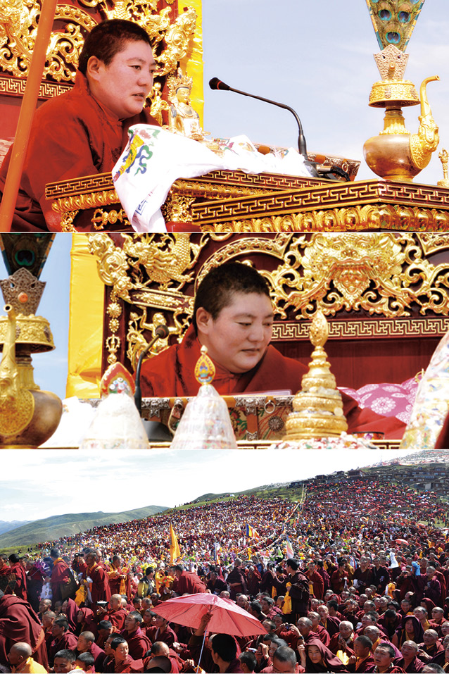

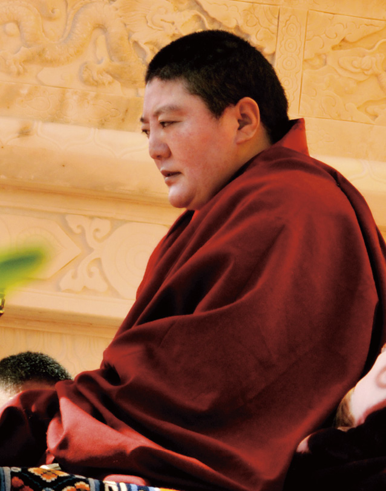

同年五月十五日，门措空行母和身边五十多名眷属一起到色达河边的满愿岭耍坝子。这时，新龙措嘉寺、密宗大乐法林寺以及当地部落的代表，总计约六十人前来拜见，献上吉祥的哈达和问安，随后恭敬顶礼，并恳请她再次到新龙。门措空行母欣然答应。

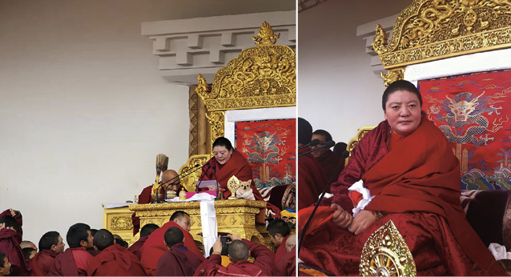

八月十五日，她带着身边的眷属，从喇荣出发，途经色达县和东古地区前往甘孜。途中，接见了前来迎接的新龙县加则地方为主的各地信众代表。抵达甘孜后，受到当地一万多名善男信女虔诚恭敬的隆重迎接，并在下榻的宾馆六楼接见了众人。

次日清晨，前往新龙的途中，受到了来自新龙上方、达革寺、耶瓦寺等地人们的热烈欢迎。特别是，则拉波寺的堪布活佛们及其佛学院全体僧众进行了盛大的迎接。当天，从甘孜到加则措嘉寺，前来迎接的有五百多辆车的车队、加则一百多名男子骑马的马队、许多身着供养天女服饰的少女，在他们的引领下，全体僧众一边吹着白色海螺，一边奏着铙钹和铜铙等各种法器，远远地前来热情相迎。空行母抵达加则密宗大乐法林寺后，安坐在金座上，为寺院进行了开光加持等。下午前往措嘉寺，入住她本人的精舍——空乐空行宫。

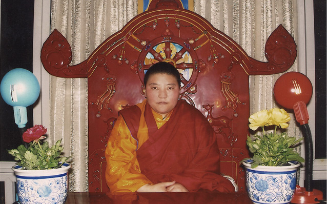

十七日上午，在加则法轮苑，门措空行母为十万多名信士赐予了“阿弥陀佛”灌顶。这里共举行了七天的极乐法会，期间，大众发愿念诵的阿弥陀佛名号达到了三百多亿遍，阿弥陀佛心咒高达两百多亿遍，受斋戒有几十万次之多。此外，还有大量信众发愿念观音心咒、莲师心咒、《普贤行愿品》和《极乐愿文》等，其念诵数量从几万遍到一亿遍不等。在这期间，更有一万多人郑重立誓戒杀放生、断荤茹素，不再参与打架斗殴。

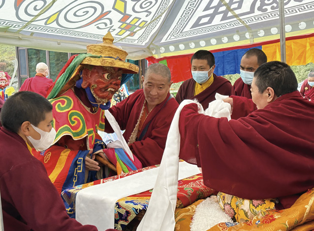

二十七日，空行母在空乐空行宫前的草坪上，观赏了加则地方和寺院表演的各种节目、悦耳动听的吟唱供养等，师徒大众共同享受了一场欢悦的喜宴。当天下午，门措空行母为加则地方和寺院的众人，特别赐予了法王上师的伏藏法——“项袋金刚橛”灌顶。加则密宗大乐法林寺的僧众和措嘉寺的尼众，相继表演了《丹哲悦吾布美传》中的息业事迹、《囊萨吾波空行母传》、格萨尔王金刚舞等，作为供养。同时，措嘉寺、密宗大乐法林寺的当地众人为感恩空行母，供养了身所依的一百多尊大大小小长寿佛像，语所依的《甘珠尔》等，意所依的各类佛塔，功德和事业所依的白色海螺、铙钹、唢呐等法器，还有各种不同的金银供品、一百多匹马、几十万人民币、许多地毯和茶砖等，他们以曼茶罗的方式献上了这些丰富的上等供品。

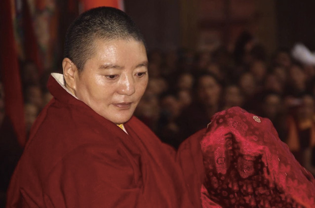

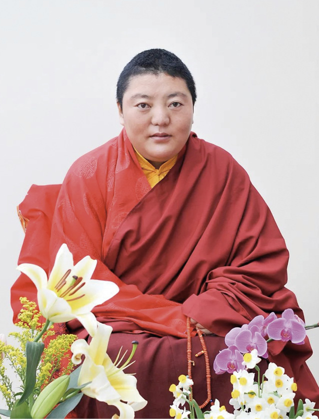

门措空行母说：“我们大家就像一家人，不需要这样。我们之间有着十分紧密的法缘和誓言关系，虽然我平日心里挂念你们，但已经很久没有来到这里了。这次再次来到你们所在的地方，我感到非常开心……”最后，她慷慨赐予两座寺院及当地三十万人民币，地毯和茶叶各两百多条，以及许多礼物。二十八日，她从新龙前往甘孜，第二天上午抵达甘孜的达混部落，为僧俗信众念了《佛子行》的传承，并传授了长寿灌顶和延寿法等，结上法缘。来自附近的小沙弥们为了表达感恩之情，在空行母面前背诵了《佛子行》以作供养。下午，空行母一行返回喇荣。

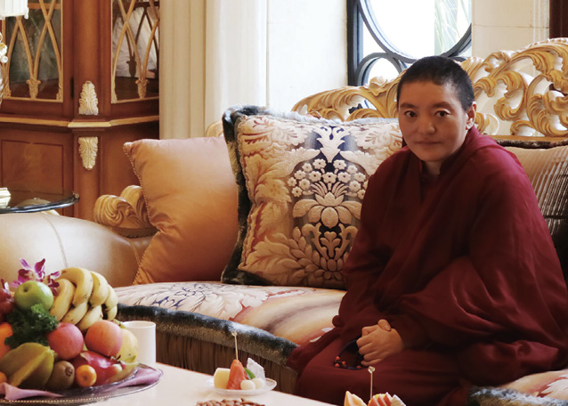

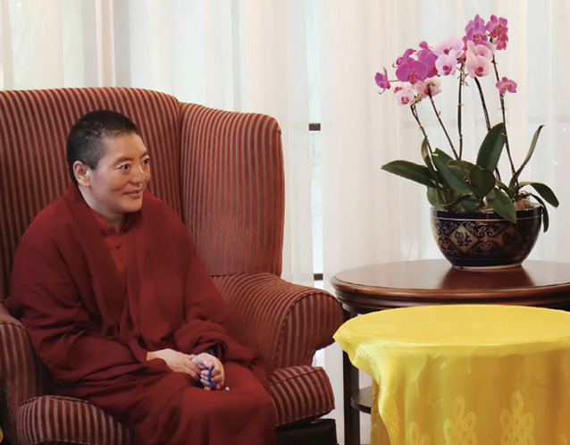

六月初十，应多昂尼玛活佛、秋涅多吉活佛等人的邀请，空行母莅临色达达龙寺。在这里，她为经堂进行了隆重的开光仪式，并为来自各地的上师、活佛、堪布以及五千多名僧俗信众传授了“阿弥陀佛”灌顶，与之结上法缘。六月二十九日，当色达尊胜塔寺的佛学院经堂全面竣工之际，桑哲罗吾活佛再次诚挚地邀请空行母为经堂开光。于是，门措空行母一行亲临尊胜塔寺，受邀入住经堂内一间特为她所建的精舍，受到了热情的款待。在当天晚上，门措空行母为具有信心的汉族弟子和个别僧人赐予了“观音菩萨”和“金刚萨埵”的灌顶。次日上午，她与喇荣五明佛学院的堪布堪姆等三百多名僧众一起，被迎请至该寺新建成的佛学院经堂，进行了撒花开光仪式。

来自西南境天使，后从雪域深山间，

伴随五色之彩虹，前往自处铜色山。

照见真如彼尊前，现隐生灭聚散等，

世俗戏论了不得，所谓圆寂唯名言。

除心暗者唯依怙，现相回归寂灭界，

至尊空行悲月光，徒众繁星之庄严。

发心皎光为点缀，妙行十六臻圆满，

彼身清凉明月轮，于大道场空中游。

数万持藏众大德，虔信顶戴之宝珠，

至诚依止女圣者，广袤大地难寻得。

或是安住或外出，或是安坐或去来，

种种方便度众生，无厌导师汝前赞。

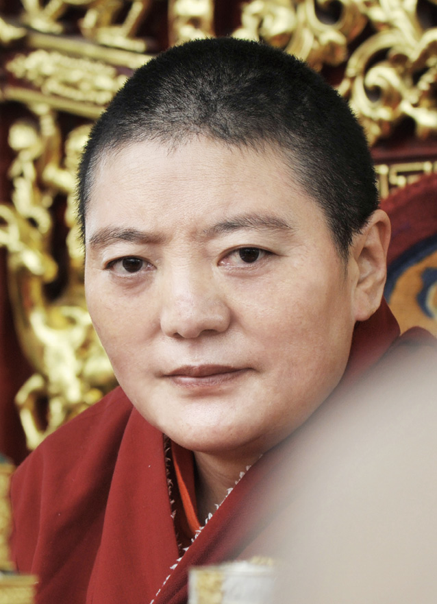
