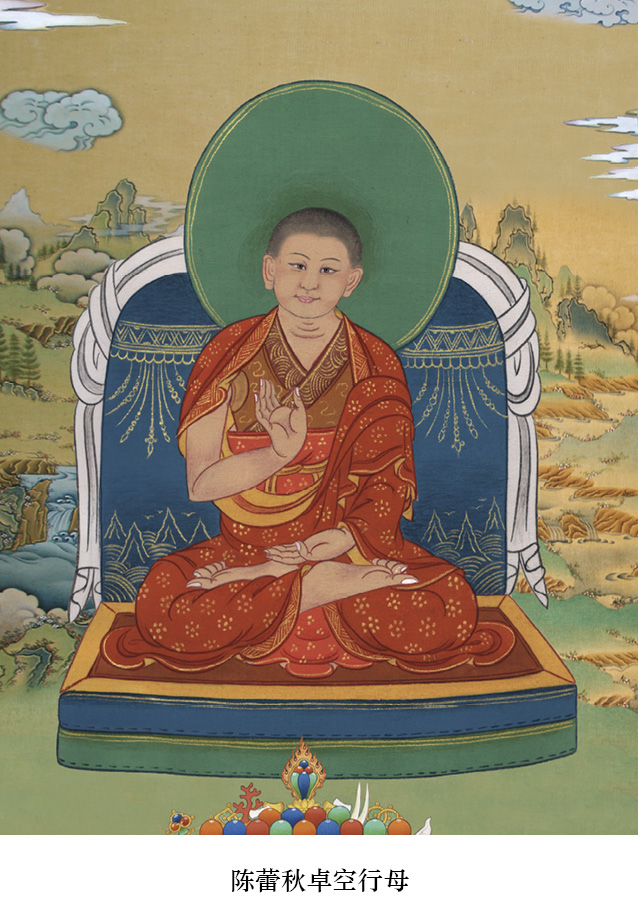

# 7．门吉华卓空行母

接下来讲的是，益西措嘉空行母的事业化身——了义俱生空行母门吉华卓。

门吉华卓出生于吉祥桑耶不变自成寺南方、位于扎囊地方的密严邬金敏珠林寺，父亲是具有德唐玛纽种姓、致力于调化众生的持明者大伏藏师秋杰嘉波，母亲是前朝法王的无误后裔彭措花作。门吉华卓在一个良辰吉日——土兔年十月二十五空行聚集日，于上师宫的法轮妙吉祥光明室中降生，生时伴随着稀有的瑞相。

父亲说：“她是我种族的传承人，不同于一般人，必须举行清净仪式。”于是，敏朗大译师达玛西日用遣除不净晦气的忿怒秽迹金刚仪式为她拂浴，她的父亲敏朗大伏藏师也按照新伏藏，特意赐予她“红威猛尊”的身语意灌顶与“无死精藏总集”的长寿灌顶等。

当她十二岁时，在普贤宫这个小精舍中，敏朗大伏藏师秋杰嘉波尊者为她剪发，并给她取名为“门吉华卓”。从那时起，她始终伴随在父亲的身边。在深法持明心滴的坛城中，她依靠四灌顶水成熟相续，敏朗大伏藏师还独传她生起次第、圆满次第、大圆满等许多不共窍诀。接着，她在勒当拉旺乐园的无死大乐茅棚中，独自进行了一年的精勤禅修。

十三岁那年，铁兔年三月出关后，她在父亲的座下，学习了新伏藏《阿底深义》的精华教言近四个月，随后实地修行，从而生起了殊胜的觉受和证悟的境界。

在她修持顿超期间，当生起“觉性如量相接近圆满”的心识觉受时，父亲对她说：“女儿啊，根据伏藏授记所说，你的修行与前世的习气息息相关，与普通人大不相同。你现在应该在禅房中认真修行几个月，之后你需要接受‘金刚萨埵’与‘深道善逝总集教言’的灌顶和引导。”她遵从父亲的教诲，在接下来的近五个月中，专注修习“阿底深义”。

到了十四岁，她在父亲敏朗大伏藏师面前，得受了“大悲善逝总集”的灌顶和引导，尤其是关于脉引导的生圆次第的所有教言，父亲都细致地作了讲解。每次学习结束后，父亲还会对她进行考核，确保她完全掌握了所有甚深引导的总要点，特别是那些教授的究竟密意。通过这些学习，她对教言的修行要点不再茫然无知，而是对能成熟的灌顶、能解脱的教言意义生起了进一步的定解。

此后，她的叔叔，敏朗大译师仁波切，将《深道善逝总集》中圆满次第方面的许多相关教言传授给她。并在近两个月的时间里，还教授了她修行各个幻轮时的身体姿态、风脉明点的所有窍诀。门吉华卓因此成为了这些甚深要诀的传承人。敏朗大译师仁波切非常高兴地说：“伏藏师达吉秋当巴的法脉虽未由儿子继承，却被你这个女儿传承下去了，你不要忘记将来要好好护持它。”

在她十六岁的时候，木马年二月初二，她的父亲敏朗大伏藏师尊者前往清净刹土了。之后的三年里，她一直严格地闭关，主要实修《吉祥秘密心滴密意》的甚深引导——精髓光明金刚藏，附带着也修行了《善逝总集》中的一些窍诀。

土狗年时，一个被恶鬼迷住心窍的恶人吾犹晋嘎，率领军队对受持大密藏的密宗行人进行了超乎想象、惨不忍睹的迫害。在这场可怕的灾难中，古老而庄严的邬金敏珠林寺遭受了巨大的破坏，除了密宗殿，所有其他建筑物，包括整个经堂、佛塔、上师宫、僧寮等，都被彻底摧毁了。更令人痛心的是，世间唯一明目的敏朗大译师仁波切，及其胞兄班玛杰美嘉措等许多大德，也无缘无故遭受了残忍的杀害。当时，门吉华卓空行母为了避免面临死亡和破戒的危险，选择了在敦波札吉通门道场和龙扬坡这些崎岖险峻的山岭中暂时躲藏起来。后来，她翻越龙扬山顶，穿过了卡如山，最终穿着乞丐服秘密抵达锡金。

在土猪年，发生了一次政变，罪人晋嘎巴的政权被推翻。得强巴德得以执政，并下令两位官员重新修复一些宁玛寺院。凭借这个命令，门吉华卓空行母师徒以及原先的僧人们从锡金迁回了藏地。当她站在年卡山旁边，望着眼前的寺院时，曾经那个像天界花园一样的圣地，现在只剩下了密宗殿，而两座上师宫、佛塔、僧寮为主的建筑统统变成了一堆废墟。见此情景，她回想起昔日父亲与叔伯们世间的幸福与出世间的圆满，难以抑制的伤感之情涌上心头，依此为缘，她回忆起前世成为囊萨吾波的辛酸经历。

后来，一些德高望重的人物为首与僧众一起将她迎回到密宗殿的大乐顶层精舍，并接见众人。当时，坡拉塔的杰·索朗多吉是主谏法臣，他的权势非常大，而且有十分虔诚的不退转信心。他在门吉华卓空行母面前献上了吉祥的供品、一整套衣帽，以及一匹配有马鞍的白马，以此创立了事业兴盛的缘起。

自水鼠年起，空行母进行了三年严格的闭关修行。四十岁时，她向二百七十名弟子传授了密教大圆满金刚顿悟歌“阿底深义”精华的灌顶、引导、传承，“心滴”“金刚萨埵意修”“善逝总集”的灌顶、引导，并授以幻轮学修法。此后，她为锡金竺青巴和多康哲波两位大德传授了新伏藏的完整灌顶和传承，以及“根除轮回”与“黑忿怒续”的灌顶等。然后她又进行了一年的闭关。

在四十二岁，她为五百六十名有缘的亲传弟子，赐予了“吉祥秘密心滴”母子能成熟的灌顶和甚深引导。之后，随着年岁增长，她主要的生活方式转变为闭关修行。但每年三月，为了满足四面八方求法者的心愿，她不间断地为他们授予各自所需的正法。在间歇时，还向诸位有缘弟子传授生起次第、圆满次第、大圆满的灌顶、传承与引导，以及不偏于教法与伏藏法的甚深教言。她不计一切投入了全部精力，使大密精华的法脉如意宝经久不衰。

在七十一岁那年的四月初，她出关时，为桑则、索坡禅林、阿多新寺的尼众以及一些云游各地的舍事者等，共计一百六十人左右，广传了“阿底深义”能成熟的灌顶与引导。五月十二日，为班朗活佛等近百名有缘的求法者，完整赐予了“善逝总集”母子灌顶与引导。

在灌顶和引导圆满完成后，她谆谆教导众人说：“总的佛法与特别核心的佛法，如今已经非常衰弱，濒临隐没，因此你们必须认真地实修。尤其是，我们这一传承中，上师至尊大伏藏师的亲传法脉，似乎只有我们才能传讲、弘扬。我年事已高，力不从心，但正是考虑到法脉，我这次才不顾辛劳地将所有教言毫不保留地献给了你们。现在，我身体疲惫，视力也急速减退，虽然我暂时可能还待在这个世上，但是像这次这样的灌顶和引导，再也不会有机会传了。不管是谁，都必须在利他之前先成熟自相续，因此，一旦你们精通了教义，就要付诸实地修行。而那些有能力讲经弘法的人，一定要竭尽所能地受持、维护、传播佛法如意宝。”当场聚集的众人眼含热泪，悲痛不已，仿佛失去了意识一般。

七月初一开始，她示现重病。尽管众人请求做一些长久住世的佛事，并采取医药治疗等措施来延长她的寿命，但她没有开许，并对侍者杰央说：“我的后事由你来处理，我们俩永远不会分离。”从那以后，她再没有说过一句话，一直处于禅定中，始终以眼睛向上注视的看式安住着。

七月初十的黎明时分，这位大乐空行主尊，以法身看式凝视虚空，伴随着顶髻处冒出圣者精华水气等智慧上升的奇妙稀有瑞相，她的色身回归于光明法身本来清净界中，示现涅槃。

具德纽族梵花誉，净戒具智成就者，

令密法余火复燃，至尊华卓我随念。

