# 8．通过多种途径弘法利生

木羊年（2015年）四月初七，门措空行母按照常规在十万人坛城法苑，为佛学院四众眷属赐予了“金刚萨埵”的灌顶。随后，她根据喇荣五明佛学院全体僧众修三根本法的需求，答应了当年主管负责人秋托堪布、准哲塔辛堪布、秋佩堪布、热增秋卓堪姆、陈蕾珠玛堪姆、卓玛堪姆等的祈请，于七月二十八日，在十万人坛城法苑为学院的所有弟子赐予了列绕朗巴“缘起除障法”的灌顶，并念了文殊怙主麦彭仁波切《七句祈祷文相关之上师瑜伽·降加持雨》的传承。十月三十日至十一月初三，她在居士林为参加极乐法会的所有弟子，传授了“阿弥陀佛”、“四臂观音”、法王上师意伏藏“观音菩萨”的灌顶。当天正值天降日，空行母特别为那些发愿以后不再争斗、团结和合的在家人，每人赠送了一枚带有和平白鸽标志的像章。

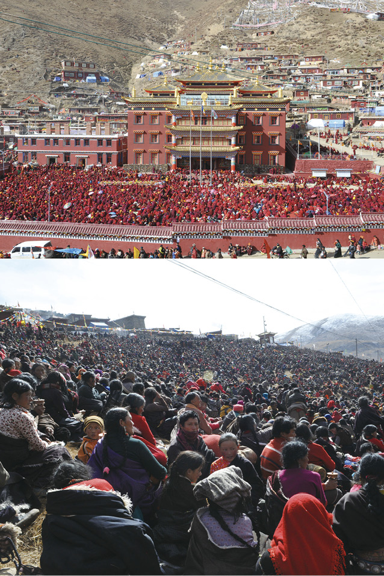

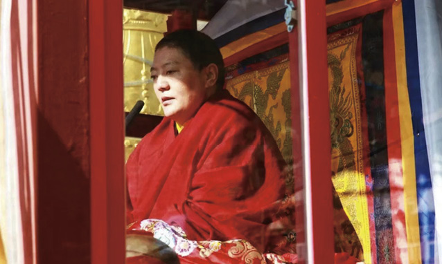

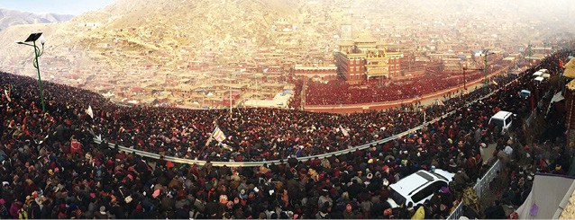

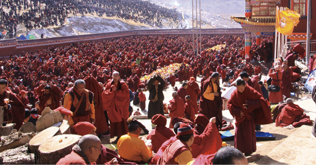

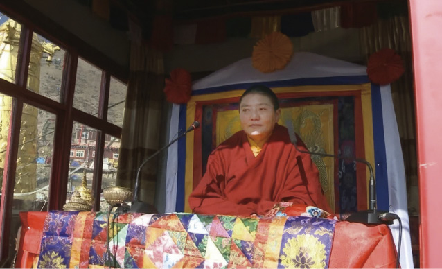

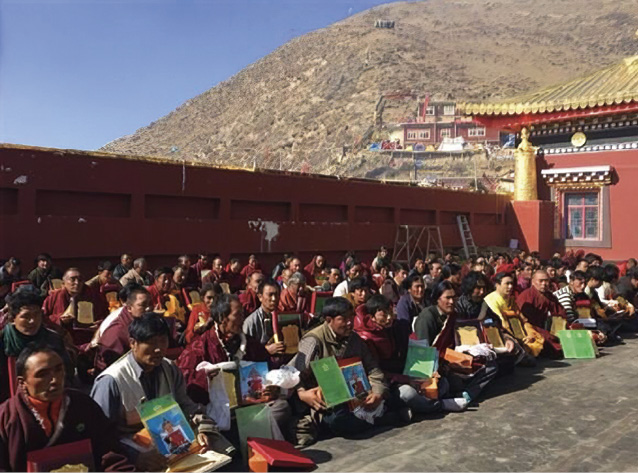

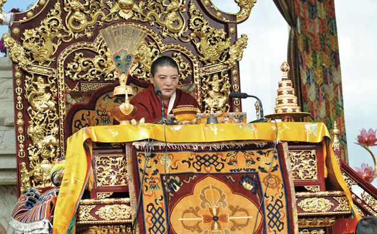

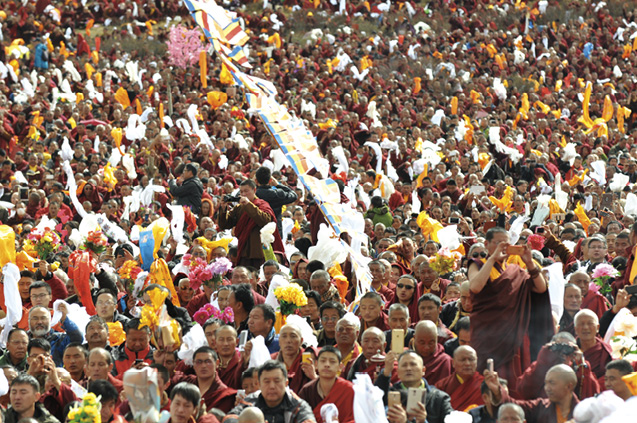

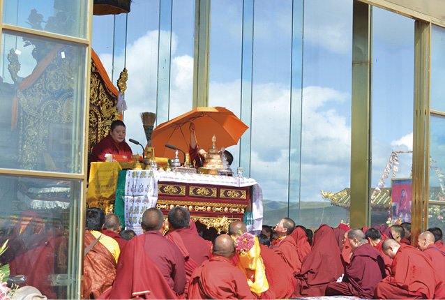

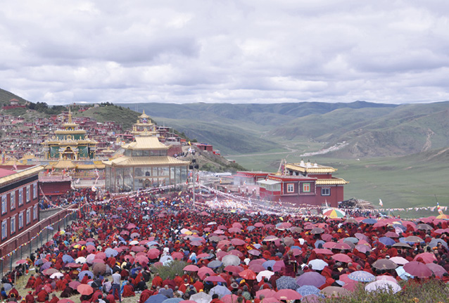

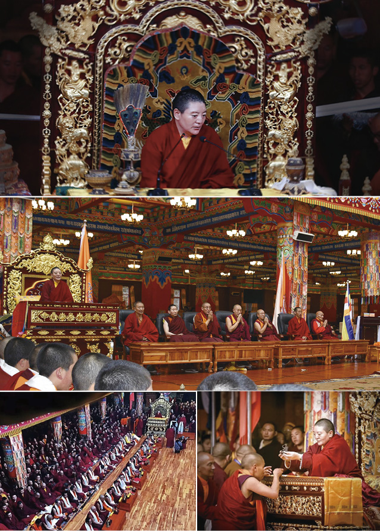

土狗年（2018年）七月初七，门措空行母从汉地途经马尔康，返回色达喇荣五明佛学院。当时，身着法衣的僧众整齐列队，隆重迎接。从洛若寺到喇荣几乎五公里的范围内，无有间隔地遍满了穿着红黄法衣的僧众。

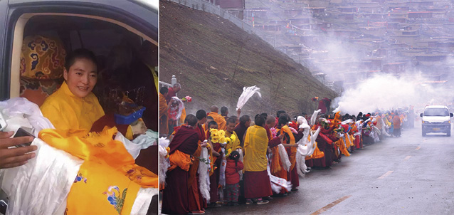

七月初九的上午和下午，门措空行母分别在喇嘛大经堂、觉姆大经堂，与慈诚罗珠堪布、索达吉堪布、龙多活佛、希阿荣博堪布、益西彭措堪布、萨桑堪布、丹增拉巴堪布、热珠堪布等众多堪布活佛善知识齐聚一堂，为新选的五十三位堪布、五十九位堪姆每人赐予一条哈达和一尊文殊像，并为那些在考试中成绩优异者颁发了相应的奖品。同时，教务科为这些堪布堪姆们每人颁发了一尊精致的释迦牟尼佛像的身所依，《般若摄颂》《密藏续》《佛一子续》《手中赐佛》的语所依，一座噶当小佛塔的意所依，还有整套法衣和一顶堪布长耳帽。这是喇荣五明佛学院历史上首次颁发堪布长耳帽。

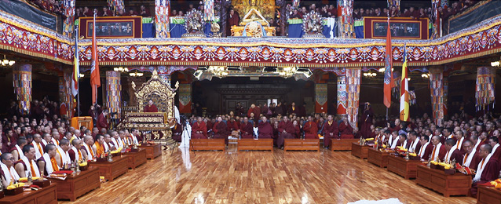

第二天上午，这些堪布堪姆们被请到门措空行母的住处——空行炽燃大乐宫，由她亲自将堪布堪姆的证书发到每个人手中。

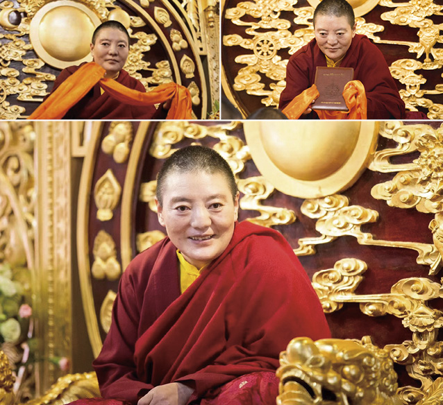

七月初十晚上，门措空行母来到新建的降魔胜利洲殿堂，为汉族众弟子传授了“金刚萨埵”灌顶，并为堪布堪姆们每人赐予一条哈达和一尊文殊像，并对经堂进行了开光。在这段时间里，门措空行母还赐予喇荣安保小组的男女僧人每人一个护法牌，以及地藏菩萨和不空羂索观音的挂件。

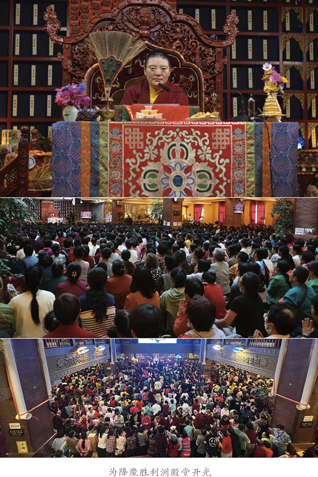

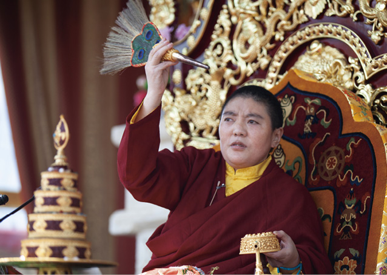

十七日，五明佛学院的轮值主管藏荣·热达堪布、根攀罗吾堪布，以及莲花空行聚集洲的轮值主管秋杰旺姆堪姆、拉吉堪姆、革森秋珠堪姆，代表整个佛学院四众眷属，祈请门措空行母赐予“项袋金刚橛”的灌顶。空行母应允后，于十八日上午，在喇嘛大经堂为五明佛学院的全体男众，恩赐了“项袋金刚橛”灌顶。随后的十九日上午，又前往莲花空行聚集洲的觉姆大经堂，为所有女众进行了同样的灌顶。当天，所有接受灌顶的弟子都承诺念诵一万遍文殊心咒，并鼓励他人也加入念诵行列，合计下来，这一心咒的念诵数量达到了四十三万亿。

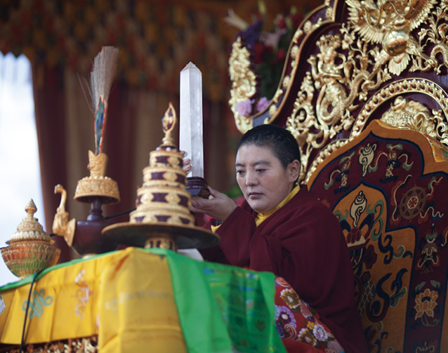

秋天，门措空行母将弟弟革札叫到身边，并告诉他：“在满愿岭，我住处的东方建了八座佛塔，但风水不太好，需要将它们移至别处，同时还要再建几座佛塔。”弟弟郑重表示依教奉行。随后，门措空行母亲自前往自己住处的北方勘察，确定了建塔位置的地眼。十月初五，负责的工作人员在尼耶秋赤山砍伐了用于塔心柱的树木，开始奠定佛塔的基础，并按照传统而如理装藏，修持装藏仪轨，短时间内便建造了四十座佛塔。所有佛塔建成后，空行母亲自主持了开光仪式。

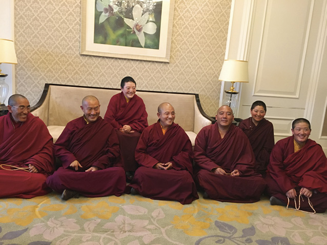

铁鼠年（2020年）七月初四，门措空行母与四十多位觉姆一同从满愿岭出发，抵达尼境的加赤德香曼宗。初五，阿邦慈罗家族的所有亲戚，尤其是九个兄弟姐妹，将空行母迎请至家中，先献上五色吉祥哈达，然后供养了特意建造的一座精舍，以及三门所依为主的众多供品，祈请生生世世予以摄受，空行母表示十分欢喜。这时，整个部落的僧众与在家人，在她面前奉上身语意所依的供品，并以一场生动的赛马表演作为观赏供养。

在这个时刻，阿邦热萨的村长阿邦查巴手捧洁白的哈达，在众人面前发表吉祥的开场白，并说道：“非常感谢门措空行母亲临阿邦父老乡亲的家里，在此将我们的村民和领地一同毫不吝惜地供养给您，祈求您以大悲慧眼照见我们，生生世世不离不弃。”众人共同发愿并皈依。随后，空行母和两百多位僧尼为德香曼宗的整个能依所依，进行了庄严的开光仪式。在接下来的八天里，门措空行母严格闭关，除了内部的个别眷属，她未接见任何其他人。最后两天，开许该村的老乡们前来拜见，满足了众信徒的心愿。

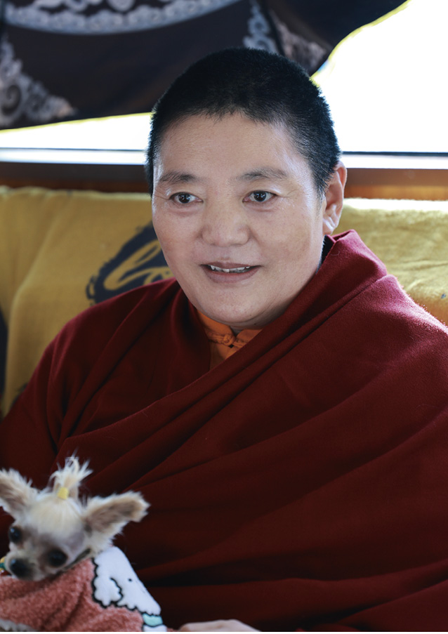

十四日上午，门措空行母与二十一位随从徒步登上该地神山的山巅，念诵了《八吉祥颂》《怀业祈祷文》等。她仔细环顾圣地四周，让熟悉尼境的长者介绍了伏藏大师列绕朗巴的伏藏圣地及圣地的历史。晚上，她到达上方的寂静之地。七月十五日，由十多辆车组成的送行车队整装出发，途中在父辈祖辈所修建的库琼玛尼石堆停留。那些在动荡年代被毁坏的玛尼石已得到修复，新增的部分也已完工，包括空行母要求新建的擦擦堆、佛像堆，全部都得到开光加持。随后，空行母返回喇荣。

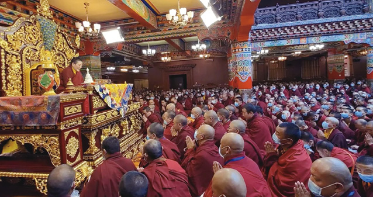

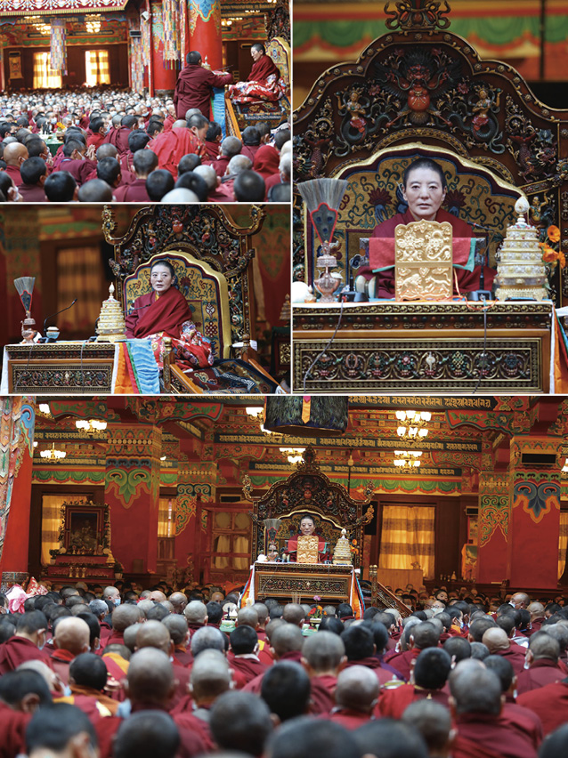

七月二十八日，学院当年轮值主管乔达堪布、热南堪布、云丹堪姆、才让堪姆、敦吉堪姆，代表全体僧众向门措空行母请法。空行母分别在喇嘛大经堂、觉姆大经堂，为五明佛学院的所有男众弟子、莲花空行聚集洲的所有女众弟子，先后授予了“项袋金刚橛”甚深灌顶。当年冬天，空行母像往年一样前往成都调理身体，次年夏天回到喇荣五明佛学院，并低调地居住在自己的住舍。

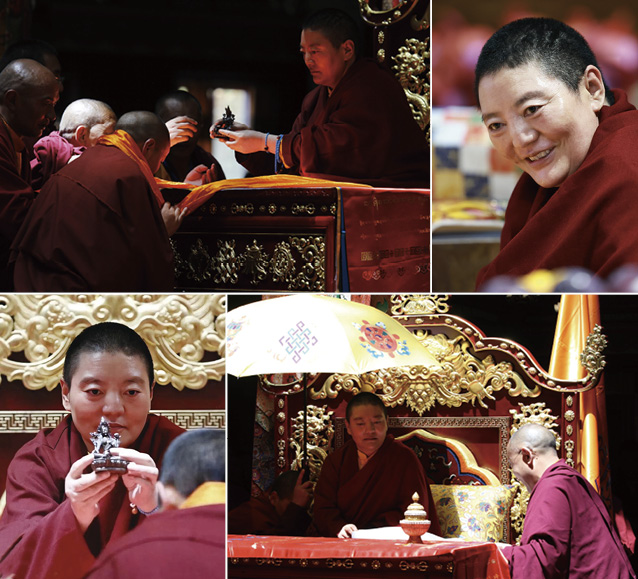

铁牛年（2021年）六月十一日，门措空行母为莲花空行聚集洲的二十六位觉姆颁发了堪姆证书。七月二十五日，应男女轮值主管代表全体僧众的请求，空行母先后在喇嘛大经堂、觉姆大经堂，为五明佛学院的男众、莲花空行聚集洲的女众赐予了法王如意宝的“白文殊”灌顶。

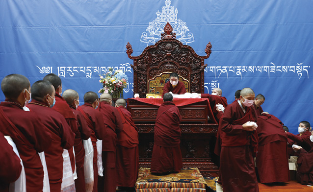

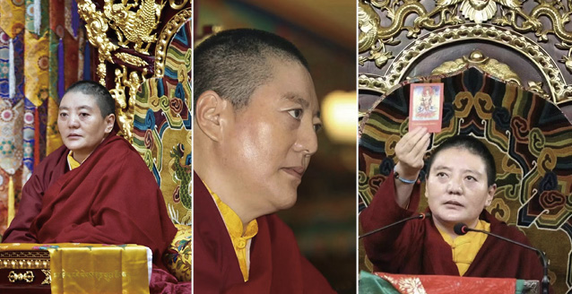

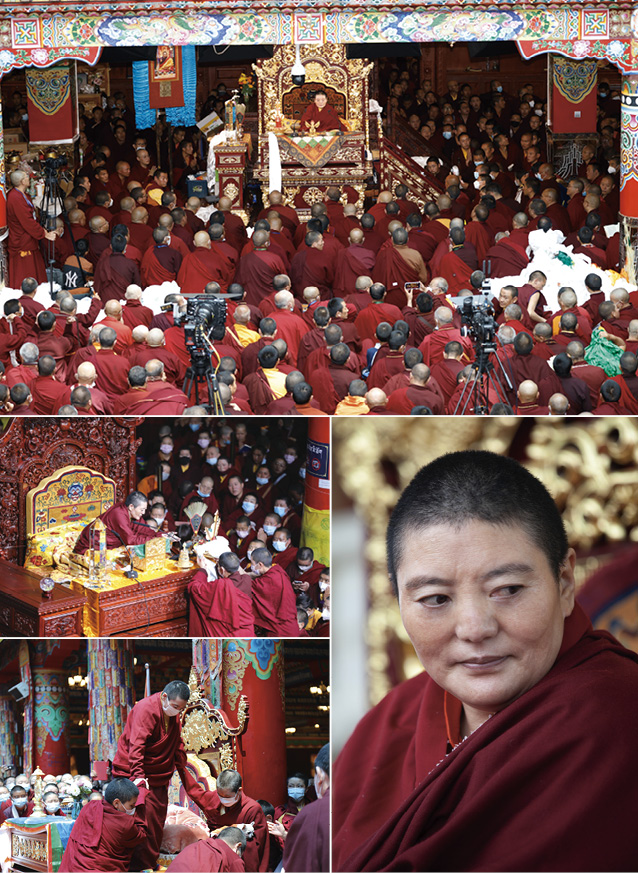

六月三十日，门措空行母一行乘车抵达圣地加赤德香曼宗神山，受到当地僧众的列队欢迎。益西、西帕等居士信众恭敬地向她顶礼。空行母入座后，欣赏了《丹哲传》《格萨尔王诞生舞》《哲美根丹传》《卓瓦桑姆传》《文成公主和尼泊尔公主传》《囊萨吾波传》《阿达拉姆传》等藏剧的舞蹈表演，流露出十分欢喜的表情。七月初七，她来到上方静处的那间精舍，弟弟才波和革札献上了带有上下精舍和玻璃房的钥匙以及吉祥哈达，表达了对她常来此居住的期望。

十四日早上八点，随着朝阳的升起，门措空行母坐上车，伴着海螺声和唢呐声的相迎，来到了底俄嘎波神山的附近。在这时，空行母突然要求将车开到神山的山顶，她一边环顾四周，一边右绕护法台进行加持。在此期间，熟悉当地情况的弟子向她介绍“从这个位置可以远远望见一座叫高山的神山”等等，详细讲解了周围的一些情况。附近还有一个名为乌鸦岩山的地方，又称巴基底俄，是伏藏大师列绕朗巴开取伏藏之处。

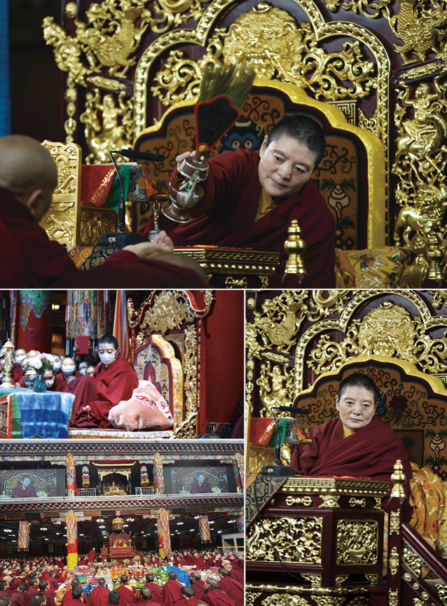

晚上六点，弟子们为了祈愿门措空行母长久住世、事业兴盛，献上了格萨尔舞，念诵了住世祈祷文。大家一同做了深广的回向和发愿，随后返回住处。

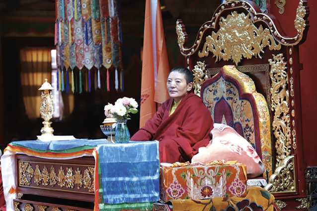

第二天早上八点左右，门措空行母带着大约八十名弟子眷属，前往伏藏大师列绕朗巴圆寂的遗址——酿嘎，共诵全知麦彭仁波切的《七句祈祷文·酬补会供仪轨》进行了会供。紧接着，她前往上方的康区达热札五佛堡神山，这座山又被称为具乐海洲金刚堡神山。在山脚下，众人准备好了午间休息所需的帐篷和垫子等用品，邀请门措空行母在此安住。众眷属为她献上了一场格萨尔王金刚舞，之后大家共享午餐。下午四点左右，以空行母为首的僧众，念诵法王如意宝意伏藏《空行益西措嘉修法·如意宝会供仪轨》，做了广大的会供。尼众悠扬地唱起会供歌、《普贤行愿品》、住世祈祷文等。在会供接近尾声时，前来朝拜的信众得见了空行母，她为每位信众进行了加持，并发愿凡与自己结缘者都会得到利益。之后，一行启程回到喇荣。

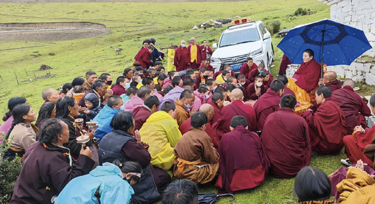

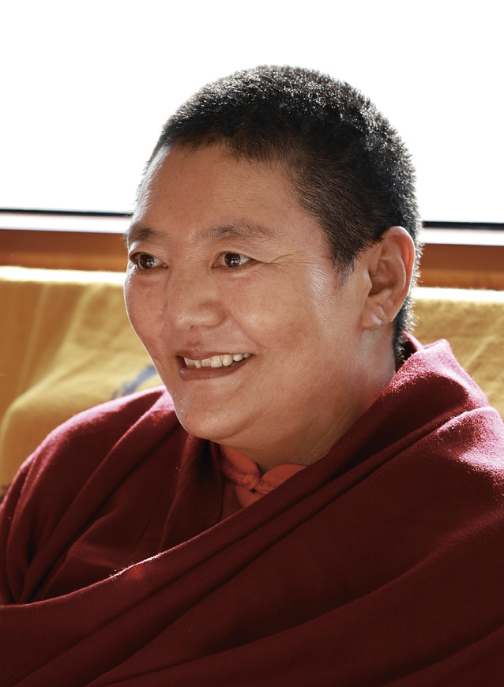

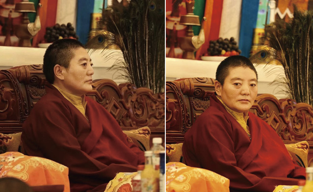

过了几天，门措空行母将弟弟革札叫到跟前，详细交代道：“列绕朗巴大师圆寂的遗址需要建造佛塔，由才热喇嘛和你两人负责。在那里，如果能修建六组八座佛塔，总共四十八座，那就最理想了。”八月初一，喇荣安保小组的男女僧众开始建造佛塔。他们严格按照传统方式，如理如法进行了装藏，修持了装藏仪轨等。数日后，他们向门措空行母汇报了伏藏大师列绕朗巴圆寂遗址的列绕朗巴遗塔已经破损，得知这一情况后，她指示道：“如果有可能的话，重建是最好的选择。然而，原塔的现存残余部分不要挖除，必须按照原样在先前的基础上进行重建。”于是，在已有的四十八座塔的基础上，又增加了一座，总计四十九座佛塔在短时间内得以完成。九月十一日，进行了开光仪式等，一切后续事宜圆满结束。

九月二十日，门措空行母从喇荣五明佛学院启程，为了调养法体，照例经马尔康前往成都。如今，她正在这座城市里的四业任运自成宫小住。

随着水虎年（2022年）新年伊始，我们满怀期待，盼望在不久的将来，当众生尽情沐浴在夏天的美好时光时，门措空行母吉祥归来，在喇荣佛教都市这个圆满佛法妙音回荡的古刹、数以万计持藏僧伽的栖息地，开启成熟、解脱的甘露之门。

以上，简明扼要地叙述了门措空行母五十七岁以前的人生经历。接下来，我们真诚祈愿：作为众生怙主、弘法利生殊胜友军的门措空行母，其莲足以如意宝不坏金刚七法的本体长久住世，以广大发心的誓愿坚持不懈地恒转深广法轮，令无边所化众生得以成熟、解脱、踏上遍知之道的事业连绵不断，以无上善巧方便在十方世界广弘佛法如意宝的贤妙事业，如日月光明般恒常、周遍、任运自成！

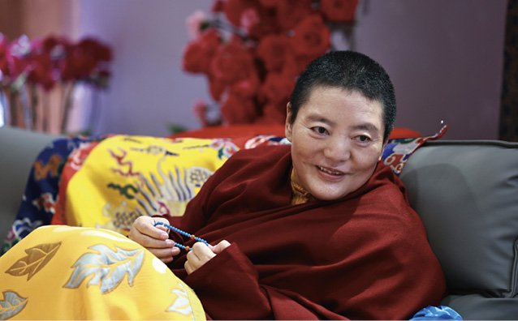

随行种种信解界，无尽海云三密行，

以不同门众形式，随入众心诚稀有。

汝常意念众方便，以大发心臂撑起，

利乐荫影清凉源，法王事业珍宝伞。

喇荣求学臻究竟，多闻具戒持藏众，

亲赐堪帽证书奖，劝勉弘扬佛妙法。

尼地德香曼宗等，趋车前往近亲处，

为诸乡亲说正法，如意满足众心愿。

十万法苑赐灌顶，匝热神山做会供，

酿嘎遗址造佛塔，种种事业广无边。

总之汝尊双足尘，凡所接触任何处，

俱胝善妙香飘逸，善资百瓣美花开。

以上简要叙述了部主自在法王门措至尊母的历代转世与今生的传记。

结文偈：

宿愿发心绕大地，充满殊胜功德宝，

无边大悲波涛涌，普贤行愿浪花掀，

恒现智慧见水月，智成就者龙王依，

法海至尊上师前，不退信心供礼赞。

游舞空行刹虚空，智慧法界空行母，

青丝发辫皆隐没，喜爱晚霞妙袈裟，

虚幻游戏善转变，不拘时代红妙光，

赋予佛法韶华彩，传奇故事动听乐。

断证功德莲花心，为闻思修百瓣严，

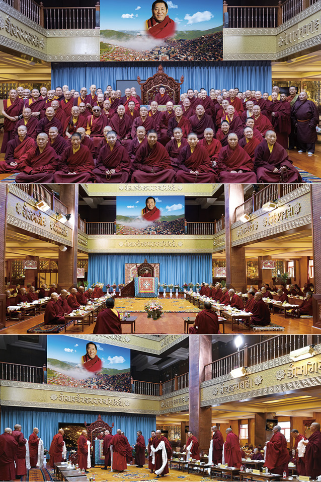

智戒贤善花蕊上，盈满讲著蜜精髓，

利他事业馥芳香，招诸善缘蜜蜂聚，

满足生存所需求，叙此传记动心弦。

汝三密行虚空藏，变幻莫测超分别，

然于共同所化前，吟诵传记悦耳诗。

汝意唯一无念智，展现众多之舞姿，

种种净不净刹中，稀有游戏水月幻。

奇哉宿愿风车引，此生至尊吉祥月，

相伴部主金刚日，现于色达虚空中。

长久熏染善习力，自从孩提时代起，

毫不掩饰诸功德，随从眷属共所见。

非凡大悲满月轮，天生聪慧玉兔严，

禅定甘露皎洁光，洒遍十方不可挡。

韶华嫩芽初生时，俱生功德万叶茂，

闻思修行枝繁荣，何故不现如意树？

事变熊熊烈火焰，吞噬圆满四德草，

众生安乐之薪柴，恶行猖獗暗岁月。

真佛现世法王前，听闻圆满佛教法，

窍诀精华传奇事，文革风暴不为患。

恒久三界生死环，始终转动不定轮，

汝已照见此悲剧，绝无实质之本性。

汝意玛拉雅山生，戒蕴圆满檀香树，

出离心根极坚稳，具别解脱戒枝叶。

三学花开喜乐园，愿行菩提心莲上，

密乘胜慧花蜜精，充溢清净解脱蕊。

完整佛法道次第，汇为自宗精华轨，

教藏净法之百川，汝悉畅饮动听传。

通彻见修闪电鬘，直指窍诀如意云，

意传加持甘露雨，流入汝心之山涧。

众生怙主如意宝，平等降下妙法雨，

圆满教言宝云髓，唯汝拥有真奇妙。

仅闻零星之正法，相似德如洪水滥，

自诩之洼喧嚣声，如空谷响人虽多，

耳传雪山中淌出，口诀教言四河流，

无余汇集之源头，无热恼海唯有汝。

无边离戏本净见，本智灌顶自住修，

所现庄严如海行，汝证三密要诀义。

依此部主如意宝，密意加持智灌顶，

经教金冕戴头上，岂非授汝为补处？

尔时手持白莲尊，离障净智所照见，

赐予盖印认定证，自此汝名得远扬。

怀业深山莲花开，二十四处妙庄严，

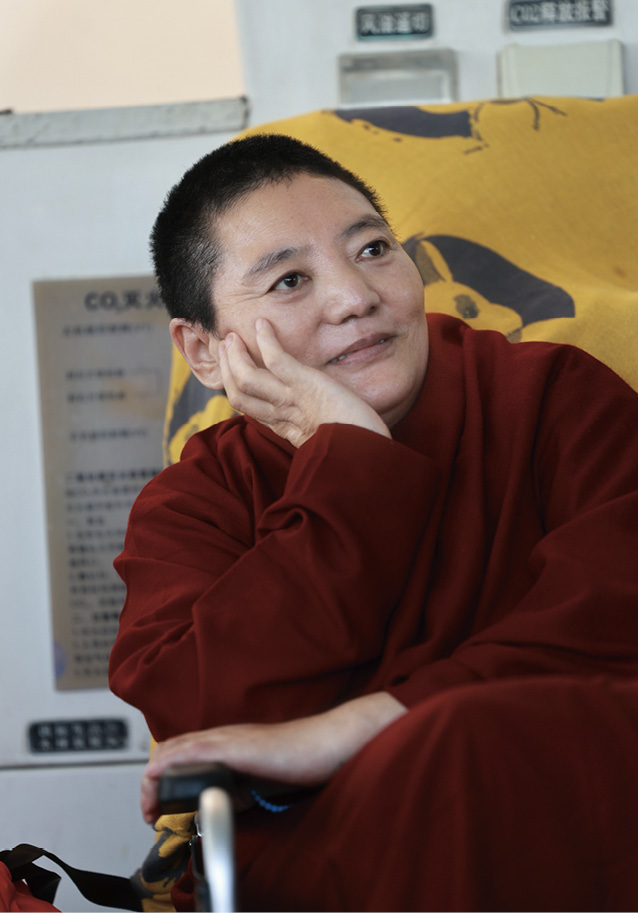

三身空行聚集洲，二尊发心难思议。

多康辽阔大地上，遍持藏师胜静处，

堪比中土大道场，全知上师交付汝。

尔时汝意深广海，经续窍诀宝藏俱，

传此妙音震诸方，善缘鸥群自云集。

法王上师语甘霖，旋转法轮善说海，

汝以辨别法慧道，传布求法有缘人。

无上胜密坛城中，注入义诠灌顶水，

净涤四处之垢染，汝乃金刚阿阇黎。

众多智者密精髓，具六殊胜前译派，

法界空行意藏法，屡赐恩德难言表。

慈悲胜意净微笑，于下众生伸施手，

悦意柔语赐安慰，暂竟利乐行稀有。

西方极乐弥陀尊，圆满成熟清净道，

汝引善缘众生趋，事业边际不可量。

启利他心虚空藏，无尽资财满所愿，

百病折磨可怜众，除身心苦得安康。

业力所感旁生众，惨遭吞食诚可怜，

无数屠刀下放生，如此善举我缅怀。

祖孙法王盖玺诏，十善妙规金字文，

浊世行垢所染污，汝以种种方便除。

劝众立誓而持诵，诸佛无二名号咒，

此等善举无边际，普行事业不可量。

普通事物赡部果，落汝发心无热海，

转成三密坛城金，福蕴边际不可得。

护持上述广无边，弘法利生奇事业，

数量等同恒河沙，然以点滴能表诠。

虽无智者喜善说，真实净心无垢故，

复鼓勇气而撰写，易懂相宜间歇偈。

谁人得见此传记，听闻读诵及受持，

恒常获得上师尊，大悲密意巨加持。

愿喜汝之功德福，随圣足迹众弟子，

常蒙垂怜圣不舍，生生世世予呵护。

汝与大密虹身洲，了义正法大都市，

如金山峦大德俱，弘法利生久住世。

唯一利他发心誓，明晰犹如石刻文，

祈请护众大菩萨，愿行永时勿松弛。

尤其末法之时代，点燃佛法珍宝灯，

精进力如上弦月，持此妙行勿松懈。

愿以法衣之光彩，大地亦成红黄色，

庄严佛法胜道场，喇荣教法如杲日。

五明宝珠遍堆集，庄严雪域大学院，

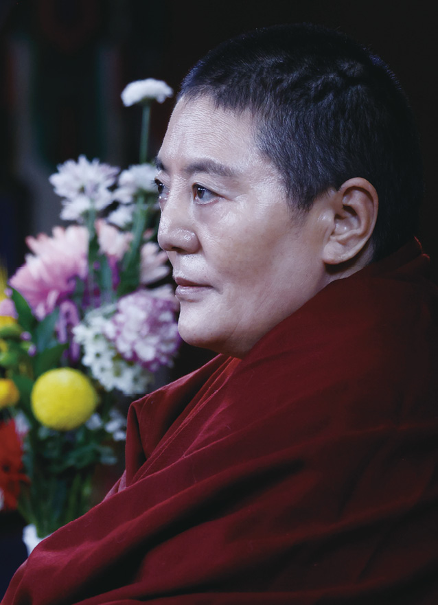

多闻持藏精英聚，善说妙音常回荡。

清净戒勤闻思修，并非外相真实行，

讲修妙法尼僧团，正法长住得弘兴。

寂乐光芒遍大地，众罪无余自解脱[^1]，

弘法利生乐莲绽，一切所欲皆如愿，

众生内心向正法，圆满怀摄境心力，

违品恶缘消法界，克胜一切诸方域。

获得解脱寂微妙，任运自成自他利，

暂竟善法云密布，无余普降众善雨，

降伏四魔得胜利，白方欢悦盛喜宴，

如意满足诸所求，四种事业任运成。

现见俱生空行性，证得无漏法身境，

善得刹生空行聚，面见三垫报身刹，

自聚咒生空行缘，游戏吻合化身舞，

开悟三身空行界，获得双运金刚身。

造此传记所获得，善根大海之水气，

法界浓密相交织，殊胜大愿吉祥云，

缘起苍龙之游戏，普贤行愿妙事业，

如意妙雨普洒降，所有一切皆吉祥。

净心春云所孕育，真实语之甘露雨，

相伴汇合吉瑞润，殊胜宏愿如意树，

事业果实应时熟，美誉芳香飘诸方，

暂竟所愿皆实现，任运成办自他利。

此传记是我出于信心的驱使，早已心生撰写之念。加之益西彭措堪布、秋扬尼玛堪布、陈蕾卡达堪布、敦吉堪姆等学院四众弟子代表的屡次劝请作为缘起纽带，让我开始了这一善行。

整体写作风格以智慧揣摩为主，回忆自己所见所闻的零碎事迹，并结合了传记采编小组特意收集的各种笔录作为素材。此外，还加入了一些门措空行母身边熟悉的眷属以及一些老弟子的谈话等内容，以助于叙述。句义采用通俗易懂的语言，将其立成文字。

尽管我没有得到所有理想的写作材料，无法详尽、全面地描述，但尽量以简明扼要的方式撰写圆满。这本传记是由法王与门措空行母亲传弟子中的红原僧侣——末学丹增嘉措于铁牛年（2021年）末开始撰写，于第二年五月二十二日完成。愿依此成为满法王如意宝无漏密意愿、至尊门措空行母事业在十方三时弘扬兴盛和长久住世之因。

善哉！善哉！善哉！

译竟于2024年2月9日除夕

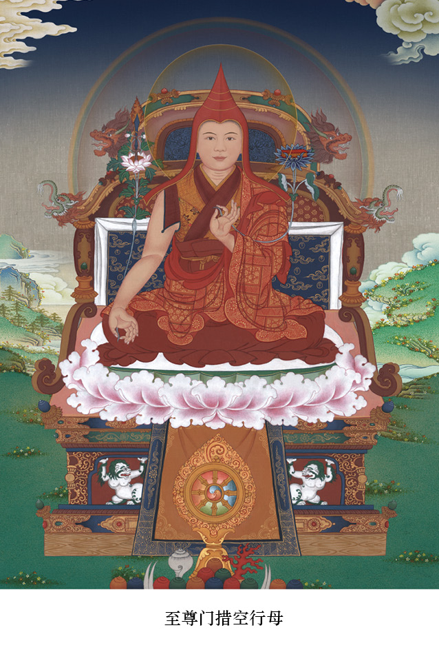

[^1]: 此划线处分别为喇荣诸洲各区：喇嘛的众罪自解洲（法轮区）、所欲如愿洲（摩尼宝区）、怀摄境心洲（莲花区）、克胜诸方洲（宝剑区）、自成二利洲（金刚区）；普降善雨洲（藏族居士林区）；降魔胜利洲（汉僧区）；觉姆的俱生法身洲（法身区）、刹生报身洲（报身区）、咒生化身洲（化身区）。
