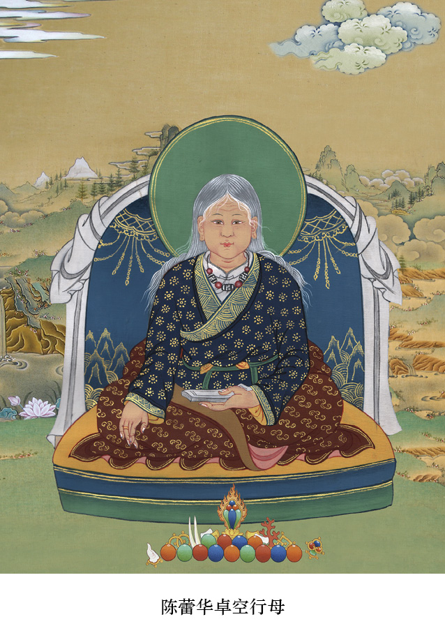

# 8．陈蕾秋卓空行母

至尊门吉华卓有两位转世化身，其中一位就是敏朗·杰美陈蕾秋卓空行母。第十三胜生周水狗年（1802年），她伴随着奇特的瑞相出生在这个世上。她的父亲是赤·莫杰陈蕾南嘉尊者。

在童年时，她就擅长读写等，通晓所有知识，表现出非凡的智慧。她在叔伯们及华衮等博学者面前广闻显密教法，并无碍通达这一切。她还听闻了法王敏朗大伏藏师的修法《如意妙瓶》等所有新伏藏，以及班玛朗巴伏藏法中的许多甚深法，成为决定密义之教主。她在三根本的众多本尊的念修上也付出了大量努力，于现量或觉受中出现了一些成就验相。尤其是在父亲至尊陈蕾南嘉面前，她聆听了大圆满《秘密心滴》的所有法类，终生实修实证，并现前了微妙的开悟境界。

为了利益他众，她以灌顶、传法、教言、引导等方式，护持无量的事业，将数量可观的弟子安置于成熟和解脱之道上，对总的前译经教法和伏藏法、分别的大伏藏师法王兄弟的教法，做出了巨大的贡献，被人们一致公认为女尊者门吉华卓之后最具恩德的空行母。她的一生都是以念经诵咒、实地修行、讲经弘法度过的。

蒋扬钦哲旺波、贡智云丹嘉措等众多高僧大德的经教法、伏藏法及大圆满心滴等甚深法的传承，都来自这位至尊母。蒋扬钦哲旺波在《稀有传记·昙花乐园》中讲述：他在至尊杰美陈蕾秋卓仁波切前，先后听受了许多灌顶、传承与引导，其中主要是“上师心滴如意宝”的完整灌顶、传承、引导，王派“大悲观音法”的传承、引导，酿伏藏“七日绝地火”的灌顶、引导及相关传承，唐派的“长寿佛与马头明王合修法”，班玛朗巴的“三黑类法”，尼达桑吉的“插草往生引导法”及其传承，“三宝总集”的根本灌顶，“心滴”的根本灌顶，大译师仁波切的“脉引导直指法”及其《文集》的完整传承，门吉华卓的“本尊引导法”、阿底妙力灌顶、“红威猛尊”三灌顶、“护法命”灌顶，以及她本人所造的大多数著作的传承。诸如此类的闻受情况都有记载。

蒋扬钦哲旺波尊者对自己的这位三恩德上师有着极大的信心，在他的著作《大恩上师祈祷文·加持甘露妙云》中写道：“证悟本净不变本实相，任运现量觉相抵如量，事业法光照亮三世间，佛法之灯尊前诚祈祷。”对她进行了高度的赞颂。此外，佛子延番塔益也称她为“无量智慧慈悲主尊空行自在母至尊仁波切”，频频撒下赞美的鲜花。

这位卓越的至尊母留下了众多著作，包括《密藏续总义相关之讲传祈祷文》《以七教解说阿底约嘎法》《酿伏藏黑忿怒日常修法》《念诵实修法》《大悲善逝总集前行引导文》《共同前行备忘录》《绝地火祈祷文》《金刚萨埵往生引导法》《新伏藏类传承祈祷文》《拉尊巴断法〈勇士顿悟歌·现有自解脱〉之笔录》《敏朗大译师仁波切〈续轨〉之笔录》《班玛旺嘉〈如何讲解续部〉之笔录》等。

教藏法理璀璨宝，善系心中吉祥结，

熟解事业遍百方，陈蕾秋卓我随念。

