慈诚罗珠堪布

引 言

这次，法友红原活佛丹增嘉措所撰写的《白莲花·门措空行母传》呈献给诸位信众，增加了我们所有弟子的信心，实在是一件令人欢喜的事。这本书不增不减、原原本本地记录了至尊上师门措仁波切身语意的传记，这些展示在共同大众前的事迹非常可靠。

至尊母从幼年起，一生致力于大圆满法的修行，并在难以提及尊名的法王如意宝晋美彭措吉祥贤前，聆听了众多特殊教言，然后实地修行，其内在必定有着非常广大的觉受与证悟功德。然而，由于法王如意宝鲜少谈及这方面的事，加之空行母本身深藏不露，从未讲过其超胜功德，因而暂时也无法详加描述。

在此，我根据个人的所见所闻，简要列举一二：

一、戒律严谨的功德

当我初至喇荣五明佛学院时，门措空行母还是一位刚刚出家、年龄不足二十岁的小觉姆。随后，在法王如意宝广泛弘法利生于藏地、汉地及海外诸地期间，她始终陪伴左右。我曾多次有幸作为随从而陪同上师出行，亲眼目睹门措空行母恒常不离上师如意宝身旁，专注于闻思修行、持诵本尊心咒等，每日唯以善行为伴，其言行举止始终如理如法，严格遵循戒律，从未见过她有丝毫不如法的言行，甚至让人怀疑她是否不如法的举止也从未出现过。这一点，任何人都很难做到。可见，她的戒律是相当严谨。

二、智慧深邃的功德

在法王如意宝面前，她认真闻思显宗五部大论、密宗经幻心教法与伏藏法等，以及《文法三十颂》《诗学》等共同明处，并多次为我们全体弟子赐予显密教言引导。她对法义的理解深刻透彻，讲法清晰明了、通俗易懂，除了宣说法义以外，不会搀杂其他闲言碎语，讲法风格简练纯粹，无论是谁听了，都会对佛法生起定解，法喜充满。

三、利生事业的功德

门措空行母曾多次为广大僧团和众多信徒灌顶、传法，精心护持着对藏汉僧俗大众今生来世有益的事业。她的这一事业，不仅对藏传佛教女性出家人的前途命运产生了深远影响，也为众多女性修行人的心理注入了新的希望、勇气和力量。为什么这样说呢？在她之前，藏地的尼众僧团就连为自利而闻思修行的现象都很少见，更不用说为利他而讲辩著了，基本上是没有。然而，依靠法王如意宝与门措空行母的大恩大德，女性得以获得全面闻思修行的机会，而且成办了广大的弘法利生事业，这一点是有目共睹的。

四、人格贤善的功德

在法王如意宝圆寂之后，门措空行母为了喇荣五明佛学院的未来着想，一直保持着十分坚稳的心性，无有偏颇地关怀所有弟子，从不听各种是非之语，持有稳固的主见。她从未口出伤人之言，恪守着法王如意宝“莫舍己道，勿扰他心”的临终遗训。这种深沉自主的风范，实在令人肃然起敬。

总之，在过去的近四十年里，我与门措空行母相处的经历中，从未见过她有令人不起信心的行为。她是一位完全值得信赖的善知识，具足严谨的戒律、深邃的智慧、利益他众的功德，因此，我们可以毫不犹豫地将今生来世的慧命托付于她。

以上只是我根据福德缘分所见所闻的简要叙述，详细内容请参阅这部传记。

水虎年（2022年）十月二十二日，依法王如意宝

与门措空行母之恩德而不舍善心的弟子慈诚罗珠撰写。

索达吉堪布

引 言

《白莲花·门措空行母传》，由丹增嘉措活佛于2022年用藏文精心撰著，记录了门措空行母前世今生的非凡事迹。2023年8月，门措空行母身边的一些亲近弟子请我将此书翻译成汉文，我欣然应允，并在2023年12月开始动笔。历经两个多月的时间，至2024年2月17日，我以7.6万字的篇幅，完成了汉文版的全文翻译。透过这部传记，将会领略到一个普通的放牧女孩，如何依靠宿世的愿力和今生的不懈修行，最终成为众多高僧大德、数以万计僧众依止的金刚上师。

我个人自1985年依止法王如意宝以来，亲眼见证了门措空行母的成长历程。在法王于国内外弘法期间，我有幸长时间陪伴在其左右，累计时间超过两年。在这段时间里，我也得以近距离观察到门措空行母的真实面貌。她的温和、谦逊以及对修行的坚持，为当代女性修行者树立了崇高的典范。

门措空行母向来行事低调，以至于她超凡入圣的境界并未广为人知。作者在撰写这部传记时，投入了巨大的心力，通过多种渠道收集资料，以真挚和细腻的笔触呈现了她的故事。尽管如此，可以肯定的是，门措空行母的实际经历远比这更加丰富和精彩。且不论其他方面的功德，在古往今来的女性修行人中，像她这样仅仅17岁就开始摄受弟子、讲经说法的，极为罕见；像她这样能给如此多弟子灌顶传法的，极为罕见；像她这样在57岁之前念诵的本尊咒语超过十亿遍的，也是极为罕见；像她这样一生中从未对任何人发过脾气的，更是极为罕见。

在翻译过程中，我特别注重收集门措空行母在不同时期的照片，希望通过这些珍贵的影像资料，让读者不仅通过文字了解她的故事，更能直观感受到她的独特魅力。在此过程中，得到了央柔卓玛、敦吉堪姆等许多人的无私帮助，对此我深表感激。

在藏文传记中，“传记综述”是最后一章，但考虑到汉文读者偏爱开门见山的叙述方式，我在作者的开许下，将其提前至全书最前面，以便读者能更快地进入状态，了解门措空行母的人生经历与修行成就。

我衷心希望，这部《门措空行母传》能激励更多女性修行者勇敢地踏上解脱之路。同时，也期待它能被翻译成更多语言，让不同国家的人们都有机会了解这位非凡女性大德的风采。

索达吉于2024年3月3日

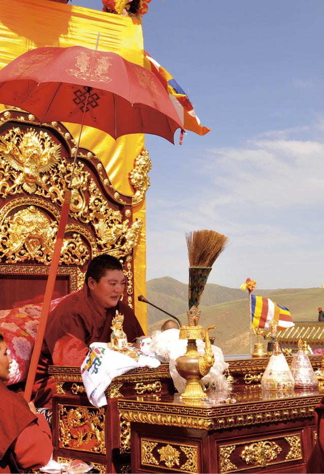

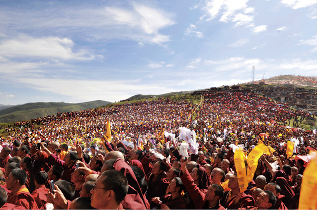

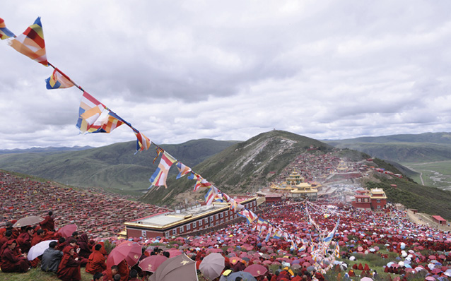

白莲花·门措空行母传

丹增嘉措活佛·著

索达吉堪布·译

顶礼上师！

无畏发心坚铠名阿大尊主，

圆满传出法音智者成就王，

胜慧语王莲师补处如意宝，

今来百万善聚遍主顶上胜。

阿嘉种子成熟种姓花绽放，

人间女身菩萨隐蔽瑜伽母，

具大证悟般若了义法之灯，

慈母尊前三信莲花作礼供。

法性空中大悲游戏众刹空行主，

益西措嘉游舞得受三藏之桂冠，

善巧遮覆耳饰璎珞俱生空行母，

大恩上师唯一补处至尊我顶戴。

犹如黑暗意空秋季繁星闪，

心之毒蛇顶间如意宝光灿，

暂依因缘具惑凡俗我心中，

萌生欲说圣尊功德之善念。

自心动念空中云层密，

劝请美女孔雀开屏时，

伴随功德自说甘露雨，

智语雷声不由自主响。

一切普贤之究竟，一切三密密传记，

随行大海之智者，浅慧之心难测度。

我意初月缓攀至，向往此念西山时，

美好故事白光辉，无法阻挡自散放。

是故共同所化前，三密幻变游戏者，

些许细微平生事，正直自然脱口说。

首先以上述偈颂歌鬘，作为步入此著述的大门。接下来要介绍的是至尊门措空行母，又称为门美益西措姆。她是邬金莲花生大士所摄受的明妃卡钦萨·益西措嘉的转世，现为“浊世佛教之灯”圣者法王如意宝身语意的无上继承者。在雪域这片土地上，她如繁星中央的满月般，从所有女尼中脱颖而出。她是现为女身相的俱生空行母，是我们所顶戴的珍宝，是诸部坛城海的遍主至尊殊胜上师，是持戒严谨的女性圣者。

在此，我从她共同与不共的如海传记中，撷取出她展现于平凡行者眼前的身语意共同事业的点点滴滴，为了满足长久以来竭诚劝请的诸位同门道友的意愿，我以虔诚的信心与恭敬，简明扼要地稍作叙述。

这部传记全书内容可以概括为四个章节：传记综述、空行母分类、历代转世简介、详述此世经历。

一 
传记综述

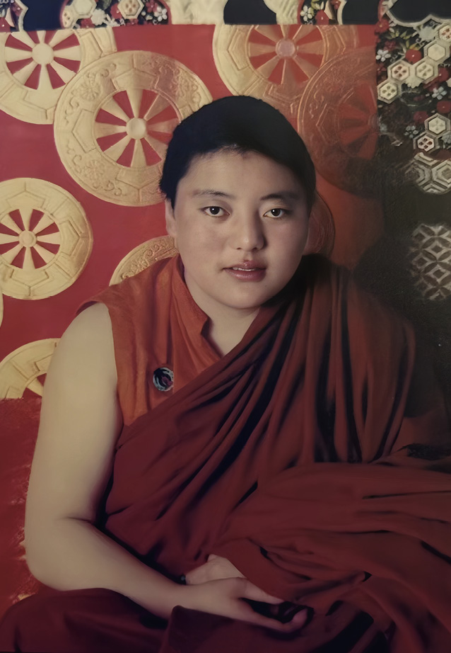

作为法王如意宝的殊胜补处，我等顶宝门措空行母这位大主尊，前世曾受身为俱生空行母、自然瑜伽母、持明母、持藏母等，使北方雪域的所化众生得以成熟和解脱。就当前这一世来说，她也是一位有着出世间超凡事迹的大德。

从普通人的视角来稍加描述，她一直保持着往昔所熏染的善妙习气，以此威德力，再加上殊胜善知识摄持的因缘，使得她修行正法未受外缘寒霜的摧残。她自小即具备调柔的心性，对正法与上师怀有巨大信心，诚信业因果，慈悲心等功德与生俱来，身体和语言自然杜绝殴打践踏、粗言恶语等有害行为，乐善好施，始终以纯真善良的心、和颜悦色的神情、正直诚实的语言对待众生，毫不骄慢自满，公平正直，喜欢依止善知识，通过供养三宝等善行影响着其他小孩。她热爱内观禅修，逐渐以出离心激发，踏入佛法如意宝之门，最终选择出家为尼。

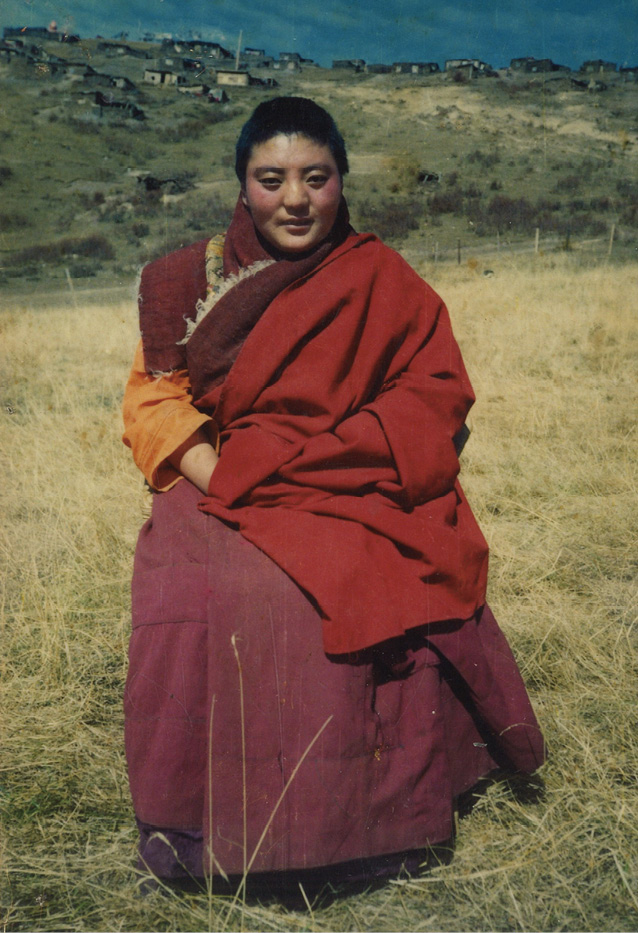

她不仅在舅舅法王为主的具相上师们面前，聆听了大量显密法理和众多窍诀；还能将所听之意义在心中举一反三，进行串习，想方设法生起思所生慧；而且，她所闻思的内容并非只留存在口头上，而是通过多种途径，千方百计地将其应用于自身的修行中，尽己所能做到了闻、思、修不相脱离。尽管她的广闻博学可能不如前世的宿姆格瓦波和陈蕾秋卓，但从投入的时间来推断，她还是进行了认真闻法和深入研习。

她不仅在法王座下听闻法教，还先后在其他善知识面前，不同程度地听受了灌顶、传承和窍诀：在见者具义大尊者前，得受了他第五世“二十五具印净现精华意修精髓总集”的深广灌顶、花姆派“千手千眼观音菩萨”的灌顶、“白度母延寿如意宝”的长寿灌顶等；在格敦达吉上师前，听闻了《伏藏大师列绕朗巴全集》的一半内容；在欧罗上师前，恭听了《上师修法具印明点》；在德钦活佛前，闻受了《敏朗如意妙瓶》的灌顶和传承；在噶玛秋佩上师前，接受了《大圆满见歌·大鹏展翅》的传承、《普贤通彻密意》的灌顶和传承、《十七续》的传承；在阿蒋上师前，接受了《阿底深义》的灌顶、列绕朗巴所有伏藏法的灌顶和传承、《敏朗如意妙瓶》的灌顶和传承；在德巴堪布前，听受了《密藏续总义·光明藏论》《中观庄严论释·文殊欢喜言教》等。

除了上述直接提名的这些上师以外，尽管她没有精力去依止更多的其他上师，但对于所依止的每一位上师，她都以如理如法的意乐和行为进行依止。特别是在三恩德上师法王如意宝的无垢莲足下，她依止了三十多年，期间从未离开，下至《沙弥五十颂》、上至大圆满的所有深广法，她几乎都无一遗漏地恭听了。从这个角度来看，除了她的母亲阿里美珠之外，法王的其他亲传弟子都无法与她相比。这显然与大全知无垢光尊者曾言“在我的法脉传承中，需要长久依止上师，长期听受教言”非常相符。

对于空行母而言，法王如意宝是一位身兼授戒师、传法师、灌顶金刚阿阇黎等多重身份的殊胜上师，他将世间、出世间的一切大小事物，甚至包括日常的威仪、短暂的物品选择、眼前的行住来去的规范，都无微不至、面面俱到地教给她。她对法王的一切教诲，甚至包括开玩笑，都是百分之百认真恭听，从未有过一丝一毫的背逆，完全以三喜的方式进行依止。

在她年幼时，就得到了舅舅法王的呵护，教导她读书识字、法行念诵等。为了确保她能够循序渐进地完整修行如阶梯般次序不乱的佛法道次第，法王从她青春美满的少年时代开始，就传授她如何调整发心、陈设供品、顶礼磕头、供曼茶罗、持诵咒语、禅修明观、入座闭关等。此外，还教导了如何区分见修行、依靠观察和安置来修持止观的方法。密宗依修四支的相关事业仪轨实行法，灌顶和开许灌顶的前行、正行、后行次第如何进行，应时的观想次第以何方式进行表示，灌顶时如何围绕受众的觉受来抉择，讲引导法时如何切中窍诀来直指，所有这些道理，法王都耐心细致地逐一教给了她。

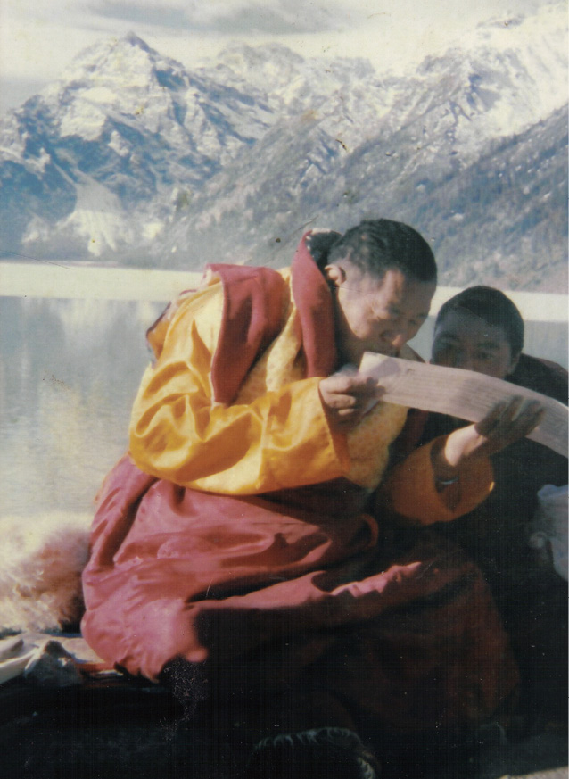

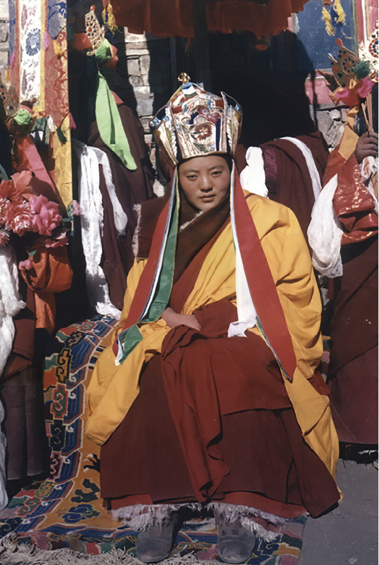

特别是，光明大圆满的究竟道要、法性不停留于伺察意上而现量直指的究竟言教、深中最深的大圆满窍诀部精髓、绝密心滴的教言，以及将佛果赐予手中的能成熟的灌顶流程与能解脱的引导次第，法王不仅以满瓶倾泻的方式赐予了她，还传授了许多与实修相关的要点窍诀的直接引导法以及不共的口传，多次解开她心中的疑团，在见修的要害上牢牢钉上无误的钉子。这一点从法王的语言中便可窥见，法王如意宝在兄长才让敦珠接近圆寂之前，他们私下交流时曾说：“我们这个外甥女，在认识觉性方面应该相当不错，您可以放心。”由此也能大致推测一二。

总的来说，门措空行母鲜少谈论个人修行。然而，有一次法王前往新龙香札地方传授“四心滴”灌顶，空行母与侍者则卓一同在区分有寂时，她看到每棵树梢上都显现一位本尊；另外，在卫罗神山的静处时，她看到每一块石头都呈现本尊形象。这些零星片段是从个别觉姆口中获悉的。此外，还有一次，门措空行母以闲谈的方式对内部的眷属弟子说：“依靠舅舅法王的恩德，我感觉在实修方面确实略有把握。”除此之外，由于她言辞谨慎，守口如瓶，因此从未听她谈论自己的甚深见解境界与内在的现证功德。

当然，她实修实证的核心是大圆满，这一点无需多言。同时，持诵本尊心咒等有相瑜伽的修持，她似乎也特别重视。她从小就养成了持诵三根本心咒等的良好习惯，到了十三岁时已经念了约一亿遍咒语。至今，她持诵本尊心咒的总数已超过十亿。虽然这个数字对普通人来说似乎难以置信，但以前法王在世时，有一次统计佛学院做佛事时已完成的持咒总数，他老人家亲口说过：“美珠和我虽然不能念那么多，但自己的那一份基本上完成了。门措则念得比较多，她似乎有着持诵速度是一般人六倍的潜能。”可见，大德们的能力，显然是凡夫人观现世量的分别心无法理解的。

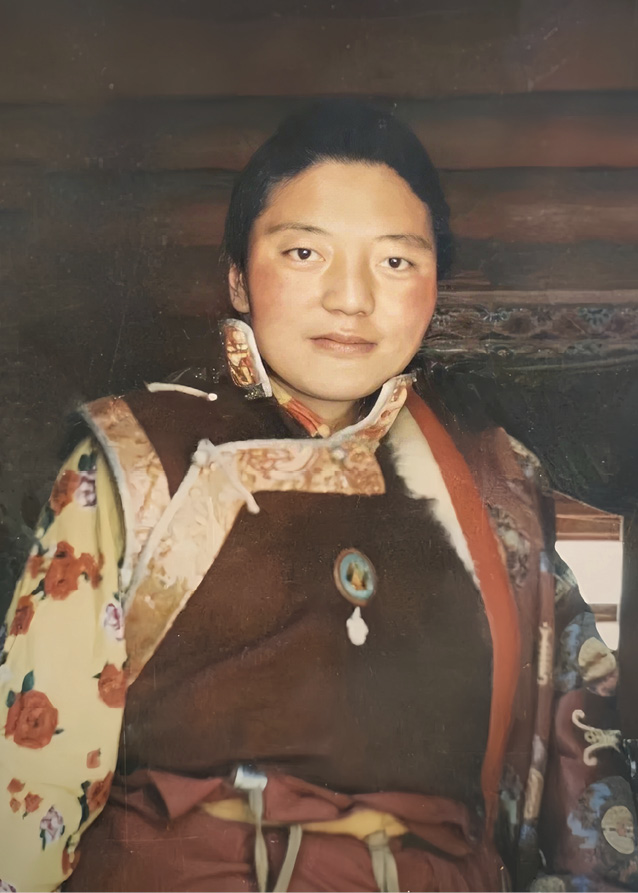

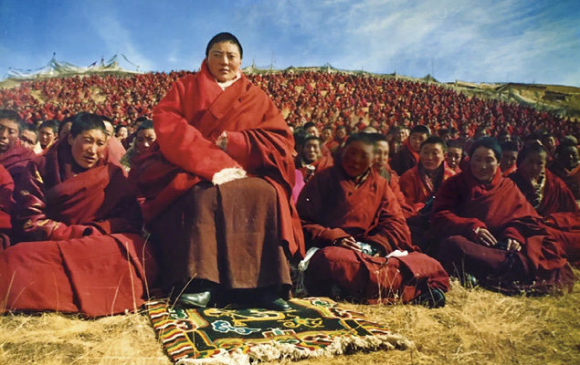

门措空行母平时在喇荣五明佛学院的五大例行法会期间，通常都会各念一百万遍心咒，她特别重视经论中提到的“与僧众相关的所有善根都功德极大”的道理，因此每年都不间断地诵持五百万遍咒语。据她的侍者们描述：“每天清晨四五点钟，她就起床了，先是除垢气，通过修上师瑜伽接受四灌顶，然后完成本尊的念修。接下来，再修一段时间的生起次第、圆满次第、大圆满法。她每天的课诵包括《佛一子续》五遍，以及《三聚经》《诸佛菩萨名号集·宝珠鬘》《普贤行愿品》，这些都是她持之以恒念诵的内容。”

此外，拿前行积资净障的相关实修次第来讲，空行母在小时候曾与舅舅法王和母亲一起完成了一遍五十万加行，后来又独自修过四遍，总共完成了五遍五十万加行。除此之外，她平日里每天都不间断地磕两三百个头，直到后来因患脊椎病而无法继续。

平时，空行母格外重视修心法门，经常强调“死亡无常”“积财守财无有实质”等道理。她持续专注于修菩提心的教言，不仅每次讲法都会顺带传授寂天菩萨《入行论》中的发心仪轨，而且在朝拜圣地时也会念诵七支供和发心仪轨，有时还会按照两派的发心仪轨为弟子们传授菩萨戒。在与内部眷属交流时，她常说：“这个菩提心宝是所有财富中最珍贵的，其功德利益是最大的。”并表示她个人通过实修苦乐施授法，也能令其他人得到一些利益。

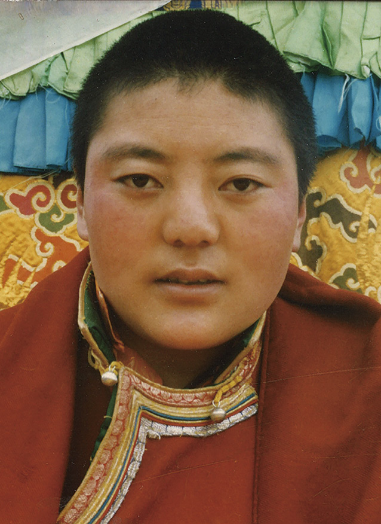

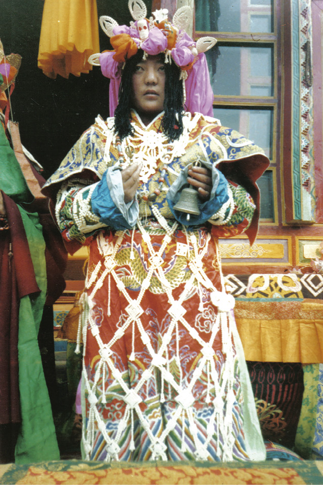

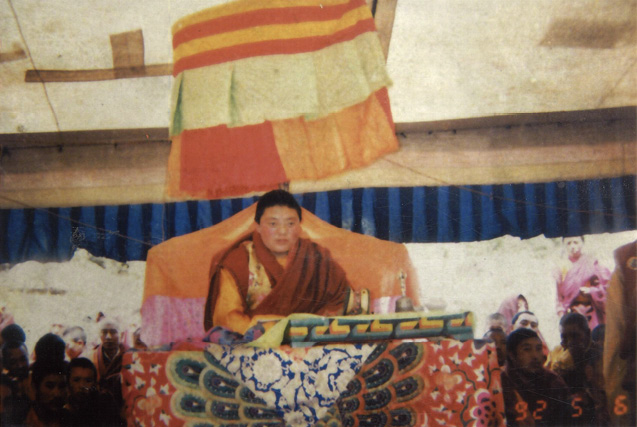

下面不论次序，随意谈谈她平时的心性和行为，让大家能深切体会她的一些功德。就如同《入行论》中所说：“出言当称意，义明语相关，悦意离贪嗔，柔和调适中。”空行母通常沉默寡言，语言小心谨慎，即便有所表达，也决不使用暴力、戏谑或放荡不羁的措辞。她的言谈温文尔雅，措辞适度，富有深意，表达得体、调柔、寂静、严谨。她心性柔和、情意长久、目光远大、秉性善良、语言诚实、坚守诺言，面对各种善缘和恶缘都能泰然处之，如如不动，具备这样的功德。

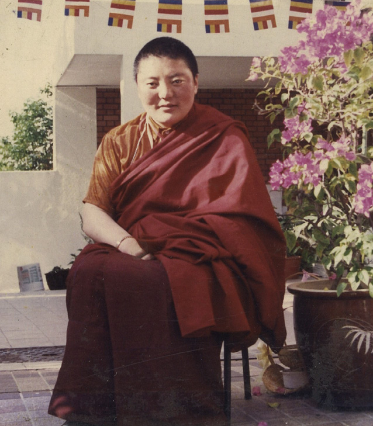

空行母对人没有贪嗔、对法没有增损，见解不偏，不寻他过，不谈他非，从未表现出轻视低下众生的言行。反之，对于可怜的弱势群体，她表现得更为慈爱。她内心寂静调柔，即便在闲聊时，也非常温柔得体。然而，在接见他人时，她时常保持沉默，凝然注视着一个目标，使来访者不知该说什么、该问什么，常常带着一种敬畏感离去。而在面对有权有势的领导官员时，她保持从容淡定，如理如法，决不屈从于世俗的情面，也不会虚伪地阿谀奉承。她一直都以荣辱不惊的态度示人。

平日里，她专心阅读一些修心方面与甚深窍诀的典籍，精勤于念咒诵经，与他人交往相当有限，几乎不说闲言碎语，不参与平凡的谈论。当有人向她请教集体或私人的重要事情如何抉择时，她会认真观察并给予方向性的暗示，而绝不随意应付。对于世间和出世间的任何事，她都会牢记在心，很少忘怀，因此，无论过去多少年，她都能清晰记得与她交流的人说过的每一句话。她有诸如此类的特质。

无论何时何地，她始终像噶当派前辈诸上师一样，行为非常如理如法。她绝对是一位智慧超群、戒律清净、人格贤善的典范。她重视出离心、菩提心、三戒的取舍等，从不刻意炫耀神通神变，根本不做损害佛教形象的粗暴疯狂行为。她严格守护出家学处，并且十分重视佛制戒，常常过午不食。她对僧财极为谨慎，绝不故意受用僧众一分一毫的财物。她时常喜欢到寂静的地方放松，爱看前辈大德生平故事的表演、格萨尔王的藏戏等。她坚守佛经中所提到的“于众说法时，毫无怀疑、无视利养、无视恭敬而善说正法”，在赐予灌顶、传承和佛法时，拒绝接受任何财物供养，甚至包括哈达。无论何时何地，不论是世间还是出世间的行为，她一直秉持着舅舅法王在世时的传统风范，全心全意地维护着他老人家的传承。对于以往法王在世时的老弟子和施主等，她非常重视，慈悲善待，并不时赠送一些礼品。

总的来说，空行母不仅在身体的仪态、语言的措辞、智慧的运用上与舅舅法王极为相似，甚至在表情、走路的姿态，乃至眼神上也如出一辙。一位随从丹珍卓玛曾描述：“在土猪年，门措上师的身体稍显不适。住在成都期间，有一次她老人家在治疗结束后从床上起来，我看到她突然变成了法王如意宝。我真的惊呆了，一边哭一边闭上眼睛祈祷。当我重新睁开眼睛时，门措上师又变回了自己的模样。”当然，这也可能是她个人的感觉。但无论如何，只要见到门措空行母，都会让人不由自主地联想到法王上师的音容笑貌、非凡智慧、言谈举止，对此许多熟悉的弟子们深有同感。

在共同所化众生前显现的其他特殊功德还包括：根据多年在她身边的侍者和随从人员讲述，她性情异常温柔，从未见过她以不悦的神情责备身边的任何人，一次都没有。有一次，门措空行母平时一直以无量大悲十分疼爱的一只哈巴狗，名叫仓哲。身边的一位觉姆不小心让它从手中滑落，结果摔掉了一两颗牙齿。当时，跟前的女众都吓坏了，害怕得不知所措，甚至有点毛骨耸然。然而，门措空行母只是一边说“怎么了，把它放在我的手里”，一边将哈巴狗搂到怀里，抚摸着安慰它。她非但没有责怪那位觉姆，而且甚至没有露出一丝怒容。类似这样的例子有许多。

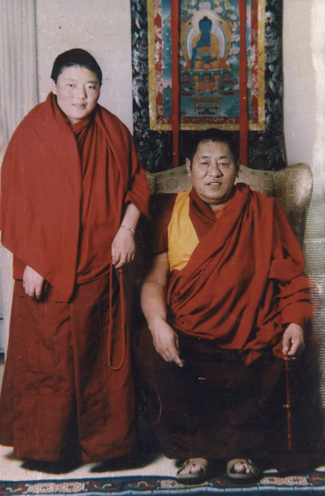

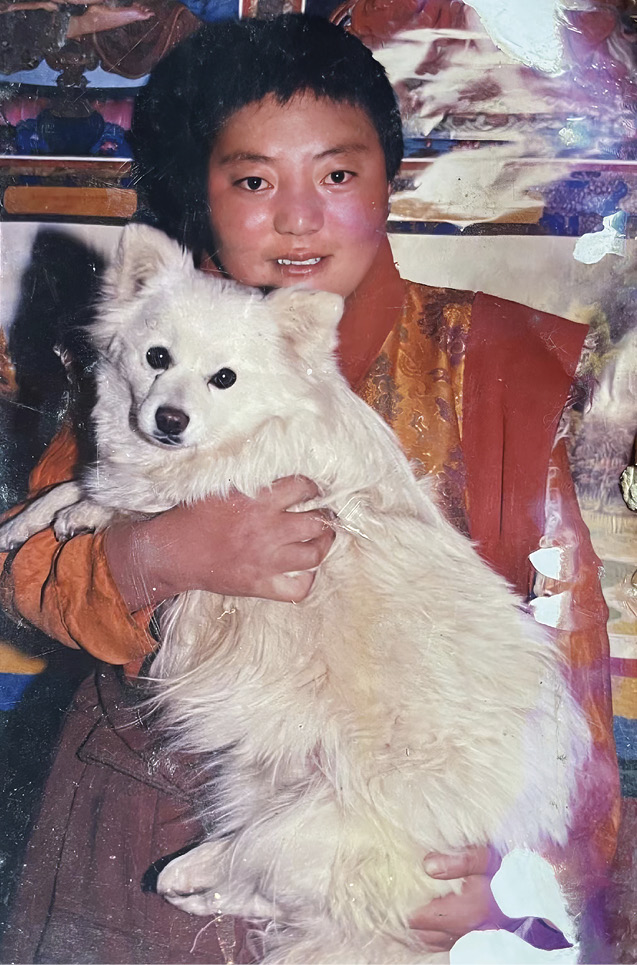

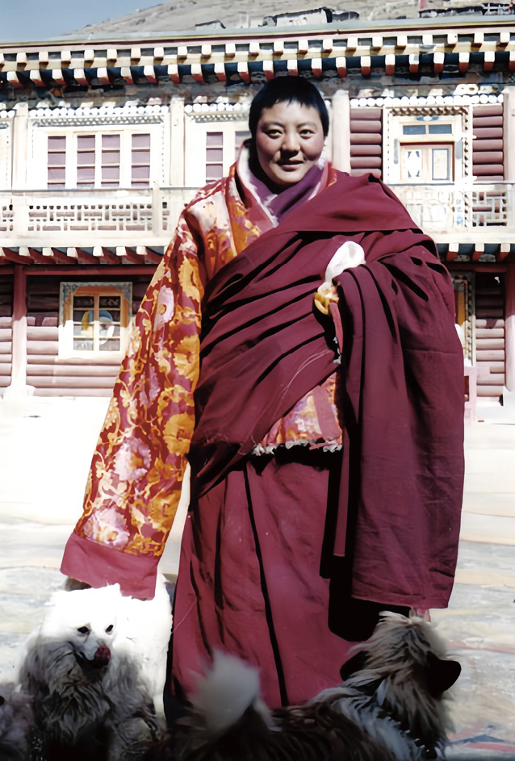

以前法王在世时，曾说过：“如果你们想依止门措为上师，是很容易的，她以后一定不会有这样那样的吩咐。”的确如此，门措空行母对于学院各部门的负责人以及上上下下的弟子，从未随意下达难以实现的命令，而总是保持着谦和的态度。即使有人请示任何好坏的事情，她都只是边说着“哦哦”边认真地听着，既不说好也不说不好，始终保持着深沉的智慧和宽广的胸怀。因此，无论面对苦乐吉凶等任何事情，无论是听到悲欢、贪嗔、贤劣、赞毁等任何言论，她对此既没有期望也没有忧虑，既不感到欢喜也不感到悲伤，就是处于大等舍的境界中。在听到欢不欢喜的分别念作怪的贪嗔偏袒、冷嘲热讽等汇报时，她也从不作出评价。她教导弟子们说：“道友内部要和睦相处，情意绵长。如果出现挑拨离间之人，不要听从他的，要有主见，保持沉稳，这样一来，离间的人也会越来越少……”这些显然在世间和出世间两个层面上，都可以算作杰出的功德，也是我们后学者值得效仿的典范。作为侍者们，也应该随学上师这么优秀的品行，要有远见卓识，胸怀宽广，所作所为要有条不紊，言行要慎重。这也是我有感而发的善意忠告。

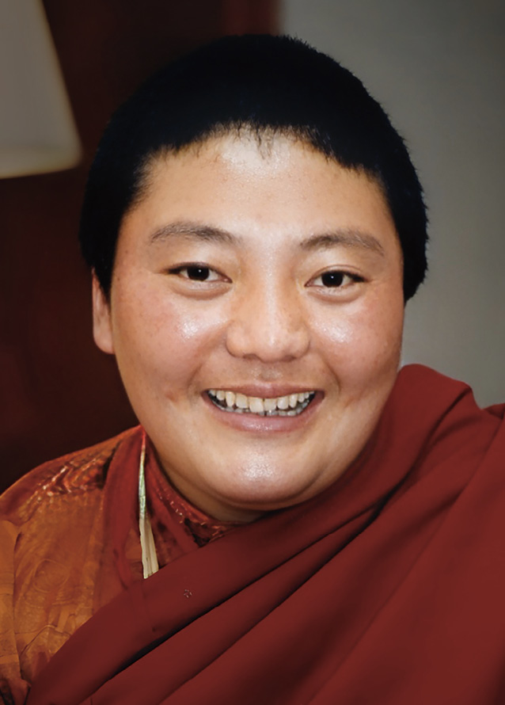

门措空行母是致力于弘法利生的楷模。关于护持暂时或永久的广大利他事业方面，正如《释量论》中所说：“所有从因聚，比知能生果，不待余义故，说彼是自性。”当一个人生圆次第的实修与持诵经咒等能力达到卓越的程度时，不费吹灰之力就能成办息业等种种微妙事业，这是因缘聚合的结果，也是自然法则的规律。因此，她无需刻意勤作、大费周折，只是赐予加持，吹一口气，便能消除众生身体不适所带来的折磨，解除他们的病魔等种种疾苦，她曾多次展现这样的神迹。

举个例子来说，在新龙加则地方，有一个名叫普巴旺姆的女子，身患绝症，四肢僵硬，双目失明。她前往康定医院进行检查时，医生们都表示：“对于这个病，实在是没有什么有效的特殊治疗方法，所以最好还是回家吧。”医生放弃了为她治疗的念头。当时，她得知门措上师来到了康定，照顾她的人们便背着她来到空行母面前，请求加持。门措空行母为她作了意加持，并轻吹了口气。结果奇迹发生了，当天晚上，在没有任何其他原因的情况下，那位女子感到心情舒畅，涌现出一种特别愉悦的感觉。从那以后，她的病情逐渐好转，最终病症完全痊愈。

还有一次，门措空行母前往新龙的途中，在甘孜县住了一晚。期间，央柔卓玛托古阿嘎管家向空行母请求：“有一位名叫才嘉的觉姆被重病折磨得快要死了，请您赐予加持。”空行母温和地回应：“明天在一个无人的安静处等我，我会满足她的愿望。”第二天，她们在路边等候接见。那位生病的觉姆只能依靠他人的搀扶，连头都抬不起来。门措空行母非常慈悲地为她祈福，随后轻轻吹了一口气进行加持。从那时起，她的身体逐渐恢复，后来甚至能够自己走着去听法。

另外一次，当空行母带着身边的众多眷属前往桑格扬宗神山时，山坡上突然滚落石头，砸伤了觉姆仁钦的头部，鲜血直流。见到这一情景，空行母立即在附近采了一种草药，将其敷在伤口上，结果伤口迅速止血，为觉姆仁钦带来了即时的安慰。

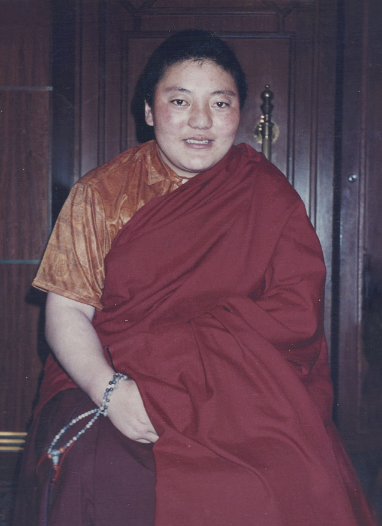

另一次，在新龙县尼塔地方，觉姆阿嘎的老父亲班玛秋佩患上了一种严重的病。阿嘎前去见他最后一面时，父亲合掌对身边的人们说：“不要大声喧哗，你们没看见吗？整个房间全都充满着胭脂红色的桃花。”在他的显现中，门措空行母亲临他家，他在她足前顶礼，并恳求道：“这次我这个病好不了了，一定会死的。在死的时候，请您一定要不舍大悲来接引我，尽量把我带到西方极乐世界。”门措空行母手中拿着一个犹如瓶子的白色水晶，从中流淌出甘露水，倒在他手掌之间，说：“将这个喝了，就决定不会死。”他感觉自己一滴也没剩下，全部都喝光了。这一幕是真真切切的，既非梦境，亦非幻觉。在医院住了七天后，他的身体日渐好转。经过很长一段时间，最终连病根也祛除了，彻底康复。

在某种程度上，这些在个别有缘人面前展现的摄受所化众生的事迹，是她利生事业的一种不共行为。暂时就共同所化众生前的显现而言，空行母绝非空口说白话，而是确实发起了最大的精进心，身体力行去利他。在这方面，有许多生动的情节可以讲述。她并非仅仅在他人面前闭着眼睛说“慈悲慈悲”，而是对所有众生都表现出巨大的慈悲心，尤其是对于那些可怜的众生，更是怀着深深的慈悲之情，竭尽所能以各种方式努力去饶益他们。

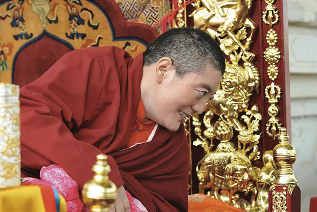

每当寒冷的冬季降临，她都会派人给色达一带的猴子们提供食物，从未有过中断。同时，她也会及时向秀若地方的流浪狗收容站捐赠狗粮。诸如此类，对于猫、狗、猴子、鸟雀等这些无依无靠的生命，她长期以来一直不断地供给食物，并关心它们的苦乐，为那些患病的生命提供医疗便利。对待自己饲养的小狗，空行母不仅仅关注它们的饮食，还在住处、穿衣、包括装饰品等方面都给予最好的照顾，并尽心尽力为它们播下解脱的种子——它们的耳边经常传扬着佛号和甚深的陀罗尼咒声。

在日常生活中，对于那些可怜的众生，她总是伸出慈悲的双手，送上急需的物资；对于那些患有严重疾病、徘徊在死亡边缘的病患，她会进行加持安慰，用温和的语言安抚他们的内心；对于那些饱受苦难折磨、心情抑郁的众生，她会以贴心的言语给予安慰，并与他们结上法缘，使他们重新燃起乐观的心情；对于那些受到非人损恼的众生，她会进行念经加持，驱除他们的魔障和违缘，为他们施以无畏的庇护，帮助他们摆脱恐惧。

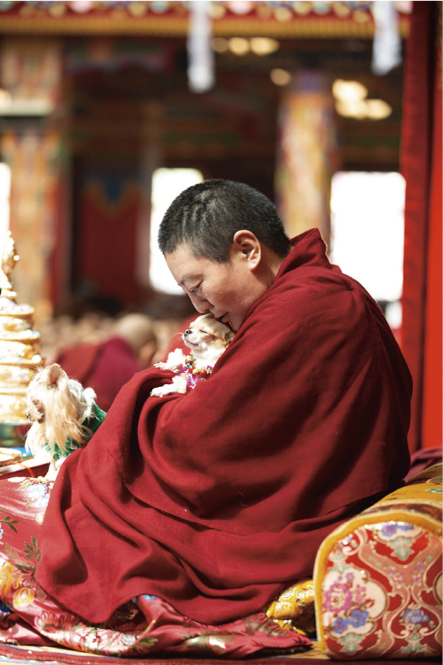

为了引导具有信心的在家人踏上解脱之道，她鼓励他们皈依三宝，信奉三宝为无上所依；或者接受一分、少分甚至圆分的居士戒；或者受持八关斋戒。在确立了世间正见之后，要求他们承诺不再从事杀生、盗窃、吸烟、酗酒等各种恶行。在学院居住期间，她每天都为从各地前来拜见她的汉藏僧俗、善男信女，赐予摸顶加持，与之结上法缘，使他们真正行持十善业道。

为了利益可怜的动物，她劝诫大家戒杀放生，让他们立誓不参与屠宰买卖，同时远离赌博，杜绝冲突和搏斗等行为。她鼓励他们持诵佛号和甚深陀罗尼咒，通过赐予佛像、护身结、尝解脱丸等，让他们随力发愿念诵固定数目的《极乐愿文》、《普贤行愿品》、文殊心咒、怀业祈祷文等。她不遗余力地广泛劝导行善，使所有结缘者都受益匪浅。

对于喇荣五明佛学院的喇嘛、觉姆、汉僧、居士四众眷属，她基本上每年都会按时赐予密宗金刚乘能成熟的甚深灌顶。为了弘法利生，她在一些要地，建造特别殊胜的身语意所依；长期资助各方僧众，为其闻思修提供顺缘；在一些寺院新创立了修行法会，并提供相应的资具；为每年的常规大修法会等设立基金；此外还进行造佛像、印佛经、建佛塔等。她将手头所有的财物毫不吝啬地倾囊而出，从不会把信士供养的财物浪费在不合理之处，而是迫不及待地将其用于讲修的助缘上，要么用于建造三所依，要么用于为僧众供斋等，以此积累广大的善法资粮。

她将大量资金投入普贤云供的基金，长期作为整个喇荣法会七支供积资的经济来源，每天供水、花、香、神馐等各三千，以及四万五千盏油灯，并供养分流道场的僧众。考虑到佛法的长久住世依赖于僧团，她想方设法恢复衰落的寺院，为那些道场创立讲修的优良传统。特别是对于那些分流的觉姆道场，她格外关心，总是按时赐予一些上等的物资。

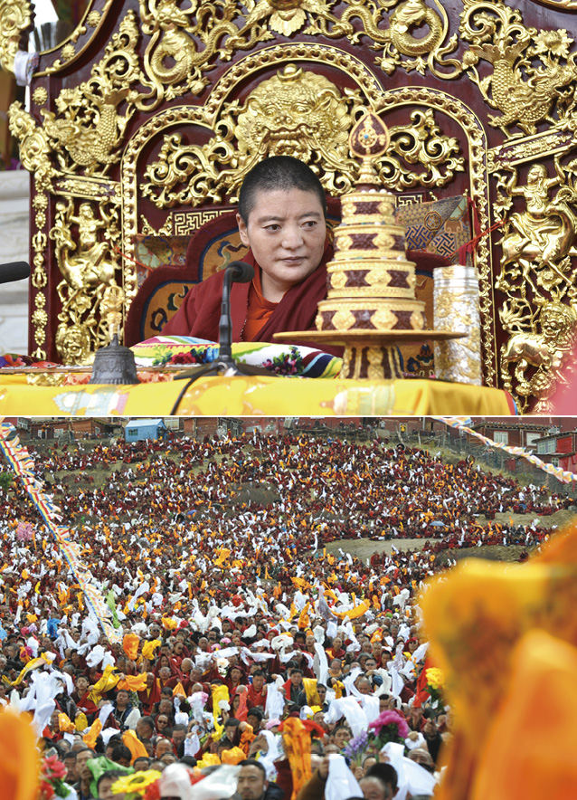

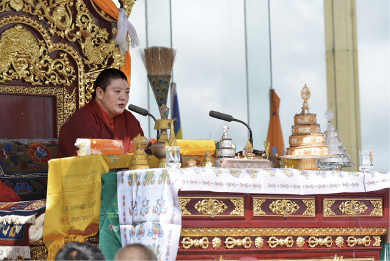

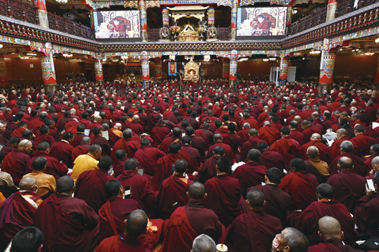

综上所述，这些是在世间人的共同显现前所成立的部分功德。而她身语意不可思议的功德，是我们这样的人无法描述的。

门字妙音宛转中，措嘉幻化童莲颜，

虽以隐藏示微笑，功德香逸谁能挡？

寂静调柔身威仪，寂雅得体语妙音，

寂凉柔和意境界，示寂灭道至尊母。

非凡二规众功德，俱生心中即具足，

善妙事迹大海尘，汝之三密秘庄严。

净戒闻思修道中，途经无误正宗轨，

圆满佛子行功德，应赞圣贤此传奇。

初依上师得教言，中修教义付实践，

末心解脱成二利，此乃人生最妙计。

别解脱戒宝砥柱，顶系菩萨戒璎珞，

大密实修宝珠顶，圆满法幢汝高擎。

智戒贤善闻思修，此等四类三组数，

十二功德汝俱全，圣者事迹极悦耳。

以教证法功德宝，俱生修慧满宝库，

超凡妙行密意藏，除众贫乏唯有汝。

稀有三密大事业，满足种种所化愿，

所行游戏无边际，结缘有义诚稀奇。

此时三轮之事业，护持如来之宗义，

雪域尼众初领主，非汝莫属余空花。

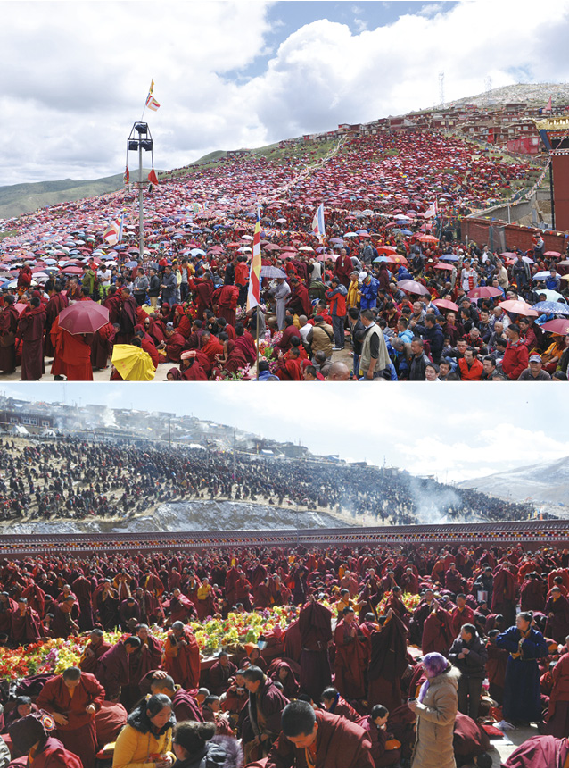
